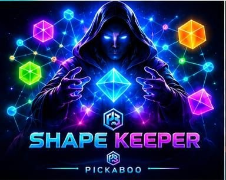
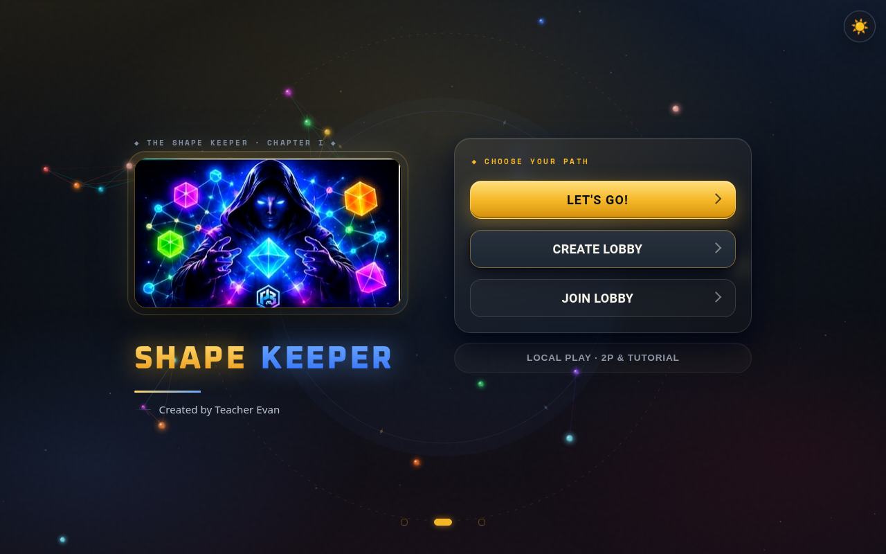
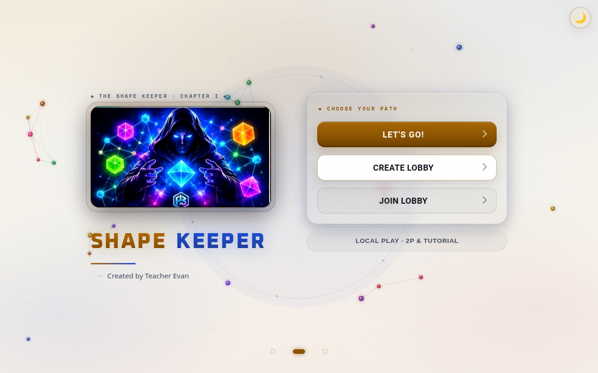
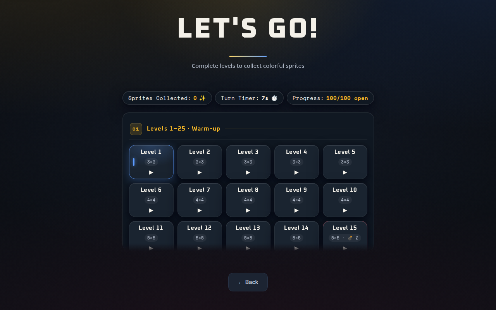
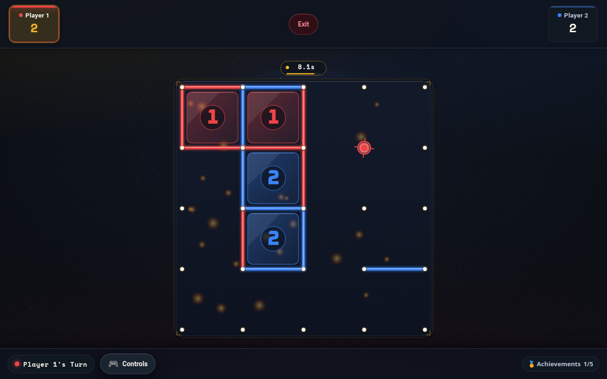
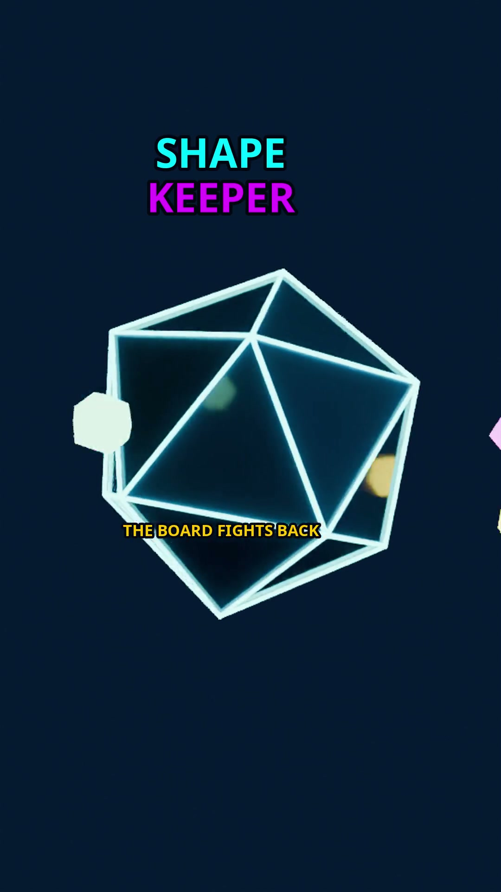

# ShapeKeeper




A modern, browser-based territory capture game (inspired by classic Dots and Boxes) featuring a 100-level campaign, collectible physics-driven sprites, real-time Convex multiplayer, procedural Web Audio synthesis, and a high-craft Cosmic Void & Dawn visual system.

## 🌐 Live Demo

**Play Now:** [https://shape-keeper.vercel.app](https://shape-keeper.vercel.app)

## 🖼️ Visual Showcase

| Cosmic Void (Home) | Dawn Light (Home) |
| :---: | :---: |
|  |  |
| **100-Level Campaign** | **Active Match & Lava Timer** |
|  |  |

## 🎬 Gameplay Trailer (Mobile Portrait)

<p align="center">
  <a href="media/shapekeeper-gameplay-shorts.mp4">
    
  </a>
</p>

- **Watch Full 1080×1920 Trailer (0:59 with Voiceover & Arcade Synth):** [shapekeeper-gameplay-shorts.mp4](media/shapekeeper-gameplay-shorts.mp4) (`7.90 MB`, 9:16 portrait — ready for YouTube Shorts)
- **YouTube Shorts Publish Kit & Metadata:** [media/publish-kit.md](media/publish-kit.md) · [media/CREDITS.md](media/CREDITS.md)

## 🎮 Features

### 100-Level Campaign & Interactive Sprite Playground

- **100 Progressive Levels** — Five structured chapters scaling from quick `3×3` warm-ups (Levels 1–25) through `6×8` (26–50), `8×8` (51–89), `10×10` (90–99), and the `10×15` Grand Finale at Level 100
- **Adaptive Turn Timer** — Starts at `7s` and adds `+2s` per completed level, capped at `30s`
- **Draws Count as Wins** — Tying the AI clears the level, awards `+1` sprite, and advances; the AI must out-score you to take a sprite (floored at 1)
- **Collectible Sprite Playground** — Swipe left or right on the home screen to visit interactive playgrounds populated by the exact **3D luminous mini spheres** you have earned (`1` minimum, capped at `300`), featuring boids flocking, subtle electrostatic filaments, tap ripples, grab-and-fling springs, and hold-to-singularity blooms
- **Level 100 Easter Egg** — Clearing Level 100 permanently unlocks celebratory home-screen sprite fireworks

### Core Gameplay & Multiplayer

- **Classic Dots and Boxes Mechanics** — Connect adjacent dots to complete squares; completing a box grants a bonus turn
- **Local Play, AI & Tutorial** — Hot-seat 2-player mode, Easy/Medium/Hard AI opponents (with Minimax + chain analysis), and a guided 4-step interactive tutorial
- **2–6 Player Online Multiplayer** — Real-time turn synchronization over Convex with ACID transactions, dynamic multi-player scorecards, and automatic reconnection recovery
- **Open Lobby Browser & Invite Links** — `JOIN LOBBY` lists open rooms in real time; `CREATE LOBBY` supports live ready checks, configurable grid sizes, `?join=ROOMCODE` invite links, and silly `[Adjective][Animal]` passcodes (`convex/rooms/shared.ts`)
- **Allowed Time Lava Timer** — Configurable per-turn countdown (`Off`, `10s`, `15s` default, `30s`, `60s`) with molten-ember particle visualization and automatic random-line fallback on timeout
- **Mines (Levels 15+)** — Hidden mined boxes cut the claiming player's score to 20% (`×0.2`, `−80%`). Opens with **2** mines at Level 15 and doubles every 10 levels, capped at **5** per board, with permanent `💣` markers and a live footer counter (`#mineCounter`)
- **Opponent Tap Mechanic (Multiplayer)** — Tap an opponent's unrevealed completed box to collapse its multiplier (`2× → 0.5×`) before they reveal it (`✋` indicator)
- **Rematch, Save & Replay** — Instant local rematch, consent-based online rematch, Undo/Redo, local save/load, step-by-step replay controls, and unlockable achievements

### Visual Identity & Accessibility

- **Dual Themes & Celestial Astrolabe Stage** — Instant toggle between deep obsidian (`#0b0e14`, Cosmic Void) and warm ivory paper (`#f7f4ec`, Dawn) with Solar Gold (`#f5b727` / `#8c5500`) and Royal Cobalt (`#5c9bff` / `#1d4ed8`) accents, radial nebula washes (zero gridlines), twinkling starlight, counter-rotating astrolabe rings, and cached 3D volumetric mini spheres with glass specular highlights
- **Typography & Tactile Surfaces** — Geometric `Oxanium` display headings paired with `Space Grotesk` body text and `Space Mono` (`tabular-nums`) telemetry, perceptual `oklch()` layered surfaces, frosted command plinths, top-edge specular hairlines, and forged gold/glass key elevations
- **Faceted Relic Board & Jewel Craft** — Chamfered tabletop board bezels with gold corner brackets, stained-glass claimed tiles with diagonal crystal glints and circular owner medallions, four-pass jewel filaments, machined constellation pegs, rotating astrolabe selection reticles, an integrated thermal Lava Timer gauge with molten embers, and dual-core celebration fireworks
- **Accessibility & Comfort (WCAG 2.2)** — Full keyboard dot navigation (`Arrow` keys, `Enter`/`Space`, `Escape`) via `AccessibleGridTree`, `prefers-reduced-motion: reduce`, `prefers-contrast: more`, `forced-colors: active`, `44×44 px` touch targets, and one-click Okabe-Ito color-blind-safe player colors

### Audio Features

- **Procedural Web Audio Synthesizer** — Zero external audio files; generates line-draw tones, square-completion chords, combo arpeggios, victory fanfares, and an interactive playground ambient soundscape (`AmbientSoundscape.js`)
- **Persistent Mute Toggle** — Quick audio toggle inside the in-game Controls drawer

### Donation Edition

All 100 levels and online multiplayer are open. Every fifth completed level offers a dismissible “Consider donating ❤️” prompt with **Sure** and **🐷** (maybe later). It never blocks progression and never grants donor-only levels, cosmetics, or status. Configure `window.DONATION_URL` in [`config.js`](config.js) (defaults to `donate.html`; set to `""` to disable).

## 🚀 Quick Start

### Option 1: Local Web Server (Recommended)

Run from the `ShapeKeeper` repository root:

```bash
# Using Python 3
npm run serve        # python -m http.server 8000

# Using Node.js (with http-server)
npm start            # npx http-server -p 8000 -o
```

Then visit `http://localhost:8000` in your browser.

> `game.js` and `welcome.js` are loaded as browser ES modules, so opening `index.html` directly via `file://` is not supported.

### Option 2: Live Deployment

Visit [https://shape-keeper.vercel.app](https://shape-keeper.vercel.app).

## 🚀 Deployment

> **Important:** All commands must run from the `ShapeKeeper/` project directory (where `package.json` and `convex/` live).

### Prerequisites

- A linked Vercel project (`shape-keeper`) and Convex project (`shapekeeper`).
- Local `.env.local` with `CONVEX_DEPLOYMENT` / `CONVEX_DEPLOY_KEY` for the dev backend during local development.
- Production frontend connects to the production Convex deployment (`precise-ladybug-504.convex.cloud`) via [`config.js`](config.js). Override `window.CONVEX_URL` before `config.js` loads to target another deployment.

### Security Headers (`vercel.json`)

The deployment enforces strict response headers via [`vercel.json`](vercel.json):

- **Content-Security-Policy**: `default-src 'self'`; `script-src 'self' https://unpkg.com`; `connect-src` restricted to the Convex deployment; `frame-ancestors 'none'`; `object-src 'none'`. No `unsafe-inline` for `script-src`.
- **Subresource Integrity**: Convex browser bundle loaded from `unpkg.com/convex@1.42.3` with an `integrity="sha384-..."` pin verified by `tests/sri-integrity.test.js`.
- **Transport & Cache**: HSTS, `X-Content-Type-Options`, `Referrer-Policy`, `Permissions-Policy`, `X-Frame-Options`, `max-age=0, must-revalidate` for HTML, and 5-minute cache for `config.js`.

### Commands

```bash
# 1. Deploy backend functions to the PROD Convex deployment
npx convex deploy --yes

# 2. Deploy the static frontend to Vercel (no build step; serves index.html as-is)
vercel --prod

# Local development (uses dev Convex backend via .env.local)
npx convex dev
npm run serve
```

Pushing `main` to GitHub triggers Vercel auto-deploy for the static frontend. Backend changes require `npx convex deploy --yes`.

## 🧪 Testing & Quality Gates

```bash
npm run lint                       # ESLint across JS/MJS/TS
npx convex typecheck               # TypeScript check on convex/
npx vitest run                     # Unit & integration test suite
npm run build                      # Static build parity check
npm run test:e2e:smoke             # Playwright Chromium smoke test
npm run test:e2e                   # Full Playwright E2E suite
```

## 📐 Grid Sizes

### Local & Online Presets

The board honors your exact selected dimensions and scales cell size smoothly to fit any viewport:

| Selection | Grid Dimensions | Total Squares |
| --------- | --------------- | ------------- |
| `5×5`     | `5×5` dots      | 16 squares    |
| `10×10`   | `10×10` dots    | 81 squares    |
| `20×20`   | `20×20` dots    | 361 squares   |
| `30×30`   | `30×30` dots    | 841 squares   |

### Campaign Levels (1–100)

| Levels    | Grid Size | Turn Timer | Hidden Mines |
| --------- | --------- | ---------- | ------------ |
| `1–25`    | `3×3` → `7×5` | `7s` + `2s`/win (cap `30s`) | `0` (Levels 1–14), `2` (Levels 15–24), `4` (Level 25) |
| `26–50`   | `6×8`     | up to `30s` | `4` (Levels 26–34), `5` (Levels 35–50) |
| `51–89`   | `8×8`     | `30s`      | `5` (capped) |
| `90–99`   | `10×10`   | `30s`      | `5` (capped) |
| `100`     | `10×15`   | `30s`      | `5` (capped) + Fireworks Easter Egg |

## 🎯 How to Play

### Game Rules

1. **Objective**: Complete more squares than your opponent
2. **Turns**: Players alternate drawing orthogonal lines between adjacent dots
3. **Scoring**: Complete a square by drawing its fourth side to claim it
4. **Bonus Turn**: Completing a square earns another immediate turn
5. **Multipliers & Mines**: Completed boxes reveal multipliers (and hidden mines on Levels 15+); in multiplayer, tap an opponent's unrevealed box to drop its multiplier
6. **Winning**: Highest score when the board fills wins (in Levels mode, ties count as wins)

### Controls

- **Mouse / Touch**: Click or tap two adjacent dots (or drag across adjacent dots) to draw a line
- **Keyboard**: Focus the board, move with `Arrow` keys, press `Enter` or `Space` to select/connect dots, and `Escape` to clear selection
- **Multipliers**: Click/tap completed squares to reveal or contest multipliers

## 🏗️ Project Structure

```
ShapeKeeper/
├── index.html                  # Main HTML shell (menu, setup, levels, lobby, game, winner)
├── donate.html / checkout.html # Tip-jar & archived paywall checkout pages
├── config.js / constants.js    # Runtime feature flags, Convex URL, gameplay constants
├── styles.css                  # Authoritative CSS entry (cosmic-identity.css loaded last)
├── styles/                     # Modular visual layers (base, menu-redesign, tactile-controls, game, winner, cosmic-identity)
├── game.js / welcome.js        # Browser ES module entrypoints
├── dots-and-boxes-game.js      # Core game orchestrator
├── game-state.js / game-logic.js
├── input-handler.js / animation-system.js / particle-system.js / sound-manager.js
├── renderer.js                 # Canvas 2D renderer facade
├── renderer/                   # board.js, effects.js, lava-timer.js, markers.js
├── effect-system/              # Square multipliers & Level 15+ mines
├── ui-manager/                 # Celebrations, confetti/fireworks, effect badges
├── src/                        # Modular AI, a11y, audio, lifecycle, particle pool, timing, UI controllers
│   ├── ai/                     # ChainAnalysis, LocalAIController, MinimaxEngine
│   ├── timing/                 # Clock sync, local turn timer, turn clock controller
│   └── ui/                     # WelcomeAnimation, LevelsScreen, LiveLobbyManager, HomePager, ThemeManager
├── convex/                     # Convex TypeScript schema, queries, mutations, turn timer
├── convex-client/              # Browser Convex client operations & subscriptions
├── tests/                      # Vitest unit tests & Playwright E2E specs
├── docs/                       # Plans, audits, feature notes, and docs/screenshots/
└── vercel.json                 # Vercel static hosting & CSP/SRI headers
```

## 🔧 Technical Architecture

### Core Components

[`index.html`](index.html) loads [`config.js`](config.js), the SRI-pinned Convex browser bundle, [`convex-client.js`](convex-client.js) (`window.ShapeKeeperConvex`), and the authoritative ES modules [`game.js`](game.js) and [`welcome.js`](welcome.js).

#### DotsAndBoxesGame Class (`dots-and-boxes-game.js`)

- **State Management**: Normalized line `Set`, claimed `squares` map, dynamic `scores`, and bounded `moveHistory`
- **Rendering Engine**: DPR-clamped (`[1, 2]`) HTML5 Canvas with cached static dots (`dotsCanvas`) and dt-normalized 60fps animation loop
- **Event Handling**: Unified mouse, touch, and `AccessibleGridTree` keyboard input
- **Lifecycle Hygiene**: `DisposableRegistry` tears down timers, listeners, and controllers cleanly on exit

### Data Structures

```javascript
// Normalized Line Keys (sorted endpoints)
'1,2-1,3'; // Horizontal line from (1,2) to (1,3)
'1,2-2,2'; // Vertical line from (1,2) to (2,2)

// Square Keys
'5,10';    // Square at row 5, column 10

// Screen Coordinate Mapping
screenX = offsetX + col * cellSize;
screenY = offsetY + row * cellSize;
```

## 🎨 Customization

### Adjusting Grid & Visual Constants

Edit [`constants.js`](constants.js) (`DOT_RADIUS`, `LINE_WIDTH`, `CELL_SIZE_MIN`, `CELL_SIZE_MAX`, `LAVA_*`) and [`styles/cosmic-identity.css`](styles/cosmic-identity.css) (theme tokens).

### Default Player Colors

Default color picker values live in [`index.html`](index.html):

```html
<input type="color" id="player1Color" value="#ef4444" aria-label="Player 1 color picker" />
<input type="color" id="player2Color" value="#3b82f6" aria-label="Player 2 color picker" />
```

## 📱 Browser Compatibility

| Browser | Version | Status          |
| ------- | ------- | --------------- |
| Chrome  | 90+     | ✅ Full Support |
| Firefox | 88+     | ✅ Full Support |
| Safari  | 14+     | ✅ Full Support |
| Edge    | 90+     | ✅ Full Support |
| Opera   | 76+     | ✅ Full Support |

**Requirements:** ES6+ JavaScript modules, HTML5 Canvas API, CSS3 (`oklch()` with sRGB fallbacks, Flexbox, Grid).

## 🐛 Known Issues & Limitations

- Opening `index.html` directly via `file://` is not supported because the app boots with browser ES modules.
- Very large grids (`30×30+`) may feel dense on small phone viewports in portrait orientation.

## 📄 License

MIT License — feel free to use, modify, and distribute.

## 👨‍💻 Author

**Teacher Evan**

Created as an educational project demonstrating Canvas 2D rendering, real-time Convex multiplayer state, AI minimax/chain heuristics, procedural Web Audio synthesis, and accessible responsive design.

## 🤝 Contributing

Contributions welcome! Feel free to report bugs via Issues, submit pull requests, suggest new features, or improve documentation.

## 📝 Version History

### v4.7.0 (Celestial Astrolabe & Faceted Relic Overhaul)

- **Celestial Astrolabe Stage & Forged Relic Hero** — Added deterministic twinkling starlight and counter-rotating gold/cobalt astrolabe rings to `WelcomeAnimation`, upgraded display typography to geometric `Oxanium`, framed the hero relic with an inscribed double halo (`◆ THE SHAPE KEEPER · CHAPTER I ◆`), placed the menu CTAs on a frosted Celestial Command Plinth, and forged 3-tier metallic gold/machined-glass keys with responsive `390×844` mobile clearance.
- **Faceted Gameplay Board & Thermal HUD** — Sculpted the game board bezel with burnished-gold corner L-brackets, upgraded claimed boxes into stained-glass diagonal gradients with crystal glints and circular owner medallions, rendered 4-pass jewel filaments, machined 4-pass constellation pegs, rotating astrolabe lock-on reticles, an integrated thermal Lava Timer gauge bar with molten embers, and frosted celestial HUD rails with live mid-game theme repainting.
- **Star-Atlas Levels Codex, Tactile Setup & Winner Altar** — Grouped the 100-level campaign under color-coded chapter tiers with a Level 100 Grand Finale centerpiece, arranged desktop Local Setup into a 2-column tactile card grid, upgraded `donate.html` and `checkout.html` with gold-cobalt crown hairlines and `Oxanium` headers, and framed the Winner Altar with a rank-1 gilded plaque and dual-core celebration fireworks.
- **Updated README & showcase** — Refreshed documentation and captured verified clean showcase screenshots across Void, Dawn, Levels, and active Gameplay in `docs/screenshots/`.

### v4.7.0 (Draws count as wins)

- **A draw clears the level** — If the board ends level (e.g. 2–2), Levels mode records the level, pays the `+1` sprite, and offers the next level instead of failing you.
- **Copy matches the rule** — The win screen displays `🤝 Level N Complete — Draw!` with a "draw counts as a win" note; only a real AI win shows `Level N Failed`.
- **Smoother motion** — Background hue, screen shake, and screen pulse decay by elapsed time (`expDecay`) for consistent 60 Hz / 120 Hz behavior.

### v4.6.0 (Mine penalties)

- **Mines (Levels 15+)** — Level 15 starts with 2 mines, doubling every 10 levels and capped at **5 mines per board**. Casual local and online games seed none.
- **Legible feedback** — Fired mines keep a permanent `💣` marker and `×0.2` label, the footer chip counts remaining hidden mines, and Levels buttons preview mine counts.

### v4.5.0 (Opponent Tap Mechanic & Open Lobby Browser)

- **Tap-to-collapse (multiplayer)** — Opponents can tap a completed unrevealed box to drop its multiplier (`2× → 0.5×`) with a live `✋` indicator.
- **Open lobby browser & Local Allowed Time** — Real-time open lobby list plus configurable per-turn lava timer on local setup.

### v4.4.0 (Live Lobby + Silly Passcode)

- **Silly `[Adjective][Animal]` passcodes** — Server-generated room passcodes (`convex/rooms/shared.ts`), `LiveLobbyManager`, and `?join=` invite URLs.

### v4.0.0 – v4.3.0

- **Cosmic Visual Overhaul, Procedural Web Audio, Dark Mode, Particle Trails, Combo System, Fireworks, and Modular ES6 Architecture.**

---

**Enjoy the game!** 🎮✨

For questions or feedback, please open an issue on GitHub.
