# Surgical Audit Report: ShapeKeeper (Round 2 — Post-Overhaul)

| Audit Metadata | Specification |
| :--- | :--- |
| **Audit Date** | 2026-11-27 (Round 2, post-`9d6d9ba` Plastic Surgery & Media overhaul) |
| **Baseline Commit** | `32fabaf6ce60bf6ec4abc7414f6e8d5c089c5d17` (`main`) |
| **Audited Scope** | Whole tracked repository (`126` impl JS/TS files = `16,208` eff. LOC; `131` test files [`97` Vitest + `28` Playwright specs + `6` helpers] = `15,533` eff. LOC; `3` HTML files = `1,104` LOC; `18` CSS files = `4,729` LOC; total scored LOC = **`17,312`**) |
| **Tech Stack & Runtime** | Vanilla ES Modules (HTML5 Canvas 2D, Web Audio API) + Convex Realtime Backend (TypeScript) + Vitest 4.1 + Playwright 1.58 + Vercel Static |
| **Pre/Post Audit SHA-256** | Working tree: `0ef1b19cd8361478` / `0ef1b19cd8361478` (`MATCH: True`) · Pristine `git archive HEAD`: `1906e014e562c738` (**VERIFIED ZERO SOURCE MUTATION**) |
| **Baseline Quality Gates** | `npm run lint` PASS (`0` errors) · `npx convex typecheck` PASS (`0` errors) · `npx vitest run` PASS (`97` files, `704` tests, `1,775` assertions) · `npm audit` PASS (`0` prod / `0` dev vulns) · Playwright targeted run (`8` specs, `25` tests): **`23` PASS / `2` FAIL** (`tests/e2e/local-turn-timer.spec.js` fails `2/2` on permanently `hidden` `#localTurnTimerSection`) |
| **Deterministic Health Score** | **`45 / 100`** (`D_raw = 195`, `scale = 0.240340`, `P_test = 8.2031`, `M_kill = 45.3125%` [`29 / 64`]) |
| **Vibe-Debt Risk Level** | **`CRITICAL`** (`N_P0 = 3 >= 2`) |
| **Post-Remediation Target** | **`99 / 100` — `LOW`** (`0 P0 / 0 P1 / 0 P2 / 0 P3`, `M_kill >= 90.625%` [`58 / 64`], `P_test = 1.4062`) |
| **SARIF 2.1.0 Telemetry** | [`shapekeeper-surgical-audit-2026-11-27-r2.sarif`](file:///home/leandi-duplessis/github/workspaces/ShapeKeeper/docs/audits/shapekeeper-surgical-audit-2026-11-27-r2.sarif) |
| **Remediation Plan** | [`2026-11-27-surgical-audit-remediation-plan-r2.md`](file:///home/leandi-duplessis/github/workspaces/ShapeKeeper/docs/plans/2026-11-27-surgical-audit-remediation-plan-r2.md) |

---

## 1. Executive Architecture & Vibe-Debt Triage

ShapeKeeper improved meaningfully from Round 1 (`d757456`, **`23 / 100`**) to Round 2 (`32fabaf`, **`45 / 100`**) after landing 15 remediation commits (`4e136a8..ca4f95f`) and 14 Plastic Surgery v2 / Arcade Classic palette / promo media commits (`8ab853e..32fabaf`). Specifically, open-lobby passcode deadlocks, non-member `tapSquare` access, public `sweepStaleLobbies`, `wouldCompleteSquare` deletion, AI achievement attribution, `shared.SESSION_ID`, `deferInitialReady` resize locks, `launchFireworks` frame-1 exit, and WCAG 2.5.8 small-target failures (`10x10` pager dots and `18px` achievement summary) are now resolved.

However, a fresh end-to-end static + live Chromium audit at `32fabaf` exposes **3 P0 critical defects and 14 P1 high defects** — including several partial/unwired fixes and brand-new regressions introduced during the recent visual overhaul:
1. **`markLocalMoveSent()` is completely unwired (`0` callers)**, leaving cross-client wall-clock skew poisoning online `ClockSync` on every opponent move (`[P0-1]`).
2. **Public Paystack & Licence HTTP endpoints (`/paystack/verify`, `/license/validate`) have zero rate limiting** (`[P0-2]`), enabling authenticated Paystack API amplification via spoofed `Origin` headers.
3. **`turnClockController` module singleton leaks Match #1's destroyed `game` closure** across `teardownMultiplayerSession()`, disabling online turn timers on Match #2+ (`[P0-3]`).

```mermaid
flowchart TD
    subgraph Client["Browser Client (Vanilla ESM + Canvas 2D)"]
        Menu["welcome.js + MenuNavigation.js"]
        Anim["WelcomeAnimation.js (Hidden 60Hz, Reduced-Motion Leak, Canvas Stranding)"]
        Audio["SoundManager + AmbientSoundscape (Unguarded Throws, Event Mismatch)"]
        Lobby["lobbyEvents.js + lobbyView.js (0..600 Input vs Server Whitelist)"]
        Sync["syncHandlers.js (Leaked turnClockController Singleton, P3-P6 Dropped)"]
        Clock["turn-clock-controller.js (markLocalMoveSent = 0 Callers)"]
        Game["dots-and-boxes-game.js + game-state.js (Dual Clocks, topTimerPad Overflow)"]
        Input["pointer-controls.js + AccessibleGridTree.js (Dot Swallow, Invisible Focus Ring)"]
        Save["local-save-replay.js (Rejects POPULATE_PLAYER_ID = 0)"]
        AI["MinimaxEngine.js (Unbounded O(B^D) Freeze, _sacEval Discarded)"]
        Render["renderer/ + particle-system/ (Non-dt Physics, Lava Freeze, shadowBlur)"]
    end

    subgraph Backend["Convex Backend + Vercel Static"]
        Http["convex/http.ts (Unrated /paystack/verify & /license/validate)"]
        Timer["convex/games/turnTimer.ts + draw.ts (Full-Board Loop, Uncancelled Finish Jobs)"]
        Rooms["convex/mutations/ + roomQueries.ts (N+1 Collect, HostToken Strip, Stale Playing Rooms)"]
        Deploy[".vercelignore (Ships 8.24 MB media/ Payload)"]
    end

    Menu --> Anim
    Anim -->|"touch / singularity_start ignored"| Audio
    Lobby -->|"Invalid seconds 20..600"| Rooms
    Sync -->|"Stale Match #1 game closure"| Clock
    Game -->|"0 callers to markLocalMoveSent"| Clock
    Game --> Input
    Game --> Save
    Game --> AI
    Game --> Render
    Sync --> Timer
```

4. **Live Chromium regressions & contract breaks**: Populate (`POPULATE_PLAYER_ID = 0`) breaks `validateLocalSavePayload` (`[P1-1]`); lobby turn-timer `<input 0..600>` conflicts with server preset whitelist `[0,10,15,30,60]` while `#localTurnTimerSection` stays permanently `hidden` (`2/2` E2E failure, `[P1-2]`); opponent-square tap hit-tests swallow adjacent dot clicks even in local/Levels mode (`[P1-3]`); `949db87`'s `showKeyboardFocusRing` gate broke `AccessibleGridTree` focus rings (`[P1-4]`); `Levels Grid -> Back` strands `WelcomeAnimation` on `#gameBackgroundCanvas` (`[P1-5]`); `topTimerPad` overflows 10×15 boards over `.game-footer` (`[P1-11]`); and an **8.0 MB MP4** is unignored in `.vercelignore` (`[P1-14]`).



| Severity Tier | Count | Deduction Weight | Primary Failure Domains |
| :--- | :---: | :---: | :--- |
| **P0 — Critical (Crash / Data Loss / Security / Leak)** | `3` | `-18 pts ea` | `turn-clock-controller.js` (`markLocalMoveSent` unwired), `convex/http.ts` (unrated payment/licence endpoints), `syncHandlers.js` (`turnClockController` singleton closure leak) |
| **P1 — High (Frame-Budget / Race / Logic Bug)** | `14` | `-8 pts ea` | `local-save-replay.js` (`POPULATE_PLAYER_ID=0`), `lobbyEvents.js`/`index.html` timer split-brain + E2E fail, `pointer-controls.js` dot swallow, `AccessibleGridTree.js` focus ring, `WelcomeAnimation.js` stranding/burn/reduced-motion/theme, 3–6P online breaks, `MinimaxEngine.js` freeze, `turnTimer.ts` loop/cancel, Convex cost/auth gaps, non-`dt` physics/lava freeze/`shadowBlur`, `game-state.js` `topTimerPad` overflow, WebAudio throws & `AmbientSoundscape` mismatch, teardown timers + Light-mode fireworks contrast, 8.24 MB Vercel media bloat |
| **P2 — Medium (God File / Split-Brain State / Debt)** | `8` | `-3 pts ea` | 5 God files >400 LOC, dual local clocks + dead splash, unreachable `#localSetupScreen`, 6 unshipped/shim modules, `checkout.js`/`UnlockGate.js` gaps, `subscriptions.js` debounce/diff gaps, unbounded `moveHistory`, `createRoom`/`joinRoom` edge cases |
| **P3 — Low (Magic Constants / DX / Portability)** | `5` | `-1 pt ea` | `AGENTS.md`/HTML copy drift, `LevelsScreen.js` smooth-scroll & `innerHTML`, biased shuffle & modulo jitter, 19 silent catches & legacy neon hexes, CI missing `convex typecheck` + `smoke` |

### High-Risk File Telemetry Hotspots

*Telemetry from pristine `git archive HEAD` (`preflight_telemetry.py`, excluding untracked local Python venvs `myenv/` and `ShapeKeeper/`).*

| File Path | Effective LOC | Branch Density | Silent Catches | Hot-Loop Markers | Primary Vibe-Debt Signature |
| :--- | :---: | :---: | :---: | :---: | :--- |
| [`dots-and-boxes-game.js`](file:///home/leandi-duplessis/github/workspaces/ShapeKeeper/dots-and-boxes-game.js) | `1,243` | `0.002` | `0` | `11` | God class, dual local turn clocks, `turn-urgent` stick, uncapped `moveHistory`, missing `markLocalMoveSent` |
| [`src/ui/WelcomeAnimation.js`](file:///home/leandi-duplessis/github/workspaces/ShapeKeeper/src/ui/WelcomeAnimation.js) | `830` | `0.002` | `0` | `7` | God animation loop, hidden-screen burn, reduced-motion bypass, no theme re-tint, 9 leaked listeners, 36k arr/s |
| [`src/audio/AmbientSoundscape.js`](file:///home/leandi-duplessis/github/workspaces/ShapeKeeper/src/audio/AmbientSoundscape.js) | `365` | `0.011` | `5` | `0` | Unwired `'touch'`/`'singularity_start'` profiles, uncancelled `fadeOut` timers, leaked `StereoPannerNode`/`delaySend` |
| [`ui-manager/celebrations.js`](file:///home/leandi-duplessis/github/workspaces/ShapeKeeper/ui-manager/celebrations.js) | `531` | `0.066` | `0` | `7` | 2-player hardcode, non-`dt`/un-DPR confetti, Light-mode black fireworks veil & `#00f0ff` contrast fail, 4 untracked timers |
| [`sound-manager.js`](file:///home/leandi-duplessis/github/workspaces/ShapeKeeper/sound-manager.js) | `267` | `0.180` | `3` | `0` | Eager `AudioContext`, 7/10 methods unguarded against throws mid-`drawLine()`, missing iOS `'interrupted'` |
| [`src/ui/menu/lobbyEvents.js`](file:///home/leandi-duplessis/github/workspaces/ShapeKeeper/src/ui/menu/lobbyEvents.js) | `327` | `0.211` | `1` | `0` | Missing `#lobbyTurnTimer`, invalid `0..600` seconds vs server preset, unhandled clipboard promise, re-entrant `createRoom` |
| [`renderer/effects.js`](file:///home/leandi-duplessis/github/workspaces/ShapeKeeper/renderer/effects.js) | `409` | `0.056` | `0` | `0` | Non-`dt` floating geometry in render, per-particle `shadowBlur = 10`, 2P color hardcode, invalid `playerColor + '60'` |
| [`convex/games/state.ts`](file:///home/leandi-duplessis/github/workspaces/ShapeKeeper/convex/games/state.ts) | `409` | `0.034` | `0` | `0` | Uncancelled `turnTimerJobId` on end/reset, multiplier-less `tapSquare` writes, raw `console.log` leaking `sessionId` |
| [`input-handler/pointer-controls.js`](file:///home/leandi-duplessis/github/workspaces/ShapeKeeper/input-handler/pointer-controls.js) | `313` | `0.029` | `2` | `0` | `handleCellInteraction` runs before dot hit-test and swallows adjacent dot clicks in local/Levels mode |
| [`local-save-replay.js`](file:///home/leandi-duplessis/github/workspaces/ShapeKeeper/local-save-replay.js) | `313` | `0.080` | `1` | `0` | `isPlayerNumber(0)` rejects `POPULATE_PLAYER_ID = 0`; 120 LOC FR-4 online snapshot helpers 100% dead in prod |
| [`game-state.js`](file:///home/leandi-duplessis/github/workspaces/ShapeKeeper/game-state.js) | `329` | `0.009` | `0` | `0` | `topTimerPad` added after `cellSize` -> footer overlap; untracked 500ms `showWinner`; unclamped DPR; missing a11y rebuild |
| [`src/ui/menu/syncHandlers.js`](file:///home/leandi-duplessis/github/workspaces/ShapeKeeper/src/ui/menu/syncHandlers.js) | `293` | `0.133` | `0` | `0` | Module-singleton `turnClockController` leaks Match #1 `game`; drops P3–P6 scores; misses `multiplierRevealed` |
| [`src/a11y/AccessibleGridTree.js`](file:///home/leandi-duplessis/github/workspaces/ShapeKeeper/src/a11y/AccessibleGridTree.js) | `274` | `0.004` | `1` | `0` | Never sets `showKeyboardFocusRing = true` (WCAG 2.4.7 fail); 900 `<button>`s & 2,700 listeners on 30×30 |
| [`src/ai/MinimaxEngine.js`](file:///home/leandi-duplessis/github/workspaces/ShapeKeeper/src/ai/MinimaxEngine.js) | `230` | `0.078` | `0` | `0` | Unbounded `O(B^D)` main-thread hang (`3M+` nodes on 30×30); `_sacEval` computed and discarded |
| [`convex/http.ts`](file:///home/leandi-duplessis/github/workspaces/ShapeKeeper/convex/http.ts) | `210` | `0.033` | `0` | `0` | Zero rate limiting on `/paystack/verify` & `/license/validate`; unbounded webhook body; silent `EXPECTED_KOBO` fallback |

### Historical Audit Delta (`d757456` Round 1 → `32fabaf` Round 2)

| Resolved Since `d757456` | Partial / Unwired Fixes Found | Brand-New Regressions in `8ab853e..32fabaf` |
| :--- | :--- | :--- |
| Open-lobby passcode deadlock (`e890686`) | `markLocalMoveSent()` added in `6d393d6` but wired to `0` callers (`[P0-1]`) | `949db87` `showKeyboardFocusRing` broke `AccessibleGridTree` focus ring (`[P1-4]`) |
| `tapSquare` membership gate & `sweepStaleLobbies` internalized (`4e136a8`) | `POPULATE_PLAYER_ID = 0` (`1c61ef8`) broke `local-save-replay.js` (`[P1-1]`) | `949db87` `topTimerPad = 38` added after `cellSize` clips board behind `.game-footer` (`[P1-11]`) |
| `shared.getSessionId()` & `deferInitialReady` clear (`8db5407`) | `76e05be` claimed drop per-particle `shadowBlur`, but `renderer/effects.js:L308` still sets `shadowBlur = 10` (`[P1-10]`) | `7d4283e`/`32fabaf` added 8.24 MB `media/` unignored by `.vercelignore` (`[P1-14]`) |
| `wouldCompleteSquare` non-destructive & AI trophies fixed (`1c61ef8`) | `1d10076` cancels `turnTimerJobId` on move, but not on game over/`endGame`/`resetGame`/`leaveRoom` (`[P1-8]`) | `8ab853e` restored dead `convex/rooms/settings.ts` & duplicate shims (`[P2-4]`) |
| `launchFireworks` frame-1 exit & WCAG 2.5.8 target sizes (`207d22c`, `ff48163`) | `ff48163` fixed `ambientParticles`/`backgroundGeometry` reduced-motion, but `WelcomeAnimation` still moves (`[P1-5]`) | `0f6ca4d` Arcade Classic swap left legacy `#00f0ff`, `#ff0055`, `#0000FF`, `#00FFFF` (`[P1-13]`, `[P3-4]`) |

---

## 1.5 Pass 2.5 Live Playwright Runtime Geometry, Canvas & WCAG 2.2 Probe Evidence

Executed against pristine `git archive HEAD` served on `http://127.0.0.1:4179` in headless Chromium (`deviceScaleFactor: 1`) using stroke-gated `CanvasRenderingContext2D` hooks. **Host contention guard:** `uptime` load average `0.89, 0.93, 0.94` on `4` cores (quiet host); deterministic geometry, stroke counts, DOM state, and WCAG 2.2 checks reported below.

| Scenario | Viewport / Emulation | Console Errors | `overflowX` | WCAG 2.5.8 / 2.4.11 | Verified Runtime Geometry & Behavioral Measurements |
| :--- | :--- | :---: | :---: | :---: | :--- |
| `main-menu-desktop` (Dark → Light toggle) | `1280×800` | `0` | `0` | `0` small / `0` obscured | `welcomeCanvas`: `380` segs (`longCount=0`, `longest=0.37px`). **BUG (`[P1-5]`):** Toggling Dark→Light leaves `spriteColors = ["#f43f5e"]` unchanged (never re-tinted for Light backdrop). |
| `levels-mobile` (Hidden menu canvas) | `390×844` | `0` | `0` | `0` small / `0` obscured | **BUG (`[P1-5]`):** While `#levelsScreen` is active, hidden `welcomeCanvas` still paints **`427` segs / `61` strokes / `122` fills per second** (`welcomeAnimRunning: true`). |
| `game-lvl1-mobile` (Interactive checks) | `390×844` | `0` | `0` | `0` small / `0` obscured | `gameCanvas`: `517` segs (`longCount=0`, `longest=142.3px`); pill (`38px`) clears frame (`42.16px`). **BUG (`[P1-4]`):** `accessibleGrid.focusDot({0,0})` leaves `showKeyboardFocusRing: false`. **BUG (`[P1-3]`):** Clicking `4px` inside AI square `(0,0)` next to dot `(1,1)` returns `swallowedDotClick: true`. |
| `game-to-levels-to-menu` | `390×844` | `0` | — | — | **BUG (`[P1-5]`):** Winner → `Levels Grid` → `← Back` leaves `welcomeAnimation.canvas.id === "gameBackgroundCanvas"` (`isDimmed: true`), stranding home sprites offscreen. |
| `short-desktop-lvl100` (`10×15` board) | `1280×600` | `0` | `0` | — | **BUG (`[P1-11]`):** `logicalH = 470 > containerH = 433`; `canvasBottom (553) > footerTop (535)` — **`18px` overlap behind `.game-footer` (`canvasOverlapsFooter: true`)**. Mobile `390×844` Lvl 100 also overflows container by `7px` (`610 > 603`). |
| `reduced-motion-forced-colors` | `1280×800` (`reduce` + `active`) | `0` | `0` | — | `ambientParticles: 0`, `backgroundGeometry: 0` (PASS). **BUG (`[P1-5]`):** `welcomeReducedMotionFlag: true`, YET **`spritesMovedUnderReducedMotion: true`** (`427` segs/s on `welcomeCanvas`; `66` fills/500ms on `gameBackgroundCanvas`). |
| Playwright E2E targeted suite (`8` specs) | Chromium (`25` tests) | — | — | — | `23/25` PASS (`smoke`, `mines`, `brand-identity`, `winner-screen`, `local-setup`, `aria-hidden-verify`, `game-controls-panel`); **`2/2` FAIL in `tests/e2e/local-turn-timer.spec.js`** because `#localTurnTimerSection` has static `hidden` attribute (`[P1-2]`). |

---

## 2. The 10-Principal-Engineer Deep Audit

### Lens 1 — Systems Architect

- **`[P1-6]` 3–6 Player Online Multiplayer Broken Across Client HUD, Scores, Colors & Winner Screen** — [`src/ui/MenuNavigation.js:L292-L315`](file:///home/leandi-duplessis/github/workspaces/ShapeKeeper/src/ui/MenuNavigation.js#L292-L315), [`src/ui/menu/syncHandlers.js:L215-L216`](file:///home/leandi-duplessis/github/workspaces/ShapeKeeper/src/ui/menu/syncHandlers.js#L215-L216), [`src/ui/menu/syncHandlers.js:L297-L319`](file:///home/leandi-duplessis/github/workspaces/ShapeKeeper/src/ui/menu/syncHandlers.js#L297-L319), [`ui-manager.js:L26-L162`](file:///home/leandi-duplessis/github/workspaces/ShapeKeeper/ui-manager.js#L26-L162), [`ui-manager/celebrations.js:L35`](file:///home/leandi-duplessis/github/workspaces/ShapeKeeper/ui-manager/celebrations.js#L35), [`ui-manager/celebrations.js:L487-L606`](file:///home/leandi-duplessis/github/workspaces/ShapeKeeper/ui-manager/celebrations.js#L487-L606), [`dots-and-boxes-game.js:L222`](file:///home/leandi-duplessis/github/workspaces/ShapeKeeper/dots-and-boxes-game.js#L222), [`renderer/effects.js:L228-L279`](file:///home/leandi-duplessis/github/workspaces/ShapeKeeper/renderer/effects.js#L228-L279)
  - **Root Cause Mechanism:** Convex lobbies and `index.html:L369` (`Players (1/6)`) support 2–6 players, and `renderer/board.js:L26` already reads `game.playerColors?.[player]`. Yet `initializeMultiplayerGame()` only reads `sortedPlayers[0..1]` and never sets `multiplayerGame.playerColors`; `syncHandlers.js:L315-L318` only copies `playerIndex === 0` and `1` into `game.scores[1..2]`; `ui-manager.js` caches only `#player1Info`/`#player2Info`; `celebrations.js:showWinner()` compares only `scores[1]` vs `scores[2]`; and `dots-and-boxes-game.js` + `renderer/effects.js` branch on `player === 1 ? player1Color : player2Color`. Additionally, `syncHandlers.js:L279-L313` never populates `game.revealedMultipliers` when `square.multiplierRevealed === true` arrives on reconnect.
  - **Deterministic Trigger & Failure Mode:** Start a 3-player online lobby. Player 3 draws lines and claims squares: their score never renders in the header, their hover/ribbon/square animations render in Player 2's color, and when Player 3 wins with the highest score, `showWinner()` declares Player 1 or Player 2 the winner and omits Player 3 from `#finalScores`.
  - **Surgical Fix Specification:** Populate `game.playerColors`, `game.playerNames`, `game.playerCount`, `game.scores[i]`, and `game.displayedScores[i]` dynamically from `sortedPlayers` in `MenuNavigation.js` & `syncHandlers.js`; sync `square.multiplierRevealed` into `game.revealedMultipliers`; render dynamic player scorecards in `ui-manager.js` and N-player rankings in `celebrations.js`; replace every `player === 1 ? player1Color : player2Color` with `getPlayerColor(game, player)`.

- **`[P2-1]` Five Monolithic God Files Exceeding 400 Effective LOC** — [`dots-and-boxes-game.js:L1-L1507`](file:///home/leandi-duplessis/github/workspaces/ShapeKeeper/dots-and-boxes-game.js#L1-L1507), [`src/ui/WelcomeAnimation.js:L1-L1027`](file:///home/leandi-duplessis/github/workspaces/ShapeKeeper/src/ui/WelcomeAnimation.js#L1-L1027), [`ui-manager/celebrations.js:L1-L615`](file:///home/leandi-duplessis/github/workspaces/ShapeKeeper/ui-manager/celebrations.js#L1-L615), [`renderer/effects.js:L1-L487`](file:///home/leandi-duplessis/github/workspaces/ShapeKeeper/renderer/effects.js#L1-L487), [`convex/games/state.ts:L1-L503`](file:///home/leandi-duplessis/github/workspaces/ShapeKeeper/convex/games/state.ts#L1-L503)
  - **Root Cause Mechanism:** `dots-and-boxes-game.js` (`1,243` eff LOC) fuses RAF orchestration, AI heuristics (`L660-L936`), undo/redo/replay snapshots (`L938-L1161`), dual turn timers (`L1245-L1472`), and mine DOM UI (`L249-L331`). `WelcomeAnimation.js` (`830` eff LOC) fuses boids physics, spatial hashing, pointer-gesture FSM, and Canvas 2D rendering.
  - **Deterministic Trigger & Failure Mode:** Edits to one concern routinely regress adjacent ones (e.g., `applyValidatedLocalPayload:L1153` clobbering `turnDurationMs` set 16 lines above, and `WelcomeAnimation` physics/DOM coupling causing hidden-screen burn).
  - **Surgical Fix Specification:** Extract `src/ai/LocalAIController.js`, `src/game/LocalHistoryController.js`, and `src/timing/LocalTurnClockFacade.js` from `dots-and-boxes-game.js`, and extract `src/ui/welcome/BoidsSimulation.js` from `WelcomeAnimation.js`, keeping public class methods as thin delegates.

- **`[P2-2]` Split-Brain Dual Local Turn Clocks & Orphaned `handleLevelTimeout` / `#gameOverSplashOverlay`** — [`dots-and-boxes-game.js:L49-L83`](file:///home/leandi-duplessis/github/workspaces/ShapeKeeper/dots-and-boxes-game.js#L49-L83), [`dots-and-boxes-game.js:L1220-L1472`](file:///home/leandi-duplessis/github/workspaces/ShapeKeeper/dots-and-boxes-game.js#L1220-L1472), [`index.html:L591-L641`](file:///home/leandi-duplessis/github/workspaces/ShapeKeeper/index.html#L591-L641)
  - **Root Cause Mechanism:** `DotsAndBoxesGame` runs two separate local clocks simultaneously (`this.localTurnTimer` from `src/timing/local-turn-timer.js` AND hand-rolled `this._localTurnClock`). `restartLocalTurnTimer()` (`L1259-L1260`) only increments `localTurnCounter` when `localTurnTimer.enabled` is true; if `FEATURE_LAVA_TIMER` is toggled off in Levels mode, `localTurnCounter` stalls at `0`. Meanwhile `handleLevelTimeout()` (`L1449`) has `0` production callers because missed turns now auto-draw a random line.
  - **Deterministic Trigger & Failure Mode:** Toggling `window.FEATURE_LAVA_TIMER = false` in Levels mode breaks `maybeAnnounceTimeLow` turn-key dedupe and `_autoMoveTurnKey`; maintaining two timers caused `applyValidatedLocalPayload:L1153` to clobber `turnDurationMs` while leaving `turnDurationSeconds` set.
  - **Surgical Fix Specification:** Consolidate onto a single `LocalTurnTimer` (`src/timing/local-turn-timer.js`) driving both hot-seat and Levels mode (with a small urgency/tick listener), always increment `localTurnCounter` on move/undo/redo, and remove or gate dead `handleLevelTimeout` per Product Owner decision.

- **`[P2-3]` Unreachable `#localSetupScreen` & Three Unused `<canvas>` Elements** — [`index.html:L98-L120`](file:///home/leandi-duplessis/github/workspaces/ShapeKeeper/index.html#L98-L120), [`index.html:L144-L278`](file:///home/leandi-duplessis/github/workspaces/ShapeKeeper/index.html#L144-L278), [`index.html:L289`](file:///home/leandi-duplessis/github/workspaces/ShapeKeeper/index.html#L289), [`index.html:L316`](file:///home/leandi-duplessis/github/workspaces/ShapeKeeper/index.html#L316), [`src/ui/menu/localSetupEvents.js:L1-L221`](file:///home/leandi-duplessis/github/workspaces/ShapeKeeper/src/ui/menu/localSetupEvents.js#L1-L221)
  - **Root Cause Mechanism:** `#mainMenuScreen` exposes only `LET'S GO!`, `CREATE LOBBY`, and `JOIN LOBBY`. No button anywhere opens `#localSetupScreen`, stranding Local 2-Player Hot-Seat, Guided Tutorial, AI Difficulty, Colorblind Palette, and Load Saved Game behind 135 unreachable HTML lines and 221 LOC of JS. Separately, `#localSetupCanvas`, `#levelsCanvas`, and `#lobbyCanvas` are created in DOM but never drawn to.
  - **Deterministic Trigger & Failure Mode:** A real player cannot start a 2-player pass-and-play match, run the guided tutorial, or load a saved game from the UI; three dead `<canvas>` elements allocate default `300×150` backing stores on page load.
  - **Surgical Fix Specification:** Either expose a compact `LOCAL PLAY` CTA (or secondary link) on `#mainMenuScreen` wired to `showScreen('localSetupScreen')` (Product Owner decision `D1`), and remove the 3 unused `<canvas>` elements.

- **`[P2-4]` Six Unshipped Modules, Restored Convex Shims & Duplicate Export Collisions** — [`convex/rooms/settings.ts:L1-L127`](file:///home/leandi-duplessis/github/workspaces/ShapeKeeper/convex/rooms/settings.ts#L1-L127), [`convex/entitlements.ts:L1-L115`](file:///home/leandi-duplessis/github/workspaces/ShapeKeeper/convex/entitlements.ts#L1-L115), [`convex/games/line_validation.ts`](file:///home/leandi-duplessis/github/workspaces/ShapeKeeper/convex/games/line_validation.ts), [`convex/games/turnDeadline.js`](file:///home/leandi-duplessis/github/workspaces/ShapeKeeper/convex/games/turnDeadline.js), [`convex/games/turn_duration.js`](file:///home/leandi-duplessis/github/workspaces/ShapeKeeper/convex/games/turn_duration.js), [`convex/rateLimit.js`](file:///home/leandi-duplessis/github/workspaces/ShapeKeeper/convex/rateLimit.js), [`convex/utils/roomUtils.ts:L1-L26`](file:///home/leandi-duplessis/github/workspaces/ShapeKeeper/convex/utils/roomUtils.ts#L1-L26), [`src/particles/TypedParticlePool.js`](file:///home/leandi-duplessis/github/workspaces/ShapeKeeper/src/particles/TypedParticlePool.js), [`src/ui/LobbyManager.js`](file:///home/leandi-duplessis/github/workspaces/ShapeKeeper/src/ui/LobbyManager.js), [`local-save-replay.js:L275-L393`](file:///home/leandi-duplessis/github/workspaces/ShapeKeeper/local-save-replay.js#L275-L393)
  - **Root Cause Mechanism:** Commit `8ab853e` restored 127 LOC of dead `convex/rooms/settings.ts` plus duplicate snake_case/camelCase re-export shims because `npx convex dev --once` was not run to refresh `convex/_generated/api.d.ts`. Reachability analysis proves `6` tracked implementation files (`convex/rooms/settings.ts`, `convex/games/turnDeadline.js`, `convex/games/turn_duration.js`, `src/particles/TypedParticlePool.js`, `src/ui/LobbyManager.js`, `src/ui/index.js`) plus `convex/entitlements.ts` and `local-save-replay.js`'s 5 online-snapshot exports have `0` production callers. `DEFAULT_COLORS` and `generateRoomCode` are duplicated across `convex/rooms/shared.ts` / `sharedUtils.js` and `convex/utils/roomUtils.ts` (where `roomUtils.ts:L16` still uses insecure `Math.random()`).
  - **Deterministic Trigger & Failure Mode:** Future agents import the wrong duplicate (`roomUtils.ts:generateRoomCode` using `Math.random()` or neon `#0000FF`), and `test_only` green suites mask 0% production coverage.
  - **Surgical Fix Specification:** Run `npx convex dev --once` after consolidating imports onto canonical camelCase files (`lineValidation.ts`, `turnDeadline.js`, `rateLimit.js`), delete `convex/rooms/settings.ts` + duplicate shims + dead `roomUtils.ts:generateRoomCode`, consolidate `DEFAULT_COLORS`, and either wire `TypedParticlePool` & FR-4 snapshots or remove them cleanly.

---

### Lens 2 — Frame-Budget & Performance

- **`[P1-5]` `WelcomeAnimation` Hidden-Screen 60Hz Burn, 36k+ Temp Arrays/s, 2× Edge Overdraw, Reduced-Motion Bypass, Missing Theme Re-Tint & Canvas Stranding** — [`src/ui/WelcomeAnimation.js:L72-L106`](file:///home/leandi-duplessis/github/workspaces/ShapeKeeper/src/ui/WelcomeAnimation.js#L72-L106), [`src/ui/WelcomeAnimation.js:L149-L165`](file:///home/leandi-duplessis/github/workspaces/ShapeKeeper/src/ui/WelcomeAnimation.js#L149-L165), [`src/ui/WelcomeAnimation.js:L200-L232`](file:///home/leandi-duplessis/github/workspaces/ShapeKeeper/src/ui/WelcomeAnimation.js#L200-L232), [`src/ui/WelcomeAnimation.js:L904-L939`](file:///home/leandi-duplessis/github/workspaces/ShapeKeeper/src/ui/WelcomeAnimation.js#L904-L939), [`src/ui/WelcomeAnimation.js:L971-L1016`](file:///home/leandi-duplessis/github/workspaces/ShapeKeeper/src/ui/WelcomeAnimation.js#L971-L1016), [`src/ui/menu/sessionEvents.js:L173-L190`](file:///home/leandi-duplessis/github/workspaces/ShapeKeeper/src/ui/menu/sessionEvents.js#L173-L190), [`src/ui/ThemeManager.js:L25-L45`](file:///home/leandi-duplessis/github/workspaces/ShapeKeeper/src/ui/ThemeManager.js#L25-L45)
  - **Root Cause Mechanism:** (1) `stop()` is never called when switching to `#levelsScreen`, `#lobbyScreen`, `#lobbyBrowserScreen`, `#localSetupScreen`, or when `document.hidden === true`. (2) `startAnimationLoop()` never pauses when `this.reducedMotion === true` and never subscribes to `matchMedia('(prefers-reduced-motion: reduce)').addEventListener('change', ...)`. (3) `getNeighboringParticles()` allocates a new `neighbors = []` and spreads 9 spatial cells twice per particle per frame (`36,000` arrays/s at 300 sprites × 60Hz) plus 3 vector objects in `applyFlockingBehavior()` (`54,000` objects/s), and `drawConnections()` omits an `i < j` guard so every constellation edge is drawn twice with individual `stroke()` calls. (4) `sessionEvents.js:L173-L189` (`#winnerLevelsBtn`/`#splashLevelsGridBtn`) never calls `welcomeAnimation.moveBackToMainMenu()`, stranding `welcomeAnimation.canvas` on `#gameBackgroundCanvas`. (5) `toggleTheme()` never re-tints existing particles, leaving dark-theme colors (`#fde68a`, `1.1:1` contrast) on Light `#f7f4ec`. (6) Constructor leaks 9 anonymous `window`/`canvas` listeners and leaves `dpr` unclamped.
  - **Deterministic Trigger & Failure Mode:** Live Chromium verified `427 segs/s` on hidden `#welcomeCanvas` during Levels screen, `427 segs/s` + moving sprites under `reducedMotion: 'reduce'`, unchanged `#f43f5e` after Dark→Light toggle, and `activeCanvasId === "gameBackgroundCanvas"` after Winner → Levels → Back.
  - **Surgical Fix Specification:** Pause RAF on `document.hidden`, non-canvas screens, and `reducedMotion` (rendering a single static frame on `reducedMotion` / resize / theme change); subscribe to `shapekeeper:screenChanged`, `shapekeeper:themeChanged`, and `matchMedia` `change`; restore `#welcomeCanvas` whenever returning to `mainMenuScreen`; pre-allocate reusable neighbor/vector scratch buffers; assign monotonic `id` to sprites and draw connections only for `p1.id < p2.id`; clamp `dpr = Math.min(window.devicePixelRatio || 1, 2)`; store bound listener references and implement full `destroy()`.

- **`[P1-7]` Unbounded Main-Thread Minimax Freeze (`O(B^D)`) on Large Boards + Discarded Double-Cross Strategy (`_sacEval`)** — [`src/ai/MinimaxEngine.js:L90-L284`](file:///home/leandi-duplessis/github/workspaces/ShapeKeeper/src/ai/MinimaxEngine.js#L90-L284), [`dots-and-boxes-game.js:L735-L815`](file:///home/leandi-duplessis/github/workspaces/ShapeKeeper/dots-and-boxes-game.js#L735-L815)
  - **Root Cause Mechanism:** `minimax()` calls `gameLogic.getAllPossibleLines().filter(...)` at every interior node and recurses with zero time budget (`deadlineMs`) or node cap. On a `20×20` (`760` lines) or `30×30` (`1,740` lines) board at `depth = 2`, the tree reaches `577,600` to `3,027,600` nodes synchronously on the UI thread, calling `analyzeBoardChains()` at every leaf. Meanwhile `findOptimalMinimaxMove:L253` evaluates `const _sacEval = evaluateChainSacrifice(longestChain)` and discards it without ever choosing a double-cross sacrifice move. `chooseAIMove()` (`dots-and-boxes-game.js:L742-L747`) also runs `wouldCompleteSquare()` twice per available line.
  - **Deterministic Trigger & Failure Mode:** Play Local vs Hard AI on `20×20` or `30×30` (or Level 100 `10×15` with `275` lines): the AI turn blocks the browser main thread for multiple seconds (dropping frames and freezing lava timer rendering).
  - **Surgical Fix Specification:** Add a hard `timeBudgetMs = 45` and `maxNodes = 4000` cutoff + candidate pruning (`topK = 24` moves by heuristic) in `MinimaxEngine.js`; pass mutable `availableLines` instead of regenerating `getAllPossibleLines()` at every node; wire `_sacEval.shouldDoubleCross` when `capturableChains.length === 1` and remaining board has no safe moves; partition `scoringLines`/`safeLines` in a single pass in `chooseAIMove()`.

- **`[P1-14]` 8.24 MB Unignored Promo Media Shipped in Every Vercel Deployment** — [`.vercelignore:L1-L13`](file:///home/leandi-duplessis/github/workspaces/ShapeKeeper/.vercelignore#L1-L13), `media/shapekeeper-gameplay-shorts.mp4` (`8.0M`), `media/shapekeeper-thumbnail.jpg` (`242K`)
  - **Root Cause Mechanism:** Commits `7d4283e` and `32fabaf` added `media/shapekeeper-gameplay-shorts.mp4` (`8,373,819` bytes) and `media/shapekeeper-thumbnail.jpg` (`247,358` bytes) for README/YouTube Shorts marketing, without adding `media/` (or `audit/`, `.venv/`, `.cursor/`, `.roo/`, `.kilo/`, `.qodo/`) to `.vercelignore`.
  - **Deterministic Trigger & Failure Mode:** Every Vercel deployment packages and publishes >8.24 MB of unused video/metadata assets alongside a ~250 KB vanilla JS game.
  - **Surgical Fix Specification:** Add `media/`, `audit/`, `.venv/`, `.cursor/`, `.roo/`, `.kilo/`, and `.qodo/` to `.vercelignore`, and add a unit guard test verifying `.vercelignore` excludes `media/` without excluding any file referenced by `index.html`, `checkout.html`, or `donate.html`.

- **`[P2-7]` Unbounded `moveHistory` Deep-Cloning via `JSON.parse(JSON.stringify(...))` on Every Local Move** — [`dots-and-boxes-game.js:L476`](file:///home/leandi-duplessis/github/workspaces/ShapeKeeper/dots-and-boxes-game.js#L476), [`dots-and-boxes-game.js:L635-L640`](file:///home/leandi-duplessis/github/workspaces/ShapeKeeper/dots-and-boxes-game.js#L635-L640), [`dots-and-boxes-game.js:L938-L953`](file:///home/leandi-duplessis/github/workspaces/ShapeKeeper/dots-and-boxes-game.js#L938-L953)
  - **Root Cause Mechanism:** Every local move stores two full cloned board snapshots (`before` and `after`, including full arrays of every drawn `lineKey` and `lineOwners` pair) with zero cap. On a `30×30` grid (`1,740` moves), memory grows quadratically (`O(M^2)` ≈ `3M` string references retained in RAM).
  - **Deterministic Trigger & Failure Mode:** Playing a full `30×30` local match allocates hundreds of MB of duplicate history arrays and stalls `saveLocalGame()` when serializing to `localStorage` (5 MB quota exceeded).
  - **Surgical Fix Specification:** Store lightweight per-move deltas (`lineKey`, `player`, `completedSquares`, `scoreDelta`, `prevPlayerEffects`) or cap full snapshots / store only `after` (deriving `before` from `moveHistory[i-1].after` or `initialLocalSnapshot`, immediately halving memory and save payload size).

---

### Lens 3 — Mathematical, Physics & Algorithmic

- **`[P1-3]` Opponent-Square Hit-Test Runs Before Dot Hit-Test & Swallows Adjacent Dot Clicks** — [`input-handler/pointer-controls.js:L50-L69`](file:///home/leandi-duplessis/github/workspaces/ShapeKeeper/input-handler/pointer-controls.js#L50-L69), [`input-handler/pointer-controls.js:L287-L296`](file:///home/leandi-duplessis/github/workspaces/ShapeKeeper/input-handler/pointer-controls.js#L287-L296), [`input-handler/pointer-controls.js:L347-L350`](file:///home/leandi-duplessis/github/workspaces/ShapeKeeper/input-handler/pointer-controls.js#L347-L350)
  - **Root Cause Mechanism:** Both `handlePointerUp()` and `processClick()` run `handleCellInteraction(handler, clickedCell)` *before* checking `handler.getNearestDot(x, y)`. Furthermore, `handleCellInteraction()` returns `true` for ANY unrevealed opponent-owned square — even when the square has NO multiplier and even in Local/Levels mode (`!game.isMultiplayer`) — swallowing the pointer event up to 0.1 px from the corner dots!
  - **Deterministic Trigger & Failure Mode:** Live Chromium verified (`dotSwallowTest.swallowedDotClick === true`): when AI claims square `(0,0)` in Level 1 and the player tries to connect `(1,0)` to `(1,1)` by clicking 4 px inside `(0,0)`'s corner, the dot click is silently swallowed and no line is drawn.
  - **Surgical Fix Specification:** Only treat a click as an opponent-square tap when (1) `game.isMultiplayer` is true AND the square has a tappable unrevealed multiplier (or explicitly in the inner 50% center inset `[0.25..0.75]` of the cell), AND (2) no active drag/selection is resolving onto an adjacent dot (run `getNearestDot` priority check first when `selectedDot` is set or pointer is within dot snap radius).

- **`[P1-10]` Variable Frame-Rate Physics, Lava Energy-Death Standstill, Per-Particle `shadowBlur` & Per-Frame Board Allocation Churn** — [`particle-system/core.js:L73-L139`](file:///home/leandi-duplessis/github/workspaces/ShapeKeeper/particle-system/core.js#L73-L139), [`particle-system/lava-particles.js:L40-L111`](file:///home/leandi-duplessis/github/workspaces/ShapeKeeper/particle-system/lava-particles.js#L40-L111), [`renderer/lava-timer.js:L94-L96`](file:///home/leandi-duplessis/github/workspaces/ShapeKeeper/renderer/lava-timer.js#L94-L96), [`renderer/effects.js:L79-L82`](file:///home/leandi-duplessis/github/workspaces/ShapeKeeper/renderer/effects.js#L79-L82), [`renderer/effects.js:L231-L315`](file:///home/leandi-duplessis/github/workspaces/ShapeKeeper/renderer/effects.js#L231-L315), [`renderer/board.js:L66-L121`](file:///home/leandi-duplessis/github/workspaces/ShapeKeeper/renderer/board.js#L66-L121), [`renderer/board.js:L180-L247`](file:///home/leandi-duplessis/github/workspaces/ShapeKeeper/renderer/board.js#L180-L247), [`ui-manager/celebrations.js:L203-L268`](file:///home/leandi-duplessis/github/workspaces/ShapeKeeper/ui-manager/celebrations.js#L203-L268), [`ui-manager.js:L62`](file:///home/leandi-duplessis/github/workspaces/ShapeKeeper/ui-manager.js#L62)
  - **Root Cause Mechanism:**
    1. `particle-system/core.js` (`vx *= 0.98`, `vy += 0.15`, `life -= decay`), `lava-particles.js`, `renderer/effects.js:drawFloatingGeometry`, and `celebrations.js:launchConfetti` (`frame < 300`) are un-normalized per-frame physics -> 2×–2.4× too fast on 120Hz/144Hz monitors (Matrix A §1).
    2. `lava-particles.js:L91-L104` multiplies velocity by `0.88` on every wall bounce with no speed floor: after 30 bounces (`0.88^30 = 0.021`), all 24 lava particles asymptotically freeze to a standstill; on tiny boards where `2 * p.r > maxX - minX`, `clamp()` places `p.x - p.r < minX`. `drawLavaTimer` also steps physics inside `draw()`.
    3. `renderer/effects.js:L307-L308` still sets `ctx.shadowBlur = 10` per spark particle, and `L231/L263/L281` + `markers.js:L48` concatenate `'40'/'60'/'15'` onto `playerColor` (invalid CSS color for non-6-hex strings instead of `formatHexAlpha`).
    4. `particle-system/core.js:L113-L116` allocates `{ x, y }` + `.shift()` per particle per frame; `renderer/board.js` allocates `Set`/`Map`/`Object.entries` + parses every `squareKey` twice per frame and executes 2× `save/restore/stroke` per line; `ui-manager.js:L62` calls `updateMineCounter()` (`Object.values().filter()`) every frame before the `16ms` throttle.
  - **Deterministic Trigger & Failure Mode:** 120Hz displays finish confetti/particles in half the time; after ~10 seconds on a 5×5 timed board, lava blobs visibly stop moving; 30×30 boards drop below 16.67ms budget during spark bursts.
  - **Surgical Fix Specification:** Pass clamped `dtSeconds` (`Math.min(dt, 0.05)`) from `animate()` into `updateParticles()`, `updateLavaParticles()`, `drawFloatingGeometry()`, and `launchConfetti()` using `Math.pow(damping, dt * 60)`; enforce a minimum speed floor (`LAVA_PARTICLE_SPEED * 0.45`) and cap `p.r <= Math.min(boardW, boardH) * 0.25` in `lava-particles.js`; move lava physics out of `drawLavaTimer()` into `animate()`; remove per-particle `shadowBlur` in `renderer/effects.js` (use two-circle alpha halo or pre-rendered sprite); replace `playerColor + 'XX'` with `formatHexAlpha(playerColor, alpha)`; cache mine totals / only call `updateMineCounter()` on mine changes & undo/redo; batch static line strokes by color.

- **`[P3-3]` Biased `.sort(() => Math.random() - 0.5)` Shuffle & Wall-Clock Modulo Redraw Jitter** — [`game-state.js:L378`](file:///home/leandi-duplessis/github/workspaces/ShapeKeeper/game-state.js#L378), [`dots-and-boxes-game.js:L1213`](file:///home/leandi-duplessis/github/workspaces/ShapeKeeper/dots-and-boxes-game.js#L1213)
  - **Root Cause Mechanism:** `handlePopulate` uses non-uniform `Array.prototype.sort(() => Math.random() - 0.5)` instead of Fisher-Yates; `animate()` throttles ambient redraws via `now % 48 < 16`, which double-fires or skips irregularly at 60Hz/120Hz.
  - **Deterministic Trigger & Failure Mode:** Populated lines bias toward early board coordinates; idle ambient dust stutters unevenly on high-refresh displays.
  - **Surgical Fix Specification:** Replace with in-place Fisher-Yates shuffle and an elapsed accumulator (`now - this._lastAmbientDrawAt >= 48`).

---

### Lens 4 — Concurrency, Async & Determinism

- **`[P0-1]` Unwired `markLocalMoveSent()` Causes Cross-Client Wall-Clock Poisoning & Spurious Online Lag Pauses** — [`src/timing/turn-clock-controller.js:L37-L76`](file:///home/leandi-duplessis/github/workspaces/ShapeKeeper/src/timing/turn-clock-controller.js#L37-L76), [`dots-and-boxes-game.js:L445-L450`](file:///home/leandi-duplessis/github/workspaces/ShapeKeeper/dots-and-boxes-game.js#L445-L450)
  - **Root Cause Mechanism:** Commit `6d393d6` added `markLocalMoveSent(ts)` to `turn-clock-controller.js`, but `grep` proves it has **zero callers in the entire repository**. Because `pendingLocalSendAt` is always `null`, `onAuthoritativeRoom()` ALWAYS executes `L67` (`room.lastTurnServerReceivedAt - room.lastTurnClientSentAt`) and `L70` (`clock.sample(room.lastTurnClientSentAt, room.lastTurnServerReceivedAt, Date.now())`), feeding the *opponent's* `Date.now()` as the *local* client's `t0`.
  - **Deterministic Trigger & Failure Mode:** In any online match where Player B's device clock differs from Player A's by `Δ` ms (common on phones/laptops): Player A's `clock.sample()` shifts `estimatedServerNow()` by `Δ / 2`, making the countdown display desync from server `expireTurn`, and whenever Player B's clock lags the server by `> 600ms`, Player A triggers `clock.beginPause(latency)` and grants spurious `delayBufferMs` on every opponent move.
  - **Surgical Fix Specification:** Call `window.ShapeKeeperTurnClock?.markLocalMoveSent(sentAt)` right before `window.ShapeKeeperConvex.drawLine(lineKey, { clientSentAt: sentAt })` in `dots-and-boxes-game.js:L446`, and in `turn-clock-controller.js:L58-L86` **ONLY sample RTT and lag-pause when `pendingLocalSendAt !== null && room.lastTurnClientSentAt === pendingLocalSendAt`** (never subtract a remote client's wall clock from server time!).

- **`[P1-8]` Infinite `expireTurn` Scheduler Loop on Full Board + Uncancelled Scheduled Jobs on Game Completion / End / Reset / Leave** — [`convex/games/turnTimer.ts:L87-L95`](file:///home/leandi-duplessis/github/workspaces/ShapeKeeper/convex/games/turnTimer.ts#L87-L95), [`convex/games/draw.ts:L72-L90`](file:///home/leandi-duplessis/github/workspaces/ShapeKeeper/convex/games/draw.ts#L72-L90), [`convex/games/state.ts:L302-L307`](file:///home/leandi-duplessis/github/workspaces/ShapeKeeper/convex/games/state.ts#L302-L307), [`convex/games/state.ts:L370-L376`](file:///home/leandi-duplessis/github/workspaces/ShapeKeeper/convex/games/state.ts#L370-L376), [`convex/mutations/leaveRoom.ts:L29-L48`](file:///home/leandi-duplessis/github/workspaces/ShapeKeeper/convex/mutations/leaveRoom.ts#L29-L48)
  - **Root Cause Mechanism:** In `expireTurnHandler:L89-L95`, if `chosenLine` is `null` (board has zero free lines left), it calls `armTurnTimer()` again — re-scheduling `expireTurn` every `turnDurationMs` indefinitely! Separately, `applyLineForPlayer` (`isGameOver === true`), `endGameHandler`, `resetGameHandler`, and `leaveRoom` (when deleting a room) patch `status: 'finished'` / `'lobby'` or delete the room **without cancelling `room.turnTimerJobId`**.
  - **Deterministic Trigger & Failure Mode:** A corrupted or full-board `playing` room loops `expireTurn` every 10–15s forever (Convex free-tier quota burn); every normal finished match leaves an orphaned scheduled job that still executes and consumes function invocations.
  - **Surgical Fix Specification:** Add a shared `cancelTurnTimer(ctx, room)` helper in `turnTimer.ts` and invoke it in `applyLineForPlayer` (`isGameOver`), `endGameHandler`, `resetGameHandler`, `leaveRoom`, and `sweepStaleLobbies`. In `expireTurnHandler`, when `!chosenLine`, patch `{ status: 'finished', turnStartTime: undefined, turnEndTime: undefined, turnTimerJobId: undefined }` instead of re-arming.

- **`[P2-6]` `subscriptions.js` Missing Change Keys & 50ms Debounce Drop Race + Re-Entrant `createRoom` / Unhandled Clipboard Rejections** — [`convex-client/subscriptions.js:L10-L49`](file:///home/leandi-duplessis/github/workspaces/ShapeKeeper/convex-client/subscriptions.js#L10-L49), [`convex-client/subscriptions.js:L77-L93`](file:///home/leandi-duplessis/github/workspaces/ShapeKeeper/convex-client/subscriptions.js#L77-L93), [`convex-client/subscriptions.js:L126-L163`](file:///home/leandi-duplessis/github/workspaces/ShapeKeeper/convex-client/subscriptions.js#L126-L163), [`src/ui/menu/lobbyEvents.js:L73-L106`](file:///home/leandi-duplessis/github/workspaces/ShapeKeeper/src/ui/menu/lobbyEvents.js#L73-L106), [`src/ui/menu/lobbyEvents.js:L276-L311`](file:///home/leandi-duplessis/github/workspaces/ShapeKeeper/src/ui/menu/lobbyEvents.js#L276-L311), [`src/ui/menu/lobbyEvents.js:L335-L380`](file:///home/leandi-duplessis/github/workspaces/ShapeKeeper/src/ui/menu/lobbyEvents.js#L335-L380)
  - **Root Cause Mechanism:** `stateHasChanged()` omits `room.turnEndTime`, `room.rematchVoteCount`, and `players[i].isConnected`; `subscribeToRoom()` omits `gridSize`, `turnDurationMs`, `isHost`, and `isConnected`; `optimizedCallback` cancels a pending 50ms timer before returning on `!stateHasChanged`, which drops an intermediate state transition if state reverts within 50ms. In `lobbyEvents.js`, `#createGameBtn` has no in-flight disable lock (double-click creates 2 rooms), `navigator.clipboard.writeText()` lacks `.catch()` (unhandled rejection on insecure origins / denied permissions), `#copyInviteLinkBtn` resets text to `'🔗 Copy Invite Link'` instead of `'Copy Invite'`, and 3 debounce timers are never cleared on lobby leave.
  - **Deterministic Trigger & Failure Mode:** Double-clicking `CREATE LOBBY` orphans a ghost lobby in `listOpenLobbies`; clicking `Copy Invite` over HTTP/LAN throws an unhandled promise rejection; leaving a lobby within 250ms of typing a name fires `updatePlayer` after leaving.
  - **Surgical Fix Specification:** Include `turnEndTime`/`rematchVoteCount`/`isConnected` in `stateHasChanged` and `gridSize`/`turnDurationMs`/`isHost` in `subscribeToRoom`; guard `#createGameBtn` with an in-flight boolean/disabled flag; add `.catch()` fallback toast to clipboard writes; export a `clearLobbyDebounceTimers()` hook invoked by `teardownMultiplayerSession()`.

---

### Lens 5 — Memory & Resource Lifecycle

- **`[P0-3]` `turnClockController` Module Singleton Leaks Destroyed `game` & Breaks Online Timers on Match #2+** — [`src/ui/menu/syncHandlers.js:L11`](file:///home/leandi-duplessis/github/workspaces/ShapeKeeper/src/ui/menu/syncHandlers.js#L11), [`src/ui/menu/syncHandlers.js:L186-L192`](file:///home/leandi-duplessis/github/workspaces/ShapeKeeper/src/ui/menu/syncHandlers.js#L186-L192), [`src/ui/MenuNavigation.js:L254-L278`](file:///home/leandi-duplessis/github/workspaces/ShapeKeeper/src/ui/MenuNavigation.js#L254-L278)
  - **Root Cause Mechanism:** `turnClockController` is instantiated once (`if (!turnClockController) turnClockController = createTurnClockController(game)`) capturing Match #1's `game` object in its closure. `teardownMultiplayerSession()` destroys Match #1 and sets `game = null`, but **never calls a reset/clear function on `syncHandlers.js`**.
  - **Deterministic Trigger & Failure Mode:** Play Online Match #1 -> click Exit -> join Online Match #2 -> `turnClockController` stays non-null and writes `turnRemainingMs` onto Match #1's destroyed `game` instance (leaking the entire detached `DotsAndBoxesGame` + canvas + DOM refs AND leaving Match #2's lava timer permanently blank `null`!).
  - **Surgical Fix Specification:** Track `turnClockGame` alongside `turnClockController` in `syncHandlers.js`: recreate whenever `!turnClockController || turnClockGame !== game` (clearing the previous controller first), AND export `resetTurnClockController()` called from `teardownMultiplayerSession()` in `MenuNavigation.js`.

- **`[P1-13]` Match Teardown Timer & Listener Leaks, Stuck `turn-urgent` Vignette, `turnDurationMs` Clobber & Light-Mode Fireworks Veil** — [`game-state.js:L320-L324`](file:///home/leandi-duplessis/github/workspaces/ShapeKeeper/game-state.js#L320-L324), [`ui-manager/celebrations.js:L29-L124`](file:///home/leandi-duplessis/github/workspaces/ShapeKeeper/ui-manager/celebrations.js#L29-L124), [`ui-manager/celebrations.js:L344-L407`](file:///home/leandi-duplessis/github/workspaces/ShapeKeeper/ui-manager/celebrations.js#L344-L407), [`ui-manager/celebrations.js:L539-L577`](file:///home/leandi-duplessis/github/workspaces/ShapeKeeper/ui-manager/celebrations.js#L539-L577), [`dots-and-boxes-game.js:L317-L331`](file:///home/leandi-duplessis/github/workspaces/ShapeKeeper/dots-and-boxes-game.js#L317-L331), [`dots-and-boxes-game.js:L441-L473`](file:///home/leandi-duplessis/github/workspaces/ShapeKeeper/dots-and-boxes-game.js#L441-L473), [`dots-and-boxes-game.js:L1137-L1153`](file:///home/leandi-duplessis/github/workspaces/ShapeKeeper/dots-and-boxes-game.js#L1137-L1153), [`dots-and-boxes-game.js:L1342-L1385`](file:///home/leandi-duplessis/github/workspaces/ShapeKeeper/dots-and-boxes-game.js#L1342-L1385), [`tutorial-system.js:L124-L134`](file:///home/leandi-duplessis/github/workspaces/ShapeKeeper/tutorial-system.js#L124-L134), [`effect-system/gameplay.js:L1-L18`](file:///home/leandi-duplessis/github/workspaces/ShapeKeeper/effect-system/gameplay.js#L1-L18)
  - **Root Cause Mechanism:** (1) `game-state.js:checkGameOver` (`500ms`), `celebrations.js` (4 visual-effect timers + `fireworksCanvas` `1000ms` remove timeout), `dots-and-boxes-game.js:triggerPenaltyOverlay._resetTimer`, and `effect-system/gameplay.js:announceTurnMessage` create raw `setTimeout`s outside `game.disposables`. (2) `TutorialSystem` attaches 3 button listeners and is never registered in `game.disposables` or destroyed when `#exitGame` is clicked mid-tutorial. (3) `tickLocalTurnClock` toggles `turn-urgent` on `#gameScreen` but returns early on AI turn (`L1342`) or stops ticking on `isGameOver()` without removing `turn-urgent`. (4) `applyValidatedLocalPayload:L1153` overwrites `this.turnDurationMs` with `payload.config.turnDurationMs ?? 0` after `L1137` already derived it from `turnDurationSeconds`. (5) `drawLine` has no multiplayer in-flight submission lock (`_drawInFlight`). (6) `celebrations.js:L344` fills `rgba(0,0,0,0.15)` over the full-screen `z-index: 10000` canvas, turning Light-theme winner screens pitch dark; `L539-L577` injects hardcoded inline `#00f0ff` (`1.45:1`), `#ffd700` (`1.39:1`), and `#FFB088` (`1.77:1`) on `#f7f4ec` Light backgrounds; and `L60/L87/L119` set inline `turnIndicator.style.color` without clearing it, permanently overriding `--turn-color`.
  - **Deterministic Trigger & Failure Mode:** Exiting a finished match within 500ms pops the Winner Screen over Main Menu; winning a level in the final 3 seconds leaves the pulsing red `turn-urgent` border stuck on `#gameScreen`; winning a level in Light theme shows illegible cyan/yellow subtitle text under a darkened black fireworks overlay.
  - **Surgical Fix Specification:** Register every match-scoped timeout and `tutorialSystem` on `game.disposables` and check `if (game.isDestroyed) return`; remove `turn-urgent` whenever `!shouldRunLocalTurnClock()`; derive `turnDurationMs` once from normalized config in `applyValidatedLocalPayload`; add `_drawInFlight` guard to multiplayer `drawLine`; clear `turnIndicator.style.color = ''` on timeout; replace `rgba(0,0,0,0.15)` in `launchFireworks` with `ctx.globalCompositeOperation = 'destination-out'` fade (theme-safe transparent fade!) and move winner subtitle styles from inline `innerHTML` hexes to CSS classes using theme-safe semantic tokens.

---

### Lens 6 — Security & Trust-Boundary

- **`[P0-2]` Unrate-Limited Public Payment/Licence HTTP Endpoints (`/paystack/verify`, `/license/validate`), Unbounded Webhook Body & Silent Fallback Pricing** — [`convex/http.ts:L22-L25`](file:///home/leandi-duplessis/github/workspaces/ShapeKeeper/convex/http.ts#L22-L25), [`convex/http.ts:L113-L196`](file:///home/leandi-duplessis/github/workspaces/ShapeKeeper/convex/http.ts#L113-L196), [`convex/http.ts:L201-L236`](file:///home/leandi-duplessis/github/workspaces/ShapeKeeper/convex/http.ts#L201-L236)
  - **Root Cause Mechanism:** `validateLicense` (`L113`) and `verifyPayment` (`L141`) rely exclusively on `Origin` header checking (`allowedOrigin(request)`), which any non-browser HTTP client can trivially forge (`curl -H 'Origin: https://shape-keeper.vercel.app'`). Neither endpoint calls a Convex rate limiter (`checkRateLimit`). Every request to `/paystack/verify` triggers an outbound `fetch('https://api.paystack.co/transaction/verify/...')` authenticated with `PAYSTACK_SECRET_KEY`. Additionally, `paystackWebhook` reads `await request.text()` with no byte-length limit before HMAC-SHA512, and `EXPECTED_KOBO()` silently falls back to `1800` if `PAYSTACK_AMOUNT_KOBO` is invalid/unset instead of failing closed.
  - **Deterministic Trigger & Failure Mode:** A trivial loop sending 200 req/s with random valid-format `reference` strings and spoofed `Origin` header exhausts Paystack API rate limits (blocking real checkouts) and burns Convex action compute; a 20 MB POST to `/paystack/webhook` spikes action memory.
  - **Surgical Fix Specification:** Add an internal rate-limit mutation (`internal.rateLimit.consumeHttpQuota`) keyed by client IP (`cf-connecting-ip` / first `x-forwarded-for` / global fallback) + normalized reference/key prefix (e.g., `10/min` on `/paystack/verify`, `20/min` on `/license/validate`); cap request body bytes (`<= 64 KiB` for webhook, `<= 4 KiB` for verify/validate); fail closed (`503`) if `PAYSTACK_AMOUNT_KOBO` is set to a non-positive/non-integer value.

- **`[P1-9]` Convex Host-Auth Downgrade, Timing-Unsafe Hash Check, Abandoned Playing/Finished Room Leak, `rateLimits` Pruning Starvation & N+1/Full-Table Reads** — [`convex/mutations/leaveRoom.ts:L56-L62`](file:///home/leandi-duplessis/github/workspaces/ShapeKeeper/convex/mutations/leaveRoom.ts#L56-L62), [`convex/mutations/startGame.ts:L18-L22`](file:///home/leandi-duplessis/github/workspaces/ShapeKeeper/convex/mutations/startGame.ts#L18-L22), [`convex/mutations/sweepStaleLobbies.ts:L27-L70`](file:///home/leandi-duplessis/github/workspaces/ShapeKeeper/convex/mutations/sweepStaleLobbies.ts#L27-L70), [`convex/rate_limit.js:L91-L103`](file:///home/leandi-duplessis/github/workspaces/ShapeKeeper/convex/rate_limit.js#L91-L103), [`convex/queries/roomQueries.ts:L59-L94`](file:///home/leandi-duplessis/github/workspaces/ShapeKeeper/convex/queries/roomQueries.ts#L59-L94), [`convex/games/draw.ts:L59-L63`](file:///home/leandi-duplessis/github/workspaces/ShapeKeeper/convex/games/draw.ts#L59-L63), [`convex/games/state.ts:L206-L275`](file:///home/leandi-duplessis/github/workspaces/ShapeKeeper/convex/games/state.ts#L206-L275)
  - **Root Cause Mechanism:**
    1. `leaveRoom.ts:L60` sets `hostTokenHash: undefined` on host transfer, permanently downgrading the room to sessionId-only host auth.
    2. `startGame.ts:L21` compares `providedHash !== room.hostTokenHash` with timing-unsafe `!==` instead of `isAuthorisedHostAsync`, and lacks rate limiting.
    3. `sweepStaleLobbies.ts:L27-L30` only sweeps `status === 'lobby'`; abandoned `'playing'` (where `leaveRoom` only marks `isConnected: false`) and `'finished'` rooms accumulate `lines`/`squares`/`players` forever.
    4. `pruneExpiredRateLimits` (`rate_limit.js:L93-L94`) calls `ctx.db.query('rateLimits').take(200)` in `_creationTime` order without a `by_window_start` index — once 200 reused active buckets sit at the front of `_creationTime`, pruning starves and never deletes expired rows behind them!
    5. `listOpenLobbies` (`roomQueries.ts:L62-L75`) runs unbounded `.collect()` + N+1 `players` queries; `applyLineForPlayer` (`draw.ts:L59-L63`) runs `.collect()` over up to 841 `squares` on every move; `tapSquareHandler` (`state.ts:L206, L253-L268`) logs `sessionId` via raw `console.log` and patches `taps` + `room.updatedAt` even on multiplier-less squares (forcing all 6 subscribers to re-read up to 2,581 docs!).
  - **Deterministic Trigger & Failure Mode:** Host leaves lobby -> room loses cryptographic host-token protection; 200 active players accumulate in `rateLimits` -> expired buckets leak forever; tapping a plain square without a multiplier triggers full room re-broadcasts.
  - **Surgical Fix Specification:** Use `isAuthorisedHostAsync` + `checkRateLimit` in `startGame.ts`; add `by_window_start` index on `rateLimits` in `convex/schema.ts` (via `npx convex dev --once`) for indexed pruning; extend `sweepStaleLobbies` to reap `'playing'`/`'finished'` rooms idle `> 24h` (cancelling `turnTimerJobId`); cap `listOpenLobbies` via `.take(50)` + denormalized `playerCount`/`hostName` on `rooms` (or bounded scan); add `completedSquareCount` on `rooms` to eliminate `squares.collect()` in `applyLineForPlayer`; reject `tapSquare` when `!square.multiplier` and switch raw `console.log` to `log()`. For host transfer, issue a rotated `hostToken` claim mechanism or document the host-transfer token handoff protocol.

---

### Lens 7 — Reliability & Fault Tolerance

- **`[P1-12]` Unguarded WebAudio Throws Mid-`drawLine` Soft-Lock Match + Eager `AudioContext` + `AmbientSoundscape` Event-Name Mismatch & Audio Graph Leaks** — [`sound-manager.js:L16`](file:///home/leandi-duplessis/github/workspaces/ShapeKeeper/sound-manager.js#L16), [`sound-manager.js:L41`](file:///home/leandi-duplessis/github/workspaces/ShapeKeeper/sound-manager.js#L41), [`sound-manager.js:L60-L210`](file:///home/leandi-duplessis/github/workspaces/ShapeKeeper/sound-manager.js#L60-L210), [`sound-manager.js:L244-L314`](file:///home/leandi-duplessis/github/workspaces/ShapeKeeper/sound-manager.js#L244-L314), [`src/audio/AmbientSoundscape.js:L226-L245`](file:///home/leandi-duplessis/github/workspaces/ShapeKeeper/src/audio/AmbientSoundscape.js#L226-L245), [`src/audio/AmbientSoundscape.js:L252-L367`](file:///home/leandi-duplessis/github/workspaces/ShapeKeeper/src/audio/AmbientSoundscape.js#L252-L367), [`src/audio/AmbientSoundscape.js:L432-L449`](file:///home/leandi-duplessis/github/workspaces/ShapeKeeper/src/audio/AmbientSoundscape.js#L432-L449)
  - **Root Cause Mechanism:** (1) `SoundManager` eagerly constructs `new AudioContext()` in `constructor()`, misses iOS `'interrupted'` state in `ensureAudioContext()`, and leaves 7/10 sound methods (`playLineSound`, `playSquareSound`, `playInvalidSound`, `playPenaltySound`, `playComboSound`, `playVictorySound`, `playEffectRevealSound`, `playEffectActivationSound`) completely unwrapped by `try/catch` or `ctx.state === 'closed'` checks. Because `dots-and-boxes-game.js:L501` calls `playLineSound()` *after* `this.lines.add(lineKey)` and *before* `checkForSquares()`/`switchToNextPlayer()`, any WebAudio exception leaves the board half-mutated! (2) In `AmbientSoundscape.js:L432-L445`, `handleInteraction()` checks `type === 'tap'` and `type === 'singularity'`, whereas `WelcomeAnimation.js` emits `type: 'touch'` (`L599`) and `type: 'singularity_start'` (`L352`) — making `CHIME_PROFILES.touch` and `CHIME_PROFILES.singularity` dead! (3) `fadeOut()` and `suspendWhenQuiet()` schedule uncancelled `setTimeout`s (`L226`, `L233`), `playInteractionChime()` never disconnects created `StereoPannerNode`/`delaySend` nodes on `osc.onended`, and fast-fling `arpOsc` doesn't increment `activeChimes`.
  - **Deterministic Trigger & Failure Mode:** On iOS Safari after a phone call (`ctx.state === 'interrupted'`) or hardware-restricted audio context, drawing a line throws inside `playLineSound()`, freezing turn progression; touching empty canvas or holding a singularity on the Home screen never plays its authored chime profile; prolonged playground sessions leak audio graph nodes.
  - **Surgical Fix Specification:** Lazy-init `AudioContext` on first `ensureAudioContext()` (handling `state !== 'running'`), wrap all WebAudio node scheduling in `SoundManager` with a shared `withAudioContext(fn)` `try/catch` helper checking `this.enabled && this.ctx && this.ctx.state !== 'closed'`; cache the landmine noise buffer. In `AmbientSoundscape.js`, accept `'touch'` and `'singularity_start'` in `handleInteraction()`, track & cancel `suspendTimeout` in `fadeIn()`/`destroy()`, disconnect `chimeGain`/`overtoneGain`/`output`/`delaySend` in `release()`, and track `arpOsc` in `activeChimes`.

- **`[P2-5]` `checkout.js` Returning-Buyer Failure Locks `#pay` Permanently & References Non-Existent Receipt Input; `UnlockGate` Dead Revalidation & Stale Lemon Squeezy URL** — [`checkout.js:L95-L99`](file:///home/leandi-duplessis/github/workspaces/ShapeKeeper/checkout.js#L95-L99), [`checkout.js:L142-L148`](file:///home/leandi-duplessis/github/workspaces/ShapeKeeper/checkout.js#L142-L148), [`checkout.html:L78-L94`](file:///home/leandi-duplessis/github/workspaces/ShapeKeeper/checkout.html#L78-L94), [`src/ui/UnlockGate.js:L23`](file:///home/leandi-duplessis/github/workspaces/ShapeKeeper/src/ui/UnlockGate.js#L23), [`src/ui/UnlockGate.js:L238-L249`](file:///home/leandi-duplessis/github/workspaces/ShapeKeeper/src/ui/UnlockGate.js#L238-L249), [`vercel.json:L8`](file:///home/leandi-duplessis/github/workspaces/ShapeKeeper/vercel.json#L8)
  - **Root Cause Mechanism:** If `verify(returning)` returns `false` on page reload (`checkout.js:L96-L99`), `payBtn.disabled = true` is never re-enabled. `onClose` tells buyers to `"use the reference from your receipt below"`, yet `checkout.html` has no manual reference verification input. `UnlockGate.js:L23` still defaults to `https://api.lemonsqueezy.com/v1/licenses/validate` (and `vercel.json:L8` CSP still permits `https://api.lemonsqueezy.com`), while `revalidateStoredLicense()` has `0` callers.
  - **Deterministic Trigger & Failure Mode:** A transient 502 on checkout return strands the buyer with a permanently disabled Pay button and no retry path; if the paywall is ever enabled, refunded licences are never revoked on load.
  - **Surgical Fix Specification:** Re-enable `payBtn` when `verify(returning)` fails and add a manual reference lookup form in `checkout.html` (or update copy); wire `revalidateStoredLicense()` on app boot in `welcome.js` (no-op while `PAYWALL_ENABLED === false`); remove stale `api.lemonsqueezy.com` from `UnlockGate.js` and `vercel.json`.

- **`[P2-8]` `createRoom` Silently Stores Duplicate Passcode on Collision Exhaustion + `gridSize` Drift + `joinRoom` `LOBBY` Fails When Newest Room Is Full** — [`convex/mutations/createRoom.ts:L21`](file:///home/leandi-duplessis/github/workspaces/ShapeKeeper/convex/mutations/createRoom.ts#L21), [`convex/mutations/createRoom.ts:L48-L62`](file:///home/leandi-duplessis/github/workspaces/ShapeKeeper/convex/mutations/createRoom.ts#L48-L62), [`convex/mutations/joinRoom.ts:L22-L29`](file:///home/leandi-duplessis/github/workspaces/ShapeKeeper/convex/mutations/joinRoom.ts#L22-L29), [`convex/mutations/updateGridSize.ts:L29`](file:///home/leandi-duplessis/github/workspaces/ShapeKeeper/convex/mutations/updateGridSize.ts#L29)
  - **Root Cause Mechanism:** `createRoom.ts:L54-L61` exits the passcode collision loop after 10 attempts without checking `if (existingPasscodeRoom)` and silently inserts a duplicate passcode; `createRoom` accepts any `gridSize` `3..30` while `updateGridSize` restricts to `[5, 10, 20, 30]`; `joinRoom` (`LOBBY`) picks `joinable[0]` without skipping 6/6 full open rooms.
  - **Deterministic Trigger & Failure Mode:** Quick-joining `LOBBY` fails with `'Room is full (max 6 players)'` even when other 2/6 open lobbies are waiting.
  - **Surgical Fix Specification:** Return retry error if `existingPasscodeRoom` remains truthy after 10 attempts; align `createRoom` allowed sizes to `[5, 10, 20, 30]` (or document supported sizes consistently); iterate `joinable` in `joinRoom` to pick the newest room with `< 6` players.

---

### Lens 8 — Type Systems, Schema & Contracts

- **`[P1-1]` Local Save/Load Breaks After Using "Populate (10%)" (`POPULATE_PLAYER_ID = 0` Rejected by `isPlayerNumber`)** — [`local-save-replay.js:L15-L17`](file:///home/leandi-duplessis/github/workspaces/ShapeKeeper/local-save-replay.js#L15-L17), [`local-save-replay.js:L64-L75`](file:///home/leandi-duplessis/github/workspaces/ShapeKeeper/local-save-replay.js#L64-L75), [`constants.js:L21`](file:///home/leandi-duplessis/github/workspaces/ShapeKeeper/constants.js#L21), [`game-state.js:L412`](file:///home/leandi-duplessis/github/workspaces/ShapeKeeper/game-state.js#L412)
  - **Root Cause Mechanism:** `GAME_CONSTANTS.POPULATE_PLAYER_ID` was changed to `0` (`constants.js:L21`), and `handlePopulate()` stores `0` in `game.lineOwners`. `local-save-replay.js:L16` defines `isPlayerNumber(value)` as `value >= 1 && value <= 99` and applies it to `snapshot.lineOwners` (`L71`), rejecting `0`!
  - **Deterministic Trigger & Failure Mode:** Click `Populate (10%)` in local mode -> click `Save` (succeeds!) -> click `Load Saved Game` -> fails with `'Saved game state snapshot is invalid.'` 100% of the time.
  - **Surgical Fix Specification:** Separate `isLineOwnerId(value)` (`value === GAME_CONSTANTS.POPULATE_PLAYER_ID || isPlayerNumber(value)`) for `snapshot.lineOwners` validation while keeping `isPlayerNumber(value)` (`1..99`) for square owners and `currentPlayer`, and add a Populate+Save+Load round-trip regression test.

- **`[P1-2]` Lobby & Local Turn-Timer Contract Break: Free `0..600` Input (Default `10s`) vs Server Preset `[0,10,15,30,60]` (Default `15s`) + Hidden `#localTurnTimerSection` Failing E2E (`2/2`) + Unwired `isPrivate` / Private Passcode UI** — [`index.html:L218-L251`](file:///home/leandi-duplessis/github/workspaces/ShapeKeeper/index.html#L218-L251), [`index.html:L349-L365`](file:///home/leandi-duplessis/github/workspaces/ShapeKeeper/index.html#L349-L365), [`src/ui/menu/lobbyEvents.js:L170-L206`](file:///home/leandi-duplessis/github/workspaces/ShapeKeeper/src/ui/menu/lobbyEvents.js#L170-L206), [`src/ui/menu/lobbyEvents.js:L256-L351`](file:///home/leandi-duplessis/github/workspaces/ShapeKeeper/src/ui/menu/lobbyEvents.js#L256-L351), [`src/ui/menu/lobbyView.js:L49-L70`](file:///home/leandi-duplessis/github/workspaces/ShapeKeeper/src/ui/menu/lobbyView.js#L49-L70), [`src/ui/LiveLobbyManager.js:L29-L30`](file:///home/leandi-duplessis/github/workspaces/ShapeKeeper/src/ui/LiveLobbyManager.js#L29-L30), [`convex/mutations/updateTurnDuration.ts:L48`](file:///home/leandi-duplessis/github/workspaces/ShapeKeeper/convex/mutations/updateTurnDuration.ts#L48), [`convex-client/room-operations.js:L50-L70`](file:///home/leandi-duplessis/github/workspaces/ShapeKeeper/convex-client/room-operations.js#L50-L70)
  - **Root Cause Mechanism:** Four layers disagree on turn-timer contracts: (1) `index.html:L350-L361` exposes `<input type="number" id="lobbyTurnDuration" min="0" max="600" value="10">` (while `lobbyEvents.js:L256`, `lobbyView.js:L49`, and `syncHandlers.js:L131` reference non-existent `#lobbyTurnTimer`), and `LiveLobbyManager.js:L29` + `lobbyView.js:L63` default to `10s`; (2) `convex/mutations/updateTurnDuration.ts:L48` strictly rejects every value outside `[0, 10000, 15000, 30000, 60000]` and `createRoom.ts:L76` defaults to `15s` (`AGENTS.md`); (3) On `#localSetupScreen`, `#localTurnTimerSection` (`index.html:L218`) is statically `hidden` with nothing unhiding it, breaking `tests/e2e/local-turn-timer.spec.js` (`2/2` fail), while a second competing input `#localTurnDuration` sits right below it (`L235`); (4) `room-operations.js:createRoom(playerName, gridSize)` drops the 3rd `isPrivate` arg, and private `?join=CODE` links without `&passcode=` have no passcode prompt UI.
  - **Deterministic Trigger & Failure Mode:** Host types `20` or `45` in `#lobbyTurnDuration` -> server rejects `'Invalid turn duration'`; running `npx playwright test tests/e2e/local-turn-timer.spec.js` fails 100%; visiting `/?join=PRIVATECODE` without passcode strands the user with an error toast and no input field.
  - **Surgical Fix Specification:** Replace `#lobbyTurnDuration` free number input with a single canonical `<select id="lobbyTurnTimer">` (`Off/10s/15s/30s/60s`, default `15000` matching `AGENTS.md` and `ALLOWED_TURN_DURATIONS_MS`); unhide `#localTurnTimerSection` when `FEATURE_LAVA_TIMER` is enabled and remove duplicate `#localTurnDuration` (updating `localSetupEvents.js` & `lobbyView.js`); align `LiveLobbyManager` default to `15s` / `15000ms`; forward `isPrivate` in `room-operations.js:createRoom`; add a private-room passcode prompt modal/input when `joinRoom` returns a passcode-required error.

---

### Lens 9 — Platform, Viewport & Portability

- **`[P1-4]` `AccessibleGridTree` Focus Ring Invisible After `949db87` + 900-Button / 2,700-Listener DOM Thrash** — [`src/a11y/AccessibleGridTree.js:L46-L82`](file:///home/leandi-duplessis/github/workspaces/ShapeKeeper/src/a11y/AccessibleGridTree.js#L46-L82), [`src/a11y/AccessibleGridTree.js:L111-L139`](file:///home/leandi-duplessis/github/workspaces/ShapeKeeper/src/a11y/AccessibleGridTree.js#L111-L139), [`src/a11y/AccessibleGridTree.js:L297-L306`](file:///home/leandi-duplessis/github/workspaces/ShapeKeeper/src/a11y/AccessibleGridTree.js#L297-L306), [`renderer/markers.js:L71-L74`](file:///home/leandi-duplessis/github/workspaces/ShapeKeeper/renderer/markers.js#L71-L74), [`game-state.js:L271`](file:///home/leandi-duplessis/github/workspaces/ShapeKeeper/game-state.js#L271)
  - **Root Cause Mechanism:** Commit `949db87` gated `drawKeyboardFocusDot()` on `game.showKeyboardFocusRing` (`renderer/markers.js:L72`), updating `keyboard-controls.js` but **missing `AccessibleGridTree.js`**. Neither `focusDot()` (`L122`) nor `handleFocus()` (`L135`) sets `this.game.showKeyboardFocusRing = true` (confirmed live in Chromium!). Additionally, `buildGridDOM()` attaches 3 listeners per `<button>` (`2,700` listeners on `30×30`) and loops over all `dotButtons` on every focus and selection (`O(N^2)`), and `game-state.js` resize/orientation handlers never rebuild or re-sync `accessibleGrid`.
  - **Deterministic Trigger & Failure Mode:** Keyboard users tabbing into `#accessibleGridTree` and pressing Arrow keys see zero visual focus indicator on the canvas (WCAG 2.4.7 failure); `30×30` board init allocates 930 DOM nodes and 2,700 closures.
  - **Surgical Fix Specification:** Set `this.game.showKeyboardFocusRing = true` in `focusDot()` and `handleFocus()` (and `false` on blur/pointerdown); replace 2,700 per-button listeners with 3 delegated listeners on `gridElement` (`keydown`, `click`, `focusin`) reading `dataset.row`/`dataset.col`; track `this._activeTabButton` and `this._selectedButton` for `O(1)` updates instead of 900-node loops.

- **`[P1-11]` Board Canvas Overlaps `.game-footer` on Tight Vertical Viewports (`topTimerPad` Added After `cellSize`) + Unclamped DPR** — [`game-state.js:L159-L190`](file:///home/leandi-duplessis/github/workspaces/ShapeKeeper/game-state.js#L159-L190)
  - **Root Cause Mechanism:** `setupCanvas()` computes `cellSizeHeight = Math.floor(maxHeight / (this.game.gridRows - 1))` (`L160`), and *afterwards* adds `topTimerPad = 38` to `logicalHeight` (`L175-L184`). On short viewports or tall grids (`10×15` Level 100, `20×20`, `30×30`), `logicalHeight` exceeds `container.clientHeight` by up to `38px`, pushing the bottom row of dots under `.game-footer`. `dpr = window.devicePixelRatio || 1` (`L189`) is also unclamped on `#gameCanvas` and `dotsCanvas`.
  - **Deterministic Trigger & Failure Mode:** Live Chromium verified on `1280×600` Level 100 (`10×15`): `logicalH = 470 > containerH = 433`, causing `canvasBottom (553) > footerTop (535)` (`18px` overlap behind `.game-footer`). On `390×844` mobile Level 100, `logicalH = 610 > containerH = 603` (`7px` overflow).
  - **Surgical Fix Specification:** Compute `topTimerPad` *before* `cellSizeHeight` and subtract it: `const availableHeight = Math.max(80, maxHeight - topTimerPad); const cellSizeHeight = Math.floor(availableHeight / (this.game.gridRows - 1));`, and clamp `const dpr = Math.min(window.devicePixelRatio || 1, 2);`.

- **`[P3-2]` `LevelsScreen.js` Smooth Scroll Ignores `prefers-reduced-motion`, Uncancelled 50ms Timer & `innerHTML` Loop** — [`src/ui/LevelsScreen.js:L168-L172`](file:///home/leandi-duplessis/github/workspaces/ShapeKeeper/src/ui/LevelsScreen.js#L168-L172), [`src/ui/LevelsScreen.js:L188-L193`](file:///home/leandi-duplessis/github/workspaces/ShapeKeeper/src/ui/LevelsScreen.js#L188-L193)
  - **Root Cause Mechanism:** `renderLevelsGrid()` unconditionally passes `behavior: 'smooth'` to `scrollIntoView()` inside an uncancelled 50ms `setTimeout`, and interpolates HTML strings via `btn.innerHTML` across 100 iterations.
  - **Deterministic Trigger & Failure Mode:** Users with `prefers-reduced-motion: reduce` still get smooth-scroll animation when opening Levels; rapid open/close fires stale scroll callback.
  - **Surgical Fix Specification:** Use `behavior: prefersReducedMotion() ? 'auto' : 'smooth'`, store/clear the scroll timeout ID, and construct the 3 `<span>` children with `document.createElement` + `textContent`.

---

### Lens 10 — Cognitive Load, Governance & AI Maintainability

- **`[P3-1]` `AGENTS.md`, HTML Copy & JSDoc Drift** — [`AGENTS.md:L87`](file:///home/leandi-duplessis/github/workspaces/ShapeKeeper/AGENTS.md#L87), [`constants.js:L72`](file:///home/leandi-duplessis/github/workspaces/ShapeKeeper/constants.js#L72), [`index.html:L248-L249`](file:///home/leandi-duplessis/github/workspaces/ShapeKeeper/index.html#L248-L249), [`index.html:L363`](file:///home/leandi-duplessis/github/workspaces/ShapeKeeper/index.html#L363), [`src/ui/LevelsScreen.js:L4`](file:///home/leandi-duplessis/github/workspaces/ShapeKeeper/src/ui/LevelsScreen.js#L4)
  - **Root Cause Mechanism:** `AGENTS.md` states `FEATURE_LAVA_TIMER` defaults to `false` in `constants.js` (live code is `true`); `index.html:L248, L363` tells players `"Runs out -> turn is skipped"` (live code draws a random free line); `LevelsScreen.js:L4` documents a `"25-level"` grid (live code renders 100 levels).
  - **Deterministic Trigger & Failure Mode:** Misleads both human players (expecting skipped turns) and AI coding agents reading `AGENTS.md`.
  - **Surgical Fix Specification:** Update `index.html` hints to `"Runs out -> a random line is drawn"`, update `LevelsScreen.js` JSDoc to 100 levels, and sync `AGENTS.md` to live code per its own header rule.

- **`[P3-4]` 19 Silent `catch` Blocks & Legacy Neon Hexes Left After Arcade Classic Migration** — [`src/audio/AmbientSoundscape.js:L178,L300,L331,L467,L474`](file:///home/leandi-duplessis/github/workspaces/ShapeKeeper/src/audio/AmbientSoundscape.js#L178), [`sound-manager.js:L236,L339,L371`](file:///home/leandi-duplessis/github/workspaces/ShapeKeeper/sound-manager.js#L236), [`convex/utils/roomUtils.ts:L3-L10`](file:///home/leandi-duplessis/github/workspaces/ShapeKeeper/convex/utils/roomUtils.ts#L3-L10), [`renderer/effects.js:L437,L473`](file:///home/leandi-duplessis/github/workspaces/ShapeKeeper/renderer/effects.js#L437), [`styles/cosmic-identity.css:L4-L6,L263`](file:///home/leandi-duplessis/github/workspaces/ShapeKeeper/styles/cosmic-identity.css#L4-L6)
  - **Root Cause Mechanism:** Preflight telemetry flagged 19 silent catch blocks across 13 implementation files; commit `0f6ca4d` replaced cyan/magenta in main CSS tokens but missed `DEFAULT_COLORS` (`#0000FF`, `#00FFFF`), penalty sparks (`#ff0055`), and stale CSS comments.
  - **Deterministic Trigger & Failure Mode:** Silent failures obscure audio/storage/pointer defects during debugging; online Player 2 `#0000FF` fails 3:1 contrast (`2.18:1`) on `#0b0e14` obsidian dark boards.
  - **Surgical Fix Specification:** Add throttled `console.debug` diagnostics in non-trivial catch blocks and update `DEFAULT_COLORS` & penalty sparks to WCAG-compliant Arcade Classic hues (`#ef4444`, `#3b82f6`, `#22c55e`, `#f5b727`, `#a855f7`, `#06b6d4`).

- **`[P3-5]` CI Workflow Omits Required `AGENTS.md` Quality Gates (`convex typecheck`, `test:e2e:smoke`) & `deploy-convex.yml` Uses Unpinned `npm install`** — [`.github/workflows/ci.yml:L30-L35`](file:///home/leandi-duplessis/github/workspaces/ShapeKeeper/.github/workflows/ci.yml#L30-L35), [`.github/workflows/deploy-convex.yml:L31`](file:///home/leandi-duplessis/github/workspaces/ShapeKeeper/.github/workflows/deploy-convex.yml#L31)
  - **Root Cause Mechanism:** `AGENTS.md` mandates `lint -> convex typecheck -> vitest -> build -> test:e2e:smoke`, but `.github/workflows/ci.yml` runs only `npm run lint` and `npm run test` (never running `npx convex typecheck` or Playwright smoke!). `deploy-convex.yml:L31` runs `npm install` instead of deterministic `npm ci`.
  - **Deterministic Trigger & Failure Mode:** TypeScript errors in `convex/` or broken Playwright E2E specs (`local-turn-timer.spec.js`) merge to `main` with green CI.
  - **Surgical Fix Specification:** Add `npx convex typecheck` and `npm run test:e2e:smoke` (installing Chromium) to `.github/workflows/ci.yml`, and change `deploy-convex.yml:L31` to `npm ci`.

---

### Lens 11 — Engagement & Game-Feel Coverage Table

| Practice / Channel | State | Quantified Evidence |
| :--- | :--- | :--- |
| Home playground chimes (`touch`, `singularity`) | **Authored, NOT wired** | `CHIME_PROFILES.touch` & `CHIME_PROFILES.singularity` authored in [`AmbientSoundscape.js:L54-L55`](file:///home/leandi-duplessis/github/workspaces/ShapeKeeper/src/audio/AmbientSoundscape.js#L54-L55), but `handleInteraction()` (`L432-L440`) checks `'tap'`/`'singularity'` instead of emitted `'touch'`/`'singularity_start'` |
| AI Double-Cross (Nimstring endgame skill) | **Authored, NOT wired** | `evaluateChainSacrifice()` in [`ChainAnalysis.js:L186`](file:///home/leandi-duplessis/github/workspaces/ShapeKeeper/src/ai/ChainAnalysis.js#L186) is called at [`MinimaxEngine.js:L253`](file:///home/leandi-duplessis/github/workspaces/ShapeKeeper/src/ai/MinimaxEngine.js#L253) into unused `_sacEval` |
| Online reconnect snapshots (FR-4) | **Authored, NOT wired** | `saveOnlineSnapshot`/`listOnlineSnapshots` (`120` LOC in [`local-save-replay.js:L275-L393`](file:///home/leandi-duplessis/github/workspaces/ShapeKeeper/local-save-replay.js#L275-L393)) have `0` production callers |
| Local 2P Hot-Seat, Guided Tutorial & Save/Load | **Authored, UNREACHABLE** | `#localSetupScreen` (`135` HTML lines + `221` LOC [`localSetupEvents.js`](file:///home/leandi-duplessis/github/workspaces/ShapeKeeper/src/ui/menu/localSetupEvents.js)) has `0` navigation triggers on `#mainMenuScreen` |
| Tactile press states (`:active`) | **Wired** | `18` `:active` CSS rules across `styles/` (`cosmic-identity.css:L302-L305`, etc.) |
| Haptic feedback (`navigator.vibrate`) | **Partial (Home only)** | Wired to Home sprites (`AmbientSoundscape.js:L422-L430`), **absent** during core gameplay (line draw, square capture, combo, mine detonation) |
| Lava countdown visual tension | **Degraded** | `0.88^n` wall-bounce damping in [`lava-particles.js:L91-L104`](file:///home/leandi-duplessis/github/workspaces/ShapeKeeper/particle-system/lava-particles.js#L91-L104) freezes all 24 lava particles to a standstill during normal turns |
| Progression & Win Celebrations | **Wired (Light-mode regression)** | 100 levels + sprite collection + Level 100 fireworks persist in `localStorage`; Light-mode winner screen darkened by `rgba(0,0,0,0.15)` veil & `#00f0ff` contrast fail |

*Integration insight:* **Four of the six biggest engagement/feel levers (`touch`/`singularity` chimes, AI double-cross, FR-4 reconnect snapshots, Local/Tutorial setup) are already authored and simply disconnected** — wiring them costs a fraction of greenfield builds.

---

## 3. Existing Test Suite Comparison & Mutation Truth Table

- **Test-to-Code File Ratio:** `131 / 126` (`1.04 : 1` — `97` Vitest unit files + `28` Playwright E2E specs + `6` E2E helpers)
- **Shipping-Graph Proof:** `109 / 115` app/Convex impl files are reachable from `index.html`, `checkout.html`, `donate.html`, or Convex entrypoints. **`6` files are UNSHIPPED** (`convex/rooms/settings.ts`, `convex/games/turnDeadline.js`, `convex/games/turn_duration.js`, `src/particles/TypedParticlePool.js`, `src/ui/LobbyManager.js`, `src/ui/index.js`) — unit tests against them (`tests/particle-soa.test.js`, `tests/turn-duration.test.js`) provide **`0%` production coverage**.
- **Estimated Mutation Kill Score ($M_{\text{kill}}$):** **`45.3125%`** (`29 / 64` mutants killed across `16` critical subsystems; basis: **`1,775` assertions** across `97` Vitest files, **`72 / 97`** files with negative/boundary signals, **`43 / 97`** mock-heavy files [`>= 3` `vi.fn/mock/spyOn`], **`30 / 115`** unpaired impl modules).

| Implementation Module | Critical Functions / Branches | Paired Test File | Pathologies Detected | Mental Mutants Killed (`M1–M4`) | High-Priority Missing Assertions |
| :--- | :--- | :--- | :--- | :---: | :--- |
| `dots-and-boxes-game.js` | `drawLine()`, `animate()`, `applyValidatedLocalPayload()`, `destroy()` | `dots-and-boxes-game.test.js`, `tests/timeout-auto-move.test.js`, `tests/local-turn-timer-game.test.js` | Happy-Path Tunnel Vision, Mock-Mirror | `2 / 4 (50%)` | `markLocalMoveSent` call, `turn-urgent` clear on AI/game-over, `turnDurationMs` save parity, multiplayer `_drawInFlight` |
| `src/timing/turn-clock-controller.js` + `clock-sync.js` | `markLocalMoveSent()`, `onAuthoritativeRoom()`, `sample()` | `tests/client-sync-integration.test.js`, `tests/clock-sync.test.js` | Mock-Mirror (enshrines skew bug!), Shared Mutable State (`FEATURE_FLAGS`) | `2 / 4 (50%)` | Reject remote opponent `lastTurnClientSentAt` skew; pause-resume timeout cleanup on `clear()` |
| `src/ui/menu/syncHandlers.js` | `handleAuthoritativeGameState()`, `handleRoomStateUpdate()` | `tests/sync-handlers.test.js` | Happy-Path Tunnel Vision (2P stub only) | `2 / 4 (50%)` | Match #2 `turnClockController` rebinding; Players 3–6 scores/colors; `square.multiplierRevealed` reconnect |
| `convex/games/state.ts` | `tapSquareHandler()`, `endGameHandler()`, `resetGameHandler()` | `convex/games/state.test.ts`, `convex/games.test.ts` | Happy-Path Tunnel Vision | `3 / 4 (75%)` | Reject tap on multiplier-less square; cancel `turnTimerJobId` on `endGame`/`resetGame` |
| `convex/games/draw.ts` + `turnTimer.ts` | `applyLineForPlayer()`, `expireTurnHandler()`, `armTurnTimer()` | `convex/games/turnTimer.test.ts`, `convex/games/drawDuration.test.ts` | Happy-Path Tunnel Vision | `2 / 4 (50%)` | Full-board `!chosenLine` finalizes room instead of re-arming; cancel `turnTimerJobId` on `isGameOver` |
| `convex/http.ts` + `licences.ts` | `validateLicense()`, `verifyPayment()`, `paystackWebhook()` | `convex/licences.test.ts`, `paystackAuth.test.ts` (`http.ts`: **NONE**) | Unpaired critical trust boundary | `1 / 4 (25%)` | Rate limit on `/paystack/verify` & `/license/validate`; oversized webhook body `413`; bad `PAYSTACK_AMOUNT_KOBO` fail-closed |
| `convex/mutations/createRoom.ts` + `joinRoom.ts` + `leaveRoom.ts` | `createRoom`, `joinRoom`, `leaveRoom` | `createRoom.test.ts`, `joinRoom.test.ts`, `leaveRoom.test.ts` | Happy-Path Tunnel Vision | `3 / 4 (75%)` | Passcode collision exhaustion; `LOBBY` skips full 6/6 room; host transfer token handling & timer cancel |
| `local-save-replay.js` | `isValidSnapshot()`, `validateLocalSavePayload()` | `local-save-replay.test.js`, `tests/online-snapshots.test.js` | Happy-Path Tunnel Vision (`POPULATE_PLAYER_ID=0` untested) | `2 / 4 (50%)` | Populate (`owner = 0`) + Save + Load round-trip; `localStorage` quota failure |
| `input-handler/pointer-controls.js` | `handlePointerUp()`, `processClick()`, `handleCellInteraction()` | **NONE** (`input-handler.test.js` only tests shell) | Unpaired critical gameplay input | `0 / 4 (0%)` | Adjacent dot click near AI/opponent square must NOT be swallowed; local vs multiplayer tap rules |
| `src/a11y/AccessibleGridTree.js` | `focusDot()`, `handleFocus()`, `buildGridDOM()` | `tests/a11y-keyboard-navigation.test.js` | Implementation-Coupled, Missing Visual Contract | `2 / 4 (50%)` | `game.showKeyboardFocusRing === true` on focus; delegated `<= 3` listeners on `30×30` |
| `src/ui/WelcomeAnimation.js` | `startAnimationLoop()`, `drawConnections()`, `destroy()` | `tests/welcome-animation-trail-lines.test.js`, `welcome-animation-interaction.test.js` | Time-Window Myopia, Canvas-Stub omissions | `2 / 4 (50%)` | `0` frames painted while hidden/reduced-motion; `add == remove` listeners on `destroy()`; theme re-tint; `i < j` edge count |
| `sound-manager.js` + `AmbientSoundscape.js` | `playLineSound()`, `handleInteraction()`, `destroy()` | `tests/sound-manager.test.js`, `src/audio/AmbientSoundscape.test.js` | **No-Throw Theater** (`singularity_start` unasserted!) | `2 / 4 (50%)` | Faulty/closed `AudioContext` never throws out of `playLineSound`; `'touch'` & `'singularity_start'` call `playInteractionChime`; node disconnect |
| `src/ai/MinimaxEngine.js` + `ChainAnalysis.js` | `findOptimalMinimaxMove()`, `minimax()` | `tests/ai-chain-engine.test.js`, `tests/minimax-odd-ply.test.js` | Happy-Path Tunnel Vision (`3×3` only) | `2 / 4 (50%)` | `30×30` node/time budget (`< 60ms`); double-cross sacrifice actually chosen on length-3+ chain |
| `particle-system/core.js` + `lava-particles.js` | `updateParticles()`, `updateLavaParticles()` | `tests/particle-system/core.test.js`, `tests/lava-particles.test.js` | Result-Only / Existence-Only Assertions | `2 / 4 (50%)` | Minimum kinetic energy after 5,000 ticks (`speed > 0`); `dt`-invariance (1×16ms vs 2×8ms); tiny-board `2*r > width` |
| `ui-manager.js` + `ui-manager/celebrations.js` | `updateUI()`, `showWinner()`, `launchConfetti()`, `launchFireworks()` | `tests/ui-manager.test.js`, `celebrations-lifecycle.test.js`, `levels-loss-celebration.test.js` | Canvas-Stub, 2P Tunnel Vision | `2 / 4 (50%)` | 3–6 player HUD & winner ranking; `dt`-normalized DPR confetti; theme-safe fireworks clear; Light-mode contrast tokens |
| `game-state.js` + `src/ui/menu/lobbyEvents.js` | `setupCanvas()`, `checkGameOver()`, lobby timer/clipboard | **NONE** (both unpaired!) | Unpaired critical UI/layout modules | `0 / 4 (0%)` | `logicalHeight <= container.clientHeight` with `topTimerPad`; `checkGameOver` cancelled on `destroy()`; preset lobby timer |

### Why Existing Tests Missed Discovered P0/P1 Defects

- **`[P0-1]` (`markLocalMoveSent` unwired):** `tests/client-sync-integration.test.js:L54-L66` deliberately omitted `markLocalMoveSent()` and asserted that `lastTurnServerReceivedAt - lastTurnClientSentAt === 1000` pauses the clock — enshrining the exact cross-client skew bug!
- **`[P0-2]` (Unrated HTTP payment endpoints):** `convex/http.ts` is completely unpaired (`0` unit tests); tests only covered pure helpers in `paystackAuth.test.ts` and internal DB functions in `licences.test.ts`.
- **`[P0-3]` (`turnClockController` singleton leak):** `tests/sync-handlers.test.js` tested single-match state updates on one stub game and never simulated `teardownMultiplayerSession()` -> Match #2.
- **`[P1-1]` (`POPULATE_PLAYER_ID = 0` breaks Save/Load):** `local-save-replay.test.js` only passed `lineOwners: [['0,0-0,1', 1]]` and never tested a populated board (`owner = 0`).
- **`[P1-3]` (Dot-click swallowing):** `input-handler/pointer-controls.js` has `0` paired unit tests; `tests/input-handler.test.js` only tested `attach/detach/rebindCanvas`.
- **`[P1-4]` (`AccessibleGridTree` invisible focus ring):** `tests/a11y-keyboard-navigation.test.js` asserted `game.keyboardFocusDot` without asserting `game.showKeyboardFocusRing === true` or calling `drawKeyboardFocusDot()`.
- **`[P1-12]` (`AmbientSoundscape` dead `'singularity_start'` chime):** `src/audio/AmbientSoundscape.test.js:L258-L267` invoked both `singularity_start` and `supernova` back-to-back, then asserted `expect(chimeSpy).toHaveBeenCalledWith(..., 'supernova')` — completely hiding that `singularity_start` never called `playInteractionChime`!

### Minimal Viable Test Harness (MVTH) Specifications

1. **Tier 0 — Pure Geometry & Layout Invariant Proofs (No Browser):**
   - `tests/canvas-layout-bounds.test.js`: Table-driven `setupCanvas()` matrix across viewports `[390×844, 375×667, 1280×600, 1440×900]` × grids `[3×3, 5×5, 10×10, 10×15, 30×30]` asserting `logicalHeight <= containerHeight` and `pillBottom <= boardFrameTop`.
   - `tests/pointer-hit-priority.test.js`: Exhaustive geometry grid asserting pointer releases within dot snap radius of any corner of an opponent's square ALWAYS resolve to the dot (never swallowed by `handleCellInteraction`).
2. **Tier 1 — Core Math, Persistence & Contract Invariants (Zero Mocks):**
   - `local-save-replay.test.js`: Add `POPULATE_PLAYER_ID (0)` round-trip + invalid negative/float owner rejection.
   - `tests/lava-particles.test.js`: Assert `speed > 0` after 5,000 ticks, `dt` equivalence (`1×16ms ≈ 2×8ms`), and tiny-board (`cellSize = 8`, `3×3`) containment.
   - `tests/ai-chain-engine.test.js`: Assert `findOptimalMinimaxMove()` on `30×30` finishes in `< 60ms` / `<= 4000` nodes and chooses double-cross sacrifice when optimal.
3. **Tier 2 — Lifecycle, Concurrency & Multi-Match Integration Tests:**
   - `tests/sync-handlers.test.js`: Two-match lifecycle (`Match 1 -> teardown -> Match 2`) asserting `turnClockController` updates Match 2's `turnRemainingMs` (not Match 1's), plus 4-player score/color sync.
   - `tests/client-sync-integration.test.js`: Assert remote move (`markLocalMoveSent` NOT called) with `+5000ms` skew does NOT shift `clock.getOffset()` or pause the clock.
   - `tests/welcome-animation-lifecycle.test.js`: Assert `listenerCount(after destroy) === 0`, `0` RAF frames while `hidden`/`reducedMotion`, and dark↔light sprite color update.
4. **Tier 3 — Trust-Boundary & E2E Contract Gates:**
   - `convex/http.test.ts`: Test `/paystack/verify` and `/license/validate` HTTP rate limiting (`429`), oversized webhook body (`413`), and malformed `PAYSTACK_AMOUNT_KOBO` (`503`).
   - `tests/e2e/local-turn-timer.spec.js` & `tests/e2e/lobby-timer-and-passcode.spec.js`: Restore `2/2` green on local turn timer and verify lobby preset select + private passcode join flow.

---

## 4. Surgical Refactoring Blueprints (Zero-Mutation Drafts)

### Refactor [R1]: Fix Cross-Client Clock Poisoning (`[P0-1]`) & Match-Scoped Clock Lifecycle (`[P0-3]`)

- **Target Scope:** `src/timing/turn-clock-controller.js:L37-L89`, `dots-and-boxes-game.js:L445-L450`, `src/ui/menu/syncHandlers.js:L10-L195`
- **Engineering ROI:** Eliminates 100% of cross-client wall-clock skew errors and prevents Match #1 memory retention + broken Match #2+ timers.

**Current Pattern (Audited Code):**

```js
// src/timing/turn-clock-controller.js:L64-L70
const latency =
    pendingLocalSendAt !== null && room.lastTurnClientSentAt === pendingLocalSendAt
        ? Math.max(0, Date.now() - room.lastTurnClientSentAt)
        : room.lastTurnServerReceivedAt - room.lastTurnClientSentAt; // <-- subtracts REMOTE wall clock!
pendingLocalSendAt = null;
clock.sample(room.lastTurnClientSentAt, room.lastTurnServerReceivedAt, Date.now());
```

**Target Pattern (Surgical Blueprint):**

```js
// dots-and-boxes-game.js (before Convex mutation):
const clientSentAt = Date.now();
window.ShapeKeeperTurnClock?.markLocalMoveSent?.(clientSentAt);
const result = await window.ShapeKeeperConvex.drawLine(lineKey, { clientSentAt });

// src/timing/turn-clock-controller.js (sample ONLY local moves):
const isOwnMoveAck =
    pendingLocalSendAt !== null &&
    typeof room.lastTurnClientSentAt === 'number' &&
    room.lastTurnClientSentAt === pendingLocalSendAt;
if (isOwnMoveAck && typeof room.lastTurnServerReceivedAt === 'number' && room.lastTurnServerReceivedAt !== lastSampledServerReceivedAt) {
    lastSampledServerReceivedAt = room.lastTurnServerReceivedAt;
    const now = Date.now();
    const latency = Math.max(0, now - pendingLocalSendAt);
    pendingLocalSendAt = null;
    lastLatencySampleMs = latency;
    clock.sample(room.lastTurnClientSentAt, room.lastTurnServerReceivedAt, now);
    // lag-pause only on genuine local RTT > threshold
}

// src/ui/menu/syncHandlers.js (rebind controller per game instance):
if (!turnClockController || turnClockGame !== game) {
    turnClockController?.clear();
    turnClockController = createTurnClockController(game);
    turnClockGame = game;
    window.ShapeKeeperTurnClock = turnClockController;
}
```

### Refactor [R2]: Dot-Priority Pointer Resolution (`[P1-3]`) & Delegated Accessible Grid (`[P1-4]`)

- **Target Scope:** `input-handler/pointer-controls.js:L50-L69, L285-L372`, `src/a11y/AccessibleGridTree.js:L46-L140, L297-L306`
- **Engineering ROI:** Fixes 100% of swallowed dot clicks near opponent squares; cuts `30×30` a11y event listeners from `2,700` to `3` (`99.9%` reduction) and restores WCAG 2.4.7 focus ring.

**Current Pattern (Audited Code):**

```js
// input-handler/pointer-controls.js:L287-L298
const clickedCell = getSquareAtPosition(handler, x, y);
if (handleCellInteraction(handler, clickedCell)) { return; } // swallows corner dots!
const endDot = handler.getNearestDot(x, y);
```

**Target Pattern (Surgical Blueprint):**

```js
// input-handler/pointer-controls.js:
function isInsideSquareCenter(handler, x, y, cellKey) {
    const [r, c] = cellKey.split(',').map(Number);
    const fx = (x - (handler.game.offsetX + c * handler.game.cellSize)) / handler.game.cellSize;
    const fy = (y - (handler.game.offsetY + r * handler.game.cellSize)) / handler.game.cellSize;
    return fx >= 0.25 && fx <= 0.75 && fy >= 0.25 && fy <= 0.75;
}
// Prioritize dot selection/completion whenever pointer is within dot snap radius
const endDot = handler.getNearestDot(x, y);
if (!endDot) {
    const clickedCell = getSquareAtPosition(handler, x, y);
    if (clickedCell && isInsideSquareCenter(handler, x, y, clickedCell) && handleCellInteraction(handler, clickedCell)) {
        // ... finalize tap
        return;
    }
}
```

### Refactor [R3]: `dt`-Normalized Physics & Non-Decaying Lava Engine (`[P1-10]`)

- **Target Scope:** `particle-system/lava-particles.js:L32-L111`, `particle-system/core.js:L97-L139`, `renderer/lava-timer.js:L83-L116`
- **Engineering ROI:** Identical motion across 60/120/144Hz monitors; eliminates lava standstill after 30 wall bounces and eliminates `24,000+` trail `{x,y}` object allocations/sec.

**Current Pattern (Audited Code):**

```js
// particle-system/lava-particles.js:L87-L97
p.x += p.vx * speedScale;
p.y += p.vy * speedScale - buoyancy;
if (p.x - p.r < bounds.minX) {
    p.x = bounds.minX + p.r;
    p.vx = Math.abs(p.vx) * GAME_CONSTANTS.LAVA_BOUNCE_DAMPING; // 0.88^30 -> 0.02!
}
```

**Target Pattern (Surgical Blueprint):**

```js
// particle-system/lava-particles.js:
export function updateLavaParticles(particles, game, remainingMs, dtSeconds = 1 / 60) {
    const bounds = computeBoardBounds(game);
    const step = Math.min(0.05, Math.max(0, dtSeconds)) * 60;
    const minSpeed = GAME_CONSTANTS.LAVA_PARTICLE_SPEED * 0.55;
    const maxR = Math.max(2, Math.min(bounds.maxX - bounds.minX, bounds.maxY - bounds.minY) * 0.25);
    // ... reflect, clamp radius to maxR, and re-normalize speed >= minSpeed when speed < minSpeed
}
```

### Refactor [R4]: `topTimerPad`-Aware Board Layout (`[P1-11]`) & Theme-Safe Fireworks (`[P1-13]`)

- **Target Scope:** `game-state.js:L159-L190`, `ui-manager/celebrations.js:L344-L345`
- **Engineering ROI:** Zero board-behind-footer clipping at any viewport; eliminates dark veil over Light-theme winner screen.

**Current Pattern (Audited Code):**

```js
// game-state.js:L160, L175-L184
const cellSizeHeight = Math.floor(maxHeight / (this.game.gridRows - 1));
// ...
const topTimerPad = (FEATURE_FLAGS.FEATURE_LAVA_TIMER || this.game.isLevelsMode) && maxHeight >= 220 ? 38 : 0;
const logicalHeight = (this.game.gridRows - 1) * this.game.cellSize + GAME_CONSTANTS.GRID_OFFSET * 2 + topTimerPad;
```

**Target Pattern (Surgical Blueprint):**

```js
// game-state.js:
const topTimerPad =
    (FEATURE_FLAGS.FEATURE_LAVA_TIMER || this.game.isLevelsMode) && maxHeight >= 220 ? 38 : 0;
const cellSizeWidth = Math.floor(maxWidth / (this.game.gridCols - 1));
const cellSizeHeight = Math.floor(Math.max(64, maxHeight - topTimerPad) / (this.game.gridRows - 1));
const dpr = Math.min(window.devicePixelRatio || 1, 2);

// ui-manager/celebrations.js (transparent trail fade instead of black veil):
ctx.save();
ctx.globalCompositeOperation = 'destination-out';
ctx.fillStyle = 'rgba(0, 0, 0, 0.16)';
ctx.fillRect(0, 0, logicalWidth, logicalHeight);
ctx.restore();
```

---

## 5. Phased Execution Roadmap & Scoped Agent Prompts

Full commit-by-commit execution blueprint (`14` atomic commits `C1`–`C14` across 4 phases, dependency DAG, red-before-green tests, Convex deploy order, and Product Owner decisions `D1`–`D5`) lives in [`docs/plans/2026-11-27-surgical-audit-remediation-plan-r2.md`](file:///home/leandi-duplessis/github/workspaces/ShapeKeeper/docs/plans/2026-11-27-surgical-audit-remediation-plan-r2.md).

1. **Phase 1 — P0 Containment, Backend Hardening & Contract Locks (`C1`–`C4`)**
   - `C1`: HTTP rate limiting + webhook body cap + fail-closed `EXPECTED_KOBO` (`[P0-2]`) + Convex timer/auth/index hardening (`[P1-8]`, `[P1-9]`, `[P2-8]`).
   - `C2`: Wire `markLocalMoveSent()`, reject remote skew in `turn-clock-controller.js`, fix `turnClockController` singleton lifecycle (`[P0-1]`, `[P0-3]`).
   - `C3`: Unify Lobby & Local turn timers (`#lobbyTurnTimer`, unhide `#localTurnTimerSection`), forward `isPrivate`, add private passcode prompt (`[P1-2]`, restores `2/2` failing E2E).
   - `C4`: Fix `POPULATE_PLAYER_ID = 0` in `local-save-replay.js` (`[P1-1]`) & `subscriptions.js` / `lobbyEvents.js` races (`[P2-6]`).
2. **Phase 2 — Core Gameplay, Input, A11y & Multiplayer Parity (`C5`–`C8`)**
   - `C5`: Fix `pointer-controls.js` dot-priority hit-testing (`[P1-3]`) & `AccessibleGridTree.js` focus ring + event delegation (`[P1-4]`).
   - `C6`: Dynamic 2–6 player HUD, colors, scores, reconnect `multiplierRevealed`, and winner screen (`[P1-6]`).
   - `C7`: Bounded-budget `MinimaxEngine.js` + wire `_sacEval` double-cross (`[P1-7]`) + `topTimerPad` board fit + unclamped DPR (`[P1-11]`).
   - `C8`: Guard `SoundManager` WebAudio calls + lazy `AudioContext` + fix `AmbientSoundscape` `'touch'`/`'singularity_start'` & audio node/timer leaks (`[P1-12]`).
3. **Phase 3 — Rendering Physics, `WelcomeAnimation` & Teardown Hygiene (`C9`–`C11`)**
   - `C9`: `WelcomeAnimation` lifecycle: pause on hidden/reduced-motion, fix `Levels -> Back` canvas stranding, theme re-tint, `i < j` edges, scratch buffers, `destroy()` (`[P1-5]`).
   - `C10`: `dt`-normalized particles/confetti/floating-geometry, lava minimum speed floor & tiny-board clamp, remove per-particle `shadowBlur`, `formatHexAlpha`, throttle `updateMineCounter` (`[P1-10]`, `[P3-3]`).
   - `C11`: Register all match timers + `TutorialSystem` on `disposables`, clear `turn-urgent`, fix `applyValidatedLocalPayload`, Light-mode transparent fireworks fade & semantic contrast tokens (`[P1-13]`, `[P2-5]`).
4. **Phase 4 — Structural De-Vibing, Dead-Code Pruning & Deploy/CI Hygiene (`C12`–`C14`)**
   - `C12`: `.vercelignore` excludes `8.24 MB` `media/` + CI adds `convex typecheck` & `test:e2e:smoke` + `AGENTS.md`/HTML copy sync (`[P1-14]`, `[P3-1]`, `[P3-2]`, `[P3-4]`, `[P3-5]`).
   - `C13`: Prune dead Convex shims & unshipped modules after `npx convex dev --once` (`[P2-4]`) + restore `#localSetupScreen` entry CTA & prune dead canvases (`[P2-3]`).
   - `C14`: Consolidate dual local clocks (`[P2-2]`), cap/delta `moveHistory` (`[P2-7]`), and split God classes (`[P2-1]`).

### Copy-Paste Surgical Prompts for Coding Agents

> **Prompt `[P0-1]/[P0-3]` (`src/timing/turn-clock-controller.js`, `dots-and-boxes-game.js`, `src/ui/menu/syncHandlers.js`, `src/ui/MenuNavigation.js`):**
> "Strictly scope edits to `src/timing/turn-clock-controller.js`, `dots-and-boxes-game.js` (lines 441–473), `src/ui/menu/syncHandlers.js`, `src/ui/MenuNavigation.js` (lines 254–278), and their unit tests (`tests/client-sync-integration.test.js`, `tests/sync-handlers.test.js`). Wire `window.ShapeKeeperTurnClock?.markLocalMoveSent(clientSentAt)` before `ShapeKeeperConvex.drawLine`. Update `onAuthoritativeRoom` so `clock.sample()` and `clock.beginPause()` ONLY run when `room.lastTurnClientSentAt === pendingLocalSendAt` (never subtract remote clocks). Bind `turnClockController` per `game` instance in `syncHandlers.js` and export `resetTurnClockController()` called from `teardownMultiplayerSession()`. Add red-before-green tests for remote-clock skew immunity and Match #2 timer binding, then run `npm run lint && npx vitest run`."

> **Prompt `[P0-2]` (`convex/http.ts`, `convex/rateLimit.js`, `convex/http.test.ts`):**
> "Strictly scope edits to `convex/http.ts`, `convex/rate_limit.js`, and new `convex/http.test.ts`. Add internal rate-limit buckets for `httpVerifyPayment` (10/min) and `httpValidateLicense` (20/min) invoked at the top of `verifyPayment` and `validateLicense`, cap webhook body size at 64 KiB (`413`), and fail closed (`503`) if `PAYSTACK_AMOUNT_KOBO` is set to a non-positive/non-integer string. Add tests covering 429 rate limiting, 413 oversized payload, and 503 bad pricing env, then run `npx convex typecheck && npx vitest run convex/http.test.ts`."

> **Prompt `[P1-1]/[P1-3]/[P1-4]` (`local-save-replay.js`, `input-handler/pointer-controls.js`, `src/a11y/AccessibleGridTree.js`):**
> "Strictly scope edits to `local-save-replay.js` (lines 15–75), `input-handler/pointer-controls.js` (lines 50–69, 274–372), `src/a11y/AccessibleGridTree.js`, and tests (`local-save-replay.test.js`, `tests/pointer-hit-priority.test.js`, `tests/a11y-keyboard-navigation.test.js`). Allow `GAME_CONSTANTS.POPULATE_PLAYER_ID` (`0`) in `snapshot.lineOwners`; prioritize `getNearestDot` over `handleCellInteraction` and restrict opponent taps to multiplayer squares with unrevealed multipliers inside the inner 50% cell inset; set `game.showKeyboardFocusRing = true` in `AccessibleGridTree.focusDot`/`handleFocus` and delegate `keydown`/`click`/`focusin` on `gridElement` (3 total listeners). Run `npm run lint && npx vitest run`."
