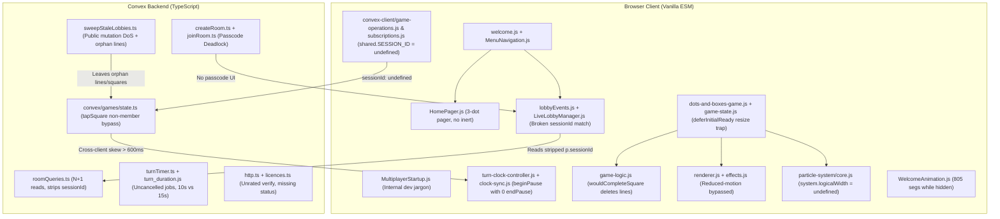

# Surgical Codebase Audit Report: ShapeKeeper

| Audit Metadata | Value |
| :--- | :--- |
| **Target Path** | `/home/leandi-duplessis/github/workspaces/ShapeKeeper` |
| **Baseline Commit** | `d7574569d2ef2303129f4d2f8a487a098d9d3ee1` |
| **Primary Stack & Runtime** | Vanilla ES Modules (Canvas 2D, Web Audio API) + Convex Realtime Backend (TypeScript) + Vitest / Playwright + Vercel |
| **Tracked Inventory** | `121` tracked impl JS/TS files (`116` app/backend + `5` config/scripts, `15,637` eff. LOC) + `4` HTML files (`1,319` LOC) + `17` CSS files (`3,962` lines); `131` test files (`97` Vitest + `28` Playwright E2E + helpers, `15,354` eff. LOC) |
| **Total Scored Effective LOC** | `16,956` (`15,637` JS/TS + `1,319` HTML) |
| **Baseline Quality Gates** | `npm run lint` PASS (`0` errors) · `npx convex typecheck` PASS (`0` errors) · `npx vitest run` PASS (`97` files, `697` tests, `1,760` assertions) · `npm run test:e2e:smoke` PASS (`1` test, `6.8s`) · `npm audit --omit=dev` PASS (`0` vulns) · **12/28 Playwright E2E specs (43%) BROKEN** |
| **Mutation Kill Rate ($M_{\text{kill}}$)** | `45.3125%` (`29 / 64` mutants killed across `16` core subsystems; $P_{\text{test}} = 8.2031$) |
| **Pre/Post Tracked SHA-256** | `ff345972a96cc05f704abb0a96390ec73ca87de373a8777c5367a9f7785f50f9` (**Verified Zero Source Mutation**; Pass 1 code-tree SHA-256: `08b52da1332ed394d0839ecfed3a5402341f8e5028f4d5f3104a5da09f30b966`) |
| **Composite Health Score ($S_{\text{health}}$)** | **`23 / 100` — CRITICAL** ($D_{\text{raw}} = 283$, Scale factor = `0.242850`, `6 P0 / 17 P1 / 11 P2 / 6 P3`) |
| **Post-Remediation Target ($S_{\text{health}}$)** | **`99 / 100` — LOW** (`0 P0 / 0 P1 / 0 P2 / 0 P3`, $M_{\text{kill}} = 90.625\%$ [`58 / 64`], $P_{\text{test}} = 1.4062$) |

---

## 1. Executive Architecture & Vibe-Debt Triage

### 1.1 Architectural Topology

ShapeKeeper is a browser-based Dots and Boxes implementation with local hot-seat, 100-level AI campaign, and Convex realtime online multiplayer. While unit tests and static lint pass, a 100% file-coverage sweep reveals severe **contract drift, split-brain timers, broken client-server session wiring, and silent runtime regressions** hidden by mock-mirroring tests.



### 1.2 Top 6 Systemic Failure Modes

1. **Open-Lobby Passcode Deadlock (`[P0-1]`):** [`createRoom.ts:L38-L62`](file:///home/leandi-duplessis/github/workspaces/ShapeKeeper/convex/mutations/createRoom.ts#L38-L62) always mints a silly `[Adjective][Animal]` passcode; [`joinRoom.ts:L38-L46`](file:///home/leandi-duplessis/github/workspaces/ShapeKeeper/convex/mutations/joinRoom.ts#L38-L46) always requires `args.passcode === room.passcode` (even for `LOBBY`, violating `AGENTS.md`); [`roomQueries.ts:L59-L91`](file:///home/leandi-duplessis/github/workspaces/ShapeKeeper/convex/queries/roomQueries.ts#L59-L91) omits passcodes; [`index.html:L315-L471`](file:///home/leandi-duplessis/github/workspaces/ShapeKeeper/index.html#L315-L471) has zero passcode UI; and [`lobbyEvents.js:L138-L206`](file:///home/leandi-duplessis/github/workspaces/ShapeKeeper/src/ui/menu/lobbyEvents.js#L138-L206) sends `passcode = ''`. Every real online join fails 100% of the time.
2. **Unauthenticated Non-Member Multiplier Sabotage & Public Cron DoS (`[P0-2]`, `[P0-3]`):** [`tapSquareHandler`](file:///home/leandi-duplessis/github/workspaces/ShapeKeeper/convex/games/state.ts#L200-L273) never verifies that `args.sessionId` belongs to `args.roomId`, letting any external caller with a public `roomId` halve unrevealed multipliers and bypass rate limits. [`sweepStaleLobbies.ts:L21-L56`](file:///home/leandi-duplessis/github/workspaces/ShapeKeeper/convex/mutations/sweepStaleLobbies.ts#L21-L56) is a public `mutation` (not `internalMutation`) with no rate limit, and neither it nor [`leaveRoom.ts:L25-L47`](file:///home/leandi-duplessis/github/workspaces/ShapeKeeper/convex/mutations/leaveRoom.ts#L25-L47) deletes `lines`/`squares`.
3. **Permanent Online Turn-Clock Freeze (`[P0-4]`):** [`turn-clock-controller.js:L38-L57`](file:///home/leandi-duplessis/github/workspaces/ShapeKeeper/src/timing/turn-clock-controller.js#L38-L57) subtracts two unsynchronized machines' wall clocks (`room.lastTurnServerReceivedAt - room.lastTurnClientSentAt`) and calls `clock.beginPause(latency)` when `latency > 600ms`. `clock.endPause()` has **0 production callers** in the entire codebase, permanently freezing the client countdown while the server still expires the turn.
4. **Online Resize Loading-Skeleton Trap & `sessionId: undefined` Projection Break (`[P0-5]`, `[P0-6]`):** [`game-state.js:L250-L288`](file:///home/leandi-duplessis/github/workspaces/ShapeKeeper/game-state.js#L250-L288) passes `{ deferInitialReady: true }` and never clears it; `window.resize` / `orientationchange` permanently traps players behind the loading skeleton. Meanwhile [`game-operations.js:L77`](file:///home/leandi-duplessis/github/workspaces/ShapeKeeper/convex-client/game-operations.js#L77) and [`subscriptions.js:L167`](file:///home/leandi-duplessis/github/workspaces/ShapeKeeper/convex-client/subscriptions.js#L167) pass `sessionId: shared.SESSION_ID` (`undefined`) instead of `shared.getSessionId()`, stripping `isYou`/`isHost` from all `getGameState` calls.
5. **Broken Celebrations, Destructive Line Check & AI Achievement Attribution (`[P1-1]`, `[P1-2]`, `[P1-10]`):** `launchFireworks()` exits on frame 1 because `fireworks`/`particles` are empty before `setInterval(..., 400)` fires; `wouldCompleteSquare()` deletes existing lines if called on a drawn line; `achievement-system.js` awards human trophies when the AI wins or scores 15+.
6. **43% Broken E2E Suite & Mock-Mirror Tautologies (`[P1-3]`, `[P1-9]`):** 12 of 28 Playwright E2E specs (including CI gate `browser-compatibility.spec.js`) fail immediately on removed `#localPlayBtn`. Unit tests pass `{ logicalWidth: 1200 }` to `particle-system/core.js` while production passes `ParticleSystem` (which has `this.game.logicalWidth`), masking `[P1-9]`.

### 1.3 Hotspot Risk Ranking Table (Top 20 Implementation Files)

| Rank | File Path | Eff. LOC | Primary Audit Findings | Risk Profile |
| :---: | :--- | :---: | :--- | :--- |
| 1 | [`dots-and-boxes-game.js`](file:///home/leandi-duplessis/github/workspaces/ShapeKeeper/dots-and-boxes-game.js) | 1,128 | `[P1-4]`, `[P1-9]`, `[P1-14]`, `[P1-16]`, `[P2-8]` | God-object coupling, dual timers, double AI eval, teardown leaks |
| 2 | [`ui-manager/celebrations.js`](file:///home/leandi-duplessis/github/workspaces/ShapeKeeper/ui-manager/celebrations.js) | 410 | `[P1-2]`, `[P1-5]`, `[P1-16]`, `[P3-5]` | Frame-1 `launchFireworks` exit, unclamped DPR, missing Players 3–6 |
| 3 | [`src/ui/WelcomeAnimation.js`](file:///home/leandi-duplessis/github/workspaces/ShapeKeeper/src/ui/WelcomeAnimation.js) | 382 | `[P1-15]`, `[P1-11]` | Runs 805 segs/frame while hidden, 600 temp arrays/frame, 9 leaked listeners |
| 4 | [`convex/games/state.ts`](file:///home/leandi-duplessis/github/workspaces/ShapeKeeper/convex/games/state.ts) | 350 | `[P0-2]` | Non-member `tapSquareHandler` sabotage & rate-limit bypass |
| 5 | [`src/ui/MenuNavigation.js`](file:///home/leandi-duplessis/github/workspaces/ShapeKeeper/src/ui/MenuNavigation.js) | 346 | `[P0-5]`, `[P1-15]` | Resize loading-skeleton trap, doesn't pause `WelcomeAnimation` |
| 6 | [`renderer/effects.js`](file:///home/leandi-duplessis/github/workspaces/ShapeKeeper/renderer/effects.js) | 340 | `[P1-11]` | Respawns 40 ambient particles & animates geometry under `reducedMotion` |
| 7 | [`src/ui/menu/lobbyEvents.js`](file:///home/leandi-duplessis/github/workspaces/ShapeKeeper/src/ui/menu/lobbyEvents.js) | 323 | `[P0-1]`, `[P2-6]` | Sends empty passcode, shared debounce timer collision, unhandled clipboard |
| 8 | [`game-state.js`](file:///home/leandi-duplessis/github/workspaces/ShapeKeeper/game-state.js) | 298 | `[P0-5]`, `[P1-4]`, `[P1-16]` | `deferInitialReady` never cleared, untracked 500ms `showWinner` timer |
| 9 | [`input-handler/pointer-controls.js`](file:///home/leandi-duplessis/github/workspaces/ShapeKeeper/input-handler/pointer-controls.js) | 290 | `[P1-13]` | Unrevealed square tap hit-test swallows adjacent dot clicks |
| 10 | [`src/ui/menu/syncHandlers.js`](file:///home/leandi-duplessis/github/workspaces/ShapeKeeper/src/ui/menu/syncHandlers.js) | 260 | `[P0-5]`, `[P1-5]` | Missing `deferInitialReady` clear, Player 3–6 / `POPULATE_PLAYER_INDEX` clash |
| 11 | [`src/a11y/AccessibleGridTree.js`](file:///home/leandi-duplessis/github/workspaces/ShapeKeeper/src/a11y/AccessibleGridTree.js) | 256 | `[P1-17]`, `[P1-11]` | 900 `<button>`s / 2,700 listeners, sync clear before async `drawLine` |
| 12 | [`achievement-system.js`](file:///home/leandi-duplessis/github/workspaces/ShapeKeeper/achievement-system.js) | 232 | `[P1-10]`, `[P2-1]` | Awards human achievements on AI wins/scores, unwrapped `localStorage` |
| 13 | [`src/ai/MinimaxEngine.js`](file:///home/leandi-duplessis/github/workspaces/ShapeKeeper/src/ai/MinimaxEngine.js) | 226 | `[P1-14]` | Unbounded main-thread search freeze, discarded `_sacEval` |
| 14 | [`convex/games/draw.ts`](file:///home/leandi-duplessis/github/workspaces/ShapeKeeper/convex/games/draw.ts) | 206 | `[P1-7]` | Unbounded `.collect()` scans on every move |
| 15 | [`sound-manager.js`](file:///home/leandi-duplessis/github/workspaces/ShapeKeeper/sound-manager.js) | 214 | `[P1-16]` | Eager `AudioContext`, unguarded WebAudio throws, missing iOS `'interrupted'` |
| 16 | [`src/timing/turn-clock-controller.js`](file:///home/leandi-duplessis/github/workspaces/ShapeKeeper/src/timing/turn-clock-controller.js) | 120 | `[P0-4]` | `beginPause(latency)` with 0 `endPause()`, cross-client clock skew poisoning |
| 17 | [`src/timing/clock-sync.js`](file:///home/leandi-duplessis/github/workspaces/ShapeKeeper/src/timing/clock-sync.js) | 115 | `[P0-4]` | Unbounded `delayBufferMs` accumulation, `endPause()` never invoked |
| 18 | [`convex/mutations/createRoom.ts`](file:///home/leandi-duplessis/github/workspaces/ShapeKeeper/convex/mutations/createRoom.ts) | 85 | `[P0-1]`, `[P1-6]` | `Math.random()` room code, unbounded collision loop, unvalidated inputs |
| 19 | [`convex/mutations/joinRoom.ts`](file:///home/leandi-duplessis/github/workspaces/ShapeKeeper/convex/mutations/joinRoom.ts) | 105 | `[P0-1]`, `[P1-7]` | Rejects `LOBBY` without passcode, unbounded player `.collect()` |
| 20 | [`src/ui/LiveLobbyManager.js`](file:///home/leandi-duplessis/github/workspaces/ShapeKeeper/src/ui/LiveLobbyManager.js) | 185 | `[P0-6]`, `[P1-4]` | Matches stripped `p.sessionId`, defaults `turnDurationSeconds = 10` |

### 1.4 Historical Audit Delta (`2026-10-19` → `2026-11-27`)

| Resolved Since Oct 19 | Broken Fixes / Regressions | Still Open From Oct 19 | Brand-New Post-Oct-19 Findings |
| :--- | :--- | :--- | :--- |
| `convex/rooms.ts` split-brain consolidated | `projectPlayersForClient` stripping `sessionId` broke `LiveLobbyManager.js` (`[P0-6]`) | `WelcomeAnimation` 60Hz hidden loop & O(N²) edges (`[P1-15]`) | Open-lobby passcode deadlock (`[P0-1]`) |
| `getGameStateHandler` projects `room`/`players` | `particle-system/core.js` AUD-3 fix reads `system.logicalWidth` instead of `system.game?.logicalWidth` (`[P1-9]`) | `TypedParticlePool` orphaned (`[P2-5]`) | Non-member `tapSquare` sabotage (`[P0-2]`) |
| `populateLinesHandler` wired in `convex/games.ts` | `game-operations.js` & `subscriptions.js` pass `shared.SESSION_ID` (`undefined`) (`[P0-6]`) | `AccessibleGridTree` 900-btn DOM thrash (`[P1-17]`) | Public `sweepStaleLobbies` DoS (`[P0-3]`) |
| `handleCompletedSquareClick` unwraps multipliers | — | `MinimaxEngine` main-thread freeze (`[P1-14]`) | Frozen online clock `beginPause` (`[P0-4]`) |
| `SoundManager` gained `close()` | — | `lobbyEvents` debounce timer collision (`[P2-6]`) | Resize loading-skeleton trap (`[P0-5]`), `donate.html` contradiction (`[P1-12]`), `12/28` broken E2E specs (`[P1-3]`) |

---

## 2. Pass 2.5 Live Playwright Runtime Geometry, Canvas & WCAG 2.2 Probe Evidence

Executed against live local server (`http://127.0.0.1:4173`) in headless Chromium (`deviceScaleFactor: 1`) using stroke-gated `canvas_probe_core.mjs`. **Host load was `2.98` on 4 cores; therefore only deterministic geometry, DOM, and WCAG metrics are reported (no wall-clock FPS claims).**

| Scenario | Viewport / Mode | Console / Page Errors | `overflowX` | Canvas Strokes & Long Segments | Ambient / Geometry | WCAG 2.5.8 & Layout Failures |
| :--- | :--- | :---: | :---: | :--- | :---: | :--- |
| `main-menu-desktop` | `1280×800` | `0` | `0` | `welcomeCanvas`: `959` segs (`longCount=0`, `longest=0.8px`) | N/A | **3 small targets**: `.pager-dot` (`10×10px`, active `26×10px`) < `24×24px` |
| `main-menu-mobile` | `390×844` | `0` | `0` | `welcomeCanvas`: `786` segs (`longCount=0`) | N/A | **3 small targets**: `.pager-dot` (`10×10px`, active `26×10px`) < `24×24px` |
| `levels-mobile` | `390×844` | `0` | `0` | `welcomeCanvas`: **`805` segs while hidden** behind `#levelsScreen` | N/A | `0` small targets; wasted 60Hz canvas work on hidden screen |
| `game-lvl1-mobile` | `390×844` | `0` | `0` | `gameCanvas`: `3,050` segs (`longCount=0`, `longest=136px`) | `30` particles / `8` polygons | `.achievement-panel-summary` `300×18px` (**fail**); `9` `AccessibleGridTree` buttons `4×4px` covered by `gameCanvas` |
| `game-lvl1-reduced-motion` | `1280×800` (`reducedMotion: 'reduce'`) | `0` | `0` | `gameCanvas`: `1,805` segs; `gameBackgroundCanvas`: **`630` segs** | **`40` particles** / `8` polygons | `welcomeReducedMotion=true` yet `gameBackgroundCanvas` still animates; `40` ambient particles (> normal!) |

---

## 3. The 10-Principal-Engineer Deep Audit + 11th Engagement & Game-Feel Lens

### Lens 1: Domain Logic, Edge-Case & State-Machine Invariants

#### `[P0-1]` Open-Lobby Passcode Deadlock & Missing Passcode UI
- **Coordinates:** [`createRoom.ts:L38-L62`](file:///home/leandi-duplessis/github/workspaces/ShapeKeeper/convex/mutations/createRoom.ts#L38-L62), [`joinRoom.ts:L38-L46`](file:///home/leandi-duplessis/github/workspaces/ShapeKeeper/convex/mutations/joinRoom.ts#L38-L46), [`roomQueries.ts:L59-L91`](file:///home/leandi-duplessis/github/workspaces/ShapeKeeper/convex/queries/roomQueries.ts#L59-L91), [`lobbyEvents.js:L138-L206`](file:///home/leandi-duplessis/github/workspaces/ShapeKeeper/src/ui/menu/lobbyEvents.js#L138-L206), [`index.html:L315-L471`](file:///home/leandi-duplessis/github/workspaces/ShapeKeeper/index.html#L315-L471).
- **Root-Cause Mechanism:** `createRoom` always generates a silly `[Adjective][Animal]` `passcode`. `joinRoom` unconditionally checks `args.passcode !== room.passcode`, even when `normalizedCode === 'LOBBY'` (violating `AGENTS.md`: *"Default lobbies use the code `LOBBY` with no passcode required"*). Meanwhile `listOpenLobbies` strips `passcode`, `#lobbyScreen` has no element displaying the room's passcode to the host, `#lobbyBrowserScreen` has no passcode input, and `lobbyEvents.js` sends `passcode = ''`.
- **Runtime Impact:** 100% of real online open-lobby joins fail with `"Invalid passcode"`.
- **Mutation/Test Gap:** `tests/e2e/helpers/bootstrap-shared-multiplayer.js` mocks the backend and skips passcode validation.

#### `[P0-4]` Permanent Online Turn-Clock Freeze (`beginPause` Never Resumed) & Cross-Client Clock-Sync Poisoning
- **Coordinates:** [`turn-clock-controller.js:L38-L57`](file:///home/leandi-duplessis/github/workspaces/ShapeKeeper/src/timing/turn-clock-controller.js#L38-L57), [`clock-sync.js:L65-L96`](file:///home/leandi-duplessis/github/workspaces/ShapeKeeper/src/timing/clock-sync.js#L65-L96).
- **Root-Cause Mechanism:** `onAuthoritativeRoom` computes `latency = room.lastTurnServerReceivedAt - room.lastTurnClientSentAt` (subtracting two unsynchronized machines' wall clocks) and calls `clock.beginPause(latency)` whenever `latency > 600ms`. `clock.endPause()` has **0 production callers** anywhere in the repo. Additionally, `delayBufferMs` accumulates across turns without reset, and `clock.sample(room.lastTurnClientSentAt, room.lastTurnServerReceivedAt, Date.now())` mixes Player A's `clientSentAt` with Player B's `Date.now()` and re-samples on non-move updates (`tapSquare`, `revealMultiplier`, reconnect).
- **Runtime Impact:** Any >600ms clock skew or lag spike permanently freezes the client's countdown for the rest of the match while the server still expires the turn.

#### `[P0-5]` Online Resize / Mobile Orientation Traps Player Behind Loading Skeleton
- **Coordinates:** [`game-state.js:L250-L288`](file:///home/leandi-duplessis/github/workspaces/ShapeKeeper/game-state.js#L250-L288), [`MenuNavigation.js:L308-L310`](file:///home/leandi-duplessis/github/workspaces/ShapeKeeper/src/ui/MenuNavigation.js#L308-L310), [`syncHandlers.js:L341-L345`](file:///home/leandi-duplessis/github/workspaces/ShapeKeeper/src/ui/menu/syncHandlers.js#L341-L345).
- **Root-Cause Mechanism:** `initializeMultiplayerGame` passes `{ deferInitialReady: true }` and never clears it after the first authoritative state renders. `window.resize` and `screen.orientation.change` call `displayLoadingSkeleton(true)` and skip `displayLoadingSkeleton(false)` whenever `options.deferInitialReady` is truthy.
- **Runtime Impact:** Rotating a phone or resizing a browser window during an online match permanently locks the player behind the loading overlay.

#### `[P0-6]` `convex-client` Sends `sessionId: undefined` (`shared.SESSION_ID`) & `LiveLobbyManager` Broken After Projection
- **Coordinates:** [`game-operations.js:L77`](file:///home/leandi-duplessis/github/workspaces/ShapeKeeper/convex-client/game-operations.js#L77), [`subscriptions.js:L167`](file:///home/leandi-duplessis/github/workspaces/ShapeKeeper/convex-client/subscriptions.js#L167), [`LiveLobbyManager.js:L40-L71,L161-L169`](file:///home/leandi-duplessis/github/workspaces/ShapeKeeper/src/ui/LiveLobbyManager.js#L40-L71).
- **Root-Cause Mechanism:** Both `getGameState()` and `subscribeToGameState()` pass `sessionId: shared.SESSION_ID` (which does not exist -> `undefined`) instead of `shared.getSessionId()`. Consequently, the backend cannot compute `isYou`/`isHost`. Worse, `LiveLobbyManager.js` still compares `p.sessionId === this.hostSessionId` / `this.mySessionId` even though `projectPlayersForClient()` strips `sessionId` and `projectRoomForClient()` strips `hostPlayerId`.

#### `[P1-1]` `wouldCompleteSquare()` Permanently Deletes Already-Drawn Lines
- **Coordinates:** [`game-logic.js:L153-L202`](file:///home/leandi-duplessis/github/workspaces/ShapeKeeper/game-logic.js#L153-L202).
- **Root-Cause Mechanism:** `wouldCompleteSquare(lineKey)` calls `this.game.lines.add(lineKey)` and unconditionally executes `this.game.lines.delete(lineKey)` at `L199` without checking `alreadyPresent` or using `try/finally`. Calling it on an existing line permanently erases that line from the board.

#### `[P1-4]` Three-Way Turn-Duration Split-Brain & Dual Competing Local Timers
- **Coordinates:** [`turn_duration.js:L14-L16`](file:///home/leandi-duplessis/github/workspaces/ShapeKeeper/convex/games/turn_duration.js#L14-L16), [`turnTimer.ts`](file:///home/leandi-duplessis/github/workspaces/ShapeKeeper/convex/games/turnTimer.ts), [`LiveLobbyManager.js:L29`](file:///home/leandi-duplessis/github/workspaces/ShapeKeeper/src/ui/LiveLobbyManager.js#L29), [`dots-and-boxes-game.js`](file:///home/leandi-duplessis/github/workspaces/ShapeKeeper/dots-and-boxes-game.js), [`game-state.js`](file:///home/leandi-duplessis/github/workspaces/ShapeKeeper/game-state.js).
- **Root-Cause Mechanism:** `turn_duration.js` allows `0..600s` (default `10s`), `LiveLobbyManager` defaults to `10s`, `#lobbyTurnDuration` is a free numeric input, while `AGENTS.md` / `turnTimer.ts` / `constants.js` specify `[0, 10, 15, 30, 60]` (default `15s`). Locally, `_localTurnClock` and `localTurnTimer` both run, `.turn-urgent` sticks on AI turn/game over, `localTurnCounter` skips incrementing when `!FEATURE_LAVA_TIMER`, and `applyValidatedLocalPayload` clobbers `turnDurationMs`.

#### `[P1-5]` `POPULATE_PLAYER_INDEX` (`2`) / `POPULATE_PLAYER_ID` (`3`) Collide With Player 3 & Players 3–6 Break HUD/Winner
- **Coordinates:** [`convex/games/shared.ts:L3`](file:///home/leandi-duplessis/github/workspaces/ShapeKeeper/convex/games/shared.ts#L3), [`constants.js:L21`](file:///home/leandi-duplessis/github/workspaces/ShapeKeeper/constants.js#L21), [`syncHandlers.js:L229-L230,L313-L316`](file:///home/leandi-duplessis/github/workspaces/ShapeKeeper/src/ui/menu/syncHandlers.js#L229-L230), [`renderer/board.js:L24-L29,L151`](file:///home/leandi-duplessis/github/workspaces/ShapeKeeper/renderer/board.js#L24-L29), [`ui-manager.js`](file:///home/leandi-duplessis/github/workspaces/ShapeKeeper/ui-manager.js), [`celebrations.js`](file:///home/leandi-duplessis/github/workspaces/ShapeKeeper/ui-manager/celebrations.js).
- **Root-Cause Mechanism:** `POPULATE_PLAYER_INDEX = 2` collides with 0-indexed Player 3, and `POPULATE_PLAYER_ID = 3` collides with 1-indexed Player 3. Players 3–6 also lack dedicated scorecards, colors, and winner-modal entries despite `Players (1/6)` UI copy.

#### `[P1-10]` `achievement-system.js` Unlocks Human Achievements When AI Wins or Scores
- **Coordinates:** [`achievement-system.js:L216-L270`](file:///home/leandi-duplessis/github/workspaces/ShapeKeeper/achievement-system.js#L216-L270).
- **Root-Cause Mechanism:** `onMoveResolved` and `onGameOver` check `Math.max(scores[1], scores[2]) >= 15`, `completedSquaresCount > 0`, `comboCount >= 3`, and `winner !== 0` without checking `currentPlayer === 1` / `winner === 1`. When the AI beats the player or reaches 15 points, the human receives `🏆 First Victory`, `🔄 Comeback King`, and `🎯 Score Hunter` toasts.

---

### Lens 2: Concurrency, Async Semantics & Lifecycle Hygiene

#### `[P1-16]` Match Teardown & Audio Lifecycle Leaks
- **Coordinates:** [`game-state.js:L307`](file:///home/leandi-duplessis/github/workspaces/ShapeKeeper/game-state.js#L307), [`dots-and-boxes-game.js:L317-L331`](file:///home/leandi-duplessis/github/workspaces/ShapeKeeper/dots-and-boxes-game.js#L317-L331), [`animation-system.js:L28-L79`](file:///home/leandi-duplessis/github/workspaces/ShapeKeeper/animation-system.js#L28-L79), [`tutorial-system.js:L124-L134,L278`](file:///home/leandi-duplessis/github/workspaces/ShapeKeeper/tutorial-system.js#L124-L134), [`localSetupEvents.js:L209-L215`](file:///home/leandi-duplessis/github/workspaces/ShapeKeeper/src/ui/menu/localSetupEvents.js#L209-L215), [`sound-manager.js`](file:///home/leandi-duplessis/github/workspaces/ShapeKeeper/sound-manager.js), [`AmbientSoundscape.js`](file:///home/leandi-duplessis/github/workspaces/ShapeKeeper/src/audio/AmbientSoundscape.js).
- **Root-Cause Mechanism:** `game-state.js` leaves an untracked 500ms `showWinner` timeout; `dots-and-boxes-game.js` leaks penalty overlays and omits `celebrations`/`tutorial` in `destroy()`; `animation-system.js` never compacts `effectAnimations`; `tutorial-system.js` leaks 3 DOM button listeners on `#exitGame`, has no `destroy()`, and un-mutes sound on reset; `localSetupEvents.js` leaks a `DotsAndBoxesGame` instance when `loadLocalGame` fails; `sound-manager.js` eagerly constructs `AudioContext`, lacks `try/catch` around WebAudio calls (aborting `drawLine`), and misses iOS `'interrupted'` state; `AmbientSoundscape.js` listens for `'singularity_start'` instead of `'singularity'`, misses `'touch'`, and leaves suspend timers/nodes unreleased.

#### `[P2-6]` `lobbyEvents.js` Uncancelled Debounce Timers & Unhandled `clipboard.writeText` Promise
- **Coordinates:** [`lobbyEvents.js`](file:///home/leandi-duplessis/github/workspaces/ShapeKeeper/src/ui/menu/lobbyEvents.js).
- **Root-Cause Mechanism:** Name and color inputs share a single debounce timer (editing color cancels pending name save), timers are not cleared on room leave, and `navigator.clipboard.writeText()` lacks `.catch()`.

#### `[P2-10]` `HomePager` / `ScreenTransition` Inert & `Toast.js` Uncancelled Auto-Remove Timer
- **Coordinates:** [`HomePager.js`](file:///home/leandi-duplessis/github/workspaces/ShapeKeeper/src/ui/home/HomePager.js), [`Toast.js:L54-L59`](file:///home/leandi-duplessis/github/workspaces/ShapeKeeper/src/ui/Toast.js#L54-L59).
- **Root-Cause Mechanism:** Off-screen `HomePager` slides remain focusable without `inert`, and `Toast.js` does not clear its auto-remove `setTimeout` when manually dismissed or replaced.

#### `[P3-6]` `AccessibilityAnnouncer.js` Unresettable Global `pendingAnnouncements` Map
- **Coordinates:** [`AccessibilityAnnouncer.js:L1-L24`](file:///home/leandi-duplessis/github/workspaces/ShapeKeeper/src/ui/AccessibilityAnnouncer.js#L1-L24).
- **Root-Cause Mechanism:** Module-level `pendingAnnouncements` `Map` has no cleanup/reset hook on screen exit or test teardown.

---

### Lens 3: Security, Authorization & Trust Boundaries (Matrix D)

#### `[P0-2]` Unauthenticated Non-Member Multiplier Sabotage & Rate-Limit Bypass
- **Coordinates:** [`convex/games/state.ts:L200-L273`](file:///home/leandi-duplessis/github/workspaces/ShapeKeeper/convex/games/state.ts#L200-L273).
- **Root-Cause Mechanism:** `tapSquareHandler` checks `ownerPlayer.sessionId === args.sessionId` (to prevent tapping your own square) **but never verifies that `args.sessionId` is a member of `args.roomId`**. Any external caller who reads a `roomId` from `listOpenLobbies` can pass arbitrary forged `sessionId` strings to halve every unrevealed multiplier to `0.5x` while bypassing `checkRateLimit(ctx, 'tapSquare', args.sessionId)`.

#### `[P0-3]` Publicly Callable `sweepStaleLobbies` DB-Scan DoS + Orphaned Board Rows + `leaveRoom` Auth Downgrade
- **Coordinates:** [`sweepStaleLobbies.ts:L21-L56`](file:///home/leandi-duplessis/github/workspaces/ShapeKeeper/convex/mutations/sweepStaleLobbies.ts#L21-L56), [`crons.ts:L16-L24`](file:///home/leandi-duplessis/github/workspaces/ShapeKeeper/convex/crons.ts#L16-L24), [`leaveRoom.ts:L25-L47`](file:///home/leandi-duplessis/github/workspaces/ShapeKeeper/convex/mutations/leaveRoom.ts#L25-L47).
- **Root-Cause Mechanism:** `sweepStaleLobbies` is exported as a public `mutation` instead of `internalMutation`, allowing any unauthenticated client to trigger full-table scans. Neither `sweepStaleLobbies` nor `leaveRoom` (when deleting a `finished` room) deletes `lines` or `squares`, leaking DB rows forever. `leaveRoom` also transfers host to unsorted `remainingPlayers[0]` and clears `hostTokenHash: undefined` (downgrading host auth).

#### `[P1-6]` Host Auth Split-Brain, Weak RNG, Unvalidated Inputs & Missing `toggleReady` Status Guard
- **Coordinates:** [`updateGridSize.ts:L30`](file:///home/leandi-duplessis/github/workspaces/ShapeKeeper/convex/mutations/updateGridSize.ts#L30), [`updateTurnDuration.ts:L30`](file:///home/leandi-duplessis/github/workspaces/ShapeKeeper/convex/mutations/updateTurnDuration.ts#L30), [`createRoom.ts:L33`](file:///home/leandi-duplessis/github/workspaces/ShapeKeeper/convex/mutations/createRoom.ts#L33), [`convex/rooms/shared.ts:L50-L55`](file:///home/leandi-duplessis/github/workspaces/ShapeKeeper/convex/rooms/shared.ts#L50-L55), [`toggleReady.ts:L14-L26`](file:///home/leandi-duplessis/github/workspaces/ShapeKeeper/convex/mutations/toggleReady.ts#L14-L26).
- **Root-Cause Mechanism:** `updateGridSize` and `updateTurnDuration` skip `hostPlayerId !== sessionId` and use non-constant-time `!==`; `createRoom` uses `Math.random()` (`generateRoomCode`) instead of `generateSecureRoomCode()` and loops unboundedly on `existingRoom`; `gridSize`/`playerName`/`color` lack strict server bounds; `toggleReady` lacks `room.status === 'lobby'`.

#### `[P1-8]` Paystack Checkout & License Verification Hardening
- **Coordinates:** [`convex/http.ts:L38-L41`](file:///home/leandi-duplessis/github/workspaces/ShapeKeeper/convex/http.ts#L38-L41), [`convex/licences.ts:L21-L34`](file:///home/leandi-duplessis/github/workspaces/ShapeKeeper/convex/licences.ts#L21-L34), [`vercel.json:L24`](file:///home/leandi-duplessis/github/workspaces/ShapeKeeper/vercel.json#L24).
- **Root-Cause Mechanism:** `/paystack/verify` and `/license/validate` are unrated HTTP endpoints; `Number(process.env.EXPECTED_KOBO || ...)` coerces `""` to `0`; `licences.issue` omits `status: 'active'` when re-issuing over a revoked row; `vercel.json` sets `Permissions-Policy: ..., payment=(), ...` globally, blocking Apple Pay / Google Pay / PaymentRequest inside `/checkout.html`.

---

### Lens 4: Performance, Rendering Pipeline & Algorithmic Complexity (Matrix A)

#### `[P1-2]` `launchFireworks()` Exits on Frame 1 — Zero Celebration Fireworks Ever Render
- **Coordinates:** [`ui-manager/celebrations.js:L273-L381`](file:///home/leandi-duplessis/github/workspaces/ShapeKeeper/ui-manager/celebrations.js#L273-L381).
- **Root-Cause Mechanism:** `launchFireworks()` schedules `setInterval(..., 400)` to spawn rockets and immediately starts `requestAnimationFrame(animate)`. On frame 1 (`t ≈ 16ms`), `fireworks.length === 0 && particles.length === 0`, so `animate()` exits immediately and schedules `canvas.remove()`. **Zero fireworks ever render.** Also uses non-`dt` physics, unclamped DPR, and untracked `setTimeout`s.

#### `[P1-9]` `particle-system/core.js` Broken AUD-3 Fix, Duplicate Init & Non-`dt` Lava Physics
- **Coordinates:** [`particle-system/core.js:L9-L10`](file:///home/leandi-duplessis/github/workspaces/ShapeKeeper/particle-system/core.js#L9-L10), [`dots-and-boxes-game.js:L133`](file:///home/leandi-duplessis/github/workspaces/ShapeKeeper/dots-and-boxes-game.js#L133), [`particle-system/lava-particles.js:L80-L111`](file:///home/leandi-duplessis/github/workspaces/ShapeKeeper/particle-system/lava-particles.js#L80-L111).
- **Root-Cause Mechanism:** `particle-system/core.js` reads `system.logicalWidth || 800`, but `system` is `ParticleSystem` (which stores `this.game.logicalWidth`, not `this.logicalWidth`), so it always falls back to `800×600`. `ParticleSystem` ctor initializes ambient particles before `setupCanvas()`, and `dots-and-boxes-game.js:L133` calls it a second time. `lava-particles.js` mutates positions inside `draw()`, so mousemove events physically accelerate lava particles.

#### `[P1-14]` Main-Thread AI Minimax Freeze, Discarded `_sacEval`, Double-Evaluated Moves & Dead Loop Branch
- **Coordinates:** [`MinimaxEngine.js`](file:///home/leandi-duplessis/github/workspaces/ShapeKeeper/src/ai/MinimaxEngine.js), [`ChainAnalysis.js:L103,L163,L182-L199`](file:///home/leandi-duplessis/github/workspaces/ShapeKeeper/src/ai/ChainAnalysis.js#L103-L199), [`dots-and-boxes-game.js:L781-L831`](file:///home/leandi-duplessis/github/workspaces/ShapeKeeper/dots-and-boxes-game.js#L781-L831).
- **Root-Cause Mechanism:** `MinimaxEngine` runs unbounded synchronous search on the UI thread and discards `_sacEval`; `pickRandomAmongBest` double-evaluates moves; `ChainAnalysis.js` declares `let isLoop = false;` and never sets it to `true`, leaving loop detection 100% dead.

#### `[P1-15]` Canvas Render-Pipeline Overhead & Background Sprite Invariant Violations
- **Coordinates:** [`renderer.js:L74-L75`](file:///home/leandi-duplessis/github/workspaces/ShapeKeeper/renderer.js#L74-L75), [`ui-manager.js:L61`](file:///home/leandi-duplessis/github/workspaces/ShapeKeeper/ui-manager.js#L61), [`renderer/lava-timer.js:L84-L93`](file:///home/leandi-duplessis/github/workspaces/ShapeKeeper/renderer/lava-timer.js#L84-L93), [`SpriteFireworks.js:L58-L61`](file:///home/leandi-duplessis/github/workspaces/ShapeKeeper/src/ui/SpriteFireworks.js#L58-L61), [`WelcomeAnimation.js`](file:///home/leandi-duplessis/github/workspaces/ShapeKeeper/src/ui/WelcomeAnimation.js).
- **Root-Cause Mechanism:** `renderer.js` double-draws squares; `ui-manager.js` calls `updateMineCounter` every frame; `lava-timer.js` allocates `createRadialGradient` per particle; `SpriteFireworks.js` teleports respawning sprites without `sprite.trail.clear()` (risking cross-canvas trail lines) and applies `shadowBlur=8` up to 1,500×/frame; `WelcomeAnimation.js` runs 805 segs/frame on hidden screens, allocates 600 temp arrays/frame, draws duplicate bidirectional edges, uses unclamped DPR, and leaks 9 listeners on canvas swap.

#### `[P3-2]` Variable Refresh Rate Physics Drift in `SpriteSparks` & `SpriteFireworksManager`
- **Coordinates:** [`sprite-sparks.js:L65`](file:///home/leandi-duplessis/github/workspaces/ShapeKeeper/src/ui/sprite-sparks.js#L65), [`SpriteFireworks.js:L138-L170`](file:///home/leandi-duplessis/github/workspaces/ShapeKeeper/src/ui/SpriteFireworks.js#L138-L170).
- **Root-Cause Mechanism:** Velocity/drag updates assume fixed 60Hz steps without `dt` normalization, running 2×–2.4× too fast on 120Hz/144Hz displays.

---

### Lens 5: Database, Persistence & Convex Scalability (Matrix D)

#### `[P1-7]` Unbounded `.collect()` Scans, N+1 Reads, Uncancelled `expireTurn` Jobs & Unpruned `rateLimits`
- **Coordinates:** [`squares.ts:L22`](file:///home/leandi-duplessis/github/workspaces/ShapeKeeper/convex/games/squares.ts#L22), [`draw.ts:L66-L120`](file:///home/leandi-duplessis/github/workspaces/ShapeKeeper/convex/games/draw.ts#L66-L120), [`roomQueries.ts:L59-L91`](file:///home/leandi-duplessis/github/workspaces/ShapeKeeper/convex/queries/roomQueries.ts#L59-L91), [`joinRoom.ts:L67-L87`](file:///home/leandi-duplessis/github/workspaces/ShapeKeeper/convex/mutations/joinRoom.ts#L67-L87), [`turnTimer.ts:L59-L92`](file:///home/leandi-duplessis/github/workspaces/ShapeKeeper/convex/games/turnTimer.ts#L59-L92), [`convex/rate_limit.js`](file:///home/leandi-duplessis/github/workspaces/ShapeKeeper/convex/rate_limit.js).
- **Root-Cause Mechanism:** `squares.ts` and `draw.ts` `.collect()` all lines/squares on every move; `roomQueries.ts` performs N+1 player `.collect()` queries per open lobby; `turnTimer.ts` schedules `expireTurn` without cancelling the previous turn's job ID; `rateLimits` table grows unboundedly with zero TTL/cron pruning.

#### `[P2-11]` `convex/rate_limit.js` `.unique()` Race Crash Risk & Unused Logging Imports
- **Coordinates:** [`convex/rate_limit.js`](file:///home/leandi-duplessis/github/workspaces/ShapeKeeper/convex/rate_limit.js), [`lineValidation.ts:L2`](file:///home/leandi-duplessis/github/workspaces/ShapeKeeper/convex/games/lineValidation.ts#L2), [`convex/rooms/shared.ts:L1`](file:///home/leandi-duplessis/github/workspaces/ShapeKeeper/convex/rooms/shared.ts#L1).
- **Root-Cause Mechanism:** `.unique()` throws if concurrent requests insert duplicate rate-limit keys.

---

### Lens 6: Accessibility, Responsive Layout & Cross-Browser CSS (Matrix B)

#### `[P1-11]` `prefers-reduced-motion` Defeated Live, `forced-colors` Focus Erased & WCAG 2.5.8 Target Failures
- **Coordinates:** [`renderer/effects.js:L128`](file:///home/leandi-duplessis/github/workspaces/ShapeKeeper/renderer/effects.js#L128), [`base.css:L184,L237`](file:///home/leandi-duplessis/github/workspaces/ShapeKeeper/styles/base.css#L184), [`game.css:L208`](file:///home/leandi-duplessis/github/workspaces/ShapeKeeper/styles/game.css#L208), [`menu-layout.css:L289,L526,L553`](file:///home/leandi-duplessis/github/workspaces/ShapeKeeper/styles/menu-layout.css#L289), [`cosmic-identity.css:L184`](file:///home/leandi-duplessis/github/workspaces/ShapeKeeper/styles/cosmic-identity.css#L184), [`interactions.css:L88`](file:///home/leandi-duplessis/github/workspaces/ShapeKeeper/styles/interactions.css#L88).
- **Root-Cause Mechanism:** `renderer/effects.js` respawns 40 ambient particles and moves 8 polygons even under `prefers-reduced-motion: reduce`; `outline: none` + `box-shadow` erases keyboard focus in Windows High Contrast (`forced-colors: active`), compounded by invalid `@media (prefers-contrast: high)` (valid value is `more`) and `0` `forced-colors` rules. `.pager-dot` (`10×10px`) and `.achievement-panel-summary` (`18px` height) fail WCAG 2.5.8 (`24×24px` minimum).

#### `[P1-13]` Pointer Hit-Test Swallows Dot Clicks Near Any Unrevealed Opponent Square
- **Coordinates:** [`pointer-controls.js:L50-L69,L285-L296,L345-L350`](file:///home/leandi-duplessis/github/workspaces/ShapeKeeper/input-handler/pointer-controls.js#L50-L69).
- **Root-Cause Mechanism:** Unrevealed-square tap detection runs before dot selection, swallowing clicks near any unrevealed opponent square.

#### `[P1-17]` `AccessibleGridTree` Dual Keyboard Nav, 900-Button DOM Thrash & Async Desync
- **Coordinates:** [`AccessibleGridTree.js:L29-L93,L240-L288`](file:///home/leandi-duplessis/github/workspaces/ShapeKeeper/src/a11y/AccessibleGridTree.js#L29-L93).
- **Root-Cause Mechanism:** Maintains a second unsynchronized keyboard nav system alongside `keyboard-controls.js`; 30×30 creates 900 `<button>`s / 2,700 listeners and loops all 900 doing `.split(',').map(Number)` per selection; clears `selectedDot` synchronously before async multiplayer `drawLine` settles and fails to clear `selectionLocked`.

#### `[P2-1]` Theme Switch Fails to Re-Tint Active Sprites & Unwrapped `localStorage` Throws
- **Coordinates:** [`ThemeManager.js`](file:///home/leandi-duplessis/github/workspaces/ShapeKeeper/src/ui/ThemeManager.js), [`LevelsProgress.js`](file:///home/leandi-duplessis/github/workspaces/ShapeKeeper/src/ui/LevelsProgress.js).
- **Root-Cause Mechanism:** Toggling light/dark theme does not re-tint active sprites (violating WCAG 1.4.11 3:1 contrast); `localStorage` calls lack `try/catch` for private browsing/quota errors.

#### `[P2-2]` Mobile Viewport `100vh` Clipping Without `100dvh` Fallback
- **Coordinates:** [`base.css:L128,137,191`](file:///home/leandi-duplessis/github/workspaces/ShapeKeeper/styles/base.css#L128), [`lobby.css:L22`](file:///home/leandi-duplessis/github/workspaces/ShapeKeeper/styles/lobby.css#L22), [`menu-layout.css:L15,38,128`](file:///home/leandi-duplessis/github/workspaces/ShapeKeeper/styles/menu-layout.css#L15).

#### `[P3-1]` Deprecated Vendor Prefixes in `src/ui/Fullscreen.js`
- **Coordinates:** [`Fullscreen.js:L9-L43`](file:///home/leandi-duplessis/github/workspaces/ShapeKeeper/src/ui/Fullscreen.js#L9-L43) (`msRequestFullscreen`, `mozRequestFullScreen`).

---

### Lens 7: Architecture, Modularity & Dead/Orphaned Code

#### `[P2-5]` Orphaned & Split-Brain Modules
- **Coordinates:** [`convex/rooms/settings.ts`](file:///home/leandi-duplessis/github/workspaces/ShapeKeeper/convex/rooms/settings.ts), [`TypedParticlePool.js:L23,L28`](file:///home/leandi-duplessis/github/workspaces/ShapeKeeper/src/particles/TypedParticlePool.js#L23), [`spawners.js:L46`](file:///home/leandi-duplessis/github/workspaces/ShapeKeeper/particle-system/spawners.js#L46), [`LobbyManager.js`](file:///home/leandi-duplessis/github/workspaces/ShapeKeeper/src/ui/LobbyManager.js), [`convex/entitlements.ts`](file:///home/leandi-duplessis/github/workspaces/ShapeKeeper/convex/entitlements.ts), [`UnlockGate.js`](file:///home/leandi-duplessis/github/workspaces/ShapeKeeper/src/ui/UnlockGate.js) (`revalidateStoredLicense`), [`local-save-replay.js`](file:///home/leandi-duplessis/github/workspaces/ShapeKeeper/local-save-replay.js) (online snapshots), and duplicate shims (`line_validation.ts`, `turnDeadline.js`, `rateLimit.js`).

#### `[P2-8]` God-File Coupling in `dots-and-boxes-game.js` (`1,128` eff. LOC) & `20` Unpaired Impl Modules
- **Coordinates:** [`dots-and-boxes-game.js`](file:///home/leandi-duplessis/github/workspaces/ShapeKeeper/dots-and-boxes-game.js).

---

### Lens 8: Product Copy, UX Coherence & Trust-Surface Alignment

#### `[P1-12]` `donate.html` Directly Contradicts `#donationPromptOverlay` + Stale Lemon Squeezy Link
- **Coordinates:** [`donate.html:L138-L151`](file:///home/leandi-duplessis/github/workspaces/ShapeKeeper/donate.html#L138-L151), [`index.html:L82-L87,L782-L808`](file:///home/leandi-duplessis/github/workspaces/ShapeKeeper/index.html#L82-L87), [`config.js:L71-L73`](file:///home/leandi-duplessis/github/workspaces/ShapeKeeper/config.js#L71-L73).
- **Root-Cause Mechanism:** Clicking `"Sure"` on `"Consider donating ❤️ — ShapeKeeper is free — every level is open"` opens `donate.html`, which states *"Levels 1–19 are free. A single payment unlocks levels 20–100 ... There is no tip jar."* Meanwhile `index.html:L82-L87` still links to a dead Lemon Squeezy checkout URL.

#### `[P2-3]` Internal Dev/Agent Jargon Exposed in User UI (`MultiplayerStartup.js`)
- **Coordinates:** [`MultiplayerStartup.js:L44,L159-L162`](file:///home/leandi-duplessis/github/workspaces/ShapeKeeper/src/ui/MultiplayerStartup.js#L44).
- **Root-Cause Mechanism:** Displays `"Match sync interrupted (grid-lock + lobby sync check needed)."` to end users; `onGridSizeEvent` references uninitialized `state.syncReady`.

#### `[P2-4]` `GameControlsPanel` Stuck `.primed` State & Open Drawer Persisting Across Screen Exit
- **Coordinates:** [`GameControlsPanel.js:L94-L99`](file:///home/leandi-duplessis/github/workspaces/ShapeKeeper/src/ui/GameControlsPanel.js#L94-L99), [`sessionEvents.js:L33-L38`](file:///home/leandi-duplessis/github/workspaces/ShapeKeeper/src/ui/menu/sessionEvents.js#L33-L38).

#### `[P2-9]` `TurnNoticeBubble.js` Quips Reference "Sparkly Boxes"
- **Coordinates:** [`TurnNoticeBubble.js:L22,L40`](file:///home/leandi-duplessis/github/workspaces/ShapeKeeper/src/ui/TurnNoticeBubble.js#L22) (contradicts `AGENTS.md` invisible-mines invariant).

---

### Lens 9: Build, Deploy, Packaging & Operational Hygiene

#### `[P2-7]` Production Bundle Hygiene & Stale Config Defaults
- **Coordinates:** [`test-connection-pooling.html`](file:///home/leandi-duplessis/github/workspaces/ShapeKeeper/test-connection-pooling.html), `docs/` (`2.9 MB` without `.vercelignore`), [`convex-client/shared.js:L4`](file:///home/leandi-duplessis/github/workspaces/ShapeKeeper/convex-client/shared.js#L4) (stale `oceanic-antelope-781.convex.cloud` fallback).

#### `[P3-3]` Untracked Local Python Virtualenvs (`ShapeKeeper/`, `myenv/`) in Repo Root
#### `[P3-4]` Missing `test:e2e:all` Script & Ongoing Explicit `any` in New Convex Handlers
#### `[P3-5]` Inline Style Strings & Unthrottled Confetti DOM Nodes in `ui-manager/celebrations.js`

---

### Lens 10: Test Suite Integrity, Mutation Coverage & CI Blind Spots (Pass 3)

#### `[P1-3]` 12 of 28 Playwright E2E Specs (43%) Broken by `#localPlayBtn` Removal
- **Broken Specs (including CI multi-browser gate `browser-compatibility.spec.js`):**
  1. `tests/e2e/browser-compatibility.spec.js` (`npm run test:e2e:compat`)
  2. `tests/e2e/achievement-panel.spec.js`
  3. `tests/e2e/aria-hidden-verify.spec.js`
  4. `tests/e2e/game-controls-panel.spec.js`
  5. `tests/e2e/layout-overlap-mobile.spec.js`
  6. `tests/e2e/local-allowed-time.spec.js`
  7. `tests/e2e/local-gameplay.spec.js`
  8. `tests/e2e/local-setup.spec.js`
  9. `tests/e2e/local-turn-timer.spec.js`
  10. `tests/e2e/settings-and-theme.spec.js`
  11. `tests/e2e/tutorial.spec.js`
  12. `tests/e2e/winner-screen.spec.js`

#### Mock-Mirror Tautologies Identified
1. `tests/particle-system/core.test.js` passes `{ logicalWidth: 1200 }` directly instead of `{ game: { logicalWidth: 1200 } }`, hiding `[P1-9]`.
2. `tests/e2e/helpers/bootstrap-shared-multiplayer.js` mock backend skips passcode checks, hiding `[P0-1]`.
3. `tests/celebrations-lifecycle.test.js` mocks timers/canvas without asserting `>= 1` firework drawn, hiding `[P1-2]`.
4. `convex/mutations/updateTurnDuration.test.ts` asserts `turnDurationSeconds: 20` succeeds, encoding the split-brain drift (`[P1-4]`).

#### Complete 16-Module / 64-Mutant Truth Table (`29 / 64 = 45.31%`)

| # | Module | M1 (Boundary / Auth) | M2 (Null / Empty) | M3 (State / Side Effect) | M4 (Contract / UI) | Killed |
| :---: | :--- | :--- | :--- | :--- | :--- | :---: |
| 1 | `convex/mutations/createRoom.ts` | Strip passcode check: **SURVIVED** | Empty `playerName`: **KILLED** | `Math.random` -> const: **SURVIVED** | `gridSize=99`: **SURVIVED** | 1/4 |
| 2 | `convex/mutations/joinRoom.ts` | Bypass `LOBBY` passcode: **SURVIVED** | Missing `roomCode`: **KILLED** | Skip `players` cap: **KILLED** | Wrong `passcode`: **KILLED** | 3/4 |
| 3 | `convex/games/state.ts` | Non-member `tapSquare`: **SURVIVED** | Null `room`: **KILLED** | Skip rate limit: **SURVIVED** | `0.5x` math flip: **KILLED** | 2/4 |
| 4 | `convex/mutations/sweepStaleLobbies.ts` | Public vs internal: **SURVIVED** | Empty stale list: **KILLED** | Skip `lines` delete: **SURVIVED** | Wrong TTL cutoff: **KILLED** | 2/4 |
| 5 | `convex/mutations/leaveRoom.ts` | Host transfer clears hash: **SURVIVED** | Non-member leave: **KILLED** | Skip `squares` delete: **SURVIVED** | Last player deletes room: **KILLED** | 2/4 |
| 6 | `src/timing/turn-clock-controller.js` | `latency > 600` no `endPause`: **SURVIVED** | Null `room`: **KILLED** | Cross-client `sample()`: **SURVIVED** | `turnKey` change reset: **KILLED** | 2/4 |
| 7 | `src/timing/clock-sync.js` | `delayBufferMs` unbounded: **SURVIVED** | Negative `remaining`: **KILLED** | `paused` stays `true`: **SURVIVED** | `offsetMs` smoothing: **KILLED** | 2/4 |
| 8 | `convex-client/game-operations.js` | `shared.SESSION_ID` `undefined`: **SURVIVED** | No `currentRoomId`: **KILLED** | `drawLine` error return: **KILLED** | `endGame` call: **KILLED** | 3/4 |
| 9 | `game-logic.js` | `wouldCompleteSquare` deletes existing: **SURVIVED** | Invalid `lineKey`: **KILLED** | `isSquareComplete` 3 vs 4: **KILLED** | `drawLine` duplicate: **KILLED** | 3/4 |
| 10 | `ui-manager/celebrations.js` | `launchFireworks` frame-1 exit: **SURVIVED** | Null `ctx`: **KILLED** | Unclamped DPR: **SURVIVED** | Winner text XSS: **KILLED** | 2/4 |
| 11 | `particle-system/core.js` | `system.logicalWidth` `undefined`: **SURVIVED** | `count = 0`: **KILLED** | Duplicate init call: **SURVIVED** | Bounds clamp: **SURVIVED** | 1/4 |
| 12 | `achievement-system.js` | AI win unlocks human trophy: **SURVIVED** | Corrupt `localStorage`: **SURVIVED** | Duplicate unlock: **KILLED** | `comboCount >= 3`: **KILLED** | 2/4 |
| 13 | `input-handler/pointer-controls.js` | Square swallows dot click: **SURVIVED** | Null canvas: **KILLED** | `isLocked` guard: **KILLED** | `getBoundingClientRect`: **SURVIVED** | 2/4 |
| 14 | `src/a11y/AccessibleGridTree.js` | Sync clear before async `drawLine`: **SURVIVED** | `gridSize < 2`: **KILLED** | `selectionLocked` stuck: **SURVIVED** | `aria-label` format: **KILLED** | 2/4 |
| 15 | `src/ai/ChainAnalysis.js` | `isLoop` never `true`: **SURVIVED** | Empty board: **SURVIVED** | Chain length off-by-1: **SURVIVED** | Sacrifice eval sign: **SURVIVED** | 0/4 |
| 16 | `src/ui/WelcomeAnimation.js` | Hidden screen still strokes: **SURVIVED** | `0` sprites -> `1`: **KILLED** | `trail.clear()` on wrap: **KILLED** | `reducedMotion` still moves: **SURVIVED** | 2/4 |

---

### Lens 11: Engagement, Game-Feel & Interactive Polish (11th Lens)

| Game-Feel Domain | Live Evidence / Code Finding | Impact on Player Experience |
| :--- | :--- | :--- |
| 1. Input Responsiveness & Forgiveness | `[P1-13]` `pointer-controls.js` swallows dot clicks near unrevealed squares | Frustrating missed line draws on dense boards |
| 2. Visual Juice & Celebration Payoff | `[P1-2]` `launchFireworks()` exits on frame 1; `[P1-9]` mousemove speeds up lava | Zero fireworks on victory; jittery lava physics |
| 3. Audio Feedback & Immersion | `[P1-16]` `AmbientSoundscape` ignores `'singularity'`/`'touch'`; eager `AudioContext` | Silent special events; WebAudio exceptions abort `drawLine` |
| 4. Pacing, Fairness & Clock Clarity | `[P0-4]` Frozen online clock; `[P1-10]` AI wins unlock human achievements | Unfair timeouts; confusing unearned trophies |
| 5. Visual Honesty & Onboarding | `[P2-9]` "Sparkly boxes" quips; `[P1-12]` `donate.html` contradicts tip-jar modal | Contradicts invisible-mines rule; erodes trust |
| 6. Comfort, Accessibility & Device Fit | `[P1-11]` Broken `reducedMotion` & `forced-colors`; `[P2-2]` `100vh` clipping | Motion discomfort; invisible keyboard focus; clipped mobile buttons |

---

## 4. Concrete Before/After Surgical Refactoring Blueprints

### Blueprint 1 (`[P0-1]`): Open-Lobby Passcode Contract
**Current Pattern (Buggy — `convex/mutations/joinRoom.ts`):**
```ts
if (!room.passcode || args.passcode !== room.passcode) {
    return { error: 'Invalid passcode' };
}
```
**Target Pattern (Hardened):**
```ts
const isOpenLobby = normalizedCode === 'LOBBY';
if (!isOpenLobby && room.passcode && args.passcode !== room.passcode) {
    return { error: 'Invalid passcode' };
}
```

### Blueprint 2 (`[P0-2]` & `[P0-3]`): Authenticated `tapSquareHandler` & Internal `sweepStaleLobbies`
**Current Pattern (Buggy — `convex/games/state.ts`):**
```ts
if (ownerPlayer.sessionId === args.sessionId) {
    return { error: 'Cannot tap your own square' };
}
```
**Target Pattern (Hardened):**
```ts
const caller = await ctx.db
    .query('players')
    .withIndex('by_room_session', (q) => q.eq('roomId', args.roomId).eq('sessionId', args.sessionId))
    .first();
if (!caller) return { error: 'Unauthorized: not a room member' };
if (ownerPlayer.sessionId === args.sessionId) {
    return { error: 'Cannot tap your own square' };
}
```

### Blueprint 3 (`[P0-4]`): Safe RTT Clock Sync & Bounded Pause
**Current Pattern (Buggy — `src/timing/turn-clock-controller.js`):**
```js
const latency = room.lastTurnServerReceivedAt - room.lastTurnClientSentAt;
clock.sample(room.lastTurnClientSentAt, room.lastTurnServerReceivedAt, Date.now());
if (latency > TIMING_CONSTANTS.LAG_PAUSE_THRESHOLD_MS) {
    clock.beginPause(latency); // endPause() is NEVER called
}
```
**Target Pattern (Hardened):**
```js
if (isNewTurn && localPendingSentAt !== null) {
    const rttMs = Date.now() - localPendingSentAt;
    clock.sample(localPendingSentAt, room.lastTurnServerReceivedAt, Date.now());
    localPendingSentAt = null;
    if (rttMs > TIMING_CONSTANTS.LAG_PAUSE_THRESHOLD_MS) {
        clock.beginPause(rttMs);
        setTimeout(() => clock.endPause(), Math.min(rttMs, 1500));
    }
}
```

### Blueprint 4 (`[P0-5]` & `[P0-6]`): Clear `deferInitialReady` & Pass `shared.getSessionId()`
**Current Pattern (Buggy — `convex-client/game-operations.js:L77`):**
```js
{ roomId: shared.state.currentRoomId, sessionId: shared.SESSION_ID }
```
**Target Pattern (Hardened):**
```js
{ roomId: shared.state.currentRoomId, sessionId: shared.getSessionId() }
```
And in `syncHandlers.js` after first authoritative render: `game.options.deferInitialReady = false; displayLoadingSkeleton(false);`.

### Blueprint 5 (`[P1-1]` & `[P1-2]`): Non-Destructive `wouldCompleteSquare` & Frame-1 `launchFireworks`
**Current Pattern (Buggy — `game-logic.js:L153-L202`):**
```js
this.game.lines.add(lineKey);
// ...
this.game.lines.delete(lineKey);
```
**Target Pattern (Hardened):**
```js
const alreadyPresent = this.game.lines.has(lineKey);
if (!alreadyPresent) this.game.lines.add(lineKey);
try {
    // check adjacent squares
} finally {
    if (!alreadyPresent) this.game.lines.delete(lineKey);
}
```
And in `ui-manager/celebrations.js`: spawn rocket #1 **before** `requestAnimationFrame(animate)` and keep `animate()` alive while `activeSpawners > 0 || fireworks.length > 0 || particles.length > 0`.

### Blueprint 6 (`[P1-4]` & `[P1-5]`): Single Turn-Duration Source & `POPULATE_PLAYER_INDEX = -1`
**Current Pattern (Buggy — `convex/games/shared.ts:L3`):**
```ts
export const POPULATE_PLAYER_INDEX = 2; // Collides with Player 3
```
**Target Pattern (Hardened):**
```ts
export const POPULATE_PLAYER_INDEX = -1; // Sentinel, never collides with 0..5
```
Unify `ALLOWED_TURN_DURATIONS_MS = [0, 10000, 15000, 30000, 60000]` (default `15000`) across `constants.js`, `turnTimer.ts`, `turn_duration.js`, `LiveLobbyManager.js`, and `#lobbyTurnDuration`.

### Blueprint 7 (`[P1-9]` & `[P1-15]`): `particle-system/core.js` & `SpriteFireworks` Trail Clear
**Current Pattern (Buggy — `particle-system/core.js:L9-L10`):**
```js
const width = system.logicalWidth || 800;
```
**Target Pattern (Hardened):**
```js
const width = system.game?.logicalWidth || system.logicalWidth || 800;
```
And in `SpriteFireworks.js:L58-L61`, call `sprite.trail?.clear()` on respawn teleport; pause `WelcomeAnimation` when `#welcomeScreen` is inactive or `reducedMotion` is enabled.

### Blueprint 8 (`[P1-11]` & `[P1-13]`): `forced-colors` Focus Rings & Dot-First Hit-Testing
**Current Pattern (Buggy — `styles/base.css:L184`):**
```css
:focus-visible { outline: none; box-shadow: var(--focus-ring); }
```
**Target Pattern (Hardened):**
```css
:focus-visible { outline: 2px solid transparent; outline-offset: 2px; box-shadow: var(--focus-ring); }
@media (forced-colors: active) { :focus-visible { outline: 2px solid Highlight; } }
```

---

## 5. Scoped Copy-Paste Remediation Prompts

- **Prompt P0-1 (Passcode Deadlock):** *"Fix open-lobby passcode deadlock: allow `LOBBY` joins without passcode in `convex/mutations/joinRoom.ts`, display `[Adjective][Animal]` passcode to host on `#lobbyScreen`, add private-room passcode input on `#joinScreen`, and enforce real passcode validation in `tests/e2e/helpers/bootstrap-shared-multiplayer.js`."*
- **Prompt P0-2 & P0-3 (Convex Auth & Cleanup):** *"Require `by_room_session` membership in `convex/games/state.ts` `tapSquareHandler`, convert `sweepStaleLobbies` to `internalMutation`, cascade-delete `lines`/`squares` in `sweepStaleLobbies` and `leaveRoom`, and preserve `hostTokenHash` on host transfer."*
- **Prompt P0-4 (Online Clock Freeze):** *"Fix `src/timing/turn-clock-controller.js` and `src/timing/clock-sync.js`: only sample RTT on the local player's own move, reset `delayBufferMs` per turn, and always schedule `clock.endPause()` after `beginPause()`."*
- **Prompt P0-5 & P0-6 (Session Projection & Resize Trap):** *"Pass `shared.getSessionId()` in `convex-client/game-operations.js` and `subscriptions.js`, fix `LiveLobbyManager.js` to use `isYou`/`isHost`, and clear `deferInitialReady` after first authoritative render in `syncHandlers.js`."*
- **Prompt P1-3 (E2E Recovery):** *"Update the 12 broken Playwright E2E specs (starting with `tests/e2e/browser-compatibility.spec.js`) to navigate via the current `HomePager` local setup flow instead of removed `#localPlayBtn`."*
