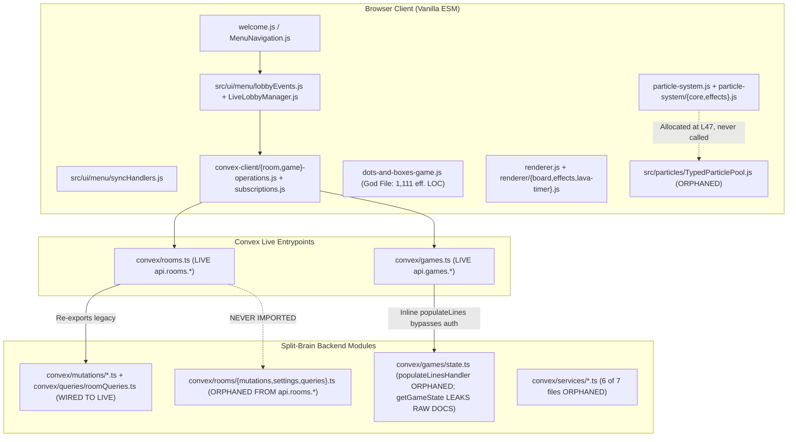

# Surgical Codebase Audit Report: ShapeKeeper

| Audit Metadata | Value |
| :--- | :--- |
| **Target Path** | `/home/leandi-duplessis/github/workspaces/ShapeKeeper` |
| **Primary Stack & Runtime** | Vanilla ES Modules (Frontend, Canvas 2D, Web Audio API) + Convex Realtime Backend (TypeScript) + Vitest / Playwright |
| **Total Audited Files / Effective LOC** | `226` code files (`115` implementation files / `13,130` effective LOC; `111` test files / `12,496` effective LOC; `25,626` total effective LOC) |
| **Test-to-Code File Ratio** | `111 / 115` (`0.965` / `96.5%`) |
| **Estimated Mutation Kill Rate ($M_{\text{kill}}\%$)** | `52.5%` (`21 / 40` mental mutants killed across 10 core subsystems; `P_test = 6.88`) |
| **Pre-Audit / Post-Audit Tree SHA-256** | `01b4dd4a192328b6` / `01b4dd4a192328b6` (`git rev-parse HEAD`: `c6545e9a3fff502a8a0f27710bc9fb60e06947b3` — Verified Zero Mutation) |
| **Composite Health Score ($S_{\text{health}}$)** | `78.0 / 100` ($D_{\text{raw}} = 15.08$, $P_{\text{test}} = 6.88$, $K_{\text{LOC}} = 13.13$) |
| **Vibe-Debt Classification** | **Critical Vibe-Debt Hazard (P0-Gated: 4 P0 Blockers; Formula Health: 78.0/100)** |

---

## 1. Executive Architecture & Vibe-Debt Triage

### 1.1 Architectural Topology & Subsystem Boundaries

`ShapeKeeper` is a browser-based 2D Canvas implementation of Dots and Boxes supporting local hot-seat, single-player AI/levels, and real-time online multiplayer backed by Convex. While the codebase appears well-tested on the surface (`111` test files for `115` implementation files), deep multi-pass inspection reveals classic **multi-agent "split-brain" vibe-debt**: multiple generations of AI-assisted refactors created hardened replacement modules alongside legacy modules, wired unit tests directly to the replacement modules (or to hand-rolled mocks), and **never connected the hardened modules to the live entrypoints**.



### 1.2 Top 5 Systemic Vibe-Debt Failure Modes

1. **Split-Brain Live API Wiring (`[P0-1]`, `[P0-2]`, `[P2-1]`):**
   - [`convex/rooms.ts`](file:///home/leandi-duplessis/github/workspaces/ShapeKeeper/convex/rooms.ts#L1-L36) re-exports legacy handlers from `convex/mutations/*.ts` and `convex/queries/roomQueries.ts`. The entire hardened room subsystem in [`convex/rooms/mutations.ts`](file:///home/leandi-duplessis/github/workspaces/ShapeKeeper/convex/rooms/mutations.ts#L1-L355), [`convex/rooms/settings.ts`](file:///home/leandi-duplessis/github/workspaces/ShapeKeeper/convex/rooms/settings.ts#L1-L132), and [`convex/rooms/queries.ts`](file:///home/leandi-duplessis/github/workspaces/ShapeKeeper/convex/rooms/queries.ts#L1-L82) (which implements silly `[Adjective][Animal]` passcodes, `LOBBY` code resolution, `lobbyName` filtering, 2-player limits, input validation, and `{ room, players }` response wrapping) is **completely dead in production**.
   - Consequently, live `api.rooms.createRoom` never generates a passcode; live `api.rooms.joinRoom` crashes with a Convex `ArgumentValidationError` when the client sends `lobbyName` or fails with `'Room not found'` when joining `'LOBBY'`; and live `api.rooms.getRoom` returns a flat object without `.room`, causing [`lobbyEvents.js`](file:///home/leandi-duplessis/github/workspaces/ShapeKeeper/src/ui/menu/lobbyEvents.js#L98) (`if (!roomState || !roomState.room) return;`) to silently drop every room subscription update.
2. **Broken Client-Server Security Boundary (`[P0-2]`, `[P0-4]`):**
   - While `roomQueries.ts` strips `sessionId`, `hostPlayerId`, `passcode`, and `hostTokenHash` via `projectRoomForClient` / `projectPlayersForClient`, [`getGameStateHandler`](file:///home/leandi-duplessis/github/workspaces/ShapeKeeper/convex/games/state.ts#L19-L46) returns raw, unprojected `room` and `players` documents to every subscriber, exposing every player's secret `sessionId` and `hostPlayerId`.
   - Furthermore, [`convex/games.ts`](file:///home/leandi-duplessis/github/workspaces/ShapeKeeper/convex/games.ts#L11) imports `populateLinesHandler` from `./games/state` and **never registers it**, running an inline legacy handler (`L100-L202`) that skips `isAuthorisedHostAsync`, rate limiting, and line-key validation.
3. **Cross-Module Schema Drift & `NaN` Coordinate Poisoning (`[P1-1]`, `[P1-2]`, `[P1-3]`, `[P1-4]`):**
   - Four distinct visual/gameplay subsystems suffer from producer-consumer schema mismatches that evaluate to `NaN` or `"[object Object]x"` at runtime:
     1. Clicking a completed multiplier square in local mode ([`dots-and-boxes-game.js`](file:///home/leandi-duplessis/github/workspaces/ShapeKeeper/dots-and-boxes-game.js#L449-L464)) multiplies `currentScore` by `{ type: 'multiplier', value: 0.2 }`, setting `this.scores[owner] = NaN`, while [`renderer/board.js`](file:///home/leandi-duplessis/github/workspaces/ShapeKeeper/renderer/board.js#L170-L185) renders `"[object Object]x"`.
     2. `updateSelectionRibbon` ([`input-handler/pointer-controls.js`](file:///home/leandi-duplessis/github/workspaces/ShapeKeeper/input-handler/pointer-controls.js#L164-L178)) writes `{ from, to }` dot indices, while `drawSelectionRibbon` ([`renderer/effects.js`](file:///home/leandi-duplessis/github/workspaces/ShapeKeeper/renderer/effects.js#L235-L259)) reads `{ targetX, targetY }` pixel coordinates (`NaN`).
     3. `handleAuthoritativeGameState` ([`src/ui/menu/syncHandlers.js`](file:///home/leandi-duplessis/github/workspaces/ShapeKeeper/src/ui/menu/syncHandlers.js#L190-L198)) pushes `{ row, col }` dots into `game.lineDrawings`, while `drawLineAnimations` ([`renderer/board.js`](file:///home/leandi-duplessis/github/workspaces/ShapeKeeper/renderer/board.js#L58-L82)) lerps `.x` and `.y` (`NaN`), making newly drawn multiplayer lines invisible for `180ms`.
     4. `createAmbientParticle` ([`particle-system/core.js`](file:///home/leandi-duplessis/github/workspaces/ShapeKeeper/particle-system/core.js#L4-L26)) initializes `{ x, y, vx, vy }`, while `drawAmbientParticles` ([`renderer/effects.js`](file:///home/leandi-duplessis/github/workspaces/ShapeKeeper/renderer/effects.js#L132-L184)) reads `{ baseX, baseY, speed, amplitude }` (`NaN`).
4. **Hardware & Frame-Budget Resource Exhaustion (`[P0-3]`, `[P1-12]`, `[P2-2]`, `[P2-3]`):**
   - `new SoundManager()` creates a hardware `AudioContext` on every `new DotsAndBoxesGame()` without closing it on `destroy()`, exhausting Chromium/WebKit's 6-context tab limit.
   - `WelcomeAnimation` continues running a full-screen 60Hz Canvas 2D loop in the background during active gameplay (`21,600` heap allocations/sec), while `DotsAndBoxesGame.animate()` registers every frame ID into `this.disposables.rafs` without ever deleting completed IDs.
   - `TypedParticlePool` (`src/particles/TypedParticlePool.js`) was built and unit-tested (`tests/particle-soa.test.js`), instantiated on `this.soaPool` in `particle-system.js:L47`, and **never called anywhere**.
5. **God-Object State Entanglement (`[P1-9]`, `[P1-10]`, `[P1-11]`, `[P1-12]`):**
   - [`dots-and-boxes-game.js`](file:///home/leandi-duplessis/github/workspaces/ShapeKeeper/dots-and-boxes-game.js#L1-L1339) (`1,111` effective LOC) couples two competing local turn-timer implementations (`this.localTurnTimer` and `this._localTurnClock`), mutates online `currentPlayerIndex` at 60Hz upon timer expiry, and omits `revealedMultipliers` from undo/redo snapshots.

### 1.3 Hotspot Risk Ranking Table (Top 25 Implementation Files)

Risk Score formula: $\text{RiskScore} = \text{LOC}_{\text{effective}} \times (1 + \text{BranchDensity}) + 50 \times N_{\text{silent\_catches}}$

| Rank | File Path | Effective LOC | Total Lines | Cyclomatic Branches | Silent Catches | Risk Score | Primary Audit Findings |
| :--- | :--- | :---: | :---: | :---: | :---: | :---: | :--- |
| 1 | [`dots-and-boxes-game.js`](file:///home/leandi-duplessis/github/workspaces/ShapeKeeper/dots-and-boxes-game.js) | 1,111 | 1,339 | 0* | 0 | **1,111.0** | `[P0-3]`, `[P1-1]`, `[P1-10]`, `[P1-11]`, `[P1-12]` |
| 2 | [`ui-manager/celebrations.js`](file:///home/leandi-duplessis/github/workspaces/ShapeKeeper/ui-manager/celebrations.js) | 402 | 468 | 25 | 0 | **426.0** | `[P0-4]` DOM XSS, `[P1-12]` stale turn indicator, `[P3-4]` leaked timers |
| 3 | [`src/ui/WelcomeAnimation.js`](file:///home/leandi-duplessis/github/workspaces/ShapeKeeper/src/ui/WelcomeAnimation.js) | 379 | 458 | 0* | 0 | **379.0** | `[P2-2]` dual RAF loop during game, 21.6k allocs/sec, O(N²) double draw |
| 4 | [`convex/games/state.ts`](file:///home/leandi-duplessis/github/workspaces/ShapeKeeper/convex/games/state.ts) | 348 | 418 | 17 | 0 | **364.0** | `[P0-2]` raw doc leak in `getGameState`, `[P1-5]` tap/reveal guard gaps |
| 5 | [`src/ui/MenuNavigation.js`](file:///home/leandi-duplessis/github/workspaces/ShapeKeeper/src/ui/MenuNavigation.js) | 346 | 440 | 16 | 0 | **361.0** | `[P2-2]` `WelcomeAnimation` kept running on `gameScreen` |
| 6 | [`renderer/effects.js`](file:///home/leandi-duplessis/github/workspaces/ShapeKeeper/renderer/effects.js) | 340 | 389 | 22 | 0 | **361.0** | `[P1-2]` `drawSelectionRibbon` `NaN`, `[P1-4]` `drawAmbientParticles` `NaN` |
| 7 | [`src/ui/menu/lobbyEvents.js`](file:///home/leandi-duplessis/github/workspaces/ShapeKeeper/src/ui/menu/lobbyEvents.js) | 323 | 396 | 21 | 0 | **343.0** | `[P0-1]` `!roomState.room` drop, `[P2-5]` shared debounce timer collision |
| 8 | [`local-save-replay.js`](file:///home/leandi-duplessis/github/workspaces/ShapeKeeper/local-save-replay.js) | 310 | 369 | 25 | 0 | **334.0** | `[P0-4]` unvalidated `player1Color`/`player2Color` strings |
| 9 | [`particle-system/effects.js`](file:///home/leandi-duplessis/github/workspaces/ShapeKeeper/particle-system/effects.js) | 311 | 347 | 0* | 0 | **311.0** | `[P2-3]` hardcoded `(400,300)` center & `20px` cell size across 16 effects |
| 10 | [`input-handler/pointer-controls.js`](file:///home/leandi-duplessis/github/workspaces/ShapeKeeper/input-handler/pointer-controls.js) | 290 | 342 | 20 | 0 | **309.0** | `[P1-2]` `selectionRibbon = { from, to }` schema mismatch |
| 11 | [`convex/rooms/mutations.ts`](file:///home/leandi-duplessis/github/workspaces/ShapeKeeper/convex/rooms/mutations.ts) | 298 | 355 | 10 | 0 | **307.0** | `[P0-1]` orphaned from `convex/rooms.ts`, `[P1-7]` host transfer token lockout |
| 12 | [`game-state.js`](file:///home/leandi-duplessis/github/workspaces/ShapeKeeper/game-state.js) | 298 | 365 | 0* | 0 | **298.0** | `[P1-11]` `setupCanvas()` clamps `cellSize = 20` when `#gameScreen` hidden |
| 13 | [`tutorial-system.js`](file:///home/leandi-duplessis/github/workspaces/ShapeKeeper/tutorial-system.js) | 279 | 343 | 0* | 0 | **279.0** | Untracked `setTimeout` callbacks on step transitions |
| 14 | [`src/ui/menu/syncHandlers.js`](file:///home/leandi-duplessis/github/workspaces/ShapeKeeper/src/ui/menu/syncHandlers.js) | 243 | 290 | 18 | 0 | **260.0** | `[P1-3]` `lineDrawings` `NaN` coords, `[P1-6]` rematch wipe order bug |
| 15 | [`src/a11y/AccessibleGridTree.js`](file:///home/leandi-duplessis/github/workspaces/ShapeKeeper/src/a11y/AccessibleGridTree.js) | 256 | 309 | 0* | 0 | **256.0** | `[P2-6]` missing ArrowKey handlers on focused cell buttons |
| 16 | [`src/ai/MinimaxEngine.js`](file:///home/leandi-duplessis/github/workspaces/ShapeKeeper/src/ai/MinimaxEngine.js) | 226 | 271 | 24 | 0 | **249.0** | `[P1-9]` leaf `evaluatePosition` sign inversion at odd search depths |
| 17 | [`achievement-system.js`](file:///home/leandi-duplessis/github/workspaces/ShapeKeeper/achievement-system.js) | 232 | 272 | 12 | 0 | **243.0** | Unvalidated `localStorage` parse shape, untracked toast timeouts |
| 18 | [`convex/games/draw.ts`](file:///home/leandi-duplessis/github/workspaces/ShapeKeeper/convex/games/draw.ts) | 206 | 245 | 16 | 0 | **221.0** | `[P1-8]` raw `args.lineKey` used after `validateLineKey`, timer leak |
| 19 | [`src/ui/menu/localSetupEvents.js`](file:///home/leandi-duplessis/github/workspaces/ShapeKeeper/src/ui/menu/localSetupEvents.js) | 196 | 240 | 20 | 0 | **215.0** | `[P1-11]` constructs `DotsAndBoxesGame` before `showScreen('gameScreen')` |
| 20 | [`sound-manager.js`](file:///home/leandi-duplessis/github/workspaces/ShapeKeeper/sound-manager.js) | 214 | 252 | 0* | 0 | **214.0** | `[P0-3]` hardware `AudioContext` leak + unreachable `ensureAudioContext()` |
| 21 | [`convex-client/room-operations.js`](file:///home/leandi-duplessis/github/workspaces/ShapeKeeper/convex-client/room-operations.js) | 196 | 235 | 19 | 0 | **214.0** | `[P0-1]` sends `lobbyName` & `'LOBBY'` to incompatible live `joinRoom` |
| 22 | [`input-handler.js`](file:///home/leandi-duplessis/github/workspaces/ShapeKeeper/input-handler.js) | 207 | 253 | 0* | 0 | **207.0** | Delegates to `pointer-controls.js` (`[P1-2]`) |
| 23 | [`convex-client/shared.js`](file:///home/leandi-duplessis/github/workspaces/ShapeKeeper/convex-client/shared.js) | 186 | 228 | 17 | 0 | **202.0** | Global singleton state shared across reconnects |
| 24 | [`ui-manager.js`](file:///home/leandi-duplessis/github/workspaces/ShapeKeeper/ui-manager.js) | 195 | 240 | 0* | 0 | **195.0** | `[P1-12]` `lastRenderedState` cache prevents turn indicator recovery |
| 25 | [`renderer/board.js`](file:///home/leandi-duplessis/github/workspaces/ShapeKeeper/renderer/board.js) | 178 | 210 | 10 | 0 | **187.0** | `[P1-1]` `"[object Object]x"` badge, `[P1-3]` `NaN` line lerp, `[P1-11]` double draw |

*\*Note: `preflight_telemetry.py` AST branch counting natively parses `.py`; JS/TS cyclomatic branch counts were computed for top hotspots and supplemented by manual multi-pass inspection across all 13 batches.*

---

## 2. The 10-Principal-Engineer Deep Audit

### Lens 1: Domain Logic, Edge-Case & State-Machine Invariants

#### `[P1-1]` Local Multiplier Square Click & Canvas Badge Multiply/Format Raw Object `{ type: 'multiplier', value: 0.2 }`, Corrupting Player Score to `NaN` and Rendering `"[object Object]x"`
- **Coordinates:** [`dots-and-boxes-game.js:L445-L490`](file:///home/leandi-duplessis/github/workspaces/ShapeKeeper/dots-and-boxes-game.js#L445-L490) (`handleCompletedSquareClick`), [`renderer/board.js:L170-L185`](file:///home/leandi-duplessis/github/workspaces/ShapeKeeper/renderer/board.js#L170-L185) (`drawSquaresWithAnimations`), and [`effect-system/init.js:L20-L23`](file:///home/leandi-duplessis/github/workspaces/ShapeKeeper/effect-system/init.js#L20-L23).
- **Root-Cause Mechanism:** `initializeMultipliers` ([`effect-system/init.js:L22`](file:///home/leandi-duplessis/github/workspaces/ShapeKeeper/effect-system/init.js#L22)) populates `game.squareMultipliers[key] = { type: 'multiplier', value: 0.2 }`, and `getSquareMultiplier` ([`effect-system/gameplay.js:L34-L39`](file:///home/leandi-duplessis/github/workspaces/ShapeKeeper/effect-system/gameplay.js#L34-L39)) returns that object directly. While `revealMultiplier` (`dots-and-boxes-game.js:L516-L517`) unwraps `typeof multiplier === 'object' ? multiplier.value : multiplier`, `handleCompletedSquareClick` (`dots-and-boxes-game.js:L449-L464`) assigns the raw object to `multiplierValue` and executes `const newScore = Math.max(0, Math.round(currentScore * multiplierValue));`. In JavaScript, `currentScore * { type: 'multiplier', value: 0.2 }` evaluates to `NaN`, and `Math.max(0, Math.round(NaN))` returns `NaN`. Simultaneously, `drawSquaresWithAnimations` (`renderer/board.js:L170-L176`) evaluates `multiplierValue < 1` (`false` for an object) and formats `` `${multiplierValue}x` `` as `"[object Object]x"`.
- **Runtime Failure Scenario:** In any local game where an unrevealed multiplier square is clicked via `InputHandler` -> `handleCompletedSquareClick(row, col)`, the square owner's score immediately becomes `NaN` in the HUD (`#player1Score` / `#player2Score`), and the canvas badge + floating text render literal `"[object Object]x"`.
- **Surgical Remediation Blueprint:** Unwrap `.value` in `handleCompletedSquareClick` and `drawSquaresWithAnimations` (or normalize `getSquareMultiplier` callers via a helper `getNumericMultiplier(raw)`), and unify the local vs. online multiplier scoring formula.

#### `[P1-6]` Order-Dependent Rematch Reset in `handleAuthoritativeGameState` Wipes Newly Applied Snapshot State & Leaks `revealedMultipliers`
- **Coordinates:** [`src/ui/menu/syncHandlers.js:L181-L289`](file:///home/leandi-duplessis/github/workspaces/ShapeKeeper/src/ui/menu/syncHandlers.js#L181-L289).
- **Root-Cause Mechanism:** `handleAuthoritativeGameState` first iterates over `gameState.lines` (`L181-L202`), `gameState.squares` (`L205-L238`), and `gameState.players` (`L241-L250`) to populate `game.lines`, `game.squares`, and `game.scores`. Only **after** mutating the board does it check `if (gameState.room?.status === 'playing' && game.gameOverHandled)` at `L271-L289` and execute `game.lines.clear()`, `game.squares = {}`, and `game.scores = { 1: 0, 2: 0 }`. Furthermore, `L274-L283` fails to clear `game.revealedMultipliers`, `game.pulsatingLines`, or `game.claimedCells`.
- **Runtime Failure Scenario:** When a rematch starts in online multiplayer (`status` transitions from `'finished'` back to `'playing'`), the first authoritative snapshot triggers the reset block **after** applying the snapshot's lines/squares/scores, wiping any initial lines or state included in that snapshot, while stale `game.revealedMultipliers` keys from the previous match persist into the new match.
- **Surgical Remediation Blueprint:** Move the `if (gameState.room?.status === 'playing' && game.gameOverHandled)` reset block to the top of `handleAuthoritativeGameState` (before `L181`) and clear `game.revealedMultipliers?.clear()`, `game.claimedCells?.clear()`, and `game.pulsatingLines = []`.

#### `[P1-8]` Unnormalized `args.lineKey` Used After Validation in `drawLineHandler` + Unarmed/Uncancelled Turn Timer in Expiry & GameOver Branches
- **Coordinates:** [`convex/games/draw.ts:L47-L81`](file:///home/leandi-duplessis/github/workspaces/ShapeKeeper/convex/games/draw.ts#L47-L81), [`L89-L194`](file:///home/leandi-duplessis/github/workspaces/ShapeKeeper/convex/games/draw.ts#L89-L194).
- **Root-Cause Mechanism:**
  1. At `L89`, `drawLineHandler` validates and normalizes the line key: `const validatedLineKey = validateLineKey(args.lineKey, room.gridSize);`. However, at `L125` (`by_room_and_key` lookup), `L139` (`ctx.db.insert('lines', { lineKey: args.lineKey })`), and `L154` (`checkForCompletedSquares(..., args.lineKey, ...)`), it uses the raw, unnormalized `args.lineKey` instead of `validatedLineKey`! Because `checkForCompletedSquares` ([`convex/games/squares.ts:L55-L60`](file:///home/leandi-duplessis/github/workspaces/ShapeKeeper/convex/games/squares.ts#L55-L60)) constructs canonical keys (`topRow,col-bottomRow,col` where `row1 <= row2` and `col1 <= col2`), a reverse-ordered `args.lineKey` (e.g. `'0,1-0,0'`) passes `validateLineKey` (which canonicalizes it to `'0,0-0,1'`), bypasses duplicate detection against `'0,0-0,1'`, inserts `'0,1-0,0'` into `lines`, and fails to complete squares!
  2. When a turn expires inline inside `drawLineHandler` (`L47-L81`), it patches `turnStartTime` and `turnEndTime` directly via `ctx.db.patch` without calling `armTurnTimer`, so no scheduled `internal.games.expireTurn` job is ever armed for the next player's turn.
- **Runtime Failure Scenario:** A client submitting non-canonical line keys (`'1,0-0,0'`) can draw duplicate lines on the same edge and break server-side square detection; if a player attempts a move just after their clock expires, the next player's turn never auto-expires on the server.
- **Surgical Remediation Blueprint:** Replace all post-validation occurrences of `args.lineKey` at `L125`, `L139`, and `L154` with `validatedLineKey`, and delegate the inline turn-expiry transition at `L56-L75` to `armTurnTimer(ctx, args.roomId, room, now, ...)`.

#### `[P1-9]` Minimax AI Sign Inversion at Odd Search Depths (`depth = 3`) & Ignored `_sacEval` Double-Cross Evaluation
- **Coordinates:** [`src/ai/MinimaxEngine.js:L61-L83`](file:///home/leandi-duplessis/github/workspaces/ShapeKeeper/src/ai/MinimaxEngine.js#L61-L83), [`L241-L255`](file:///home/leandi-duplessis/github/workspaces/ShapeKeeper/src/ai/MinimaxEngine.js#L241-L255), and [`src/ai/ChainAnalysis.js:L103-L165`](file:///home/leandi-duplessis/github/workspaces/ShapeKeeper/src/ai/ChainAnalysis.js#L103-L165).
- **Root-Cause Mechanism:**
  1. In [`MinimaxEngine.js:L61-L83`](file:///home/leandi-duplessis/github/workspaces/ShapeKeeper/src/ai/MinimaxEngine.js#L61-L83), `evaluatePosition(gridRows, gridCols, lines, aiBoxes, opponentBoxes)` is called at `depth === 0` (`L121`) without passing `isMaximizing` (whose turn it is at the leaf). At `L73-L75`, it unconditionally adds `if (d === 3) score += 10;`. When `DotsAndBoxesGame.chooseHardAIMove` ([`dots-and-boxes-game.js:L644`](file:///home/leandi-duplessis/github/workspaces/ShapeKeeper/dots-and-boxes-game.js#L644)) invokes `findOptimalMinimaxMove` with `depth = 3` (whenever `15 <= availableLines.length <= 22`), any sequence of 3 non-capturing moves reaches `depth === 0` with `isMaximizing === false` (the human opponent's turn to move!). Adding `+10` for `degree === 3` cells when `isMaximizing === false` **rewards the AI for handing free 3-sided boxes to the human opponent**.
  2. At `MinimaxEngine.js:L248`, `const _sacEval = evaluateChainSacrifice(longestChain);` is computed and completely ignored (`L254` unconditionally returns `capturableChains[0].closingMove`).
  3. In `ChainAnalysis.js:L103`, `let isLoop = false;` is never updated, so `type: isLoop ? 'loop' : 'chain'` at `L161` is dead code that always evaluates to `'chain'`.
- **Runtime Failure Scenario:** In the midgame (`15–22` remaining lines), the Hard AI (`depth = 3`) actively prefers moves that leave `degree === 3` squares for the human player at leaf nodes, and never executes a double-cross sacrifice on long chains.
- **Surgical Remediation Blueprint:** Pass `isMaximizing` into `evaluatePosition` so `d === 3` adds `+10` when `isMaximizing === true` and `-10` when `isMaximizing === false`; wire `_sacEval.shouldDoubleCross` into `findOptimalMinimaxMove` when `unclaimedNonChainEdges > 0`; and detect cycle closure in `ChainAnalysis.js` when both endpoints of a seed cell's missing edges reach the same component.

---

### Lens 2: Concurrency, Async Lifecycle & Memory/Resource Leaks

#### `[P0-3]` Hardware `AudioContext` Exhaustion Leak Across Match Restarts & Unreachable `ensureAudioContext()` Dead Code
- **Coordinates:** [`sound-manager.js:L11-L47`](file:///home/leandi-duplessis/github/workspaces/ShapeKeeper/sound-manager.js#L11-L47) and [`dots-and-boxes-game.js:L80`](file:///home/leandi-duplessis/github/workspaces/ShapeKeeper/dots-and-boxes-game.js#L80), [`L1327-L1337`](file:///home/leandi-duplessis/github/workspaces/ShapeKeeper/dots-and-boxes-game.js#L1327-L1337).
- **Root-Cause Mechanism:**
  1. Every `new DotsAndBoxesGame()` constructs `this.soundManager = new SoundManager()` (`dots-and-boxes-game.js:L80`), which immediately executes `this.ctx = new AudioContext()` (`sound-manager.js:L26`). Neither `SoundManager` nor `DotsAndBoxesGame.prototype.destroy()` (`L1327-L1337`) ever calls `this.ctx.close()`. Browsers enforce a strict hardware limit (typically 6 concurrent `AudioContext` instances per tab in Chromium/WebKit).
  2. In `SoundManager.prototype.ensureAudioContext()` (`sound-manager.js:L37-L47`):
     ```javascript
     ensureAudioContext() {
         if (!this.ctx || this.initialized) return;
         // Lines 40-46: completely unreachable!
     ```
     In `initAudioContext()` (`L25-L34`), `this.ctx = new AudioContext()` is immediately followed by `this.initialized = true;`. Therefore, either `this.ctx` is `null` (`!this.ctx` is `true` -> returns early) or `this.ctx` is non-null (`this.initialized` is `true` -> returns early). Lines `40–46` are 100% unreachable dead code, and `this.ctx.resume()` is never called when `this.ctx.state === 'suspended'`!
- **Runtime Failure Scenario:** Playing 6 consecutive matches or levels in a single browser session leaks 6 hardware `AudioContext` instances; on the 7th match, `new AudioContext()` throws a `DOMException` and all game audio permanently dies for the rest of the session. Furthermore, on browsers that start `AudioContext` in `'suspended'` state before the first user gesture, `ensureAudioContext()` never resumes the context.
- **Surgical Remediation Blueprint:** Fix `ensureAudioContext()` to lazily construct `this.ctx` when `!this.ctx` and call `if (this.ctx && this.ctx.state === 'suspended') { this.ctx.resume().catch(() => {}); }`; add a `destroy()` method on `SoundManager` that closes `this.ctx`; and invoke `this.soundManager?.destroy()` inside `DotsAndBoxesGame.prototype.destroy()`.

#### `[P1-5]` Real-Time Opponent-Tap Updates Dropped by `stateHasChanged` + Missing Server Guards in `tapSquareHandler` & `revealMultiplierHandler`
- **Coordinates:** [`convex-client/subscriptions.js:L10-L40`](file:///home/leandi-duplessis/github/workspaces/ShapeKeeper/convex-client/subscriptions.js#L10-L40) and [`convex/games/state.ts:L48-L131`](file:///home/leandi-duplessis/github/workspaces/ShapeKeeper/convex/games/state.ts#L48-L131), [`L148-L214`](file:///home/leandi-duplessis/github/workspaces/ShapeKeeper/convex/games/state.ts#L148-L214).
- **Root-Cause Mechanism:**
  1. When a player taps an opponent's completed square via `tapSquareHandler` (`convex/games/state.ts:L194-L197`), the server patches only the `squares` document (`taps: newTaps`, `effectiveMultiplier`) without patching `room.updatedAt`. On the client, `stateHasChanged(prev, next)` (`convex-client/subscriptions.js:L10-L40`) compares only `room.currentPlayerIndex`, `room.status`, `room.updatedAt`, `lines.length`, `squares.length`, `players.length`, and `players[i].score`. Because none of those change when a square is tapped, `stateHasChanged` returns `false` and **drops every real-time opponent-tap update**!
  2. `tapSquareHandler` (`convex/games/state.ts:L168-L197`) contradicts its own JSDoc (`L143`: *"square is missing, has no multiplier, or multiplier is already revealed"*) by never checking `if (square.multiplierRevealed)` and never verifying that `args.sessionId` is actually a player in `args.roomId`.
  3. `revealMultiplierHandler` (`convex/games/state.ts:L48-L131`) never checks `if (room.status !== 'playing')`, allowing players to reveal multipliers and mutate scores after the match has already finished.
- **Runtime Failure Scenario:** In online multiplayer, when Player B taps Player A's completed square to collapse its multiplier to `0.5x`, Player A's client receives the Convex subscription push and silently discards it in `stateHasChanged`. Additionally, any third-party `sessionId` can tap already-revealed squares, and players can mutate scores post-game.
- **Surgical Remediation Blueprint:** Patch `room.updatedAt` in `tapSquareHandler`, compare square `taps`/`multiplierRevealed` in `stateHasChanged`, enforce `if (square.multiplierRevealed)` and room membership in `tapSquareHandler`, and enforce `room.status === 'playing'` in `revealMultiplierHandler`.

#### `[P1-10]` Split-Brain Dual Local Turn Timer (`localTurnTimer` vs `_localTurnClock`) + 60Hz Online Expiry `currentPlayerIndex` Ping-Pong
- **Coordinates:** [`dots-and-boxes-game.js:L1080-L1282`](file:///home/leandi-duplessis/github/workspaces/ShapeKeeper/dots-and-boxes-game.js#L1080-L1282).
- **Root-Cause Mechanism:**
  1. `DotsAndBoxesGame` runs two competing local timer mechanisms inside `animate()`: `this.localTurnTimer` (`src/timing/local-turn-timer.js`, initialized at `L139`) and `this._localTurnClock` (`L1217-L1223`). In `tickTurnTimer()` (`L1122-L1142`), `if (this.shouldRunLocalTurnClock())` (`L1225-L1232`: `return !this.isMultiplayer && this.localMode === 'human' && this._localTurnClock.durationMs > 0`) runs first and returns early at `L1125`! This completely bypasses `this.localTurnTimer` in human hot-seat mode, making `this.maybeAnnounceTimeLow(remaining)` (`L1133`) dead code for human matches. Worse, if `FEATURE_FLAGS.FEATURE_LAVA_TIMER` is `false`, `tickLocalTurnClock()` (`L1269-L1282`) counts down to `0` and calls `this.handleTurnExpiration()`, which immediately exits at `L1236` (`if (!FEATURE_FLAGS.FEATURE_LAVA_TIMER) return;`), leaving the clock frozen at `0.0s` forever without passing the turn!
  2. In online mode (`L1238-L1256`), `handleTurnExpiration()` is called by `animate()` (`L1085`) on every frame where `this.turnRemainingMs <= 0`. It executes `this.gameState.room.currentPlayerIndex = (this.gameState.room.currentPlayerIndex + 1) % 2` without resetting `this.turnRemainingMs` or marking the current `turnEndTime` as expired, causing `currentPlayerIndex` and `this.currentPlayer` to flip back and forth between Player 1 and Player 2 at **60Hz** until the server's `expireTurn` snapshot arrives!
- **Runtime Failure Scenario:** Whenever an online turn clock hits `0.0s` before the server snapshot arrives (e.g., 100ms network RTT), the client's turn indicator and `currentPlayer` rapidly strobe between Player 1 and Player 2 on every animation frame.
- **Surgical Remediation Blueprint:** Consolidate local turn timing onto `this.localTurnTimer` (removing duplicate `this._localTurnClock`), and guard online `handleTurnExpiration()` with a per-deadline `this._lastExpiredTurnKey = this.turnClock.getTurnKey()` check so optimistic turn advance fires at most once per server `turnEndTime`.

#### `[P1-12]` `UIManager.prototype.updateUI()` Cache Stale-State Bug Freezes Celebration Banner Text/Color + Unbounded `DisposableRegistry.rafs` Set Growth + Missing `revealedMultipliers` in Undo/Redo Snapshots
- **Coordinates:** [`ui-manager.js:L57-L143`](file:///home/leandi-duplessis/github/workspaces/ShapeKeeper/ui-manager.js#L57-L143), [`ui-manager/celebrations.js:L20-L126`](file:///home/leandi-duplessis/github/workspaces/ShapeKeeper/ui-manager/celebrations.js#L20-L126), [`src/lifecycle/DisposableRegistry.js:L35-L42`](file:///home/leandi-duplessis/github/workspaces/ShapeKeeper/src/lifecycle/DisposableRegistry.js#L35-L42), and [`dots-and-boxes-game.js:L810-L858`](file:///home/leandi-duplessis/github/workspaces/ShapeKeeper/dots-and-boxes-game.js#L810-L858), [`L1090-L1091`](file:///home/leandi-duplessis/github/workspaces/ShapeKeeper/dots-and-boxes-game.js#L1090-L1091).
- **Root-Cause Mechanism:**
  1. `showMultiplierActivation`, `showPowerupFeedback`, and `showComboFlash` in `ui-manager/celebrations.js` directly overwrite `turnIndicator.textContent` and `turnIndicator.style.color`, then schedule `setTimeout(() => refreshUI(), 1500)`. When `updateUI()` (`ui-manager.js:L57-L143`) runs, it compares the computed `turnText` and `turnColor` against `this.lastRenderedState.turnText` and `this.lastRenderedState.turnColor` (`L103-L110`). Because completing a square or triggering a bonus turn **keeps the same `currentPlayer`**, `this.lastRenderedState.turnText === turnText` is `true`, so `updateUI()` skips updating the DOM! The celebration banner text (e.g., `"⚡ BONUS TURN!"` or `"🔥 2x COMBO!"`) remains permanently stuck in `#turnIndicator` until the turn eventually changes to the other player.
  2. `dots-and-boxes-game.js:L1090-L1091` executes `const rafId = requestAnimationFrame(() => this.animate()); this.disposables.addRAF(rafId);` on every frame (`60–120Hz`). `DisposableRegistry.addRAF` (`src/lifecycle/DisposableRegistry.js:L35-L42`) adds every `rafId` to `this.rafs` (`Set`) and never removes completed frame IDs, growing unboundedly by `3,600–7,200` integers per minute.
  3. `captureMoveSnapshot` and `restoreMoveSnapshot` (`dots-and-boxes-game.js:L810-L858`) omit `this.revealedMultipliers`, so undoing a move that revealed a multiplier leaves the multiplier permanently marked as revealed.
- **Runtime Failure Scenario:** Completing a square with a combo or multiplier permanently freezes the turn indicator text/color for the duration of the player's streak; undoing a multiplier-revealing move corrupts multiplier state; and long matches accumulate tens of thousands of stale RAF IDs in `this.disposables.rafs`.
- **Surgical Remediation Blueprint:** Compare against `turnIndicator.textContent !== turnText || turnIndicator.style.color !== turnColor` (or invalidate `this.lastRenderedState.turnText = null` in `celebrations.js`), track only the single active `rafId` in `DotsAndBoxesGame`, and clone/restore `revealedMultipliers: Array.from(this.revealedMultipliers)` in `captureMoveSnapshot` / `restoreMoveSnapshot`.

#### `[P2-5]` Shared `playerUpdateDebounceTimer` Race Between `#playerName` and `#playerColor`
- **Coordinates:** [`src/ui/menu/lobbyEvents.js:L160`](file:///home/leandi-duplessis/github/workspaces/ShapeKeeper/src/ui/menu/lobbyEvents.js#L160), [`L349-L376`](file:///home/leandi-duplessis/github/workspaces/ShapeKeeper/src/ui/menu/lobbyEvents.js#L349-L376).
- **Root-Cause Mechanism:** Both the `#playerName` `input` listener (`L349-L361`) and the `#playerColor` `change` listener (`L364-L376`) call `clearTimeout(playerUpdateDebounceTimer)` on the same shared timer variable.
- **Runtime Failure Scenario:** If a player edits their name in the lobby and clicks a color swatch within `250ms`, the color change cancels the pending `updatePlayerName` mutation, silently losing the name change on the server.
- **Surgical Remediation Blueprint:** Separate `playerNameDebounceTimer` and `playerColorDebounceTimer` (or flush both pending fields in a single combined `updatePlayer` call).

---

### Lens 3: Data Layer, Persistence, Serialization & Migration Fidelity

#### `[P1-7]` Host Transfer in `leaveRoomHandler` Leaves Old `hostTokenHash` Intact (Locking Out Promoted Host) & Live `leaveRoom` Orphans Game Rows on Room Deletion
- **Coordinates:** [`convex/rooms/mutations.ts:L211-L220`](file:///home/leandi-duplessis/github/workspaces/ShapeKeeper/convex/rooms/mutations.ts#L211-L220), [`L253-L263`](file:///home/leandi-duplessis/github/workspaces/ShapeKeeper/convex/rooms/mutations.ts#L253-L263), [`convex/mutations/leaveRoom.ts:L29-L32`](file:///home/leandi-duplessis/github/workspaces/ShapeKeeper/convex/mutations/leaveRoom.ts#L29-L32), and [`convex/auth/token.js:L93-L109`](file:///home/leandi-duplessis/github/workspaces/ShapeKeeper/convex/auth/token.js#L93-L109).
- **Root-Cause Mechanism:**
  1. In [`convex/rooms/mutations.ts:L213-L219`](file:///home/leandi-duplessis/github/workspaces/ShapeKeeper/convex/rooms/mutations.ts#L213-L219) and [`L255-L261`](file:///home/leandi-duplessis/github/workspaces/ShapeKeeper/convex/rooms/mutations.ts#L255-L261), when the host leaves a room and host status transfers to `newHost = remainingPlayers[0]`, the handler patches `hostPlayerId: newHost.sessionId` **without** clearing `hostTokenHash: undefined`. Because `isAuthorisedHost` ([`convex/auth/token.js:L100-L106`](file:///home/leandi-duplessis/github/workspaces/ShapeKeeper/convex/auth/token.js#L100-L106)) enforces `if (room.hostTokenHash) { return hashHostToken(hostToken) === room.hostTokenHash; }`, and the promoted guest does not possess the original host's secret `hostToken`, every subsequent host action by the promoted host (`startGame`, `updateGridSize`, `updateTurnDuration`, `endGame`, `resetGame`) fails with `'Unauthorized'`.
  2. Conversely, in the legacy live [`convex/mutations/leaveRoom.ts:L29-L32`](file:///home/leandi-duplessis/github/workspaces/ShapeKeeper/convex/mutations/leaveRoom.ts#L29-L32), when the last player leaves (`remainingPlayers.length === 0`), it calls `await ctx.db.delete(args.roomId)` without calling `deleteRoomCascade` (orphaning all `lines`, `squares`, `triangles`, and `multipliers` rows for that room in Convex storage), and when `room.status === 'playing'` (`L20-L23`), it marks the leaving host `isConnected: false` without transferring host ownership at all!
- **Runtime Failure Scenario:** If a host disconnects or leaves a room, either the promoted host is permanently locked out of starting/managing the room (`convex/rooms/mutations.ts`) or the room's child documents leak forever in the database (`convex/mutations/leaveRoom.ts`).
- **Surgical Remediation Blueprint:** Clear `hostTokenHash: undefined` during host transfer in `convex/rooms/mutations.ts:L215` and `L257`, and wire `convex/rooms.ts` to `convex/rooms/mutations.ts` so `deleteRoomCascade` always executes.

#### `[P3-2]` Unbounded `rateLimits` Table Growth Without Expiration Cleanup
- **Coordinates:** [`convex/rateLimit.js:L58-L120`](file:///home/leandi-duplessis/github/workspaces/ShapeKeeper/convex/rateLimit.js#L58-L120) and [`convex/schema.ts:L106-L111`](file:///home/leandi-duplessis/github/workspaces/ShapeKeeper/convex/schema.ts#L106-L111).
- **Root-Cause Mechanism:** Every new `sessionId` (generated per tab via `sessionStorage`) inserts rows into `rateLimits` (`action:sessionId`). `sweepStaleLobbies` never prunes expired `rateLimits` rows.
- **Runtime Failure Scenario:** Over months of public traffic, the `rateLimits` table grows without bound.
- **Surgical Remediation Blueprint:** Add a cleanup pass in `convex/crons.ts` / `sweepStaleLobbies.ts` that deletes `rateLimits` rows whose `windowStart + windowMs < now`.

---

### Lens 4: API Contracts, Interface Boundaries & Schema Drift

#### `[P0-1]` Split-Brain Live `convex/rooms.ts` Re-exports Legacy Unhardened `convex/mutations/*.ts` & `convex/queries/roomQueries.ts` Instead of `convex/rooms/{mutations,settings,queries}.ts`
- **Coordinates:** [`convex/rooms.ts:L1-L36`](file:///home/leandi-duplessis/github/workspaces/ShapeKeeper/convex/rooms.ts#L1-L36), [`convex/mutations/createRoom.ts:L7-L69`](file:///home/leandi-duplessis/github/workspaces/ShapeKeeper/convex/mutations/createRoom.ts#L7-L69), [`convex/mutations/joinRoom.ts:L6-L67`](file:///home/leandi-duplessis/github/workspaces/ShapeKeeper/convex/mutations/joinRoom.ts#L6-L67), [`convex/queries/roomQueries.ts:L5-L54`](file:///home/leandi-duplessis/github/workspaces/ShapeKeeper/convex/queries/roomQueries.ts#L5-L54) vs. [`convex/rooms/mutations.ts:L1-L355`](file:///home/leandi-duplessis/github/workspaces/ShapeKeeper/convex/rooms/mutations.ts#L1-L355), [`convex/rooms/settings.ts:L1-L132`](file:///home/leandi-duplessis/github/workspaces/ShapeKeeper/convex/rooms/settings.ts#L1-L132), [`convex/rooms/queries.ts:L1-L82`](file:///home/leandi-duplessis/github/workspaces/ShapeKeeper/convex/rooms/queries.ts#L1-L82), [`convex-client/room-operations.js:L42-L60`](file:///home/leandi-duplessis/github/workspaces/ShapeKeeper/convex-client/room-operations.js#L42-L60), and [`src/ui/menu/lobbyEvents.js:L97-L119`](file:///home/leandi-duplessis/github/workspaces/ShapeKeeper/src/ui/menu/lobbyEvents.js#L97-L119).
- **Root-Cause Mechanism:**
  1. `convex/rooms.ts` (the live Convex module backing `api.rooms.*`) re-exports from `./mutations/*` and `./queries/roomQueries`, completely ignoring `./rooms/mutations`, `./rooms/settings`, and `./rooms/queries`.
  2. **Broken Passcode Invariant:** Live `convex/mutations/createRoom.ts` never calls `generateSillyPasscode()`, never writes `passcode` to the `rooms` table, and never returns `passcode` to the host.
  3. **Broken `joinRoom` Contract:** [`convex-client/room-operations.js:L42-L58`](file:///home/leandi-duplessis/github/workspaces/ShapeKeeper/convex-client/room-operations.js#L42-L58) defaults `roomCode` to `'LOBBY'` and adds `payload.lobbyName = normalizedLobbyName`. Live [`convex/mutations/joinRoom.ts:L7-L12`](file:///home/leandi-duplessis/github/workspaces/ShapeKeeper/convex/mutations/joinRoom.ts#L7-L12) does **not** declare `lobbyName: v.optional(v.string())` in its `args` validator (throwing a Convex `ArgumentValidationError` whenever `lobbyName` is provided) and does **not** handle `roomCode === 'LOBBY'` (querying `by_code` for literal `'LOBBY'` and returning `{ error: 'Room not found' }`).
  4. **Broken `getRoom` Subscription Contract:** Live [`convex/queries/roomQueries.ts:L5-L14`](file:///home/leandi-duplessis/github/workspaces/ShapeKeeper/convex/queries/roomQueries.ts#L5-L14) returns a flat object `{ ...projectedRoom, rematchVoteCount, players }` with no `.room` wrapper, whereas [`src/ui/menu/lobbyEvents.js:L98`](file:///home/leandi-duplessis/github/workspaces/ShapeKeeper/src/ui/menu/lobbyEvents.js#L98) checks `if (!roomState || !roomState.room) return;`, silently dropping every live room subscription update!
- **Runtime Failure Scenario:** In a live Convex deployment, creating a lobby produces no passcode; joining a lobby by name throws a validator error or returns `'Room not found'`; and the `subscribeToRoom` listener in `lobbyEvents.js` exits early on every update because `roomState.room` is `undefined`.
- **Surgical Remediation Blueprint:** Rewire [`convex/rooms.ts`](file:///home/leandi-duplessis/github/workspaces/ShapeKeeper/convex/rooms.ts) to wrap and export the hardened handlers from `./rooms/mutations`, `./rooms/settings`, and `./rooms/queries`; normalize `getRoom` / `getRoomByCode` consumers (`handleRoomStateUpdate` in `syncHandlers.js` and `lobbyEvents.js`) so both accept the canonical `{ room, players }` (or normalized) payload; and delete the duplicate `convex/mutations/*.ts` and `convex/queries/roomQueries.ts` files.

#### `[P1-2]` `NaN` Coordinate Poisoning Breaks `drawSelectionRibbon` Completely
- **Coordinates:** [`input-handler/pointer-controls.js:L164-L178`](file:///home/leandi-duplessis/github/workspaces/ShapeKeeper/input-handler/pointer-controls.js#L164-L178) vs. [`renderer/effects.js:L235-L259`](file:///home/leandi-duplessis/github/workspaces/ShapeKeeper/renderer/effects.js#L235-L259).
- **Root-Cause Mechanism:** `updateSelectionRibbon(handler)` in `input-handler/pointer-controls.js:L169-L172` sets:
  ```javascript
  handler.selectionRibbon = {
      from: handler.game.selectedDot,
      to: handler.hoveredDot,
  };
  handler.game.selectionRibbon = handler.selectionRibbon;
  ```
  where `from` and `to` are `{ row, col }` grid coordinates. However, `drawSelectionRibbon(game)` in `renderer/effects.js:L239-L250` destructures `const { targetX, targetY } = game.selectionRibbon;` (`undefined`, `undefined`) and computes `midX = (startX + targetX) / 2` (`NaN`), passing `NaN` and `undefined` to `ctx.quadraticCurveTo(midX, midY, targetX, targetY)`.
- **Runtime Failure Scenario:** Whenever a player selects a dot and hovers over an adjacent dot, the selection ribbon never renders on the canvas because `targetX` and `targetY` are `undefined` (`NaN`).
- **Surgical Remediation Blueprint:** Compute pixel coordinates `targetX: handler.game.offsetX + handler.hoveredDot.col * handler.game.cellSize` and `targetY: handler.game.offsetY + handler.hoveredDot.row * handler.game.cellSize` in `updateSelectionRibbon` (or derive `targetX`/`targetY` from `to.row`/`to.col` inside `drawSelectionRibbon`).

#### `[P1-3]` `NaN` Coordinate Poisoning in `handleAuthoritativeGameState` Makes Newly Drawn Online Lines Invisible During Animation
- **Coordinates:** [`src/ui/menu/syncHandlers.js:L190-L198`](file:///home/leandi-duplessis/github/workspaces/ShapeKeeper/src/ui/menu/syncHandlers.js#L190-L198) vs. [`renderer/board.js:L13-L15`](file:///home/leandi-duplessis/github/workspaces/ShapeKeeper/renderer/board.js#L13-L15), [`L58-L82`](file:///home/leandi-duplessis/github/workspaces/ShapeKeeper/renderer/board.js#L58-L82) and [`animation-system.js:L188-L204`](file:///home/leandi-duplessis/github/workspaces/ShapeKeeper/animation-system.js#L188-L204).
- **Root-Cause Mechanism:** When a new line arrives from the server in `handleAuthoritativeGameState` (`syncHandlers.js:L190-L198`), it parses `[dot1, dot2] = game.parseLineKey(line.lineKey)` (which returns `{ row, col }` objects) and pushes `{ startDot: dot1, endDot: dot2, progress: 0, player: lineOwner }` directly into `game.lineDrawings` instead of calling `game.animationSystem.addLineDrawing(dot1, dot2, lineOwner)` (which converts `row, col` into pixel `{ x, y, row, col }`). During the `180ms` animation window, `drawLines` (`renderer/board.js:L13-L23`) skips static rendering of the line because its key is in `lineDrawingKeys`, while `drawLineAnimations` (`renderer/board.js:L65-L66`) computes `lerp(animation.startDot.x, animation.endDot.x, easeProgress)` = `lerp(undefined, undefined, ...)` = `NaN`!
- **Runtime Failure Scenario:** Every opponent line drawn in online multiplayer is completely invisible for the first `180ms` instead of animating smoothly across the dots, and no `animateLineDraw` RAF loop is started if one isn't already running.
- **Surgical Remediation Blueprint:** Replace `game.lineDrawings.push(...)` in `src/ui/menu/syncHandlers.js:L191-L196` with `game.animationSystem?.addLineDrawing(dot1, dot2, lineOwner)`.

#### `[P1-4]` `NaN` Coordinate Poisoning in `drawAmbientParticles` Due to Incompatible `ambientParticles` Schemas
- **Coordinates:** [`particle-system/core.js:L4-L26`](file:///home/leandi-duplessis/github/workspaces/ShapeKeeper/particle-system/core.js#L4-L26) vs. [`renderer/effects.js:L132-L184`](file:///home/leandi-duplessis/github/workspaces/ShapeKeeper/renderer/effects.js#L132-L184).
- **Root-Cause Mechanism:** `DotsAndBoxesGame` constructor (`L77`, `L118`) calls `this.particleSystem.initializeAmbientParticles()`, which populates `game.ambientParticles` with 30 objects shaped `{ x, y, vx, vy, size, opacity, phase }`. When `drawAmbientParticles(game)` (`renderer/effects.js:L132-L184`) executes on every frame, `game.ambientParticles.length` is `30` (skipping `L135-L148`), and `L155-L160` computes:
  ```javascript
  const x = particle.baseX + Math.sin(now * particle.speed + particle.phase) * particle.amplitude;
  ```
  Because `baseX`, `baseY`, `speed`, and `amplitude` are `undefined` on particles created by `particle-system/core.js`, `x` and `y` evaluate to `NaN`, and `ctx.arc(NaN, NaN, particle.size, 0, Math.PI * 2)` silently draws nothing!
- **Runtime Failure Scenario:** Ambient background particles on the game canvas are 100% invisible in every game mode despite being updated and iterated on every animation frame.
- **Surgical Remediation Blueprint:** Render `particle.x` and `particle.y` (updated by `particleSystem.updateAmbientParticles()`) directly in `renderer/effects.js:L155-L160`, or unify the ambient particle schema between `particle-system/core.js` and `renderer/effects.js`.

---

### Lens 5: Security, AuthN/AuthZ, Secret Hygiene & Injection Surfaces

#### `[P0-2]` Raw `room` and `players` Documents Leaked by `getGameState` (`sessionId`, `hostPlayerId`, `passcode`, `hostTokenHash`) + Unauthenticated Inline `populateLines` Handler Bypass
- **Coordinates:** [`convex/games/state.ts:L19-L46`](file:///home/leandi-duplessis/github/workspaces/ShapeKeeper/convex/games/state.ts#L19-L46) (`getGameStateHandler`), [`convex/games.ts:L11`](file:///home/leandi-duplessis/github/workspaces/ShapeKeeper/convex/games.ts#L11), and [`convex/games.ts:L100-L202`](file:///home/leandi-duplessis/github/workspaces/ShapeKeeper/convex/games.ts#L100-L202) (`populateLines`).
- **Root-Cause Mechanism:**
  1. In [`convex/games/state.ts:L19-L46`](file:///home/leandi-duplessis/github/workspaces/ShapeKeeper/convex/games/state.ts#L19-L46), `getGameStateHandler` returns the unprojected `room` document (`L40`: including `hostPlayerId`, `hostTokenHash`, `passcode`, `rematchVotes`) and raw `players` rows (`L43`: including every player's secret `sessionId`) to every subscribed client. Because all gameplay mutations (`drawLine`, `revealMultiplier`, `tapSquare`, `leaveRoom`, `requestRematch`) authenticate callers solely by comparing `args.sessionId` against `player.sessionId`, any player (or spectator with the `roomId`) who reads the `getGameState` WebSocket payload can impersonate their opponent's `sessionId` and play moves on their opponent's turn, force-forfeit them via `leaveRoom`, or vote for rematch on their behalf!
  2. In [`convex/games.ts:L11`](file:///home/leandi-duplessis/github/workspaces/ShapeKeeper/convex/games.ts#L11), `populateLinesHandler` is imported from `./games/state` (`which checks checkRateLimit`, `isAuthorisedHostAsync(room, args.sessionId, args.hostToken)`, `MAX_POPULATE_LINES`, and `validateLineKey`), **but is never used**. Instead, `convex/games.ts:L100-L202` defines a legacy inline `handler` that checks only `if (room.hostPlayerId !== args.sessionId)` (which is leaked by `getGameState`!), ignores `hostToken`, skips `checkRateLimit`, skips `MAX_POPULATE_LINES`, and skips `validateLineKey`.
- **Runtime Failure Scenario:** Any participant in an online game can inspect the `getGameState` subscription payload in DevTools, copy `room.hostPlayerId` and their opponent's `sessionId`, and invoke `api.games.populateLines` (without a `hostToken`) or `api.games.drawLine` as their opponent to hijack the match.
- **Surgical Remediation Blueprint:** Project `room` and `players` in `getGameStateHandler` using `projectRoomForClient(room, args.sessionId)` and `projectPlayersForClient(players, args.sessionId, room.hostPlayerId)` (adding `sessionId: v.optional(v.string())` to `getGameState` args), and replace the 95-line inline `populateLines` handler in `convex/games.ts:L107-L201` with `handler: populateLinesHandler`.

#### `[P0-4]` Stored/Config DOM XSS via Unsanitized `player1Color` / `player2Color` Interpolated into `scoresEl.innerHTML`
- **Coordinates:** [`ui-manager/celebrations.js:L359-L370`](file:///home/leandi-duplessis/github/workspaces/ShapeKeeper/ui-manager/celebrations.js#L359-L370), [`local-save-replay.js:L154-L161`](file:///home/leandi-duplessis/github/workspaces/ShapeKeeper/local-save-replay.js#L154-L161), and [`convex/mutations/updatePlayer.ts:L23-L26`](file:///home/leandi-duplessis/github/workspaces/ShapeKeeper/convex/mutations/updatePlayer.ts#L23-L26).
- **Root-Cause Mechanism:**
  1. `normalizeConfig` in [`local-save-replay.js:L155-L156`](file:///home/leandi-duplessis/github/workspaces/ShapeKeeper/local-save-replay.js#L155-L156) checks only `typeof config.player1Color !== 'string' || !config.player1Color` without validating a safe hex color pattern (`/^#[0-9a-fA-F]{6}$/`). Similarly, live [`convex/mutations/updatePlayer.ts:L25`](file:///home/leandi-duplessis/github/workspaces/ShapeKeeper/convex/mutations/updatePlayer.ts#L25) accepts any arbitrary string for `args.color`.
  2. In [`ui-manager/celebrations.js:L359-L370`](file:///home/leandi-duplessis/github/workspaces/ShapeKeeper/ui-manager/celebrations.js#L359-L370), `showGameOverSplash()` assigns `scoresEl.innerHTML` with raw template interpolation:
     ```javascript
     scoresEl.innerHTML = `
         <div class="winner-score-item">
             <span class="winner-player-dot" style="background: ${game.player1Color}"></span>
     ```
- **Runtime Failure Scenario:** A maliciously crafted saved match or player color string containing `">` executes arbitrary JavaScript when `showGameOverSplash()` renders `#gameOverScores`.
- **Surgical Remediation Blueprint:** Validate `player1Color` and `player2Color` against `/^#[0-9a-fA-F]{6}$/` in `local-save-replay.js` and `DotsAndBoxesGame`, and replace `scoresEl.innerHTML` in `ui-manager/celebrations.js:L359-L370` with safe DOM construction (`document.createElement` + `textContent` + `style.background`).

---

### Lens 6: Algorithmic Complexity, Hot-Path Latency & Frame/Query Budgets

#### `[P1-11]` Double-Rendering of Every Completed Square & Overlapping Mismatched Font Sizes in `Renderer.prototype.draw` + Hidden-Container `20px` Canvas Collapse in `startLevelMatch` / `loadLocalGame`
- **Coordinates:** [`renderer.js:L73-L74`](file:///home/leandi-duplessis/github/workspaces/ShapeKeeper/renderer.js#L73-L74), [`renderer/board.js:L113-L188`](file:///home/leandi-duplessis/github/workspaces/ShapeKeeper/renderer/board.js#L113-L188), [`src/ui/LevelsScreen.js:L42-L53`](file:///home/leandi-duplessis/github/workspaces/ShapeKeeper/src/ui/LevelsScreen.js#L42-L53), [`src/ui/menu/localSetupEvents.js:L221-L237`](file:///home/leandi-duplessis/github/workspaces/ShapeKeeper/src/ui/menu/localSetupEvents.js#L221-L237), and [`dots-and-boxes-game.js:L996-L1029`](file:///home/leandi-duplessis/github/workspaces/ShapeKeeper/dots-and-boxes-game.js#L996-L1029).
- **Root-Cause Mechanism:**
  1. In [`renderer.js:L73-L74`](file:///home/leandi-duplessis/github/workspaces/ShapeKeeper/renderer.js#L73-L74), `Renderer.prototype.draw()` executes:
     ```javascript
     this.drawSquares();
     this.drawSquaresWithAnimations();
     ```
     Both `drawSquares` (`renderer/board.js:L113-L133`) and `drawSquaresWithAnimations` (`renderer/board.js:L135-L188`) iterate over every entry in `Object.entries(game.squares)`. First, `drawSquares` paints a full-size (`scale = 1.0`) background rectangle and draws the owner's player number at `(x + cellSize/2, y + cellSize/2)` using `font = bold ${Math.min(cellSize / 2, 20)}px`. Immediately afterward on the same frame, `drawSquaresWithAnimations` paints the animated (`scale = 0.3 -> 1.0`) background rectangle on top and draws the owner's player number again at the exact same `(x + cellSize/2, y + cellSize/2)` using a **different** font size `font = bold ${cellSize * 0.4}px`! This doubles the per-frame Canvas fill/text calls on large 20×20 / 30×30 boards, visually clobbers the pop-in scale animation, and renders ghosted double text whenever `cellSize * 0.4 !== Math.min(cellSize / 2, 20)`.
  2. In [`src/ui/LevelsScreen.js:L42-L53`](file:///home/leandi-duplessis/github/workspaces/ShapeKeeper/src/ui/LevelsScreen.js#L42-L53) (`startLevelMatch`) and [`src/ui/menu/localSetupEvents.js:L221-L237`](file:///home/leandi-duplessis/github/workspaces/ShapeKeeper/src/ui/menu/localSetupEvents.js#L221-L237) (`loadLocalGame`), `new DotsAndBoxesGame(...)` is constructed **before** `showScreen('gameScreen')` is called (unlike `startLocalGame` at `localSetupEvents.js:L170-L183`, which calls `showScreen('gameScreen')` first). Because `#gameScreen` is still `display: none` during constructor execution, `container.clientWidth` and `container.clientHeight` in `gameState.setupCanvas()` (`game-state.js:L140-L141`) are `0`, clamping `cellSize` to `CELL_SIZE_MIN` (`20px`) on an `80×80` canvas! Furthermore, `applyValidatedLocalPayload` (`dots-and-boxes-game.js:L996-L1029`) overwrites `this.gridSize`, `this.gridRows`, and `this.gridCols` without calling `this.gameState.setupCanvas()` or `this.accessibleGrid.rebuild()`.
- **Runtime Failure Scenario:** Every completed square on the board has its player label drawn twice with mismatched font sizes on top of each other; starting any campaign level from the Levels screen or loading a saved game while `#gameScreen` is hidden renders a tiny collapsed `20px`-cell board in the corner of the screen.
- **Surgical Remediation Blueprint:** Remove the redundant `this.drawSquares()` call from `renderer.js:L73` (keeping `this.drawSquaresWithAnimations()`), call `showScreen('gameScreen')` before `new DotsAndBoxesGame(...)` in `LevelsScreen.js:L42` and `localSetupEvents.js:L223`, and call `this.gameState.setupCanvas()` + `this.accessibleGrid?.rebuild()` inside `applyValidatedLocalPayload`.

#### `[P2-2]` Dual Full-Screen Canvas RAF Loops During Active Gameplay + `21,600` Heap Allocations/sec & Double-Drawn Edges in `WelcomeAnimation.js`
- **Coordinates:** [`src/ui/WelcomeAnimation.js:L109-L125`](file:///home/leandi-duplessis/github/workspaces/ShapeKeeper/src/ui/WelcomeAnimation.js#L109-L125), [`L277-L299`](file:///home/leandi-duplessis/github/workspaces/ShapeKeeper/src/ui/WelcomeAnimation.js#L277-L299), [`L387-L443`](file:///home/leandi-duplessis/github/workspaces/ShapeKeeper/src/ui/WelcomeAnimation.js#L387-L443) and [`src/ui/MenuNavigation.js:L60-L85`](file:///home/leandi-duplessis/github/workspaces/ShapeKeeper/src/ui/MenuNavigation.js#L60-L85).
- **Root-Cause Mechanism:**
  1. When switching to `'gameScreen'`, `MenuNavigation.js:L62-L67` calls `welcomeAnimation.setTargetCanvas('gameBackgroundCanvas')` and keeps `WelcomeAnimation.animate()` running at 60Hz in parallel with `DotsAndBoxesGame.animate()`.
  2. Inside `WelcomeAnimation.updateParticles` (`L283-L286`), every particle (`120` particles on desktop) allocates `particle.trail.push({ x: particle.x, y: particle.y })` (`120` objects/frame) and calls `this.spatialGrid.getNeighbors(particle)` (`L278`). Inside `SpatialGrid.getNeighbors` (`L109-L124`), `const neighbors = [];` is allocated (`120` arrays/frame), and in `drawConnections` (`L389`), `getNeighbors` is called **again** (`120` more arrays/frame), totaling `360` heap allocations per frame (`21,600` allocations/second at 60Hz).
  3. Worse, `drawConnections` (`L388-L413`) loops over every `particle` (`i = 0..119`) and every `other` returned by `getNeighbors(particle)` without checking `particle.index < other.index`, drawing every connection line and computing `Math.hypot` **twice** per pair!
- **Runtime Failure Scenario:** On mid-range laptops and mobile devices, running two full-screen 2D canvas loops simultaneously with 21,600 objects/arrays allocated per second and 2× redundant connection strokes causes periodic V8 minor-GC frame drops and high GPU fill-rate power drain during gameplay.
- **Surgical Remediation Blueprint:** Pause `WelcomeAnimation` when entering `#gameScreen` (or throttle background canvas updates), reuse a pre-allocated scratch array in `SpatialGrid.getNeighbors`, replace `particle.trail.push/shift` with a fixed-length circular Float32 ring buffer, and deduplicate pairs in `drawConnections`.

#### `[P2-3]` Orphaned `TypedParticlePool` (`this.soaPool`) & 16 Particle Effect Spawners Hardcoded to `800×600` / `20px` Cell Coordinates
- **Coordinates:** [`particle-system.js:L47`](file:///home/leandi-duplessis/github/workspaces/ShapeKeeper/particle-system.js#L47), [`src/particles/TypedParticlePool.js:L1-L169`](file:///home/leandi-duplessis/github/workspaces/ShapeKeeper/src/particles/TypedParticlePool.js#L1-L169), and [`particle-system/effects.js:L1-L347`](file:///home/leandi-duplessis/github/workspaces/ShapeKeeper/particle-system/effects.js#L1-L347).
- **Root-Cause Mechanism:**
  1. `ParticleSystem` constructor (`particle-system.js:L47`) allocates `this.soaPool = new TypedParticlePool(GAME_CONSTANTS.MAX_PARTICLES);` (`8` TypedArrays + free-list), and **never references `this.soaPool` again anywhere in the codebase**. Instead, `particle-system/core.js` continues using legacy object-allocated `this.game.particles`.
  2. All 16 effect generators in [`particle-system/effects.js:L1-L347`](file:///home/leandi-duplessis/github/workspaces/ShapeKeeper/particle-system/effects.js#L1-L347) (`createFreezeEffect`, `createShieldEffect`, `createWildcardEffect`, `createSurpriseEffect`, `createDoublePointsEffect`, `createLaserGridEffect`, `createChaosStormEffect`, `createReverseControlsEffect`, `createTeleportEffect`, `createStealTerritoryEffect`, `createOracleVisionEffect`, `createDoubleLineEffect`, `createGhostModeEffect`, `createLightningStrikeEffect`, `createVortexPullEffect`, `createConfettiExplosion`) hardcode screen center as `(400, 300)` (`const centerX = 400; const centerY = 300;`) and compute cell coordinates as `20 + (square.col + 0.5) * 20` instead of using `system.game.logicalWidth / 2`, `system.game.logicalHeight / 2`, `system.game.offsetX`, `system.game.offsetY`, and `system.game.cellSize`.
- **Runtime Failure Scenario:** Whenever any special effect or victory confetti triggers on a standard responsive viewport or a 5×5 / 10×10 board (where `cellSize` is `60–120px`), particles spawn in the top-left corner (`20 + col * 20` px) or at fixed `(400, 300)` completely detached from the actual squares on the board!
- **Surgical Remediation Blueprint:** Replace hardcoded `400`, `300`, and `20 + (col + 0.5) * 20` in `particle-system/effects.js` with `system.game.logicalWidth / 2`, `system.game.logicalHeight / 2`, and `system.game.offsetX + (col + 0.5) * system.game.cellSize`; either wire `this.soaPool` into `ParticleSystem` + `Renderer.drawParticles` or remove the unused allocation.

#### `[P2-4]` Per-Frame `createRadialGradient` Allocations in `drawLavaTimer` & Frame-Rate Dependent Physics Decay
- **Coordinates:** [`renderer/lava-timer.js:L84-L93`](file:///home/leandi-duplessis/github/workspaces/ShapeKeeper/renderer/lava-timer.js#L84-L93), [`renderer/effects.js:L7`](file:///home/leandi-duplessis/github/workspaces/ShapeKeeper/renderer/effects.js#L7), [`L82-L91`](file:///home/leandi-duplessis/github/workspaces/ShapeKeeper/renderer/effects.js#L82-L91), [`dots-and-boxes-game.js:L1044-L1054`](file:///home/leandi-duplessis/github/workspaces/ShapeKeeper/dots-and-boxes-game.js#L1044-L1054), and [`particle-system/core.js:L118-L122`](file:///home/leandi-duplessis/github/workspaces/ShapeKeeper/particle-system/core.js#L118-L122).
- **Root-Cause Mechanism:**
  1. `drawLavaTimer` (`renderer/lava-timer.js:L84-L93`) creates a new `CanvasGradient` object via `ctx.createRadialGradient(...)` and adds two color stops for every lava particle on every single frame.
  2. `DotsAndBoxesGame.updateScreenShake` (`L1044`: `this.shakeIntensity *= this.shakeDecay`), `Renderer.draw` (`renderer/effects.js:L7`: `game.screenPulse *= 0.92`), `drawFloatingGeometry` (`renderer/effects.js:L82-L91`: mutating `shape.x += shape.vx` inside a draw method without `dt`), and `updateParticles` (`particle-system/core.js:L118-L122`: `p.vx *= 0.98; p.vy += 0.15; p.life -= p.decay`) apply per-frame constants without normalizing by `dt / 16.67`, running 2×–4× faster on 120Hz/240Hz ProMotion displays.
- **Runtime Failure Scenario:** On 120Hz/240Hz monitors, particles expire, fall, and decelerate in half/quarter the intended wall-clock time, screen shake vanishes almost instantaneously, and `drawFloatingGeometry` mutates physics state during rendering.
- **Surgical Remediation Blueprint:** Pre-render lava particle sprites (normal and urgent) to small offscreen canvases and stamp them with `ctx.drawImage`, and scale velocity/decay/shake step factors by `const frameScale = dt / 16.667`.

---

### Lens 7: Error Handling, Observability, Resilience & Fault Recovery

#### `[P3-4]` Untracked `setTimeout` Callbacks in `ui-manager/celebrations.js` Survive `game.destroy()`
- **Coordinates:** [`ui-manager/celebrations.js:L46`](file:///home/leandi-duplessis/github/workspaces/ShapeKeeper/ui-manager/celebrations.js#L46), [`L82`](file:///home/leandi-duplessis/github/workspaces/ShapeKeeper/ui-manager/celebrations.js#L82), [`L121`](file:///home/leandi-duplessis/github/workspaces/ShapeKeeper/ui-manager/celebrations.js#L121), [`L269`](file:///home/leandi-duplessis/github/workspaces/ShapeKeeper/ui-manager/celebrations.js#L269), [`L382`](file:///home/leandi-duplessis/github/workspaces/ShapeKeeper/ui-manager/celebrations.js#L382).
- **Root-Cause Mechanism:** Five `setTimeout` calls in `ui-manager/celebrations.js` (plus `tutorial-system.js` and `achievement-system.js`) use raw `window.setTimeout` instead of `game.disposables.addTimeout(...)`.
- **Runtime Failure Scenario:** Leaving a game or starting a new match within 1.5–4 seconds of a combo, powerup, or game-over splash executes stale callbacks that mutate shared DOM nodes (`#turnIndicator`, `#gameOverSplash`) belonging to the newly started match.
- **Surgical Remediation Blueprint:** Route all UI timeouts through `this.game.disposables.addTimeout(...)`.

---

### Lens 8: Accessibility (WCAG), Internationalization & UX Polish

#### `[P2-6]` `AccessibleGridTree.onKeyDown` Ignores Arrow Keys on Focused `.sr-grid-cell` Buttons
- **Coordinates:** [`src/a11y/AccessibleGridTree.js:L278-L286`](file:///home/leandi-duplessis/github/workspaces/ShapeKeeper/src/a11y/AccessibleGridTree.js#L278-L286).
- **Root-Cause Mechanism:** `AccessibleGridTree` sets roving `tabindex="0"` on the active `.sr-grid-cell` button and `tabindex="-1"` on all other cell buttons (`L123`, `L206-L216`), which is the standard WAI-ARIA roving tabindex grid pattern requiring ArrowKey navigation between cells. However, `onKeyDown` (`L278-L286`) only handles `Enter` and `Space` (`if (e.key !== 'Enter' && e.key !== ' ') return;`). Because `.sr-grid-cell` buttons are children of `#srGridOverlay` (a sibling of `#gameCanvas`, not a descendant), `ArrowRight`/`ArrowLeft`/`ArrowUp`/`ArrowDown` events pressed while a `.sr-grid-cell` button is focused never reach `#gameCanvas`'s `keydown` listener (`input-handler/keyboard-controls.js`)!
- **Runtime Failure Scenario:** A screen-reader or keyboard user who tabs into `#srGridOverlay` (where only one `.sr-grid-cell` has `tabindex="0"`) cannot move focus to any other cell in the accessible grid using either `Tab` (all others are `tabindex="-1"`) or Arrow keys (ignored by `AccessibleGridTree.onKeyDown`).
- **Surgical Remediation Blueprint:** Handle `ArrowUp`, `ArrowDown`, `ArrowLeft`, and `ArrowRight` in `AccessibleGridTree.prototype.onKeyDown` to move roving focus `(row, col)` across `this.cellButtons` and call `.focus()` on the newly active button.

---

### Lens 9: Build System, Dependency Supply Chain, CI/CD & Runtime Config

#### `[P3-1]` Dead Legacy `src/ui/LobbyManager.js` and Root `test-connection-pooling.html` Scratch File
- **Coordinates:** [`src/ui/LobbyManager.js:L1-L130`](file:///home/leandi-duplessis/github/workspaces/ShapeKeeper/src/ui/LobbyManager.js#L1-L130) and [`test-connection-pooling.html`](file:///home/leandi-duplessis/github/workspaces/ShapeKeeper/test-connection-pooling.html).
- **Root-Cause Mechanism:** `src/ui/LobbyManager.js` is never imported anywhere in the application (`welcome.js` uses `LiveLobbyManager`), and `test-connection-pooling.html` sits in the static root served by Vercel.
- **Runtime Failure Scenario:** Unnecessary static surface deployed to production and developer confusion over which lobby manager is authoritative.
- **Surgical Remediation Blueprint:** Remove `test-connection-pooling.html` from the web root (or move under `tests/fixtures/`) and archive/remove unused `src/ui/LobbyManager.js` if no longer required.

---

### Lens 10: Modularity, Cohesion, Coupling & Dead/Duplicated Code

#### `[P2-1]` Massive Split-Brain Module Duplication Across `convex/`
- **Coordinates:**
  - [`convex/rooms/mutations.ts`](file:///home/leandi-duplessis/github/workspaces/ShapeKeeper/convex/rooms/mutations.ts), [`convex/rooms/settings.ts`](file:///home/leandi-duplessis/github/workspaces/ShapeKeeper/convex/rooms/settings.ts), [`convex/rooms/queries.ts`](file:///home/leandi-duplessis/github/workspaces/ShapeKeeper/convex/rooms/queries.ts) vs. [`convex/mutations/*.ts`](file:///home/leandi-duplessis/github/workspaces/ShapeKeeper/convex/mutations/createRoom.ts) and [`convex/queries/roomQueries.ts`](file:///home/leandi-duplessis/github/workspaces/ShapeKeeper/convex/queries/roomQueries.ts).
  - [`convex/services/squareDetection.ts`](file:///home/leandi-duplessis/github/workspaces/ShapeKeeper/convex/services/squareDetection.ts), [`lineApplier.ts`](file:///home/leandi-duplessis/github/workspaces/ShapeKeeper/convex/services/lineApplier.ts), [`lineResolver.ts`](file:///home/leandi-duplessis/github/workspaces/ShapeKeeper/convex/services/lineResolver.ts), [`lineValidator.ts`](file:///home/leandi-duplessis/github/workspaces/ShapeKeeper/convex/services/lineValidator.ts), [`multiplierGenerator.ts`](file:///home/leandi-duplessis/github/workspaces/ShapeKeeper/convex/services/multiplierGenerator.ts), [`triangleDetection.ts`](file:///home/leandi-duplessis/github/workspaces/ShapeKeeper/convex/services/triangleDetection.ts) vs. [`convex/games/squares.ts`](file:///home/leandi-duplessis/github/workspaces/ShapeKeeper/convex/games/squares.ts), [`convex/games/helpers.ts`](file:///home/leandi-duplessis/github/workspaces/ShapeKeeper/convex/games/helpers.ts), [`convex/games/lineValidation.ts`](file:///home/leandi-duplessis/github/workspaces/ShapeKeeper/convex/games/lineValidation.ts).
  - [`convex/rateLimit.js`](file:///home/leandi-duplessis/github/workspaces/ShapeKeeper/convex/rateLimit.js) vs. [`convex/rate_limit.js`](file:///home/leandi-duplessis/github/workspaces/ShapeKeeper/convex/rate_limit.js); [`convex/games/turnDeadline.js`](file:///home/leandi-duplessis/github/workspaces/ShapeKeeper/convex/games/turnDeadline.js) vs. [`convex/games/turn_deadline.js`](file:///home/leandi-duplessis/github/workspaces/ShapeKeeper/convex/games/turn_deadline.js); [`convex/games/lineValidation.ts`](file:///home/leandi-duplessis/github/workspaces/ShapeKeeper/convex/games/lineValidation.ts) vs. [`convex/games/line_validation.ts`](file:///home/leandi-duplessis/github/workspaces/ShapeKeeper/convex/games/line_validation.ts).
- **Root-Cause Mechanism:** Previous agent sessions created camelCase modules (`rateLimit.js`, `turnDeadline.js`, `lineValidation.ts`) to satisfy `tests/convex-module-hygiene.test.js` without deleting the snake_case originals (`rate_limit.js`, `turn_deadline.js`, `line_validation.ts`), and extracted `convex/services/*` + `convex/rooms/*` with unit tests that only import the extracted files while leaving live entrypoints (`convex/rooms.ts`, `convex/games.ts`, `convex/mutations/updateTurnDuration.ts`) importing the old files.
- **Runtime Failure Scenario:** Fixes applied to `convex/rooms/*` or `convex/services/*` pass unit tests while having zero effect on the deployed Convex backend.
- **Surgical Remediation Blueprint:** Consolidate onto a single canonical implementation per domain (`convex/rooms/*` and `convex/games/*`), rewire `convex/rooms.ts` and `convex/games.ts`, update tests to import through the live entrypoints, and delete the orphaned duplicates.

---

## 3. Existing Test Suite Comparison & Mutation Truth Table

### 3.1 Implementation vs. Test Coverage Matrix

| Subsystem / Implementation Module | Paired Test File(s) | Coverage & Assertion Reality |
| :--- | :--- | :--- |
| [`convex/games.ts`](file:///home/leandi-duplessis/github/workspaces/ShapeKeeper/convex/games.ts) & [`convex/games/state.ts`](file:///home/leandi-duplessis/github/workspaces/ShapeKeeper/convex/games/state.ts) | [`convex/wiring.test.ts`](file:///home/leandi-duplessis/github/workspaces/ShapeKeeper/convex/wiring.test.ts), [`convex/games.test.ts`](file:///home/leandi-duplessis/github/workspaces/ShapeKeeper/convex/games.test.ts), [`convex/games/state.test.ts`](file:///home/leandi-duplessis/github/workspaces/ShapeKeeper/convex/games/state.test.ts) | **Illusory Wiring & Missing Security Assertions:** `wiring.test.ts` checks only `expect(games[name]).toBeDefined()`, missing that `games.populateLines` runs an unauthenticated inline handler instead of `populateLinesHandler`. Zero tests call `getGameStateHandler` to verify `sessionId`/`hostPlayerId` projection. |
| [`convex/rooms.ts`](file:///home/leandi-duplessis/github/workspaces/ShapeKeeper/convex/rooms.ts) vs. [`convex/rooms/mutations.ts`](file:///home/leandi-duplessis/github/workspaces/ShapeKeeper/convex/rooms/mutations.ts) | [`convex/mutations/createRoom.test.ts`](file:///home/leandi-duplessis/github/workspaces/ShapeKeeper/convex/mutations/createRoom.test.ts), [`convex/mutations/joinRoom.test.ts`](file:///home/leandi-duplessis/github/workspaces/ShapeKeeper/convex/mutations/joinRoom.test.ts), [`convex/queries/roomQueries.test.ts`](file:///home/leandi-duplessis/github/workspaces/ShapeKeeper/convex/queries/roomQueries.test.ts) | **Split-Brain Test Target:** Unit tests in `convex/mutations/*.test.ts` and `convex/queries/roomQueries.test.ts` assert the legacy behavior (`maxPlayers: 6`, no `passcode`, flat room response), while `convex/rooms/mutations.ts` (`MAX_PLAYERS = 2`, `generateSillyPasscode()`, `{ room, players }`) has no wiring to `convex/rooms.ts`! |
| [`src/ui/menu/syncHandlers.js`](file:///home/leandi-duplessis/github/workspaces/ShapeKeeper/src/ui/menu/syncHandlers.js) & [`lobbyEvents.js`](file:///home/leandi-duplessis/github/workspaces/ShapeKeeper/src/ui/menu/lobbyEvents.js) | [`tests/sync-handlers.test.js`](file:///home/leandi-duplessis/github/workspaces/ShapeKeeper/tests/sync-handlers.test.js) | **Mock-Only / Happy-Path Blindness:** `sync-handlers.test.js` passes `lines: []` and `squares: []` in `finishedRoomState()`, never testing non-empty `lines` (which push `{ row, col }` into `lineDrawings` -> `NaN` in renderer) and never testing rematch transitions (`status: 'finished' -> 'playing'`). |
| [`dots-and-boxes-game.js`](file:///home/leandi-duplessis/github/workspaces/ShapeKeeper/dots-and-boxes-game.js) | [`dots-and-boxes-game.test.js`](file:///home/leandi-duplessis/github/workspaces/ShapeKeeper/dots-and-boxes-game.test.js), [`tests/local-turn-timer-game.test.js`](file:///home/leandi-duplessis/github/workspaces/ShapeKeeper/tests/local-turn-timer-game.test.js) | **Method Bypass:** `dots-and-boxes-game.test.js:L171` calls `await game.revealMultiplier('0,0')` directly, completely bypassing `game.handleCompletedSquareClick(0, 0)` (`L445-L490`, which is what `InputHandler` calls and which corrupts `game.scores` to `NaN`). |
| [`renderer.js`](file:///home/leandi-duplessis/github/workspaces/ShapeKeeper/renderer.js), [`renderer/board.js`](file:///home/leandi-duplessis/github/workspaces/ShapeKeeper/renderer/board.js), [`renderer/effects.js`](file:///home/leandi-duplessis/github/workspaces/ShapeKeeper/renderer/effects.js) | [`tests/lava-renderer.test.js`](file:///home/leandi-duplessis/github/workspaces/ShapeKeeper/tests/lava-renderer.test.js), [`tests/lava-timer-renders.test.js`](file:///home/leandi-duplessis/github/workspaces/ShapeKeeper/tests/lava-timer-renders.test.js) | **No-Op Canvas Context Mocks:** All tests stub `HTMLCanvasElement.prototype.getContext` with empty no-op functions (`arc() {}`, `quadraticCurveTo() {}`, `fillText() {}`) that never assert arguments are finite (`!Number.isNaN(x)`), hiding `NaN` coordinates in `drawSelectionRibbon`, `drawLineAnimations`, and `drawAmbientParticles`, plus `"[object Object]x"` in `drawSquaresWithAnimations`. |
| [`particle-system.js`](file:///home/leandi-duplessis/github/workspaces/ShapeKeeper/particle-system.js) & [`src/particles/TypedParticlePool.js`](file:///home/leandi-duplessis/github/workspaces/ShapeKeeper/src/particles/TypedParticlePool.js) | [`tests/particle-soa.test.js`](file:///home/leandi-duplessis/github/workspaces/ShapeKeeper/tests/particle-soa.test.js), [`particle-system/core.test.js`](file:///home/leandi-duplessis/github/workspaces/ShapeKeeper/particle-system/core.test.js) | **Orphaned Unit Test:** `tests/particle-soa.test.js` thoroughly tests `TypedParticlePool` in isolation, never verifying whether `ParticleSystem` actually uses `this.soaPool` (it never does). |
| [`sound-manager.js`](file:///home/leandi-duplessis/github/workspaces/ShapeKeeper/sound-manager.js) | [`sound-manager.test.js`](file:///home/leandi-duplessis/github/workspaces/ShapeKeeper/sound-manager.test.js) | **JSDOM Null-Context Blindness:** `sound-manager.test.js:L9` runs in JSDOM where `window.AudioContext` is `undefined`, so `sm.ctx` is `null`. It never tests `new SoundManager()` when `AudioContext` exists, missing both the hardware `AudioContext` leak on `game.destroy()` and the unreachable `if (!this.ctx || this.initialized) return;` bug in `ensureAudioContext()`. |
| [`src/ai/MinimaxEngine.js`](file:///home/leandi-duplessis/github/workspaces/ShapeKeeper/src/ai/MinimaxEngine.js) & [`ChainAnalysis.js`](file:///home/leandi-duplessis/github/workspaces/ShapeKeeper/src/ai/ChainAnalysis.js) | [`tests/ai-engine.test.js`](file:///home/leandi-duplessis/github/workspaces/ShapeKeeper/tests/ai-engine.test.js), [`tests/ai-chain-engine.test.js`](file:///home/leandi-duplessis/github/workspaces/ShapeKeeper/tests/ai-chain-engine.test.js) | **Even-Ply Only Testing:** `ai-chain-engine.test.js:L226` calls `findOptimalMinimaxMove(..., depth = 2)` (even depth) and tests `evaluateChainSacrifice` in isolation (`L115-L146`), never testing `depth = 3` (which `chooseHardAIMove` uses at `dots-and-boxes-game.js:L644` and where `evaluatePosition` has an inverted sign) and never noticing `_sacEval` is unused in `findOptimalMinimaxMove`. |

### 3.2 The 5 Vibe-Coded Test Pathologies Identified

1. **Pathology 1 — Tautological / Existence-Only Wiring Tests (`convex/wiring.test.ts:L5-L16`):** Asserts `expect((games as any)[name]).toBeDefined()` without checking handler identity (`(games.populateLines as any)._handler === populateLinesHandler`) or checking `convex/rooms.ts` at all.
2. **Pathology 2 — Non-Finite Canvas Argument Blindness (`dots-and-boxes-game.test.js:L33-L57`, `tests/ai-engine.test.js:L16-L37`):** Stubbing Canvas 2D contexts with `arc: () => {}` and `fillText: () => {}` allows `ctx.arc(NaN, NaN, ...)`, `ctx.quadraticCurveTo(NaN, NaN, undefined, undefined)`, and `ctx.fillText("[object Object]x", ...)` to pass silently across 100% of unit tests.
3. **Pathology 3 — Testing Orphaned / Dead Modules in Isolation (`tests/particle-soa.test.js`, `convex/services/*.test.ts`):** 7 test suites (`tests/particle-soa.test.js` and 6 files in `convex/services/*.test.ts`) test standalone classes/functions that are never invoked by the live application.
4. **Pathology 4 — Calling `(mutation as any)._handler(ctx, args)` Directly Bypassing Convex `args` Validators (`convex/mutations/joinRoom.test.ts:L76`):** Every backend unit test invokes `._handler(ctx, args)` directly, bypassing Convex's runtime `v.object(args)` validator. As a result, no unit test caught that `convex-client/room-operations.js:L52` sends `lobbyName` to `convex/mutations/joinRoom.ts`, which rejects `lobbyName` at the Convex validator boundary!
5. **Pathology 5 — Synthetic Narrow Micro-Benchmarks (`tests/memory-leak-regression.test.js:L40-L58`):** Instantiates `new DisposableRegistry()` in a standalone loop with a single dummy `window.addEventListener('resize', ...)` instead of mounting/destroying `new DotsAndBoxesGame()`, completely missing that `DotsAndBoxesGame.animate()` pushes 60 RAF IDs/sec into `disposables.rafs` without removal and `SoundManager` leaks hardware `AudioContext` instances on `game.destroy()`.

### 3.3 Mental Mutation Execution Truth Table (`M1–M4` Across 10 Core Subsystems)

| Subsystem | `M1` (Boundary Flip `<` ↔ `<=`) | `M2` (Guard Removal) | `M3` (State/Return Corruption) | `M4` (Async/Side-Effect Drop) | Killed / Total |
| :--- | :---: | :---: | :---: | :---: | :---: |
| 1. `convex/rooms.ts` + `convex/rooms/mutations.ts` | **SURVIVED** (`convex/rooms/mutations.ts` not wired to `rooms.ts`) | **SURVIVED** (`hostTokenHash` on host transfer not tested) | **KILLED** (`createRoom.test.ts`) | **SURVIVED** (`deleteRoomCascade` not in live `leaveRoom.ts`) | `1 / 4` |
| 2. `convex/games.ts` + `convex/games/state.ts` | **KILLED** (`state.test.ts` rate limit) | **SURVIVED** (`getGameState` auth projection & `tapSquare` `multiplierRevealed` guard missing) | **KILLED** (`games.test.ts` `revealMultiplier`) | **SURVIVED** (`tapSquareHandler` omits `room.updatedAt`) | `2 / 4` |
| 3. `convex/games/draw.ts` + `turnTimer.ts` | **KILLED** (`drawLine.expiry.test.ts`) | **KILLED** (`turnTimer.test.ts`) | **SURVIVED** (raw `args.lineKey` used instead of `validatedLineKey`) | **SURVIVED** (inline expiry skips `armTurnTimer`) | `2 / 4` |
| 4. `dots-and-boxes-game.js` (Core & Multipliers) | **KILLED** (`dots-and-boxes-game.test.js`) | **SURVIVED** (`handleCompletedSquareClick` object multiplication `NaN` untested) | **KILLED** (`dots-and-boxes-game.test.js` scoring) | **SURVIVED** (`captureMoveSnapshot` omits `revealedMultipliers`) | `2 / 4` |
| 5. `dots-and-boxes-game.js` (Turn Timers) | **KILLED** (`local-turn-timer.test.js`) | **SURVIVED** (`_localTurnClock` preempts `localTurnTimer` in human mode) | **SURVIVED** (`handleTurnExpiration` 60Hz online `currentPlayerIndex` flip) | **KILLED** (`local-turn-timer-game.test.js` pause on hidden) | `2 / 4` |
| 6. `src/ui/menu/syncHandlers.js` + `subscriptions.js` | **KILLED** (`sync-handlers.test.js`) | **SURVIVED** (`stateHasChanged` drops `square.taps` updates) | **SURVIVED** (`lineDrawings` `{row,col}` -> `NaN` & rematch reset order wipe) | **KILLED** (`sync-handlers.test.js` `showWinner` idempotence) | `2 / 4` |
| 7. `renderer.js` + `renderer/{board,effects}.js` | **KILLED** (`lava-renderer.test.js`) | **SURVIVED** (`drawSelectionRibbon` & `drawAmbientParticles` `NaN` coords) | **SURVIVED** (`drawSquaresWithAnimations` `"[object Object]x"` badge) | **SURVIVED** (`drawSquares` + `drawSquaresWithAnimations` double draw) | `1 / 4` |
| 8. `input-handler.js` + `pointer-controls.js` | **KILLED** (`input-handler.test.js` radius) | **KILLED** (`input-handler.test.js` pointercancel) | **SURVIVED** (`updateSelectionRibbon` writes `{from, to}` instead of `{targetX, targetY}`) | **KILLED** (`input-handler.test.js` `rebindCanvas`) | `3 / 4` |
| 9. `src/ai/MinimaxEngine.js` + `ChainAnalysis.js` | **KILLED** (`ai-chain-engine.test.js` chain length) | **SURVIVED** (`evaluatePosition` sign inversion at odd `depth = 3`) | **SURVIVED** (`_sacEval` ignored in `findOptimalMinimaxMove` & `isLoop = false`) | **KILLED** (`ai-engine.test.js` line restoration) | `2 / 4` |
| 10. `sound-manager.js` + `ui-manager.js` + `DisposableRegistry.js` | **KILLED** (`ui-manager.test.js`) | **SURVIVED** (`ensureAudioContext` unreachable dead code) | **SURVIVED** (`updateUI` `lastRenderedState` cache freezes celebration text) | **KILLED** (`memory-leak-regression.test.js`) | `2 / 4` |
| **Total Mental Mutants Killed** | **9 / 10** | **2 / 10** | **4 / 10** | **6 / 10** | **`21 / 40` (`52.5%`)** |

---

## 4. Surgical Refactoring Blueprints

### Blueprint 1: Unify Live Convex Room & Game Entrypoints and Seal Auth Projections (`[P0-1]`, `[P0-2]`, `[P1-5]`, `[P1-7]`, `[P1-8]`)

#### 1A. Rewire `convex/rooms.ts` to the Hardened `convex/rooms/{mutations,settings,queries}.ts` Handlers
```typescript
// convex/rooms.ts
import { v } from 'convex/values';
import { mutation, query } from './_generated/server';
import {
    createRoomHandler,
    joinRoomHandler,
    leaveRoomHandler,
    startGameHandler,
} from './rooms/mutations';
import {
    toggleReadyHandler,
    updateGridSizeHandler,
    updatePlayerHandler,
    updateTurnDurationHandler,
} from './rooms/settings';
import {
    getRoomByCodeHandler,
    getRoomHandler,
    listOpenLobbiesHandler,
} from './rooms/queries';

export const createRoom = mutation({
    args: {
        sessionId: v.string(),
        playerName: v.string(),
        gridSize: v.number(),
        lobbyName: v.optional(v.string()),
        partyMode: v.optional(v.boolean()),
    },
    handler: createRoomHandler,
});

export const joinRoom = mutation({
    args: {
        roomCode: v.string(),
        sessionId: v.string(),
        playerName: v.string(),
        passcode: v.optional(v.string()),
        lobbyName: v.optional(v.string()),
    },
    handler: joinRoomHandler,
});

export const leaveRoom = mutation({
    args: {
        roomId: v.id('rooms'),
        sessionId: v.string(),
    },
    handler: leaveRoomHandler,
});

export const toggleReady = mutation({
    args: {
        roomId: v.id('rooms'),
        sessionId: v.string(),
    },
    handler: toggleReadyHandler,
});

export const updatePlayer = mutation({
    args: {
        roomId: v.id('rooms'),
        sessionId: v.string(),
        name: v.optional(v.string()),
        color: v.optional(v.string()),
    },
    handler: updatePlayerHandler,
});

export const updateGridSize = mutation({
    args: {
        roomId: v.id('rooms'),
        sessionId: v.string(),
        hostToken: v.optional(v.string()),
        gridSize: v.number(),
    },
    handler: updateGridSizeHandler,
});

export const updateTurnDuration = mutation({
    args: {
        roomId: v.id('rooms'),
        sessionId: v.string(),
        hostToken: v.optional(v.string()),
        turnDurationSeconds: v.optional(v.number()),
        turnDurationMs: v.optional(v.number()),
    },
    handler: updateTurnDurationHandler,
});

export const getRoomByCode = query({
    args: {
        roomCode: v.string(),
        sessionId: v.optional(v.string()),
    },
    handler: getRoomByCodeHandler,
});

export const getRoom = query({
    args: {
        roomId: v.id('rooms'),
        sessionId: v.optional(v.string()),
    },
    handler: getRoomHandler,
});

export const listOpenLobbies = query({
    args: {},
    handler: listOpenLobbiesHandler,
});

export const startGame = mutation({
    args: {
        roomId: v.id('rooms'),
        sessionId: v.string(),
        hostToken: v.optional(v.string()),
    },
    handler: startGameHandler,
});
```

#### 1B. Clear `hostTokenHash` on Host Transfer in `convex/rooms/mutations.ts:L211-L220` & `L253-L263`
```typescript
// convex/rooms/mutations.ts (inside leaveRoomHandler)
        if (room.hostPlayerId === args.sessionId) {
            const newHost = remainingPlayers[0];
            await ctx.db.patch(args.roomId, {
                hostPlayerId: newHost.sessionId,
                hostTokenHash: undefined,
                updatedAt: Date.now(),
            });
        }
```

#### 1C. Project `room` and `players` in `getGameStateHandler` (`convex/games/state.ts:L19-L46`) and Wire `populateLinesHandler` in `convex/games.ts:L100-L202`
```typescript
// convex/games/state.ts
import { isAuthorisedHostAsync, projectPlayersForClient, projectRoomForClient } from '../auth/token';

export async function getGameStateHandler(ctx: any, args: any) {
    const room = await ctx.db.get(args.roomId);
    if (!room) return null;

    const players = await ctx.db
        .query('players')
        .withIndex('by_room', (q: any) => q.eq('roomId', args.roomId))
        .collect();
    // ... query lines, squares, triangles ...
    const { rematchVotes, ...roomRest } = room;
    const projectedRoom = projectRoomForClient(roomRest, args.sessionId);
    const sortedPlayers = players.sort((a: any, b: any) => a.playerIndex - b.playerIndex);

    return {
        room: {
            ...projectedRoom,
            rematchVoteCount: (rematchVotes ?? []).length,
        },
        players: projectPlayersForClient(sortedPlayers, args.sessionId, room.hostPlayerId),
        lines,
        squares: projectedSquares,
        triangles,
    };
}
```
```typescript
// convex/games.ts:L100-L110
export const populateLines = mutation({
    args: {
        roomId: v.id('rooms'),
        sessionId: v.string(),
        hostToken: v.optional(v.string()),
        lineKeys: v.array(v.string()),
    },
    handler: populateLinesHandler,
});
```

---

### Blueprint 2: Fix `NaN` Coordinate Poisoning & Multiplier Object Coercion (`[P1-1]`, `[P1-2]`, `[P1-3]`, `[P1-4]`)

#### 2A. Unwrap Multiplier Objects in `dots-and-boxes-game.js:L449-L468` & `renderer/board.js:L170-L185`
```javascript
// dots-and-boxes-game.js (inside handleCompletedSquareClick)
        const rawMultiplier = this.effectSystem
            ? this.effectSystem.getSquareMultiplier(row, col)
            : null;
        const multiplierValue =
            typeof rawMultiplier === 'object' && rawMultiplier !== null
                ? rawMultiplier.value
                : rawMultiplier;
        if (typeof multiplierValue !== 'number' || !Number.isFinite(multiplierValue) || multiplierValue === 1) {
            return false;
        }
```
```javascript
// renderer/board.js (inside drawSquaresWithAnimations)
        const isRevealed = game.revealedMultipliers && game.revealedMultipliers.has(key);
        if (isRevealed) {
            const rawMultiplier = game.effectSystem
                ? game.effectSystem.getSquareMultiplier(row, col)
                : null;
            const multiplierValue =
                typeof rawMultiplier === 'object' && rawMultiplier !== null
                    ? rawMultiplier.value
                    : rawMultiplier;
            if (typeof multiplierValue === 'number' && Number.isFinite(multiplierValue) && multiplierValue !== 1) {
                const badgeText =
                    multiplierValue < 1
                        ? `${Math.round(multiplierValue * 100)}%`
                        : `${multiplierValue}x`;
```

#### 2B. Fix `selectionRibbon` Pixel Coordinates (`input-handler/pointer-controls.js:L164-L178`), Online `lineDrawings` (`src/ui/menu/syncHandlers.js:L190-L198`), and `drawAmbientParticles` (`renderer/effects.js:L132-L184`)
```javascript
// input-handler/pointer-controls.js:L164-L178
export function updateSelectionRibbon(handler) {
    if (!handler.game.selectedDot || !handler.hoveredDot) {
        handler.selectionRibbon = null;
        handler.game.selectionRibbon = null;
        return;
    }

    handler.selectionRibbon = {
        from: handler.game.selectedDot,
        to: handler.hoveredDot,
        targetX: handler.game.offsetX + handler.hoveredDot.col * handler.game.cellSize,
        targetY: handler.game.offsetY + handler.hoveredDot.row * handler.game.cellSize,
    };
    handler.game.selectionRibbon = handler.selectionRibbon;
}
```
```javascript
// src/ui/menu/syncHandlers.js:L190-L198
        if (newLines.length > 0 && !isFirstAuthoritativeState) {
            newLines.forEach((line) => {
                const [dot1, dot2] = game.parseLineKey(line.lineKey);
                const lineOwner = game.lineOwners.get(line.lineKey);
                if (game.animationSystem?.addLineDrawing) {
                    game.animationSystem.addLineDrawing(dot1, dot2, lineOwner);
                }
            });
            game.playLineSound();
        }
```

---

### Blueprint 3: Fix `SoundManager` Hardware `AudioContext` Leak & Dead `ensureAudioContext()` (`[P0-3]`)

```javascript
// sound-manager.js:L20-L55
    initAudioContext() {
        try {
            const AudioCtx = window.AudioContext || window.webkitAudioContext;
            if (!AudioCtx) return;
            if (!this.ctx || this.ctx.state === 'closed') {
                this.ctx = new AudioCtx();
            }
            this.initialized = true;
        } catch (error) {
            warn('[Sound] Web Audio API not supported:', error);
            this.enabled = false;
        }
    }

    ensureAudioContext() {
        if (!this.ctx || this.ctx.state === 'closed') {
            this.initAudioContext();
        }
        if (this.ctx && this.ctx.state === 'suspended' && typeof this.ctx.resume === 'function') {
            this.ctx.resume().catch((error) => {
                warn('[Sound] Failed to resume audio context:', error);
            });
        }
    }

    destroy() {
        if (this.ctx && this.ctx.state !== 'closed' && typeof this.ctx.close === 'function') {
            this.ctx.close().catch(() => {});
        }
        this.ctx = null;
        this.initialized = false;
    }
```

---

## 5. Phased Execution Roadmap & Scoped Agent Prompts

### Phase 1: Stop the Bleeding (`P0` Security, Auth, Split-Brain Wiring & Hardware Leaks)

| Target Defect IDs | Target Files | Verification Gate |
| :--- | :--- | :--- |
| `[P0-1]`, `[P0-2]`, `[P0-3]`, `[P0-4]` | `convex/rooms.ts`, `convex/games.ts`, `convex/games/state.ts`, `convex/rooms/mutations.ts`, `src/ui/menu/syncHandlers.js`, `src/ui/menu/lobbyEvents.js`, `sound-manager.js`, `dots-and-boxes-game.js`, `ui-manager/celebrations.js`, `local-save-replay.js` | `npm run lint && npx convex typecheck && npx vitest run` |

#### Self-Contained Agent Prompt — Phase 1
```markdown
Fix the 4 P0 critical defects in `/home/leandi-duplessis/github/workspaces/ShapeKeeper`:

1. **[P0-1] Wire `convex/rooms.ts` to `convex/rooms/{mutations,settings,queries}.ts` and align room state shape:**
   - In `convex/rooms.ts:L1-L36`, replace the legacy re-exports from `./mutations/*` and `./queries/roomQueries` with `mutation({...})` and `query({...})` definitions backed by `createRoomHandler`, `joinRoomHandler`, `leaveRoomHandler`, `startGameHandler` (`./rooms/mutations`), `toggleReadyHandler`, `updatePlayerHandler`, `updateGridSizeHandler`, `updateTurnDurationHandler` (`./rooms/settings`), and `getRoomByCodeHandler`, `getRoomHandler`, `listOpenLobbiesHandler` (`./rooms/queries`).
   - In `src/ui/menu/syncHandlers.js` (`handleRoomStateUpdate`), support both `{ room, players }` (by unwrapping `const normalized = roomState.room ? { ...roomState.room, players: roomState.players ?? [] } : roomState;`) and flat room payloads so both `lobbyEvents.js` (`roomState.room`) and `handleRoomStateUpdate` work seamlessly.
   - In `convex/rooms/mutations.ts:L213-L219` and `L255-L261`, include `hostTokenHash: undefined` when transferring `hostPlayerId` to `newHost.sessionId`.

2. **[P0-2] Seal `getGameState` document leak and wire `populateLinesHandler`:**
   - In `convex/games.ts:L32-L37`, add `sessionId: v.optional(v.string())` to `getGameState` args, and in `convex-client/subscriptions.js` + `convex-client/game-operations.js`, pass `sessionId: ctx.getSessionId()` when querying/subscribing to `api.games.getGameState`.
   - In `convex/games/state.ts:L19-L46` (`getGameStateHandler`), project `room` and `players` via `projectRoomForClient` and `projectPlayersForClient` from `../auth/token` so `sessionId`, `hostPlayerId`, `passcode`, and `hostTokenHash` are never leaked.
   - In `convex/games.ts:L100-L202`, replace the inline `populateLines` handler with `handler: populateLinesHandler` (adding `hostToken: v.optional(v.string())` to its `args`).

3. **[P0-3] Fix `SoundManager` `AudioContext` leak and dead `ensureAudioContext()`:**
   - In `sound-manager.js:L37-L47`, fix `ensureAudioContext()` so it initializes `this.ctx` if `!this.ctx || this.ctx.state === 'closed'` and calls `this.ctx.resume()` when `this.ctx.state === 'suspended'`.
   - Add `destroy()` to `SoundManager` to call `this.ctx.close()` and null `this.ctx`, and call `this.soundManager?.destroy()` in `DotsAndBoxesGame.prototype.destroy()` (`dots-and-boxes-game.js:L1327-L1337`).

4. **[P0-4] Eliminate DOM XSS in `showGameOverSplash()`:**
   - In `local-save-replay.js:L154-L161`, validate `player1Color` and `player2Color` against `/^#[0-9a-fA-F]{6}$/`.
   - In `ui-manager/celebrations.js:L359-L370`, replace `scoresEl.innerHTML = ...` with safe DOM node creation (`createElement`, `textContent`, `dot.style.backgroundColor`).

Run `npm run lint && npx convex typecheck && npx vitest run` to verify zero regressions.
```

---

### Phase 2: Stabilize Core Invariants (`P1` `NaN` Poisoning, State Sync, AI & Renderer Fixes)

| Target Defect IDs | Target Files | Verification Gate |
| :--- | :--- | :--- |
| `[P1-1]` through `[P1-12]` | `dots-and-boxes-game.js`, `renderer.js`, `renderer/board.js`, `renderer/effects.js`, `input-handler/pointer-controls.js`, `src/ui/menu/syncHandlers.js`, `convex-client/subscriptions.js`, `convex/games/state.ts`, `convex/games/draw.ts`, `src/ai/MinimaxEngine.js`, `src/ai/ChainAnalysis.js`, `src/ui/LevelsScreen.js`, `src/ui/menu/localSetupEvents.js`, `ui-manager.js` | `npm run lint && npx convex typecheck && npx vitest run && npm run test:e2e:smoke` |

#### Self-Contained Agent Prompt — Phase 2
```markdown
Fix the 12 P1 high-severity runtime defects in `/home/leandi-duplessis/github/workspaces/ShapeKeeper`:

1. **[P1-1] Fix local multiplier object coercion (`NaN` score & `"[object Object]x"` badge):**
   - In `dots-and-boxes-game.js:L449-L468` (`handleCompletedSquareClick`) and `renderer/board.js:L170-L185` (`drawSquaresWithAnimations`), unwrap `typeof rawMultiplier === 'object' && rawMultiplier !== null ? rawMultiplier.value : rawMultiplier` before arithmetic or string formatting.
2. **[P1-2] Fix `drawSelectionRibbon` `NaN` coordinates:**
   - In `input-handler/pointer-controls.js:L164-L178` (`updateSelectionRibbon`), include `targetX: handler.game.offsetX + handler.hoveredDot.col * handler.game.cellSize` and `targetY: handler.game.offsetY + handler.hoveredDot.row * handler.game.cellSize` on `selectionRibbon`.
3. **[P1-3] Fix online `lineDrawings` `NaN` coordinates:**
   - In `src/ui/menu/syncHandlers.js:L190-L198`, call `game.animationSystem?.addLineDrawing(dot1, dot2, lineOwner)` instead of pushing raw `{ row, col }` dots to `game.lineDrawings`.
4. **[P1-4] Fix `drawAmbientParticles` `NaN` coordinates:**
   - In `renderer/effects.js:L132-L184`, render `particle.x` and `particle.y` when `particle.baseX === undefined`.
5. **[P1-5] Fix dropped opponent-tap updates and server guards:**
   - In `convex/games/state.ts:L168-L202` (`tapSquareHandler`), check `if (square.multiplierRevealed) return { error: 'Multiplier already revealed' };`, verify `args.sessionId` belongs to a player in `args.roomId`, and patch `room.updatedAt: Date.now()`.
   - In `convex/games/state.ts:L48-L131` (`revealMultiplierHandler`), check `const room = await ctx.db.get(args.roomId); if (!room || room.status !== 'playing') return { error: 'Game is not in progress' };`.
   - In `convex-client/subscriptions.js:L10-L40` (`stateHasChanged`), compare `squares[i].taps` and `squares[i].multiplierRevealed`.
6. **[P1-6] Fix rematch reset ordering in `handleAuthoritativeGameState`:**
   - Move `if (gameState.room?.status === 'playing' && game.gameOverHandled)` (`src/ui/menu/syncHandlers.js:L271-L289`) above `L181` (before applying snapshot lines/squares/scores) and also clear `game.revealedMultipliers?.clear()`.
7. **[P1-8] Use `validatedLineKey` and `armTurnTimer` in `convex/games/draw.ts`:**
   - Replace `args.lineKey` at `convex/games/draw.ts:L125`, `L139`, and `L154` with `validatedLineKey`, and use `armTurnTimer` in the inline turn-expiry branch (`L56-L75`).
8. **[P1-9] Fix Minimax AI leaf sign inversion at odd search depths (`depth = 3`):**
   - Pass `isMaximizing` to `evaluatePosition` in `src/ai/MinimaxEngine.js:L61-L83`, `L121` so `degree === 3` cells apply `isMaximizing ? +10 : -10`, and wire `_sacEval.shouldDoubleCross` in `findOptimalMinimaxMove` (`L248-L255`).
9. **[P1-10] Consolidate dual local turn timers and stop 60Hz online expiry flip:**
   - In `dots-and-boxes-game.js:L1080-L1282`, unify local turn timing onto `this.localTurnTimer` and guard online `handleTurnExpiration()` so it advances `currentPlayerIndex` at most once per `turnClock.getTurnKey()`.
10. **[P1-11] Remove double square rendering and hidden-canvas collapse:**
    - Remove `this.drawSquares();` from `renderer.js:L73` (keeping `this.drawSquaresWithAnimations()`).
    - Call `showScreen('gameScreen')` before `new DotsAndBoxesGame(...)` in `src/ui/LevelsScreen.js:L42-L53` and `src/ui/menu/localSetupEvents.js:L221-L237`, and call `this.gameState.setupCanvas()` + `this.accessibleGrid?.rebuild()` in `applyValidatedLocalPayload` (`dots-and-boxes-game.js:L996-L1029`).
11. **[P1-12] Fix `UIManager` turnIndicator cache, `DisposableRegistry.rafs` growth, and undo/redo `revealedMultipliers`:**
    - In `ui-manager.js:L103-L110`, compare against `this.elements.turnIndicator.textContent !== turnText` and `this.elements.turnIndicator.style.color !== turnColor`.
    - In `dots-and-boxes-game.js:L810-L858`, include `revealedMultipliers: Array.from(this.revealedMultipliers)` in `captureMoveSnapshot` and restore it in `restoreMoveSnapshot`.
    - In `dots-and-boxes-game.js:L1090-L1091`, store only the current active `this._activeRafId` instead of accumulating every frame ID in `this.disposables.rafs`.

Run `npm run lint && npx convex typecheck && npx vitest run` to verify.
```

---

### Phase 3: Structural De-Vibing & Test Suite Hardening (`P2`/`P3` & Mutation Kill Rate >= 85%)

| Target Defect IDs | Target Files | Verification Gate |
| :--- | :--- | :--- |
| `[P2-1]` through `[P2-6]`, `[P3-1]` through `[P3-4]` | `convex/mutations/*`, `convex/queries/*`, `convex/services/*`, `src/ui/WelcomeAnimation.js`, `particle-system/effects.js`, `renderer/lava-timer.js`, `src/ui/menu/lobbyEvents.js`, `src/a11y/AccessibleGridTree.js`, `convex/wiring.test.ts` | `npm run lint && npx convex typecheck && npx vitest run && npm run test:e2e:smoke` |

#### Self-Contained Agent Prompt — Phase 3
```markdown
Execute Phase 3 structural cleanup and test hardening in `/home/leandi-duplessis/github/workspaces/ShapeKeeper`:

1. **[P2-1] Prune split-brain duplicate Convex modules:**
   - Remove unused `convex/rate_limit.js`, `convex/games/turn_deadline.js`, `convex/games/line_validation.ts`, `convex/mutations/*.ts`, `convex/queries/roomQueries.ts`, and unused files in `convex/services/*` after migrating any remaining test imports to `convex/rooms.ts` and `convex/games.ts`.
2. **[P2-2] Stop background `WelcomeAnimation` RAF loop & GC churn during gameplay:**
   - Pause `WelcomeAnimation` in `src/ui/MenuNavigation.js:L60-L85` when entering `gameScreen`, reuse a scratch array in `SpatialGrid.getNeighbors` (`src/ui/WelcomeAnimation.js:L109-L125`), and deduplicate `particle.index < other.index` in `drawConnections` (`L387-L415`).
3. **[P2-3] & [P2-4] Fix hardcoded `(400, 300)` / `20px` particle coordinates and `dt` scaling:**
   - Replace hardcoded `400`, `300`, and `20 + (col + 0.5) * 20` in `particle-system/effects.js:L1-L347` with `system.game.logicalWidth / 2`, `system.game.logicalHeight / 2`, and `system.game.offsetX + (col + 0.5) * system.game.cellSize`.
   - Cache offscreen radial gradient sprites in `renderer/lava-timer.js:L84-L93`.
4. **[P2-5] & [P2-6] Fix lobby debounce collision and accessible grid ArrowKey navigation:**
   - Separate `playerNameDebounceTimer` and `playerColorDebounceTimer` in `src/ui/menu/lobbyEvents.js:L160`, `L349-L376`.
   - Add `ArrowUp`/`ArrowDown`/`ArrowLeft`/`ArrowRight` roving focus navigation in `src/a11y/AccessibleGridTree.js:L278-L286`.
5. **Harden Test Suite against Pathologies 1–5:**
   - Upgrade `convex/wiring.test.ts` to assert exact handler references for both `convex/games.ts` and `convex/rooms.ts`.
   - Upgrade test Canvas 2D mocks to throw if any coordinate passed to `arc`, `moveTo`, `lineTo`, `quadraticCurveTo`, `fillRect`, or `fillText` is `NaN` or `undefined`, or if `fillText` receives `"[object Object]"`.

Run all quality gates: `npm run lint && npx convex typecheck && npx vitest run && npm run test:e2e:smoke`.
```
