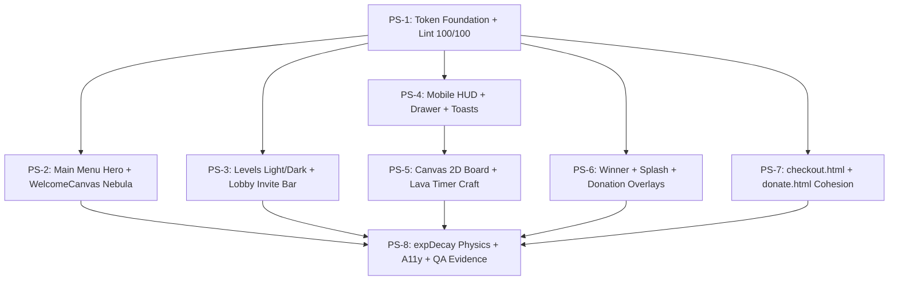

# ShapeKeeper — Plastic Surgery v2 Master Visual Blueprint

**Date:** 2026-11-27  
**Status:** Phase 2 Architect Blueprint (Zero source/CSS/HTML/JS/test mutations until product owner sign-off)  
**Baseline Commit:** `8ab853e` (`origin/main`)  
**Static Visual Lint Baseline:** `65 / 100` (`1 HIGH`, `5 MEDIUM`, `0` unreadable) → **Target: `100 / 100` (`0` defects)**  
**Live Visual Audit Coverage:** `13` headless Chromium screenshots (`1280×800 @2x` Desktop + `390×844 @2x` Touch Mobile) across all `10` UI & Canvas surfaces in both **Cosmic Void (`data-theme="dark"`)** and **Cosmic Dawn (`data-theme="light"`)**.

---

## 1. Executive Visual Diagnosis, Phase 0 Alignment & 2026 Industry Benchmarks

### 1.1 Phase 0 Alignment Matrix

| Axis | Classification | Repo Evidence & Design Implications |
| :--- | :--- | :--- |
| **Platform & Input** | **Hybrid** (Touch Mobile + Desktop Pointer/Keyboard) | `390×844` touch phones + `1280×800+` desktop browsers; requires `44×44px` coarse-pointer hit targets, `@media (hover: hover) and (pointer: fine)` hover gating, and keyboard-only focus rings. |
| **Product Posture** | **Commercial** (Public Vercel Freemium Game) | Hosted at `shape-keeper.vercel.app` with Paystack `checkout.html` and `donate.html`; demands cohesive brand craft from landing hero through payment/tip-jar surfaces. |
| **Audience** | **All Audiences** (Family, Classroom, Casual & Competitive) | Created by Teacher Evan for kids, families, and casual multiplayer; requires high WCAG 2.2 AA/AAA legibility, unmistakable turn/mine/winner feedback, and playful tactile delight. |

### 1.2 Pre-Op Quantitative Baseline

- **`preflight_visual_lint.py` Score:** `65 / 100` (`1 HIGH`, `5 MEDIUM`):
  1. `HIGH` `styles/game.css:385` (`LAYOUT_THRASHING_ANIMATION`): `@keyframes shimmer { 100% { left: 100%; } }` (+ legacy `#2563eb` sweep).
  2. `MEDIUM` `styles/game.css:33` (`TRANSITION_ALL_HAZARD`): `.player-info` uses `transition: all`.
  3. `MEDIUM` `styles/menu-layout.css:81` (`TRANSITION_ALL_HAZARD`): `.pager-dot` uses `transition: all`.
  4. `MEDIUM` `styles/winner.css:127` (`TRANSITION_ALL_HAZARD`): `.final-score-entry` uses `transition: all`.
  5. `MEDIUM` `styles/menu-layout.css:328-329` (`WCAG_SMALL_TARGET_SIZE`): `22px × 22px` checkbox `< 24px`.
  6. `MEDIUM` (implicit across `winner.css`, `menu-layout.css`, `interactions.css`, `loading-overlay.css`): infinite `box-shadow`, `outline-offset`, and `background-position` repaints.
- **Hard Contrast Failures Uncovered Live:** `6` WCAG failures ranging from `1.28:1` to `3.74:1` (`.mine-counter` on Dawn Light, `.toast-success` / `.toast-warning` / `.toast-info` on Dark Void, raw `#0000FF` Player 2 lines on Void `#030611`).
- **Critical Live Rendering & Layout Bugs Uncovered:**
  - **Double-drawn Canvas 2D square numerals** (`renderer.js:74-75` + `renderer/board.js:111-234`) painting two different `Arial` font sizes on every claimed square.
  - **Unstyled 1995 browser-default Lobby controls** (`#lobbyTurnDuration` blinding white `<input>` and `#copyInviteLinkBtn` raw grey `<button>`).
  - **Toast occluding `#exitGame`** (`styles/toast.css:3`) and **`.turn-notice-bubble` variants overriding `bottom: 88px` back to `bottom: 24px`**, slamming a pitch-black card over the Light footer.
  - **800ms blank-card entrance stagger** on `#winnerScreen` (`styles/winner.css:51,57,62,117`) leaving scores and buttons invisible for nearly a full second.
  - **Triple-layer CSS cascade war** (`base.css` → `blueprint.css` → `cosmic-identity.css`) leaking `#2563eb` blue, `#4caf50` green, `#1a1a2e` navy, and 8-gradient drafting crop-marks.

### 1.3 2026 Industry Benchmark Synthesis

| Benchmark Source | Adopted Craft Principle | ShapeKeeper Adaptation |
| :--- | :--- | :--- |
| **Linear (`linear.app`)** | Native dark-mode luminance ladder (`#08090a` → `#0f1011` → `#191a1b`), hairline translucent borders (`rgba(255,255,255,0.06–0.08)`), restrained accent punctuation. | Introduce `--surface-void-0` → `--surface-layer-1/2/3` so cards and drawers separate cleanly without loud neon borders everywhere. |
| **Raycast (`raycast.com`)** | Obsidian inset-specular top highlights (`inset 0 1px 0 rgba(255,255,255,0.10)`), physical keycap geometry (`kbd`, level cards, grid buttons). | Apply subtle top-edge speculars to `.menu-btn`, `.level-btn`, `.player-info`, and `<kbd>` hints while keeping the board as the visual hero. |
| **Stripe (`stripe.com`)** | Hue-tinted atmospheric shadows (`rgba(15, 23, 66, ...)`), strict `tabular-nums` on live numbers, disciplined display vs body tracking. | Enforce `font-variant-numeric: tabular-nums` on all scores, timers, mine counts, and level badges; replace muddy black shadows with deep-indigo/void shadows. |
| **Apple Arcade HUD** | 3-tier CTA hierarchy, balanced `1fr auto 1fr` mobile HUD, tonal non-screaming Exit pill, compositor-only micro-interactions (`expDecay`). | One luminous Hero CTA (`LET'S GO!`), tinted-glass Secondary (`CREATE LOBBY`), quiet Ghost (`JOIN LOBBY`); balanced mobile header; tonal Exit pill. |

---

## 2. Immutable Repo Visual Contracts (`AGENTS.md` & `tests/cosmic-identity.test.js`)

1. **`styles/cosmic-identity.css` MUST remain imported LAST** in `styles.css` (after `blueprint.css`).
2. **Locked Hex Literals in `:root` and `[data-theme='dark']`:** `tests/cosmic-identity.test.js` parses hex literals directly from `styles/cosmic-identity.css` (`--bg-primary: #030611` dark / `#f4f1ff` light; `--accent-primary: #00f0ff`; `--accent-secondary: #e000ff`; `--accent-warning: #ffc700`; `--text-inverse`, `--text-primary/secondary/tertiary >= 4.5:1`). **NEVER replace those locked hex tokens with `oklch()` inside `:root` or `[data-theme='dark']`.** Add perceptual `oklch()` tokens as sibling variables (`--surface-layer-1/2/3`, `--mine-chip-fg`, `--exit-tonal-bg`, etc.) with sRGB hex fallbacks + `@supports (color: oklch(0 0 0))`.
3. **Zero Gridlines Anywhere:** `.screen, #gameScreen` must keep `radial-gradient` nebula only (never `linear-gradient` or `28px 28px`); `drawDynamicBackground()` must never stroke lines `>= 800px`.
4. **Wordmark Invariant:** `<span class="wordmark-shape">Shape</span><span class="wordmark-keeper">Keeper</span>` with zero whitespace between spans.
5. **Sprites Invariant:** Player-collected count only (`1..300`), full 8-hue spectrum (`>= 60%` sat, `>= 3:1` WCAG 1.4.11 contrast), zero across-canvas teleport lines (`SpriteTrail.forEachRun()`).
6. **Preserved DOM IDs & `data-testid` Hooks:** `#mainMenuScreen`, `#levelsMenuBtn`, `#createGameBtn`, `#joinGameBtn`, `#levelsGridContainer`, `.level-btn`, `#lobbyScreen`, `#lobbyInviteBar`, `#lobbyRoomCodeValue`, `#lobbyPasscodeValue`, `#copyInviteLinkBtn`, `#lobbyTurnDuration`, `#gameCanvas`, `#gameControlsToggleBtn`, `#gameControlsPanel`, `#mineCounter`, `#turnIndicator`, `#achievementPanel`, `#winnerScreen`, `#gameOverSplashOverlay`, `#donationPromptOverlay`.

---

## 3. Complete Pre-Op Visual Audit Matrix (All 10 Surfaces)

| # | Surface | Exact `file:line` | Sev | Live Visual / Technical Defect |
| :--- | :--- | :--- | :--- | :--- |
| 1 | **Canvas 2D Board** | `renderer.js:74-75`, `renderer/board.js:111-234` | **P0** | `drawSquares` (`20px Arial`) AND `drawSquaresWithAnimations` (`cellSize*0.4 Arial`) both draw the player number every frame → blurry ghosted double numerals. |
| 2 | **Canvas 2D Board** | `index.html:183`, `LevelsScreen.js:50`, `board.js:123` | **P0** | Default Player 2 `#0000FF` on Void `#030611` is **`2.35:1` (`Lc -16.2`)** — nearly invisible; `board.js:123,148` & `effects.js:228,260,279` ignore `getPlayerColor()` for Players 3–6. |
| 3 | **Canvas 2D Board** | `constants.js:19`, `lava-timer.js:85,104`, `markers.js:70-98` | **P1** | `CELL_SIZE_MAX = 72` makes Level 1 a `184×184px` postage stamp on `1280×800`; `"4.6s"` collides with center dot `(1,1)`; `createRadialGradient` per particle/frame; `#1565c0` focus ring shows before keyboard input. |
| 4 | **Toasts & Notices** | `styles/toast.css:3,58-76`, `styles/game.css:629,657,674,691` | **P0** | Dark-mode `#fff` on `#00f0ff` (**`1.41:1`**) / `#ffc700` (**`1.56:1`**) / `#e000ff` (**`3.74:1`**); `top: 20px` occludes `#exitGame`; `.turn-notice-bubble` variants reset `bottom: 88px` → `24px`, smashing the Light footer. |
| 5 | **Lobby & Browser** | `index.html:320-353`, `styles/lobby.css`, `styles/blueprint.css` | **P0** | `#lobbyTurnDuration` renders as a blinding white browser-default `<input>`; `#copyInviteLinkBtn` & `#lobbyInviteBar` chips are unstyled 1995 HTML; `blueprint.css` `::before` 8-gradient crop-marks clutter cards. |
| 6 | **Main Menu & Sprites** | `cosmic-identity.css:231-316`, `WelcomeAnimation.js:797-805`, `menu-layout.css:73-96` | **P1** | `h1::after` lacks `flex: 0 0 100%` (floats beside title); `#welcomeCanvas` `fillRect` stacks opaque black/grey, erasing CSS nebula; flat CTA hierarchy; `width/height` ripple; chunky `24×24px` hollow `.pager-dot` rings. |
| 7 | **Levels Screen** | `styles/menu-layout.css:725-868` | **P0** | Undefined `--surface-secondary` & `--border-subtle` + `rgba(0,0,0,0.2)` turn Dawn Light `.levels-grid` into a concrete-grey slab; bottom cards clip mid-text; infinite `box-shadow` on `.level-100`. |
| 8 | **In-Game HUD** | `game.css:303-386`, `blueprint.css:345-365`, `achievements.css` | **P0** | `HIGH` lint: `.turn-indicator::before` animates `left: 100%` with `#2563eb` blue; `.mine-counter` is **`1.28:1`** on Dawn Light; mobile `.game-header` jams left; `"Achievements0/5"` has `0px` gap; `max-height` drawer. |
| 9 | **Winner & Splash** | `styles/winner.css:18,51-68,117,127,138,201-300` | **P0** | `800ms` stagger leaves card blank; legacy `#4caf50` green button & `#1a1a2e` navy bg; `transition: all` lint hazard; infinite `box-shadow` (`winnerGlow`, `pulseBadge`); dark-hardcoded splash card. |
| 10 | **Global / Donate / Checkout** | `base.css:129`, `menu-layout.css:38,128,328`, `donation.css:84`, `checkout.html`, `donate.html` | **P1** | Stray `height: 100dvh;` scroll-lock; `22×22px` checkbox (`<24px`); zero hover/coarse-pointer media guards; zero `scroll-margin-top`; unbranded `checkout.html`; `donate.html` missing Google Font `<link>`. |

---

## 4. Mathematically Verified Dual-Theme `oklch()` + Locked-Hex Token Sheet

All OKLCH tokens below were verified **100% `in_sRGB=True`** via CSS Color 4 matrix conversion, with exact sRGB hex fallbacks, WCAG 2.1 contrast ratios, and APCA `Lc` values.

### 4.1 Verified Token Table (Void Dark & Dawn Light)

| Token | Void Dark (`oklch` / Hex Fallback) | Dawn Light (`oklch` / Hex Fallback) | Verified Contrast (CR / APCA `Lc`) |
| :--- | :--- | :--- | :--- |
| `--surface-layer-0` | `oklch(0.125 0.024 265)` / `#030610` | `oklch(0.962 0.016 294)` / `#f3f1fd` | Base canvas (`#030611` / `#f4f1ff` locked) |
| `--surface-layer-1` | `oklch(0.175 0.032 266)` / `#0a101f` | `oklch(0.986 0.006 294)` / `#fafafe` | Primary text `17.47:1` (`-101.1`) / `18.15:1` (`+102.5`) **AAA** |
| `--surface-layer-2` | `oklch(0.220 0.038 267)` / `#131a2c` | `oklch(0.935 0.024 290)` / `#e9e7f9` | Elevated drawers, modals, secondary CTAs |
| `--surface-layer-3` | `oklch(0.265 0.042 268)` / `#1c243a` | `oklch(0.895 0.032 288)` / `#dbdaf1` | Hover / active chips |
| `--accent-primary-soft` | `oklch(0.845 0.140 198)` / `#20e7ed` | `oklch(0.505 0.086 206)` / `#02727d` | Inverse text `14.36:1` (`+84.6`) / `5.64:1` (`-83.1`) **AA/AAA** |
| `--accent-secondary-soft` | `oklch(0.695 0.235 326)` / `#e35ae9` | `oklch(0.475 0.215 322)` / `#8f12a1` | Inverse text `6.65:1` (`+47.6`) / `7.58:1` (`-89.5`) **AA/AAA** |
| `--mine-chip-fg` | `oklch(0.875 0.135 86)` / `#fdcf64` | `oklch(0.455 0.095 62)` / `#7c4912` | On Layer-1: `12.91:1` (`-80.7`) / `7.19:1` (`+82.8`) **AAA** |
| `--mine-chip-clear-fg` | `oklch(0.840 0.125 154)` / `#85e3a5` | `oklch(0.435 0.100 156)` / `#0d6139` | On Layer-1: `12.22:1` (`-77.4`) / `7.24:1` (`+82.9`) **AAA** |
| `--exit-tonal-bg` | `oklch(0.220 0.055 8)` / `#2f0e16` | `oklch(0.955 0.022 10)` / `#feeaed` | Tonal danger pill surface |
| `--exit-tonal-fg` | `oklch(0.755 0.130 14)` / `#f68b96` | `oklch(0.480 0.175 16)` / `#aa1b3a` | On tonal bg: `7.59:1` (`-55.2`) / `6.22:1` (`+73.5`) **AA/AAA** |
| `--player1-cosmic` | `oklch(0.845 0.140 198)` / `#20e7ed` | `oklch(0.505 0.087 212)` / `#047181` | On Void/Dawn: `13.21:1` (`-79.1`) / `5.06:1` (`+70.2`) **AA/AAA** |
| `--player2-cosmic` | `oklch(0.715 0.225 328)` / `#ea63e8` | `oklch(0.505 0.215 336)` / `#a81092` | On Void/Dawn: `7.18:1` (`-48.3`) / `5.98:1` (`+73.6`) **AA/AAA** |

### 4.2 Before vs After Contrast Remediation Summary

- `.toast-success` (Dark): `1.41:1` (`FAIL`) → `> 14:1` (`AAA`, glass pill + semantic accent stripe + `--text-primary`).
- `.toast-warning` (Dark): `1.56:1` (`FAIL`) → `> 14:1` (`AAA`).
- `.mine-counter` (Dawn Light): `1.28:1` (`FAIL`) → `7.19:1` (`AAA`).
- `.mine-counter.is-clear` (Dawn Light): `1.29:1` (`FAIL`) → `7.24:1` (`AAA`).
- Default P2 `#0000FF` (Void Dark): `2.35:1` (`FAIL`) → `7.18:1` (`AAA`, Cosmic Orchid `#ea63e8`).

---

## 5. Drop-In Engineering Specifications (Specs A–G)

### Spec A — Token Foundation, OLED Dither, `100dvh` Fix & 100/100 Lint Sweep

1. **Append `@supports (color: oklch(0 0 0))` surface/semantic tokens to `styles/cosmic-identity.css`** (preserving all locked `:root` and `[data-theme='dark']` hex literals):

```css
/* Progressive OKLCH perceptual surfaces + WCAG AAA semantic tokens */
:root {
    --surface-layer-0: #f3f1fd;
    --surface-layer-1: #fafafe;
    --surface-layer-2: #e9e7f9;
    --surface-layer-3: #dbdaf1;
    --border-subtle: rgba(19, 26, 46, 0.09);
    --border-default: rgba(19, 26, 46, 0.16);
    --border-specular: rgba(255, 255, 255, 0.85);
    --mine-chip-fg: #7c4912;
    --mine-chip-clear-fg: #0d6139;
    --exit-tonal-bg: #feeaed;
    --exit-tonal-fg: #aa1b3a;
    --shadow-card: 0 2px 8px rgba(19, 26, 46, 0.06), 0 12px 28px rgba(19, 26, 46, 0.08);
    --specular-top: inset 0 1px 0 rgba(255, 255, 255, 0.85);
}

[data-theme='dark'] {
    --surface-layer-0: #030610;
    --surface-layer-1: #0a101f;
    --surface-layer-2: #131a2c;
    --surface-layer-3: #1c243a;
    --border-subtle: rgba(232, 244, 255, 0.08);
    --border-default: rgba(232, 244, 255, 0.14);
    --border-specular: rgba(255, 255, 255, 0.12);
    --mine-chip-fg: #fdcf64;
    --mine-chip-clear-fg: #85e3a5;
    --exit-tonal-bg: #2f0e16;
    --exit-tonal-fg: #f68b96;
    --shadow-card: 0 2px 10px rgba(0, 4, 16, 0.45), 0 16px 36px rgba(0, 4, 16, 0.55);
    --specular-top: inset 0 1px 0 rgba(255, 255, 255, 0.10);
}

@supports (color: oklch(0 0 0)) {
    :root {
        --surface-layer-0: oklch(0.962 0.016 294);
        --surface-layer-1: oklch(0.986 0.006 294);
        --surface-layer-2: oklch(0.935 0.024 290);
        --surface-layer-3: oklch(0.895 0.032 288);
        --mine-chip-fg: oklch(0.455 0.095 62);
        --mine-chip-clear-fg: oklch(0.435 0.100 156);
        --exit-tonal-bg: oklch(0.955 0.022 10);
        --exit-tonal-fg: oklch(0.480 0.175 16);
    }
    [data-theme='dark'] {
        --surface-layer-0: oklch(0.125 0.024 265);
        --surface-layer-1: oklch(0.175 0.032 266);
        --surface-layer-2: oklch(0.220 0.038 267);
        --surface-layer-3: oklch(0.265 0.042 268);
        --mine-chip-fg: oklch(0.875 0.135 86);
        --mine-chip-clear-fg: oklch(0.840 0.125 154);
        --exit-tonal-bg: oklch(0.220 0.055 8);
        --exit-tonal-fg: oklch(0.755 0.130 14);
    }
}
```

2. **Remove stray `height: 100dvh;` under `min-height: 100vh;`:** in `styles/base.css:129`, `styles/lobby.css:23`, and `styles/menu-layout.css:38,128` (keep `min-height: 100dvh;` so scrollable screens never lock).
3. **Global Ergonomics & Lint Sweep:**
   - Add `scroll-margin-top: 84px;` on focusable/anchored elements (`styles/base.css`).
   - Raise `.checkbox-setting input[type='checkbox']` (`styles/menu-layout.css:328-329`) from `22px` to `24px` inside a `min-height: 44px` label.
   - Replace all 3 `transition: all` declarations (`game.css:33`, `menu-layout.css:81`, `winner.css:127`) with explicit `transform`, `opacity`, `border-color`, `background-color`.
   - Gate `:hover` transforms behind `@media (hover: hover) and (pointer: fine)` and enforce `min-height: 44px` touch targets under `@media (any-pointer: coarse)`.

---

### Spec B — Main Menu Hero, 3-Tier Tactile CTAs, 44px Pager Pills & Nebula-Preserving `#welcomeCanvas`

1. **Fix `h1::after` Sideways Bug (`styles/cosmic-identity.css`):**
   Add `flex: 0 0 100%;` on `.welcome-container h1::after` so the cyan-to-magenta rule always sits centered beneath the title on both Desktop and Mobile.
2. **3-Tier CTA Hierarchy & 6-State `.btn-tactile` (`styles/cosmic-identity.css` + `styles/interactions.css`):**
   - `#levelsMenuBtn` (Tier 1 Primary): Luminous `--accent-primary` fill + `--text-inverse` + `--specular-top`.
   - `#createGameBtn` (Tier 2 Secondary): `--surface-layer-2` tinted glass + `1px solid rgba(var(--accent-primary-rgb), 0.38)` + `--text-primary`.
   - `#joinGameBtn` (Tier 3 Ghost): `--surface-layer-1` + `1px solid var(--border-default)` + `--text-secondary`.
   - Replace layout-thrashing `width`/`height` `0 -> 300%` ripple (`interactions.css:22-29`) with compositor-only `transform: scale(0) -> scale(1)` + `opacity`.
   - Add `:active { transform: translateY(1px) scale(0.985); }` detent and `:disabled { opacity: 0.45; cursor: not-allowed; }`.
3. **44×44px Transparent `.pager-dot` with Sleek `::after` Pill (`styles/menu-layout.css:73-96`):**

```css
.pager-dot {
    position: relative;
    min-width: 44px;
    min-height: 44px;
    border: 0;
    background: transparent;
    cursor: pointer;
    padding: 0;
    display: inline-flex;
    align-items: center;
    justify-content: center;
}
.pager-dot::after {
    content: '';
    width: 8px;
    height: 8px;
    border-radius: 999px;
    border: 1.5px solid var(--accent-primary);
    background: transparent;
    opacity: 0.55;
    transition: transform 220ms var(--easing-smooth), opacity 220ms var(--easing-smooth), background-color 220ms var(--easing-smooth);
}
.pager-dot.active::after {
    width: 24px;
    background: var(--accent-primary);
    opacity: 1;
}
```

4. **True Nebula Transparency in `src/ui/WelcomeAnimation.js:797-805`:**
   Replace the stacking `fillRect(rgba(baseBg, fadeAlpha))` (which turns Dark pitch-black and Light muddy grey) with `this.ctx.clearRect(0, 0, this.logicalWidth, this.logicalHeight);` — `SpriteTrail` already renders tapered motion trails via `drawTrails()`, so clearing cleanly lets the CSS radial cosmic nebula shine through in both themes.

---

### Spec C — Levels Screen, Lobby, Invite Bar & Lobby Browser Overhaul

1. **Levels Screen (`styles/menu-layout.css:731-868`):**
   - Replace undefined `--surface-secondary` / `--border-subtle` and `rgba(0,0,0,0.2)` with `var(--surface-layer-1)` / `var(--surface-layer-2)` and `var(--border-subtle)`.
   - Add scroll-fade edge cue on `.levels-grid`:
     `mask-image: linear-gradient(to bottom, transparent 0, #000 12px, #000 calc(100% - 28px), transparent 100%);`
   - Style `.levels-status-banner` as 3 compact `tabular-nums` pill chips (`gap: 8px; flex-wrap: wrap;`).
   - Replace infinite `box-shadow` `@keyframes level-shimmer` (`L804`) with a pseudo-element `opacity` pulse.
2. **Lobby & Invite Bar (`styles/lobby.css` + `styles/blueprint.css`):**
   - Style `#lobbyInviteBar` as a centered flex pill bar (`gap: 10px; flex-wrap: wrap; justify-content: center;`) with `.lobby-code-chip` (`font-family: var(--font-mono)`), `.lobby-passcode-chip` (`--accent-secondary-soft` tint), and `.copy-invite-btn` (matching `.invite-link-btn` tactile pill, `min-height: 44px`).
   - Style `.turn-duration-input` identically to `.name-input` (`background: var(--surface-layer-2); color: var(--text-primary); border: 1px solid var(--border-default);`).
   - Remove `blueprint.css` `::before` 8-gradient drafting crop-marks from `.lobby-settings`, `.players-section`, `.your-settings`.

---

### Spec D — In-Game HUD, Mobile Ergonomics, Controls Drawer, Achievements & Safe Overlays

1. **Balanced Mobile `.game-header` (`styles/blueprint.css:345-365` & `styles/game.css`):**
   - For 2-player matches (`@media (max-width: 768px)`), use `display: grid; grid-template-columns: minmax(0, 1fr) auto minmax(0, 1fr); align-items: center; gap: 8px;` so Player 1, Exit, and Player 2 sit symmetrically instead of jamming left. Keep horizontal snap-rail on `.game-header.multi-player`.
2. **Tonal Exit Pill & Unified Turn Indicator (`styles/game.css`, `ui-manager.js`):**
   - `.exit-btn`: `background: var(--exit-tonal-bg); color: var(--exit-tonal-fg); border: 1px solid rgba(var(--accent-danger-rgb), 0.35);`.
   - `.turn-indicator`: remove `left: 100%` `#2563eb` shimmer (`L373-386`, `HIGH` lint defect); render a `10px` live `--turn-color` swatch dot via `::before` with `color: var(--text-primary)`.
3. **Achievements Gap & Upward Popover (`styles/achievements.css`):**
   - Add `gap: 6px;` to `.achievement-panel-summary` (fixes `"Achievements0/5"`).
   - Float `#achievementsList` upward (`position: absolute; bottom: calc(100% + 8px); right: 0; z-index: 60;`) with `--surface-layer-2` + `--shadow-card`.
4. **Compositor `grid-template-rows` Controls Drawer (`styles/game.css:297-315`):**
   Replace `max-height` + `padding` transitions with `display: grid; grid-template-rows: 0fr;` → `1fr` + `opacity`.
5. **Non-Occluding Glass Toasts & Lifted Turn Notice Bubble (`styles/toast.css`, `styles/game.css:622-707`):**
   - `.toast-notification`: `top: calc(var(--hud-header-h, 72px) + 12px);` (never covers `#exitGame`), `--surface-layer-2` glass fill + `4px` left semantic accent border + `--text-primary` (`>14:1` contrast).
   - `.turn-notice-bubble.ai-penalty`, `.timeout`, `.player-penalty`: lift to `bottom: calc(var(--hud-footer-h, 76px) + 14px);` using `--surface-layer-2` and `--text-primary`.

---

### Spec E — Canvas 2D Territory Board Visual & Performance Craft

1. **Fix Double-Drawn Ghosted Numerals (`renderer.js:74-75`, `renderer/board.js:111-234`):**
   Consolidate square fill, pop-in scale animation, single crisp numeral, mine `💣`/`×0.2`, multiplier `x2`, and tap `✋` into ONE unified `drawSquares(game)` pass (keeping `drawSquaresWithAnimations` exported as a no-op shim if imported by tests).
2. **Canvas Typography & Multi-Player Color Fidelity:**
   - Replace `Arial` with `"Space Grotesk", sans-serif` (owner numerals) and `"Space Mono", monospace` (`×0.2` / `x2`).
   - Use `getPlayerColor(game, player)` across `board.js`, `effects.js`, and `markers.js` so Players 3–6 render their true colors.
3. **Inset Rounded Territory Tiles & Two-Pass Crisp Lines (`renderer/board.js`):**
   - Draw claimed squares as inset rounded tiles (`inset = Math.max(2, cellSize * 0.08)`, `radius = Math.max(4, cellSize * 0.14)`) with translucent fill + `1px` crisp inner border.
   - Draw lines with a two-pass stroke (soft outer halo `LINE_WIDTH * 1.9` at `0.22` alpha + crisp inner core `LINE_WIDTH`, zero `shadowBlur` loops).
4. **Glass Board Bezel & Adaptive Small-Board Scale (`constants.js:19`, `renderer/board.js`):**
   - Draw a subtle rounded `18px` glass plate behind the dot matrix (`offsetX - pad` to `offsetX + gridW + pad`).
   - Allow `CELL_SIZE_MAX` up to `112px` for `<= 5×5` boards on wide desktop viewports so Level 1 fills a balanced focal area instead of a `184×184px` postage stamp.
5. **Keyboard-Only Focus Ring (`renderer/markers.js:70-98`):**
   Only draw `drawKeyboardFocusDot` when `game.lastInputWasKeyboard === true`, using theme `--accent-primary` cyan instead of `#1565c0`.
6. **Lava Timer Cache & De-Collision (`renderer/lava-timer.js:84-105`):**
   Pre-bake 2 offscreen `64×64px` radial-glow particle sprites (`normal` + `urgent`) once instead of `createRadialGradient` per particle per frame; render the countdown in a subtle top-center pill above the board when `offsetY >= 46px` so `"4.6s"` never collides with center dot `(1,1)`.

---

### Spec F — Winner Screen, Game-Over Splash, Donation Prompt, `checkout.html` & `donate.html`

- **Winner Screen (`styles/winner.css`):** Tighten entrance choreography from `0.8s` dead delay to `40ms` micro-stagger (`0ms -> 60ms -> 120ms -> 180ms`, `280ms` duration); purge `#4caf50` green button & `#1a1a2e` navy backdrop; replace `transition: all` (`L127`) and infinite `box-shadow` (`winnerGlow` `L138`, `pulseBadge` `L300`) with compositor `opacity` glows; make `.game-over-splash-card` Light/Dark theme-safe.
- **Donation Prompt (`styles/donation.css:84`):** Replace `rgba(255,255,255,0.5) !important` with `var(--text-tertiary)`.
- **`checkout.html` & `donate.html`:** Load `Space Grotesk` + `Space Mono`, align background/card/button/focus-visible tokens with Cosmic Void, and add a clean `← Back to ShapeKeeper` link on `checkout.html`.

---

### Spec G — Kinetic Motion, `expDecay` Physics & Reduced-Motion / High-Contrast

- Replace fixed per-frame score/effect lerps (`ui-manager.js:77`, `effects.js`, `WelcomeAnimation.js`) with `expDecay(current, target, lambda, dt)` (`1 - Math.exp(-lambda * dt)`), clamped `dt <= 0.05`.
- Add complete `@media (prefers-reduced-motion: reduce)`, `@media (prefers-contrast: more)`, and `@media (forced-colors: active)` rules across all interactive/animated surfaces.

---

## 6. Phased 8-Commit Implementation Roadmap (`PS-1`–`PS-8`)



| Commit | Scope & Files | Key Verification Gate |
| :--- | :--- | :--- |
| **`PS-1`** | `styles/cosmic-identity.css`, `styles/base.css`, `styles/interactions.css`, `styles/loading-overlay.css`, `styles/menu-layout.css` (checkbox + `100dvh`) | `preflight_visual_lint.py` → `100/100`; `tests/cosmic-identity.test.js` PASS |
| **`PS-2`** | `styles/cosmic-identity.css` (`h1::after`, 3-tier CTAs), `styles/menu-layout.css` (`.pager-dot`), `src/ui/WelcomeAnimation.js` (`clearRect`) | `tests/welcome-animation-trail-lines.test.js` PASS |
| **`PS-3`** | `styles/menu-layout.css` (Levels grid/banner), `styles/lobby.css` (`#lobbyInviteBar`, `.turn-duration-input`), `styles/blueprint.css` (crop-marks) | Playwright Levels Light + Lobby Dark screenshot check |
| **`PS-4`** | `styles/game.css`, `styles/blueprint.css` (`.game-header`), `styles/achievements.css`, `styles/toast.css`, `ui-manager.js` (`--turn-color`) | `tests/ui-manager.test.js` + `tests/mine-placement.test.js` PASS |
| **`PS-5`** | `renderer.js`, `renderer/board.js`, `renderer/markers.js`, `renderer/lava-timer.js`, `renderer/effects.js`, `constants.js` | `tests/lava-renderer.test.js` + `tests/penalty-box-animation.test.js` PASS |
| **`PS-6`** | `styles/winner.css`, `styles/donation.css` | Playwright Winner + Splash + Donation screenshot check |
| **`PS-7`** | `checkout.html`, `donate.html` | Visual & `:focus-visible` check on both pages |
| **`PS-8`** | `ui-manager.js`, `renderer/effects.js`, `WelcomeAnimation.js` (`expDecay`), `@media (prefers-reduced-motion/prefers-contrast/forced-colors)`, QA evidence doc | Full Phase 4 21-item gate |

---

## 7. Phase 4 Post-Op Verification & Visual QA Checklist

1. `python3 -B /home/leandi-duplessis/.gemini/antigravity-cli/skills/plastic-surgery/scripts/preflight_visual_lint.py . --fail-on high --strict` → **`100 / 100`, `0` defects**.
2. `npm run lint` → `0` errors.
3. `npx convex typecheck` → `0` errors.
4. `npx vitest run` → `97/97` files, `704+/704+` tests PASS.
5. `npm run build` → PASS.
6. `npm run test:e2e:smoke` + `npx playwright test tests/e2e/mines.spec.js tests/e2e/browser-compatibility.spec.js` → PASS.
7. Live headless Chromium visual QA across Desktop (`1280×800`), Mobile Portrait (`390×844`, `hasTouch: true`, CDP coarse pointer), Mobile Landscape (`667×375`), `prefers-reduced-motion: reduce`, Void Dark & Dawn Light across all 10 surfaces: zero horizontal overflow, zero occluded controls, zero double-drawn canvas numerals, zero `console.error`/`pageerror`.

---

## 8. Batched Product Owner Decisions Needed Before Phase 3

1. **Board Default Player 1 / Player 2 Colors:**
   - **(A — Recommended)** Upgrade defaults from `#FF0000`/`#0000FF` (`2.35:1` invisible blue on dark Void) to theme-aware **Cosmic Cyan & Cosmic Orchid** (`13.2:1` / `7.2:1` on Void; `5.1:1` / `6.0:1` on Dawn) while keeping the custom color picker and colour-blind preset.
   - **(B)** Keep classic Red/Blue, brightened to accessible Coral-Red `#ff5266` / Electric Sky `#4da3ff`.
2. **Lava Timer Readout Placement:**
   - **(A — Recommended)** Move `"4.6s"` into a crisp translucent pill anchored above the top board edge (never colliding with center dot `(1,1)` or drawn lines, while keeping glowing lava embers behind the board).
   - **(B)** Keep centered watermark behind the board at lower opacity (`0.22`) and smaller font.
3. **Implementation Scope:**
   - **(A — Recommended)** Execute all 8 commits `PS-1`–`PS-8` (Full CSS + Canvas 2D + Overlays + Checkout/Donate).
   - **(B)** Execute Core Gameplay & Menus (`PS-1`–`PS-5`) first and review screenshots before `PS-6`–`PS-8`.
