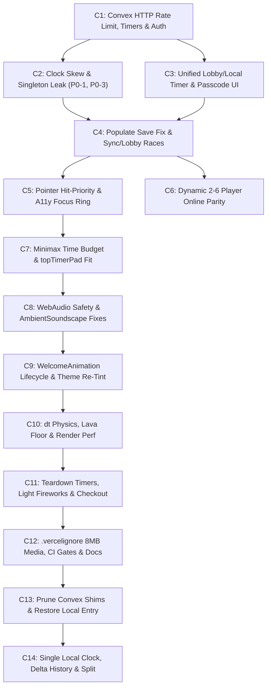

# ShapeKeeper Surgical Audit Remediation Plan (2026-11-27 — Round 2)

- **Audit Report:** [`shapekeeper-surgical-audit-2026-11-27-r2.md`](file:///home/leandi-duplessis/github/workspaces/ShapeKeeper/docs/audits/shapekeeper-surgical-audit-2026-11-27-r2.md)
- **SARIF Telemetry:** [`shapekeeper-surgical-audit-2026-11-27-r2.sarif`](file:///home/leandi-duplessis/github/workspaces/ShapeKeeper/docs/audits/shapekeeper-surgical-audit-2026-11-27-r2.sarif)
- **Baseline Commit:** `32fabaf6ce60bf6ec4abc7414f6e8d5c089c5d17` (`main`)
- **Health Score Trajectory:** **`45 / 100` (`CRITICAL`)** (`3 P0 / 14 P1 / 8 P2 / 5 P3`, `D_raw = 195`, $M_{\text{kill}} = 45.31\%$) → **`99 / 100` (`LOW`)** (`0 P0 / 0 P1 / 0 P2 / 0 P3`, `D_raw = 0`, $M_{\text{kill}} \ge 90.63\%$)
- **Scope:** `14` atomic conventional commits (`C1`–`C14`) across `4` phases, restoring `100%` passing Playwright E2E specs (including `tests/e2e/local-turn-timer.spec.js`), eliminating `8.24 MB` of accidental Vercel media bloat, and closing every live Chromium regression from Round 2.

---

## 1. Batched Product Owner Decisions (`D1–D5`)

*Resolve these five scope choices in one reply before starting Phase 4 (Phases 1–3 can execute immediately under the recommended defaults).*

| ID | Decision | Options | Recommendation |
| :--- | :--- | :--- | :--- |
| **D1** | Unreachable `#localSetupScreen` (`[P2-3]`: Local 2P Hot-Seat, Guided Tutorial, Save/Load, Colorblind Palette) | **A:** Add a compact Tier-3 `LOCAL PLAY` CTA on `#mainMenuScreen` so Local 2P, Tutorial, and Save/Load are reachable again. **B:** Remove `#localSetupScreen` + `localSetupEvents.js` + `tutorial-system.js` + `local-save-replay.js` entirely. | **Option A** (preserves 2P hot-seat, tutorial, and a11y colorblind preset) |
| **D2** | Online Turn-Timer Control (`[P1-2]`) | **A:** Replace `#lobbyTurnDuration` free number input with canonical `<select id="lobbyTurnTimer">` (`Off / 10s / 15s / 30s / 60s`, default `15s`, matching `AGENTS.md` and `updateTurnDuration.ts`). **B:** Relax `updateTurnDuration.ts` to accept any whole second `0..600`. | **Option A** (matches `AGENTS.md` & `ALLOWED_TURN_DURATIONS_MS`) |
| **D3** | Online 3–6 Player Multiplayer (`[P1-6]`) | **A:** Render dynamic 2–6 player header scorecards, colors, scores, and winner rankings. **B:** Cap online lobbies at 2 players (`maxPlayers = 2`). | **Option A** (matches `Players (1/6)` and `joinRoom.ts`) |
| **D4** | Unwired Authored Subsystems (`[P2-4]`) | **A:** Delete dead `convex/rooms/settings.ts`, duplicate snake/camel shims, `convex/entitlements.ts` (Lemon Squeezy), `LobbyManager.js`, and wire or delete `TypedParticlePool.js` + FR-4 online snapshots. **B:** Wire `TypedParticlePool.js` into `particle-system/` and wire FR-4 snapshots into Lobby Browser reconnect UI. | **Option A** for Convex dead code & `LobbyManager`; confirm whether to wire or prune `TypedParticlePool` & FR-4 snapshots |
| **D5** | Orphaned `#gameOverSplashOverlay` & `handleLevelTimeout` (`[P2-2]`) | **A:** Remove dead `handleLevelTimeout()` + `#gameOverSplashOverlay` (since `AGENTS.md` mandates random auto-line on timeout in Levels mode). **B:** Keep as unused fallback. | **Option A** (eliminates dead HTML/CSS/JS surface) |

---

## 2. Execution Dependency Graph & Deploy Order



### Mandatory Convex Sidecar & Server-Before-Client Protocol (`AGENTS.md` + `remediation-delivery.md` §3d)

1. **Sidecar Probe:** Before editing `convex/schema.ts` or removing shims in `C1`/`C13`, run `ps -ef | grep -E "convex" | grep -v grep`. If a ShapeKeeper `convex dev` sidecar is running, terminate it first.
2. **Codegen Authority:** Never hand-edit `convex/_generated/`. Run `npx convex dev --once` after `convex/schema.ts` (`C1`) and shim removal (`C13`).
3. **Server-Before-Client Release Order:** Deploy Convex commits (`C1`, `C13`) **before** deploying Vercel static client commits (`C2`–`C12`, `C14`) so new schema indexes (`by_window_start`), denormalized `completedSquareCount`, and HTTP rate limits are live before client traffic hits them.
4. **Gate Order per Commit (`AGENTS.md`):**
   ```bash
   npm run lint
   npx convex typecheck
   npx vitest run
   npm run build
   npm run test:e2e:smoke
   ```

---

## 3. Phase 1 — P0 Containment, Backend Hardening & Contract Locks (`C1`–`C4`)

### `C1` `fix(convex): rate-limit payment HTTP actions, cancel finished turn timers, and fix pruning/auth gaps`
- **Findings & Deps:** `[P0-2]`, `[P1-8]`, `[P1-9]`, `[P2-8]`. No prerequisites.
- **Files & Changes:**
  - `convex/schema.ts`: Add `.index('by_window_start', ['windowStart'])` on `rateLimits`; add `completedSquareCount: v.optional(v.number())` on `rooms` (optional for backward compatibility). Run `npx convex dev --once`.
  - `convex/rate_limit.js`: Add `httpVerifyPayment` (`10 / 60s`), `httpValidateLicense` (`20 / 60s`), and `startGame` (`6 / 10s`) windows; add an internal mutation wrapper `consumeHttpRateLimit` callable from `httpAction`; update `pruneExpiredRateLimits()` to query `.withIndex('by_window_start', q => q.lt('windowStart', cutoff)).take(200)` so reused active buckets never starve pruning.
  - `convex/http.ts:L22-L25, L113-L236`: Enforce `consumeHttpRateLimit` keyed by client IP (`cf-connecting-ip` / first `x-forwarded-for` / `'unknown'`) on `/paystack/verify` and `/license/validate` returning `429` with `Retry-After`; reject bodies `> 64 KiB` on `/paystack/webhook` (`413`) and `> 4 KiB` on verify/validate; fail closed (`503`) if `PAYSTACK_AMOUNT_KOBO` env var is present but invalid.
  - `convex/games/turnTimer.ts:L16-L96`, `convex/games/draw.ts:L58-L90`, `convex/games/state.ts:L200-L386`, `convex/mutations/leaveRoom.ts:L29-L65`:
    - Extract `cancelTurnTimer(ctx, room)` in `turnTimer.ts` and call it on `isGameOver`, `endGameHandler`, `resetGameHandler`, `leaveRoom` room deletion, and `sweepStaleLobbies`.
    - In `expireTurnHandler:L89-L95`, when `!chosenLine` (board full), patch `status: 'finished'` and clear deadline/job ID instead of re-arming infinitely.
    - Maintain `completedSquareCount` in `applyLineForPlayer` to avoid `squares.collect()` on every move (falling back once to `.collect().length` for pre-migration rooms lacking the counter).
    - In `tapSquareHandler`, reject squares where `!square.multiplier` before patching `taps`/`room.updatedAt`, and replace raw `console.log` (`L206`, `L268`) with `log()`.
  - `convex/mutations/startGame.ts:L18-L22`: Replace `providedHash !== room.hostTokenHash` with `isAuthorisedHostAsync(room, args.sessionId, args.hostToken)` + `checkRateLimit(ctx, 'startGame', args.sessionId)`.
  - `convex/mutations/createRoom.ts:L21, L48-L62`, `convex/mutations/joinRoom.ts:L22-L29`, `convex/queries/roomQueries.ts:L59-L94`, `convex/mutations/sweepStaleLobbies.ts:L27-L70`:
    - Return retry error if `existingPasscodeRoom` remains non-null after 10 collisions; align `createRoom` valid grid sizes to `[5, 10, 20, 30]`.
    - In `joinRoom` (`LOBBY`), iterate sorted open rooms and skip rooms with `>= 6` players; cap `listOpenLobbies` with `.take(50)`.
    - Extend `sweepStaleLobbies` to also reap `'playing'` and `'finished'` rooms idle `> 24h` (cascading `players`, `lines`, `squares`, and cancelling `turnTimerJobId`).
    - In `leaveRoom.ts:L56-L62`, preserve cryptographic host security on transfer (issue/rotate a server token claimable by the new host or restrict legacy fallback strictly to pre-migration rooms with audit log).
- **Red-Before-Green Tests:**
  - `convex/http.test.ts`: 11th `/paystack/verify` request returns `429` (pre-fix: `200`/`502` unbounded); 100 KB webhook body returns `413` (pre-fix: processed).
  - `convex/games/turnTimer.test.ts`: Full board (`chosenLine === null`) patches `status: 'finished'` with `0` `runAt` calls (pre-fix: calls `runAt` in infinite loop); `applyLineForPlayer` game-over cancels `turnTimerJobId` (pre-fix: `0` cancel calls).
  - `convex/games/state.test.ts`: `tapSquareHandler` rejects square with `multiplier: undefined` (pre-fix: patches `taps` & returns `success: true`).
  - `tests/rate-limit.test.js`: 205 buckets where first 200 are active and last 5 are expired prunes all 5 expired buckets (pre-fix: prunes `0`).
- **Rollback / Pitfall Guards:** Keep `completedSquareCount` optional in schema; never break legacy rooms lacking `hostTokenHash`.
- **Verification:** `npx convex typecheck && npx vitest run convex/ tests/rate-limit.test.js`

---

### `C2` `fix(timing): wire markLocalMoveSent, reject remote clock skew, and rebind turnClockController per match`
- **Findings & Deps:** `[P0-1]`, `[P0-3]`. Depends on `C1`.
- **Files & Changes:**
  - `dots-and-boxes-game.js:L445-L450`: Capture `const clientSentAt = Date.now()`, call `window.ShapeKeeperTurnClock?.markLocalMoveSent?.(clientSentAt)`, and pass `{ clientSentAt }` to `window.ShapeKeeperConvex.drawLine(...)`. Also add `_drawInFlight` guard so double-clicks cannot submit duplicate concurrent moves (`[P1-13]` partial).
  - `src/timing/turn-clock-controller.js:L46-L89`: Only compute RTT, invoke `clock.sample()`, or call `clock.beginPause()` when `pendingLocalSendAt !== null && room.lastTurnClientSentAt === pendingLocalSendAt`. Remove the remote-clock subtraction fallback (`room.lastTurnServerReceivedAt - room.lastTurnClientSentAt`).
  - `src/ui/menu/syncHandlers.js:L10-L43, L184-L193`: Track `let turnClockGame = null`. In `handleAuthoritativeGameState`, if `!turnClockController || turnClockGame !== game`, call `turnClockController?.clear()` and construct a fresh `createTurnClockController(game)`. Export `resetTurnClockController()`.
  - `src/ui/MenuNavigation.js:L254-L278`: Invoke `resetTurnClockController()` inside `teardownMultiplayerSession()`.
- **Red-Before-Green Tests:**
  - `tests/client-sync-integration.test.js`: Remote move (`markLocalMoveSent` NOT called) with `+5000ms` skew leaves `clock.getOffset() === 0` and `clock.isPaused() === false` (pre-fix: `getLastLatency() === 5000`, `isPaused() === true`!). Also fix `afterEach` to restore initial `FEATURE_FLAGS` values rather than hardcoding `false`.
  - `tests/sync-handlers.test.js`: Match 1 -> `resetTurnClockController()` / Match 2 -> `handleAuthoritativeGameState` updates `game2.turnRemainingMs` and leaves `game1.turnRemainingMs === null` (pre-fix: updates `game1`, `game2.turnRemainingMs === null`).
- **Rollback / Pitfall Guards:** Ensure `clientSentAt` passed to `markLocalMoveSent` is the exact `number` forwarded to Convex so strict `===` matching succeeds.
- **Verification:** `npm run lint && npx vitest run tests/client-sync-integration.test.js tests/sync-handlers.test.js tests/clock-sync.test.js`

---

### `C3` `fix(lobby): unify turn-timer presets across lobby and local setup, unhide local timer, and add private passcode flow`
- **Findings & Deps:** `[P1-2]`, `[P3-1]` (HTML hint copy). Depends on `C1`.
- **Files & Changes:**
  - `index.html:L218-L251`: Remove `hidden` from `#localTurnTimerSection` (or unhide it on boot when `FEATURE_FLAGS.FEATURE_LAVA_TIMER` is true), remove duplicate `#localTurnDuration` free input (or keep a single canonical `<select>` matching `TURN_TIMER_OPTIONS_MS`), and update timer hints to `"Runs out → a random line is drawn."`.
  - `index.html:L349-L365`: Replace `<input type="number" id="lobbyTurnDuration" value="10">` with `<select id="lobbyTurnTimer" data-testid="lobby-turn-timer">` offering `0 / 10000 / 15000 / 30000 / 60000` (default `15000`, matching `AGENTS.md` and `ALLOWED_TURN_DURATIONS_MS`). Add an optional `#joinPasscodeModal` (or inline passcode input on private deep-link failure).
  - `src/ui/LiveLobbyManager.js:L29-L30`: Change default `turnDurationSeconds = 15`, `turnDurationMs = 15000`.
  - `src/ui/menu/lobbyView.js:L49-L70` & `src/ui/menu/lobbyEvents.js:L170-L206, L256-L351`: Remove dead `#lobbyTurnDuration` / `#copyCodeBtn` handlers; sync `#lobbyTurnTimer` cleanly; prompt for passcode when `joinRoom` rejects due to missing/wrong passcode on private `?join=CODE` links.
  - `convex-client/room-operations.js:L50-L70, L159-L179`: Forward 3rd `isPrivate = false` arg in `createRoom(playerName, gridSize, isPrivate)`; normalize `updateTurnDuration(durationMs)` explicitly without the fragile `> 600` heuristic.
- **Red-Before-Green Tests:**
  - `npx playwright test tests/e2e/local-turn-timer.spec.js --project=chromium`: Pre-fix fails `2/2` (`#localTurnTimerSection` hidden); post-fix passes `2/2`.
  - `tests/e2e/allowed-time-lobby.spec.js`: Verify preset options `[0, 10000, 15000, 30000, 60000]`, default `15s`, and zero `'Invalid turn duration'` server errors.
- **Rollback / Pitfall Guards:** Check `tests/e2e/local-allowed-time.spec.js` and `tests/e2e/allowed-time-lobby.spec.js` selectors before removing `#localTurnDuration`/`#lobbyTurnDuration` and migrate them in the same commit (`remediation-delivery.md` §1).
- **Verification:** `npm run lint && npx vitest run && npx playwright test tests/e2e/local-turn-timer.spec.js tests/e2e/local-allowed-time.spec.js tests/e2e/allowed-time-lobby.spec.js --project=chromium`

---

### `C4` `fix(save,sync): accept POPULATE_PLAYER_ID in local saves and harden Convex subscriptions and lobby events`
- **Findings & Deps:** `[P1-1]`, `[P2-6]`. Depends on `C2`, `C3`.
- **Files & Changes:**
  - `local-save-replay.js:L15-L17, L64-L75`: Import `GAME_CONSTANTS` and validate `snapshot.lineOwners` entries with `isLineOwnerId(v)` (`v === GAME_CONSTANTS.POPULATE_PLAYER_ID || isPlayerNumber(v)`), keeping `isPlayerNumber(v)` (`1..99`) for squares and `currentPlayer`.
  - `convex-client/subscriptions.js:L10-L49, L77-L93, L126-L163`: Add `room.turnEndTime`, `room.rematchVoteCount`, `players[i].isConnected` to `stateHasChanged()`; add `gridSize`, `turnDurationMs`, `isHost`, `isConnected` to `subscribeToRoom()` change check; do NOT cancel a pending debounce timer when an unchanged snapshot arrives while an earlier change is still queued.
  - `src/ui/menu/lobbyEvents.js:L73-L106, L294-L311, L335-L380`: Add `creatingRoom` in-flight lock + button `disabled` state on `#createGameBtn`; add `.catch()` error toast on `navigator.clipboard.writeText()` and restore label `'Copy Invite'`; export `clearLobbyTimers()` called on lobby exit/teardown.
- **Red-Before-Green Tests:**
  - `local-save-replay.test.js`: Save/validate snapshot containing `lineOwners: [['0,0-0,1', 0]]` (`POPULATE_PLAYER_ID`). Pre-fix returns `{ ok: false, type: 'invalid' }`; post-fix returns `{ ok: true }`.
  - `convex-client.test.js`: Assert `stateHasChanged` returns `true` when only `turnEndTime` or `rematchVoteCount` changes, and debounce does not drop pending updates.
- **Rollback / Pitfall Guards:** Backward-compatible with all existing v1 saves (`lineOwners` with `1`, `2`, or `0`).
- **Verification:** `npm run lint && npx vitest run local-save-replay.test.js convex-client.test.js`

---

## 4. Phase 2 — Core Gameplay, Input, A11y & Multiplayer Parity (`C5`–`C8`)

### `C5` `fix(input,a11y): prioritize dot hits over opponent square taps and restore AccessibleGridTree focus ring with delegation`
- **Findings & Deps:** `[P1-3]`, `[P1-4]`. Depends on `C4`.
- **Files & Changes:**
  - `input-handler/pointer-controls.js:L50-L69, L274-L372`: Check `getNearestDot(x, y)` (within selection radius) BEFORE `handleCellInteraction()`. Restrict `handleCellInteraction()` to: (a) interior 50% cell hitbox (`0.25..0.75` of cell width/height), (b) multiplayer squares with an unrevealed tappable multiplier (`squareMultipliers[key]?.type === 'multiplier'`), never intercepting plain local/Levels squares or active line drags.
  - `src/a11y/AccessibleGridTree.js:L46-L140, L297-L318`: Set `this.game.showKeyboardFocusRing = true` in `focusDot()` and `handleFocus()`; replace per-button listeners (`2,700` on `30×30`) with 3 delegated listeners (`keydown`, `click`, `focusin`) on `gridElement`; cache `this._rovingBtn` and `this._selectedBtn` for `O(1)` updates instead of full-grid loops.
  - `game-state.js:L271, L294`: Rebuild/sync `this.game.accessibleGrid?.rebuild?.()` when dimensions change.
- **Red-Before-Green Tests:**
  - `tests/pointer-hit-priority.test.js`: Reproduce live Chromium `dotSwallowTest` (AI owns `(0,0)`, player selects `(1,0)` and clicks 4px inside `(0,0)` near `(1,1)`). Pre-fix: `lines.has('1,0-1,1') === false`; post-fix: `true`.
  - `tests/a11y-keyboard-navigation.test.js`: Assert `focusDot()` sets `game.showKeyboardFocusRing === true` (pre-fix: `undefined`/`false`), and `30×30` tree registers `<= 3` total DOM listeners (`this._listeners.length === 3`, pre-fix: `2700`).
- **Rollback / Pitfall Guards:** Keep `tests/e2e/opponent-tap.spec.js` passing (taps target the center of a multiplayer multiplier square).
- **Verification:** `npm run lint && npx vitest run tests/pointer-hit-priority.test.js tests/a11y-keyboard-navigation.test.js && npx playwright test tests/e2e/opponent-tap.spec.js --project=chromium`

---

### `C6` `feat(multiplayer): support dynamic 2-6 player HUD, colors, scores, reconnect multipliers, and winner rankings`
- **Findings & Deps:** `[P1-6]`. Depends on `C4`.
- **Files & Changes:**
  - `src/ui/MenuNavigation.js:L291-L316` & `src/ui/menu/syncHandlers.js:L204-L223, L279-L319`: Build `game.playerColors`, `game.playerNames`, `game.playerCount`, `game.scores`, and `game.displayedScores` for all `sortedPlayers` (`1..N`, up to 6). Sync `square.multiplierRevealed === true` into `game.revealedMultipliers`.
  - `ui-manager.js:L23-L163`: Render dynamic player cards in `#gameHeader` when `playerCount > 2` (preserving `#player1Info`/`#player2Info` IDs for 2-player & E2E parity); interpolate `displayedScores` for all `1..N` players with clamped `dt`; resolve turn color via `getPlayerColor(this.game, this.game.currentPlayer)`.
  - `ui-manager/celebrations.js:L35, L487-L606`, `dots-and-boxes-game.js:L222, L561, L586`, `renderer/effects.js:L228, L260, L279`: Replace all 2-player color/winner hardcodes with `getPlayerColor(game, playerNum)` and N-player ranking (`Math.max` score, multi-way tie handling, full ranked `#finalScores` list with actual player names in online mode).
- **Red-Before-Green Tests:**
  - `tests/sync-handlers.test.js` & `tests/ui-manager.test.js`: 4-player online snapshot where Player 3 has score `7` (highest) and square `0,0` has `multiplierRevealed: true`. Pre-fix: `game.scores[3]` is `undefined`, `revealedMultipliers.has('0,0')` is `false`, `showWinner` ignores Player 3; post-fix: all pass.
- **Rollback / Pitfall Guards:** Keep 2-player DOM structure (`#player1Info`, `#player1Score`, `#player2Info`, `#player2Score`) identical so existing local/Levels tests and styles remain untouched.
- **Verification:** `npm run lint && npx vitest run tests/sync-handlers.test.js tests/ui-manager.test.js tests/levels-loss-celebration.test.js`

---

### `C7` `perf(ai,layout): bound Minimax search budget, wire double-cross strategy, and subtract topTimerPad from canvas height`
- **Findings & Deps:** `[P1-7]`, `[P1-11]`. Depends on `C5`.
- **Files & Changes:**
  - `src/ai/MinimaxEngine.js:L90-L284`: Add `options = { timeBudgetMs: 45, maxNodes: 4000, maxBranching: 24 }`; stop recursing when budget expires; avoid regenerating `getAllPossibleLines()` inside recursive `minimax()` calls; wire `_sacEval.shouldDoubleCross` to play the penultimate chain edge (hard-hearted handout) when no safe lines remain outside the chain.
  - `dots-and-boxes-game.js:L734-L783`: Partition `scoringLines` and `safeLines` in a single pass instead of calling `wouldCompleteSquare()` twice per line.
  - `game-state.js:L159-L190`: Compute `topTimerPad` BEFORE `cellSizeHeight` and divide `Math.max(64, maxHeight - topTimerPad)` by `(gridRows - 1)` so `logicalHeight <= container.clientHeight` always holds; clamp `dpr = Math.min(window.devicePixelRatio || 1, 2)`.
- **Red-Before-Green Tests:**
  - `tests/ai-chain-engine.test.js`: Benchmark `findOptimalMinimaxMove` on `30×30` board asserting node count `<= 4000` (deterministic work count, immune to host load) and double-cross move selection on an isolated length-3 chain.
  - `tests/canvas-layout-bounds.test.js`: Assert `setupCanvas()` on `1280×600` (`10×15`) produces `logicalHeight <= container.clientHeight` (pre-fix: `470 > 433`).
- **Rollback / Pitfall Guards:** Keep 3×3–5×5 exact search depth unchanged so Level 1–25 AI strength does not regress.
- **Verification:** `npm run lint && npx vitest run tests/ai-chain-engine.test.js tests/minimax-odd-ply.test.js tests/canvas-layout-bounds.test.js`

---

### `C8` `fix(audio): guard SoundManager WebAudio paths, lazy-init context, and wire AmbientSoundscape touch/singularity chimes & node cleanup`
- **Findings & Deps:** `[P1-12]`. Depends on `C7`.
- **Files & Changes:**
  - `sound-manager.js:L12-L393`: Defer `AudioContext` creation until first `ensureAudioContext()` user gesture; handle `this.ctx.state !== 'running'` (covers iOS `'interrupted'`); route all 10 play methods through a guarded helper `runAudio(fn)` with `try/catch` and `ctx.state !== 'closed'` check; cache the `0.3s` landmine noise buffer once per context.
  - `src/audio/AmbientSoundscape.js:L207-L484`: Accept `'touch'` and `'singularity_start'` (mapping `'singularity_start'` -> `'singularity'` profile) in `handleInteraction()`; track and cancel `this.suspendTimeout` in `fadeIn()` and `destroy()`; disconnect `chimeGain`, `overtoneGain`, `output` (when it's a per-voice panner), and `delaySend` inside `release()`; count `arpOsc` toward `activeChimes` so `suspendWhenQuiet()` doesn't clip fling arpeggios.
- **Red-Before-Green Tests:**
  - `tests/sound-manager.test.js`: Closed/throwing `AudioContext` causes `playLineSound()`/`playSquareSound()` to return cleanly without throwing (pre-fix: throws synchronously!).
  - `src/audio/AmbientSoundscape.test.js`: Assert `handleInteraction({ type: 'touch', ... })` AND `handleInteraction({ type: 'singularity_start', ... })` BOTH invoke `playInteractionChime` (pre-fix: `0` calls for both!), `destroy()` cancels pending `fadeOut` suspend timers, and voice panner `.disconnect()` is called on `osc.onended`.
- **Rollback / Pitfall Guards:** Update any test assuming `new SoundManager()` immediately populates `sm.ctx` (either call `sm.ensureAudioContext()` or verify lazy init contract explicitly).
- **Verification:** `npm run lint && npx vitest run tests/sound-manager.test.js sound-manager.test.js src/audio/AmbientSoundscape.test.js`

---

## 5. Phase 3 — Rendering Physics, `WelcomeAnimation` & Teardown Hygiene (`C9`–`C11`)

### `C9` `perf(welcome): pause WelcomeAnimation when hidden/reduced-motion, fix canvas stranding, re-tint on theme toggle, and eliminate hot-loop churn`
- **Findings & Deps:** `[P1-5]`. Depends on `C8`.
- **Files & Changes:**
  - `src/ui/WelcomeAnimation.js`:
    - Add `pause()`/`resume()` driven by `document.visibilitychange`, `shapekeeper:screenChanged` (pause on `levelsScreen`, `lobbyScreen`, `lobbyBrowserScreen`, `localSetupScreen`, `winnerScreen`; restore `#welcomeCanvas` + resume on `mainMenuScreen`), and live `matchMedia('(prefers-reduced-motion: reduce)').addEventListener('change', ...)` (render 1 static frame, stop RAF when reduced motion is active).
    - Add `recolorForCurrentTheme()` invoked on a new `shapekeeper:themeChanged` event dispatched from `src/ui/ThemeManager.js` (`toggleTheme`/`setTheme`) so every sprite immediately switches between Dark Obsidian and Light Ivory WCAG-compliant palettes.
    - Replace per-frame `neighbors = []` spread + 3 vector literals in `applyFlockingBehavior`/`getNeighboringParticles` with pre-allocated reusable buffers; assign numeric `id` to sprites and draw constellation edges only for `p1.id < p2.id` (halving edge strokes).
    - Clamp `dpr = Math.min(window.devicePixelRatio || 1, 2)` and use `ctx.setTransform(dpr, 0, 0, dpr, 0, 0)`.
    - Store all 9 bound listener references and implement complete `destroy()` removing every listener and cancelling RAF.
  - `src/ui/menu/sessionEvents.js:L173-L190`: Ensure leaving Winner/Splash to Levels does not leave `welcomeAnimation` stranded on `#gameBackgroundCanvas` (handled centrally by `shapekeeper:screenChanged`!).
- **Red-Before-Green Tests:**
  - `tests/welcome-animation-lifecycle.test.js`: Assert (1) `destroy()` removes all 9 listeners (`adds === removes`), (2) `reducedMotion = true` schedules `0` further RAF frames and moves `0` sprites, (3) `shapekeeper:themeChanged` updates every particle's `color`/`rgb` to the Light palette, (4) `drawConnections` strokes each pair once (`<= N*(N-1)/2`), (5) `screenChanged -> levelsScreen -> mainMenuScreen` restores `canvas.id === 'welcomeCanvas'` and pauses while on `levelsScreen`.
- **Rollback / Pitfall Guards:** Keep `tests/welcome-animation-trail-lines.test.js` and `tests/cosmic-identity.test.js` 100% green.
- **Verification:** `npm run lint && npx vitest run tests/welcome-animation-trail-lines.test.js tests/welcome-animation-interaction.test.js tests/welcome-animation-lifecycle.test.js tests/cosmic-identity.test.js`

---

### `C10` `perf(rendering): normalize particle/lava/confetti physics by dt, prevent lava standstill, drop shadowBlur, and cut per-frame board allocations`
- **Findings & Deps:** `[P1-10]`, `[P3-3]`. Depends on `C9`.
- **Files & Changes:**
  - `particle-system/core.js:L73-L139` & `dots-and-boxes-game.js:L1177, L1213`: Pass clamped `dtSeconds` into `updateParticles(w, h, dtSeconds)`; apply `Math.pow(0.98, step)` and ring-buffer trails (fixed-length arrays reused in-place, zero `{x,y}` + `.shift()` churn). Replace `now % 48 < 16` with elapsed accumulator (`now - this._lastAmbientDrawAt >= 48`).
  - `particle-system/lava-particles.js:L32-L111` & `renderer/lava-timer.js:L83-L116`: Accept `dtSeconds` in `updateLavaParticles()`; clamp `p.r <= Math.min(boardW, boardH) * 0.25`; enforce minimum kinetic speed floor `LAVA_PARTICLE_SPEED * 0.55` after bounce damping so lava never freezes; call `updateLavaParticles()` from `animate()` instead of `drawLavaTimer()`.
  - `renderer/effects.js:L79-L82, L231, L263, L281, L306-L315` & `renderer/markers.js:L48`: Normalize `drawFloatingGeometry` by `dtSeconds`; replace `ctx.shadowBlur = 10` per spark particle with a cheap two-radius alpha fill; replace `playerColor + 'XX'` with `formatHexAlpha(playerColor, alpha)`.
  - `renderer/board.js:L64-L299` & `ui-manager.js:L62`: Merge `drawSquares` and `drawSquaresWithAnimations` coordinate parsing into one pass; move `updateMineCounter()` out of the 60Hz `updateUI()` hot path (invoke only on init, mine trigger, and snapshot restore).
  - `game-state.js:L378`: Replace biased `.sort(() => Math.random() - 0.5)` with Fisher-Yates shuffle.
  - `ui-manager/celebrations.js:L188-L271`: Scale confetti canvas by `Math.min(dpr, 2)` and normalize confetti physics/duration by `dtSeconds`.
- **Red-Before-Green Tests:**
  - `tests/lava-particles.test.js`: Assert mean particle speed `> 0.2` after 5,000 ticks (pre-fix: `< 0.001` frozen!), `dt` equivalence (`1×16ms ≈ 2×8ms`), and `allParticlesInBounds` on tiny `3×3` `cellSize = 8` board.
  - `tests/delta-time-clamp.test.js`: Assert `updateParticles` and `launchConfetti` progress identically at 60Hz vs 120Hz.
- **Rollback / Pitfall Guards:** Keep `updateLavaParticles(particles, game, remainingMs)` `dtSeconds` parameter defaulting to `1 / 60` so existing 3-arg unit tests remain compatible.
- **Verification:** `npm run lint && npx vitest run tests/lava-particles.test.js tests/lava-renderer.test.js tests/particle-system/ tests/delta-time-clamp.test.js`

---

### `C11` `fix(lifecycle,ux): track all match timers/tutorial listeners, clear turn-urgent, fix Light-mode fireworks contrast, and harden checkout/unlock`
- **Findings & Deps:** `[P1-13]`, `[P2-5]`. Depends on `C10`.
- **Files & Changes:**
  - `game-state.js:L320-L324`, `dots-and-boxes-game.js:L99-L105, L317-L331, L1137-L1153, L1342-L1385`, `tutorial-system.js`, `effect-system/gameplay.js:L1-L18`, `ui-manager/celebrations.js:L20-L138, L344-L407, L539-L577`:
    - Register `checkGameOver` 500ms timeout, `triggerPenaltyOverlay._resetTimer`, celebration banner timers, `announceTurnMessage`, and `tutorialSystem` (`addDisposable` + `destroy()`) on `game.disposables` with `if (game.isDestroyed) return` guards.
    - Clear `turnIndicator.style.color = ''` when celebration/effect banners expire; remove `.turn-urgent` from `#gameScreen` whenever `!shouldRunLocalTurnClock()`.
    - Fix `applyValidatedLocalPayload:L1153` so `turnDurationMs` is not clobbered after setting `turnDurationSeconds`.
    - Replace `ctx.fillStyle = 'rgba(0, 0, 0, 0.15)'` in `launchFireworks` with `destination-out` alpha fade so Light-theme winner screens stay crisp; replace inline `#00f0ff`/`#ffd700`/`#FFB088` `innerHTML` spans in `showWinner()` with safe DOM nodes styled by theme-aware CSS classes in `styles/winner.css` (`>= 4.5:1` contrast in both themes!).
  - `checkout.js:L95-L99, L142-L148`, `checkout.html:L78-L94`, `src/ui/UnlockGate.js:L23, L238-L249`, `welcome.js`, `vercel.json:L8`:
    - Re-enable `#pay` when `verify(returning)` returns `false`; add a compact receipt-reference lookup form in `checkout.html` matching `onClose` copy.
    - Wire `revalidateStoredLicense()` on boot in `welcome.js` (no-op while `PAYWALL_ENABLED === false`); remove stale `api.lemonsqueezy.com` from `UnlockGate.js` and `vercel.json` CSP.
- **Red-Before-Green Tests:**
  - `tests/celebrations-lifecycle.test.js`: Assert `launchFireworks` uses `destination-out` (no black fill veil), `stopCelebrationAnimations()` clears removal timeout, and `showWinner()` in Light theme renders zero inline `#00f0ff`/`#ffd700`/`#FFB088`.
  - `tests/memory-lifecycle.test.js`: Destroying game immediately after final move cancels `showWinner` timer and detaches `TutorialSystem` listeners.
- **Rollback / Pitfall Guards:** Keep `PAYWALL_ENABLED = false` in `config.js` (`AGENTS.md` archive rule).
- **Verification:** `npm run lint && npx vitest run tests/celebrations-lifecycle.test.js tests/memory-lifecycle.test.js tests/unlock-gate.test.js tests/levels-loss-celebration.test.js`

---

## 6. Phase 4 — Structural De-Vibing, Dead-Code Pruning & Deploy/CI Hygiene (`C12`–`C14`)

### `C12` `chore(deploy,ci): exclude 8MB media from Vercel, add convex typecheck & smoke to CI, and clean palette/doc drift`
- **Findings & Deps:** `[P1-14]`, `[P3-1]`, `[P3-2]`, `[P3-4]`, `[P3-5]`. Depends on `C11`.
- **Files & Changes:**
  - `.vercelignore`: Add `media/`, `audit/`, `.venv/`, `.cursor/`, `.roo/`, `.kilo/`, `.qodo/`.
  - `.github/workflows/ci.yml`: Add `npx convex typecheck`, `npm run build`, and `npm run test:e2e:smoke` (with Chromium install).
  - `.github/workflows/deploy-convex.yml:L31`: Change `npm install` to `npm ci`.
  - `src/ui/LevelsScreen.js:L4, L168-L193`: Fix JSDoc (`100-level`), build buttons via DOM APIs (no `innerHTML`), honor `prefersReducedMotion()` on `scrollIntoView`, and clear previous scroll timeout.
  - `convex/utils/roomUtils.ts:L3-L10`, `renderer/effects.js:L437, L473`, `styles/cosmic-identity.css:L4-L6, L263`, `AGENTS.md`: Replace `#0000FF`/`#00FFFF`/`#ff0055` with WCAG-compliant Arcade Classic hues; sync `AGENTS.md` `FEATURE_LAVA_TIMER` default (`true`) and update stale CSS comments.
- **Red-Before-Green Tests:**
  - `tests/deploy-ignore-hygiene.test.js`: Parse `.vercelignore`, assert `media/` is excluded AND assert every local `<script src>`, `<link href>`, and `` in `index.html`, `checkout.html`, and `donate.html` survives `.vercelignore` filtering (`remediation-delivery.md` §3).
- **Verification:** `npm run lint && npx convex typecheck && npx vitest run && npm run test:e2e:smoke`

---

### `C13` `refactor(cleanup): remove dead Convex shims & unshipped modules, regenerate _generated, and restore Local Play menu entry`
- **Findings & Deps:** `[P2-3]`, `[P2-4]`. Depends on `C12` + Product Owner decisions `D1` & `D4`.
- **Files & Changes:**
  - Check Convex sidecar (`ps -ef | grep -E "convex"`).
  - Consolidate Convex imports to canonical camelCase modules (`lineValidation.ts`, `turnDeadline.js`, `rateLimit.js`), delete `convex/rooms/settings.ts`, `convex/games/line_validation.ts`, `convex/games/turn_deadline.js`, `convex/games/turn_duration.js`, `convex/rate_limit.js` (moving logic to `rateLimit.js`), dead `roomUtils.ts:generateRoomCode`, and `convex/entitlements.ts` (+ `entitlements` table migration note if retiring Lemon Squeezy). Run `npx convex dev --once`.
  - Delete unshipped `src/ui/LobbyManager.js` and `src/ui/index.js`; per `D4`, either wire or remove `TypedParticlePool.js` & `local-save-replay.js` online snapshot helpers (migrating/removing their test-only specs).
  - Per `D1`, add a clean `LOCAL PLAY` entry button on `#mainMenuScreen` wired to `showScreen('localSetupScreen')` (making Local 2P, Guided Tutorial, Colorblind Palette, and Save/Load reachable), and delete the 3 unused `<canvas>` elements (`#localSetupCanvas`, `#levelsCanvas`, `#lobbyCanvas`).
- **Verification:** `npm run lint && npx convex typecheck && npx vitest run && npx playwright test tests/e2e/smoke.spec.js tests/e2e/main-menu.spec.js tests/e2e/local-setup.spec.js tests/e2e/tutorial.spec.js --project=chromium`

---

### `C14` `refactor(architecture): unify local turn clock, compact moveHistory, and decompose DotsAndBoxesGame & WelcomeAnimation`
- **Findings & Deps:** `[P2-1]`, `[P2-2]`, `[P2-7]`. Depends on `C13` + Product Owner decision `D5`.
- **Files & Changes:**
  - Unify `_localTurnClock` and `localTurnTimer` in `DotsAndBoxesGame` onto a single `LocalTurnTimer` controller (`src/timing/local-turn-timer.js`), removing duplicate state and dead `handleLevelTimeout` / `#gameOverSplashOverlay` per `D5`.
  - Compact `moveHistory` in `DotsAndBoxesGame` (store only `after` snapshot + `lineKey`/`player`, deriving `before` from previous entry or `initialLocalSnapshot`, halving RAM & save size; cap or delta-encode on `>= 20×20`).
  - Extract `src/ai/LocalAIController.js` (`chooseAIMove`, `scheduleAITurn`, `evaluateSafeLineStrength`), `src/game/LocalHistoryController.js` (undo/redo/replay/save), and `src/ui/welcome/BoidsSimulation.js` (spatial hash + flocking math) so every implementation file drops below `400` effective LOC while preserving 100% of public class methods.
- **Verification (Full `AGENTS.md` Gate Suite + Per-Commit Proof):**
  ```bash
  npm run lint
  npx convex typecheck
  npx vitest run
  npm run build
  npm run test:e2e:smoke
  npx playwright test --project=chromium
  ```

---

## 7. Post-Remediation Verification & Live-Deploy Checklist

1. **Per-Commit Bisect Proof (`remediation-delivery.md` §2b):** Archive each commit in `C1..C14` into a clean temp dir and verify `lint + convex typecheck + vitest` pass independently on every commit.
2. **Re-Run Pass 2.5 Live Chromium Probe:** Confirm `0` hidden-canvas strokes on Levels screen, `0` movement under `reducedMotion: 'reduce'`, immediate sprite color re-tint on Dark↔Light toggle, `showKeyboardFocusRing === true`, `swallowedDotClick === false`, `canvasOverlapsFooter === false` on `1280×600` Level 100, and `welcomeAnimation.canvas.id === 'welcomeCanvas'` after Winner → Levels → Back.
3. **Re-Run `score_audit.py`:** Confirm `S_health >= 95 / 100` (`LOW` risk, `0 P0`, `0 P1`, $M_{\text{kill}} \ge 90\%$).
4. **Deployed Artefact Verification (Only After Owner Approval to Push/Deploy):**
   - Deploy Convex first (`npx convex deploy --yes` for `C1`/`C13`), verify HTTP rate-limit `429` response on `/license/validate`.
   - Deploy Vercel static site, verify deployed bundle excludes `/media/shapekeeper-gameplay-shorts.mp4` (`404`) and serves updated `turn-clock-controller.js` / `pointer-controls.js` markers.
