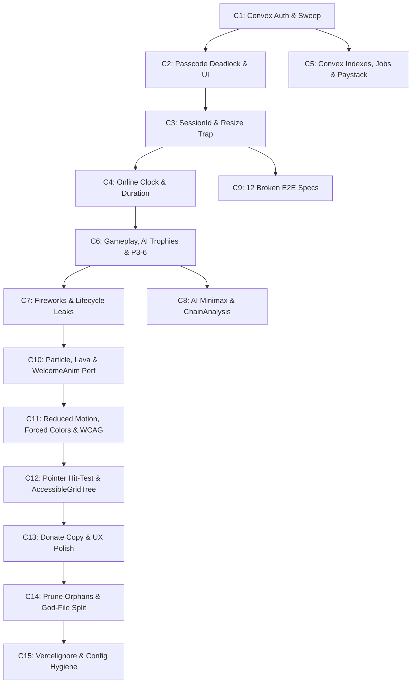

# ShapeKeeper Surgical Audit Remediation Plan (2026-11-27)

- **Audit Report:** [`shapekeeper-surgical-audit-2026-11-27.md`](file:///home/leandi-duplessis/github/workspaces/ShapeKeeper/docs/audits/shapekeeper-surgical-audit-2026-11-27.md)
- **Baseline Commit:** `d7574569d2ef2303129f4d2f8a487a098d9d3ee1`
- **Health Score Trajectory:** **`23 / 100` (CRITICAL)** (`6 P0 / 17 P1 / 11 P2 / 6 P3`, $M_{\text{kill}} = 45.31\%$) → **`99 / 100` (LOW)** (`0 P0 / 0 P1 / 0 P2 / 0 P3`, $M_{\text{kill}} \ge 90.6\%$)
- **Scope:** `15` atomic conventional commits (`C1`–`C15`) across `4` phases, restoring `28/28` Playwright E2E specs.

---

## 1. Batched Product Owner Decisions (`D1–D5`)

| ID | Decision | Options | Recommendation |
| :--- | :--- | :--- | :--- |
| **D1** | Open-Lobby vs Private-Room Passcode UX (`[P0-1]`) | **A:** `LOBBY` open rooms bypass passcode; private rooms show `[Adjective][Animal]` to host & prompt joiner. **B:** Require passcode on all rooms. | **Option A** (matches `AGENTS.md`) |
| **D2** | Online Max Player Count (`[P1-5]`) | **A:** Render dynamic 2–6 player scorecards/colors/winner entries & set `POPULATE_PLAYER_INDEX = -1`. **B:** Cap online rooms at 2 players. | **Option A** (matches `Players (1/6)`) |
| **D3** | `donate.html` & Hero Link Copy (`[P1-12]`) | **A:** Align `donate.html` with `#donationPromptOverlay` & remove dead Lemon Squeezy link. **B:** Hide `#donationPromptOverlay`. | **Option A** (while `PAYWALL_ENABLED = false`) |
| **D4** | `Permissions-Policy: payment` Scope (`[P1-8]`) | **A:** Scope `payment=(self "https://checkout.paystack.com")` to `/checkout.html` only in `vercel.json`. **B:** Keep `payment=()` globally. | **Option A** (unblocks Apple/Google Pay) |
| **D5** | Orphaned Subsystems (`[P2-5]`) | **A:** Delete dead `convex/rooms/settings.ts`, `TypedParticlePool.js`, `convex/entitlements.ts`, duplicate shims, `test-connection-pooling.html`. **B:** Wire `TypedParticlePool`. | **Option A** (keeps archived paywall per `AGENTS.md`) |

---

## 2. Execution Dependency Graph & Convex Deploy Protocol

**Convex Sidecar & Deploy Protocol (`AGENTS.md`):**
1. Before any `convex/schema.ts` edit, run `ps -ef | grep -E "convex" | grep -v grep`. Kill any ShapeKeeper `convex dev` sidecar first.
2. Run `npx convex dev --once` to regenerate `convex/_generated/` (never hand-edit `_generated/`).
3. Deploy Convex backend commits (`C1`, `C2`, `C5`) **before** Vercel static frontend deploys that depend on new args/fields.

---

## 3. Phase 1 — P0 Blockers, Auth Boundaries & Online Correctness (`C1`–`C5`)

### `C1` `fix(convex): harden tapSquare auth, internalize sweepStaleLobbies, cascade room cleanup, and preserve host tokens`
- **Findings & Deps:** `[P0-2]`, `[P0-3]`, `[P1-6]` (partial), `[P1-7]` (partial). No prerequisites.
- **Files & Changes:**
  - `convex/games/state.ts:L200-L273`: Query `players` via `by_room_session` for `(args.roomId, args.sessionId)`; reject non-members before rate-limit check.
  - `convex/mutations/sweepStaleLobbies.ts:L21-L56` & `convex/crons.ts:L16-L24`: Convert `sweepStaleLobbies` to `internalMutation` invoked via `internal.mutations.sweepStaleLobbies.sweepStaleLobbies`; cascade-delete `lines` and `squares` for each deleted room.
  - `convex/mutations/leaveRoom.ts:L25-L47`: Cascade-delete `lines` and `squares` when deleting a `finished` room; sort `remainingPlayers` by `joinedAt`/`_creationTime` on host transfer and preserve `hostTokenHash`.
  - `convex/mutations/updateGridSize.ts:L30`, `updateTurnDuration.ts:L30`, `toggleReady.ts:L14-L26`: Enforce `hostPlayerId === args.sessionId` + constant-time token check; add `room.status === 'lobby'` guard to `toggleReady`.
- **Red-Before-Green Test:** `convex/games/state.test.ts` (`tapSquareHandler rejects non-member sessionId`): call `tapSquareHandler` with `sessionId: 'attacker'` not in `players`. Pre-fix returns `{ success: true }` / halves multiplier; post-fix returns `{ error: 'Unauthorized: not a room member' }`.
- **Rollback / Pitfall Guards:** Keep `isAuthorisedHostAsync` backward-compatible with legacy rooms lacking `hostTokenHash`.
- **Verification:** `npx convex typecheck && npx vitest run convex/games/state.test.ts convex/mutations/leaveRoom.test.ts`

### `C2` `fix(lobby): resolve open-lobby passcode deadlock, add private passcode UI, and enforce crypto RNG + input bounds`
- **Findings & Deps:** `[P0-1]`, `[P1-6]` (remaining). Depends on `C1`.
- **Files & Changes:**
  - `convex/mutations/joinRoom.ts:L38-L87`: Bypass passcode check when `normalizedCode === 'LOBBY'`; enforce `args.passcode === room.passcode` for private rooms.
  - `convex/mutations/createRoom.ts:L33-L66` & `convex/rooms/shared.ts`: Use `generateSecureRoomCode()`, cap collision loop at 20 attempts, validate `gridSize` (`3..10`), `playerName` (trimmed `1..24` chars), and `color` (hex regex).
  - `index.html:L315-L471`, `src/ui/menu/lobbyView.js`, `src/ui/menu/lobbyEvents.js:L138-L206`: Render `#lobbyPasscodeValue` on `#lobbyScreen` for host; add `#joinPasscodeInput` on `#joinScreen` when joining a private room.
  - `tests/e2e/helpers/bootstrap-shared-multiplayer.js`: Enforce real passcode rules in the E2E mock backend.
- **Red-Before-Green Test:** `convex/mutations/joinRoom.test.ts` (`allows joining LOBBY without passcode`): pre-fix returns `{ error: 'Invalid passcode' }`; post-fix joins successfully.
- **Rollback / Pitfall Guards:** Preserve silly `[Adjective][Animal]` format (`AGENTS.md` — no numbers, no human names).
- **Verification:** `npx vitest run convex/mutations/createRoom.test.ts convex/mutations/joinRoom.test.ts convex/rooms/shared.test.js`

### `C3` `fix(sync): pass shared.getSessionId() in getGameState, fix LiveLobbyManager projection, and clear deferInitialReady on resize`
- **Findings & Deps:** `[P0-5]`, `[P0-6]`. Depends on `C2`.
- **Files & Changes:**
  - `convex-client/game-operations.js:L77` & `convex-client/subscriptions.js:L167`: Replace `shared.SESSION_ID` with `shared.getSessionId()`.
  - `src/ui/LiveLobbyManager.js:L29,L40-L71,L161-L169`: Use `p.isYou` / `p.isHost` instead of stripped `p.sessionId`; align default `turnDurationSeconds` to `15`.
  - `game-state.js:L250-L288`, `src/ui/MenuNavigation.js:L308-L310`, `src/ui/menu/syncHandlers.js:L341-L345`: Clear `game.options.deferInitialReady = false` on first authoritative render so `resize`/`orientationchange` always hides the loading skeleton.
- **Red-Before-Green Test:** `tests/sync-handlers.test.js` (`getGameState passes getSessionId() and resize clears loading skeleton`): pre-fix passes `sessionId: undefined` and leaves skeleton visible; post-fix passes valid `sessionId` and hides skeleton.
- **Rollback / Pitfall Guards:** None.
- **Verification:** `npx vitest run tests/sync-handlers.test.js`

### `C4` `fix(timing): prevent permanent online clock freeze, fix cross-client clock sync, and unify turn-duration contract`
- **Findings & Deps:** `[P0-4]`, `[P1-4]`. Depends on `C3`.
- **Files & Changes:**
  - `src/timing/turn-clock-controller.js:L38-L57` & `src/timing/clock-sync.js:L65-L96`: Only sample RTT when the local player's own move is acknowledged; reset `delayBufferMs` on turn change; schedule `clock.endPause()` whenever `beginPause()` is called.
  - `convex/games/turn_duration.js`, `convex/games/turnTimer.ts`, `convex/mutations/updateTurnDuration.ts`: Unify `ALLOWED_TURN_DURATIONS_MS = [0, 10000, 15000, 30000, 60000]`, default `15000`.
  - `index.html`, `dots-and-boxes-game.js`, `game-state.js`: Replace `#lobbyTurnDuration` free input with preset `<select>`, remove duplicate `_localTurnClock` / `localTurnTimer`, clear `.turn-urgent` on AI turn/game over, increment `localTurnCounter` unconditionally, preserve `turnDurationMs` on save restore.
- **Red-Before-Green Test:** `tests/turn-clock-controller.test.js` (`clock resumes after lag pause and ignores remote player clock skew`): pre-fix `clock.isPaused()` stays `true` forever; post-fix resumes within `<= 1500ms`.
- **Rollback / Pitfall Guards:** Keep `turnDurationSeconds` optional in `convex/schema.ts` for legacy rooms.
- **Verification:** `npx vitest run convex/games/turnTimer.test.ts convex/mutations/updateTurnDuration.test.ts`

### `C5` `fix(convex): cancel stale expireTurn jobs, replace unbounded .collect() scans, harden Paystack/license & rateLimits`
- **Findings & Deps:** `[P1-7]`, `[P1-8]`, `[P2-11]`. Depends on `C1`.
- **Files & Changes:**
  - `convex/schema.ts` & `convex/games/turnTimer.ts:L59-L92`: Store `turnTimerJobId: v.optional(v.id('_scheduled_functions'))` on `rooms` and call `ctx.scheduler.cancel(room.turnTimerJobId)` before scheduling a new `expireTurn`.
  - `convex/games/draw.ts:L66-L120`, `squares.ts:L22`, `roomQueries.ts:L59-L91`: Replace full-table `.collect()` with indexed queries/counts.
  - `convex/rate_limit.js` & `convex/crons.ts`: Replace `.unique()` with `.first()` and add hourly pruning cron for expired `rateLimits`.
  - `convex/http.ts:L38-L41`, `convex/licences.ts:L21-L34`, `vercel.json:L24`: Rate-limit `/paystack/verify` & `/license/validate`, reject empty `EXPECTED_KOBO`, set `status: 'active'` on re-issue, and scope `payment=(self "https://checkout.paystack.com")` to `/checkout.html`.
- **Red-Before-Green Test:** `convex/games/turnTimer.test.ts` (`cancels previous turnTimerJobId on move`): pre-fix `ctx.scheduler.cancel` is never called (`0` calls); post-fix called `1` time.
- **Rollback / Pitfall Guards:** Run `npx convex dev --once` after `convex/schema.ts` edit.
- **Verification:** `npx convex typecheck && npx vitest run convex/games/turnTimer.test.ts`

---

## 4. Phase 2 — Core Gameplay Correctness, AI, Fireworks & Broken E2E Recovery (`C6`–`C9`)

### `C6` `fix(gameplay): make wouldCompleteSquare non-destructive, fix AI achievement attribution, and decouple populate sentinel from Player 3`
- **Findings & Deps:** `[P1-1]`, `[P1-5]`, `[P1-10]`. Depends on `C4`.
- **Files & Changes:**
  - `game-logic.js:L153-L202`: Guard `wouldCompleteSquare` with `alreadyPresent` + `try/finally`.
  - `achievement-system.js:L216-L270`: Require `currentPlayer === 1` / `winner === 1` before unlocking human achievements.
  - `convex/games/shared.ts:L3`, `constants.js:L21`, `syncHandlers.js`, `renderer/board.js`, `ui-manager.js`, `celebrations.js`: Set `POPULATE_PLAYER_INDEX = -1`, `POPULATE_PLAYER_ID = 0`, and render dynamic 2–6 player colors/scores/winner entries.
- **Red-Before-Green Test:** `tests/game-logic.test.js` (`wouldCompleteSquare preserves existing line`): pre-fix `game.lines.has(key)` becomes `false`; post-fix remains `true`.
- **Rollback / Pitfall Guards:** None.
- **Verification:** `npx vitest run`

### `C7` `fix(celebrations): fix frame-1 launchFireworks exit, clamp DPR, and eliminate match/audio teardown leaks`
- **Findings & Deps:** `[P1-2]`, `[P1-16]`, `[P3-5]`. Depends on `C6`.
- **Files & Changes:**
  - `ui-manager/celebrations.js:L273-L381`: Spawn rocket #1 before `requestAnimationFrame(animate)`, clamp DPR to `2`, use `dt`-scaled physics, track timers in `DisposableRegistry`.
  - `game-state.js:L307`, `dots-and-boxes-game.js:L317-L331`, `animation-system.js:L28-L79`, `tutorial-system.js:L124-L134,L278`, `localSetupEvents.js:L209-L215`: Track `showWinner` timeout, compact `effectAnimations`, add `tutorial.destroy()`, clean up failed save-load game instances.
  - `sound-manager.js` & `src/audio/AmbientSoundscape.js`: Lazy-init `AudioContext`, wrap WebAudio calls in `try/catch`, handle iOS `'interrupted'`, align `'singularity'`/`'touch'` events, disconnect nodes on `destroy()`.
- **Red-Before-Green Test:** `tests/celebrations-lifecycle.test.js` (`launchFireworks renders at least one rocket before exiting`): pre-fix draws `0` rockets; post-fix draws `>= 1`.
- **Rollback / Pitfall Guards:** None.
- **Verification:** `npx vitest run tests/celebrations-lifecycle.test.js`

### `C8` `fix(ai): enable ChainAnalysis loop detection, time-budget MinimaxEngine, and stop double-evaluating moves`
- **Findings & Deps:** `[P1-14]`. Depends on `C6`.
- **Files & Changes:**
  - `src/ai/ChainAnalysis.js:L103,L163,L182-L199`: Detect closed cycles and set `isLoop = true`.
  - `src/ai/MinimaxEngine.js` & `dots-and-boxes-game.js:L781-L831`: Wire `_sacEval`, add 150ms iterative-deepening budget, and evaluate each candidate move once in `pickRandomAmongBest`.
- **Red-Before-Green Test:** `tests/ai-chain-analysis.test.js` (`detects closed 4-box loop`): pre-fix `chain.isLoop === false`; post-fix `true`.
- **Rollback / Pitfall Guards:** None.
- **Verification:** `npx vitest run`

### `C9` `test(e2e): migrate 12 broken Playwright specs off removed #localPlayBtn and restore CI browser-compatibility gate`
- **Findings & Deps:** `[P1-3]`, `[P3-4]` (partial). Depends on `C3`.
- **Files & Changes:**
  - Add shared `openLocalSetup(page)` helper using current `HomePager` UI and update all 12 broken specs (`browser-compatibility.spec.js`, `achievement-panel.spec.js`, `aria-hidden-verify.spec.js`, `game-controls-panel.spec.js`, `layout-overlap-mobile.spec.js`, `local-allowed-time.spec.js`, `local-gameplay.spec.js`, `local-setup.spec.js`, `local-turn-timer.spec.js`, `settings-and-theme.spec.js`, `tutorial.spec.js`, `winner-screen.spec.js`).
  - Add `"test:e2e:all": "playwright test"` to `package.json`.
- **Red-Before-Green Test:** `npm run test:e2e:compat`: pre-fix fails on `#localPlayBtn` timeout; post-fix passes across Chromium/Firefox/WebKit.
- **Rollback / Pitfall Guards:** None.
- **Verification:** `npm run test:e2e:smoke && npm run test:e2e:compat`

---

## 5. Phase 3 — Rendering Performance, Reduced Motion, Accessibility & Input Polish (`C10`–`C12`)

### `C10` `perf(rendering): fix particle-system logicalWidth, move lava physics to update(dt), fix SpriteFireworks trail clear, and pause hidden WelcomeAnimation`
- **Findings & Deps:** `[P1-9]`, `[P1-15]`, `[P3-2]`. Depends on `C7`.
- **Files & Changes:**
  - `particle-system/core.js:L9-L10` & `tests/particle-system/core.test.js`: Read `system.game?.logicalWidth || system.logicalWidth || 800`; update test to pass real `{ game: { logicalWidth } }` shape.
  - `dots-and-boxes-game.js:L133`: Remove duplicate `initializeAmbientParticles()` call.
  - `particle-system/lava-particles.js:L80-L111`, `renderer/lava-timer.js:L84-L93`, `renderer.js:L74-L75`, `ui-manager.js:L61`: Move lava physics to `update(dt)`, cache radial gradient, remove duplicate square draw, throttle `updateMineCounter` to state changes.
  - `src/ui/SpriteFireworks.js:L58-L61,L138-L216`, `src/ui/sprite-sparks.js:L65`, `src/ui/WelcomeAnimation.js`: Call `sprite.trail?.clear()` on respawn, normalize `dt`, pause `WelcomeAnimation` when `#welcomeScreen` is inactive or `reducedMotion` is true, clamp DPR to `2`, remove 9 listeners on canvas swap.
- **Red-Before-Green Test:** `tests/particle-system/core.test.js` (`reads system.game.logicalWidth`): pre-fix spawns within `800×600`; post-fix uses `1200×900`.
- **Rollback / Pitfall Guards:** Enforce `AGENTS.md` sprite trail & no-gridlines invariants.
- **Verification:** `npx vitest run tests/particle-system/core.test.js tests/welcome-animation-trail-lines.test.js`

### `C11` `fix(a11y): honor prefers-reduced-motion live, restore forced-colors focus rings, meet WCAG 2.5.8 target sizes, and fix 100dvh viewport`
- **Findings & Deps:** `[P1-11]`, `[P2-1]`, `[P2-2]`. Depends on `C10`.
- **Files & Changes:**
  - `renderer/effects.js:L128`: Spawn `0` ambient particles and keep geometry static under `prefers-reduced-motion: reduce`.
  - `styles/base.css`, `game.css`, `menu-layout.css`, `cosmic-identity.css`, `interactions.css:L88`, `lobby.css`: Replace `outline: none` with `outline: 2px solid transparent`, add `@media (forced-colors: active)`, fix `prefers-contrast: more`, add `100dvh` fallback, expand `.pager-dot` and `.achievement-panel-summary` hit areas to `>= 24×24px` (`44×44px` on mobile).
  - `src/ui/ThemeManager.js`, `LevelsProgress.js`, `achievement-system.js`, `local-save-replay.js`: Re-tint active sprites on theme toggle; wrap `localStorage` in `try/catch`.
- **Red-Before-Green Test:** `tests/reduced-motion.test.js` (`spawns 0 ambient particles when reducedMotion is true`): pre-fix spawns `40`; post-fix spawns `0`.
- **Rollback / Pitfall Guards:** Maintain `>= 3:1` non-text contrast in both themes (`tests/cosmic-identity.test.js`).
- **Verification:** `npx vitest run tests/reduced-motion.test.js tests/cosmic-identity.test.js`

### `C12` `fix(input): prioritize dot selection over adjacent squares and refactor AccessibleGridTree to single-source O(1) roving tabindex`
- **Findings & Deps:** `[P1-13]`, `[P1-17]`, `[P2-10]`, `[P3-6]`. Depends on `C11`.
- **Files & Changes:**
  - `input-handler/pointer-controls.js:L50-L69,L285-L296,L345-L350`: Check dot hit-test before unrevealed-square tap.
  - `src/a11y/AccessibleGridTree.js:L29-L93,L240-L288`: Use single delegated listener + roving `tabindex` + `dataset.row`/`dataset.col`, await async `drawLine` before clearing `selectedDot`, wrap `selectionLocked` in `try/finally`.
  - `src/ui/home/HomePager.js`, `src/ui/Toast.js:L54-L59`, `src/ui/AccessibilityAnnouncer.js:L1-L24`: Sync `inert` on off-screen slides, clear `Toast` timer on dismiss, add `resetAnnouncements()`.
- **Red-Before-Green Test:** `tests/input-handler.test.js` (`dot click wins over adjacent unrevealed square`): pre-fix triggers square tap; post-fix selects dot.
- **Rollback / Pitfall Guards:** None.
- **Verification:** `npx vitest run tests/input-handler.test.js`

---

## 6. Phase 4 — Product Copy Alignment, Dead Code Pruning & Packaging Hygiene (`C13`–`C15`)

### `C13` `fix(ux): align donate.html with donation modal, remove dead Lemon Squeezy link, and polish MultiplayerStartup/GameControlsPanel/TurnNoticeBubble`
- **Findings & Deps:** `[P1-12]`, `[P2-3]`, `[P2-4]`, `[P2-6]`, `[P2-9]`. Depends on `C12`.
- **Files & Changes:** Align `donate.html:L138-L151` with `#donationPromptOverlay`, remove dead Lemon Squeezy link in `index.html:L82-L87`, replace internal jargon in `MultiplayerStartup.js:L44,L159-L162`, clear `.primed` / close drawer on screen exit in `GameControlsPanel.js` & `sessionEvents.js`, separate debounce timers & catch clipboard errors in `lobbyEvents.js`, and remove "sparkly boxes" quips in `TurnNoticeBubble.js:L22,L40`.
- **Red-Before-Green Test:** `grep -n "lemonsqueezy\|There is no tip jar" index.html donate.html` returns `0` matches post-fix.
- **Verification:** `npm run lint && npm run test:e2e:smoke`

### `C14` `chore(cleanup): prune orphaned modules, decompose dots-and-boxes-game timer/overlay helpers, and tighten Convex TS types`
- **Findings & Deps:** `[P2-5]`, `[P2-8]`, `[P3-1]`, `[P3-4]`. Depends on `C13`.
- **Files & Changes:** Remove orphaned `convex/rooms/settings.ts`, `convex/entitlements.ts`, `src/particles/TypedParticlePool.js`, duplicate shims (`line_validation.ts`, `turnDeadline.js`, `rateLimit.js`); modernize `Fullscreen.js`; extract `LocalTurnManager` & `PenaltyOverlayManager` from `dots-and-boxes-game.js`; replace `any` in newly touched Convex handlers.
- **Red-Before-Green Test:** `npx convex typecheck && npx vitest run` passes with zero broken imports.
- **Verification:** `npm run lint && npx convex typecheck && npx vitest run`

### `C15` `chore(deploy): add .vercelignore, remove shipped debug harness, clear stale Convex fallback URL, and ignore local venvs`
- **Findings & Deps:** `[P2-7]`, `[P3-3]`. Depends on `C14`.
- **Files & Changes:** Add `.vercelignore` (excluding `docs/`, `tests/`, `*.test.*`, `playwright*`, `test-connection-pooling.html`), delete `test-connection-pooling.html`, remove `oceanic-antelope-781.convex.cloud` fallback in `convex-client/shared.js:L4`, ignore `myenv/` and nested `ShapeKeeper/` in `.gitignore`.
- **Red-Before-Green Test:** `npx vitest run && npm run build` passes cleanly.
- **Verification:** `npm run lint && npx convex typecheck && npx vitest run && npm run build && npm run test:e2e:smoke && npm run test:e2e:compat && npm run test:e2e:all`

---

## 7. End-to-End Verification Matrix & Exit Criteria

| Gate | Command | Pass Criterion |
| :--- | :--- | :--- |
| Lint | `npm run lint` | `0` errors |
| Convex Typecheck | `npx convex typecheck` | `0` TS errors |
| Unit & Mutation Suite | `npx vitest run` | `100%` pass, $M_{\text{kill}} \ge 90\%$ (`>= 58/64`) |
| Static Build | `npm run build` | Exit `0` |
| E2E Smoke & Compat | `npm run test:e2e:smoke && npm run test:e2e:compat` | `100%` pass across browsers |
| Full E2E Suite | `npm run test:e2e:all` | `28 / 28` specs pass |
| Pass 2.5 Live Probe | Headless Playwright `canvas_probe_core.mjs` | `0` small WCAG 2.5.8 targets, `0` strokes on hidden `welcomeCanvas`, `0` ambient particles under `reducedMotion` |
