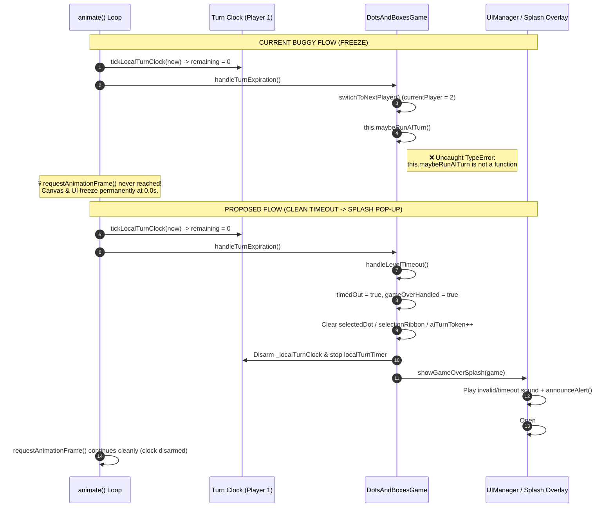

# Implementation Plan (v2 — Deep Architectural Audit)
## Levels Mode Timer Scaling (`+2s` / Completed Level), Freeze Root-Cause Remediation & Game Over Splash Pop-Up

---

## 1. Goal Description

1. **Answer & remediate "Why is there a timer in Levels and why does the level freeze when it runs out?"** by fixing all **six underlying timer and lifecycle defects** uncovered in the codebase audit.
2. **Keep the timer and scale it by `+2 seconds` for each level completed** ($T = 7 + 2 \times C$ seconds, where $C$ is the number of completed levels), surfacing the current timer budget clearly in the Levels UI and post-level celebration banner.
3. **Add a dedicated Game Over Splash Pop-Up when time runs out** (`#gameOverSplashOverlay`) that springs open over the board with `"⏰ TIME'S UP! — GAME OVER"`, final score & timer breakdown, and one-tap **Retry Level**, **Levels Grid**, and **Main Menu** actions.

---

## 2. Deep Root-Cause Analysis (6 Defects Uncovered)

### Defect 1 (Primary Freeze Cause): Uncaught `TypeError` inside `animate()` kills the `requestAnimationFrame` loop
- **Location:** [`dots-and-boxes-game.js`](file:///home/leandi-duplessis/github/workspaces/ShapeKeeper/dots-and-boxes-game.js#L1064-L1074) and [`dots-and-boxes-game.js`](file:///home/leandi-duplessis/github/workspaces/ShapeKeeper/dots-and-boxes-game.js#L1212-L1231)
- **Why there is a timer:** Commit `b2b8dcb` introduced a 25-level progression mode (`isLevelsMode: true`) with a hardcoded 7-second turn countdown (`turnDurationSeconds: 7`) rendered via the Layer-2 Lava Timer (`drawLavaTimerLayer()`).
- **Why it freezes at `0.0s`:**
  In `DotsAndBoxesGame.prototype.animate()`:
  ```javascript
  } else if (this.shouldRunLocalTurnClock()) {
      this.tickLocalTurnClock(now);
      this.handleTurnExpiration(); // <-- throws uncaught TypeError at line 1229!
  }
  if (!this.isDestroyed) {
      const rafId = requestAnimationFrame(() => this.animate()); // <-- NEVER REACHED!
      this.disposables.addRAF(rafId);
  }
  ```
  When `this.turnRemainingMs` reaches `0`, `handleTurnExpiration()` calls `this.gameState.switchToNextPlayer()` (switching `this.currentPlayer` to `2`) and then executes:
  ```javascript
  if (this.isLevelsMode && this.currentPlayer === 2) {
      this.maybeRunAITurn(); // <-- DOES NOT EXIST! Real method is this.scheduleAITurn()
  }
  ```
  Because `this.maybeRunAITurn` is `undefined`, JavaScript throws an uncaught `TypeError: this.maybeRunAITurn is not a function` **before** `requestAnimationFrame(() => this.animate())` is scheduled for the next frame. The render loop permanently dies, freezing the canvas at `0.0s`.

### Defect 2 (Split-Brain Dual Timers): `_localTurnClock` never resets when completing a square!
- **Location:** [`dots-and-boxes-game.js`](file:///home/leandi-duplessis/github/workspaces/ShapeKeeper/dots-and-boxes-game.js#L509), [`dots-and-boxes-game.js`](file:///home/leandi-duplessis/github/workspaces/ShapeKeeper/dots-and-boxes-game.js#L1064-L1153)
- `DotsAndBoxesGame` currently contains **two competing local timer engines**:
  1. **Engine A (`this._localTurnClock` / `tickLocalTurnClock(Date.now())`)** — runs when `this.shouldRunLocalTurnClock()` is `true` (used in `localMode === 'human'` and `isLevelsMode && currentPlayer === 1`).
  2. **Engine B (`this.localTurnTimer` / `tickLocalTurnTimer()`)** — created in `initLocalTurnTimer()` using `performance.now()`.
- When Player 1 completes a square in `drawLine()`, `this.currentPlayer` remains `1` (bonus move for completing a box). Line 509 calls `this.restartLocalTurnTimer()`, which restarts **Engine B (`this.localTurnTimer`)**—not **Engine A (`this._localTurnClock`)**!
- Because Engine A only re-arms its deadline when `clock.player !== this.currentPlayer || clock.deadline === 0`, **completing a square in Levels mode (or local hot-seat mode) does NOT reset the turn timer!** A player chaining multiple boxes must complete their entire chain within the original single-move deadline.

### Defect 3 (Fallthrough Phantom Expiry): `animate()` falls through to Engine B when `shouldRunLocalTurnClock()` becomes `false`
- **Location:** [`dots-and-boxes-game.js`](file:///home/leandi-duplessis/github/workspaces/ShapeKeeper/dots-and-boxes-game.js#L1062-L1069)
- In `animate()`:
  ```javascript
  if (this.isOnline) {
      this.handleTurnExpiration();
  } else if (this.shouldRunLocalTurnClock()) {
      this.tickLocalTurnClock(now);
      this.handleTurnExpiration();
  } else if (this.localTurnTimer?.enabled) {
      this.tickLocalTurnTimer();
  }
  ```
- In Levels mode, `this.localTurnTimer.enabled` is `true` (since `FEATURE_LAVA_TIMER` is `true` and `turnDurationMs > 0`). While `currentPlayer === 1` and the game is active, `shouldRunLocalTurnClock()` is `true`, so the `else if (this.localTurnTimer?.enabled)` branch is skipped even though `this.localTurnTimer` was started in the constructor.
- The moment `shouldRunLocalTurnClock()` becomes `false` (either when `currentPlayer` switches to `2` or when `isGameOver()` becomes `true` on timeout), `animate()` falls through into `else if (this.localTurnTimer?.enabled)` and calls `this.tickLocalTurnTimer()`, which consumes its stale deadline and fires `this.expireLocalTurn()` in the background!

### Defect 4 (Background Tab Drift): `visibilitychange` pauses Engine B (`localTurnTimer`), not Engine A (`_localTurnClock`)
- **Location:** [`dots-and-boxes-game.js`](file:///home/leandi-duplessis/github/workspaces/ShapeKeeper/dots-and-boxes-game.js#L128-L134)
- Switching browser tabs calls `this.localTurnTimer?.pause()` / `resume()`, but `this._localTurnClock` uses raw `Date.now()` (`clock.deadline - now`). If a player switches tabs for a few seconds during a level, `_localTurnClock` immediately expires upon returning.

### Defect 5 (Zombie Game Instances): `setActiveGame()` in `MenuNavigation.js` never calls `game.destroy()`
- **Location:** [`src/ui/MenuNavigation.js`](file:///home/leandi-duplessis/github/workspaces/ShapeKeeper/src/ui/MenuNavigation.js#L119-L128)
- `setActiveGame(nextGame)` overwrites `game = nextGame` without calling `game.destroy()` on the previous `DotsAndBoxesGame` instance:
  ```javascript
  function setActiveGame(nextGame) {
      game = nextGame; // <-- previous `game` is leaked and keeps running animate()!
  ```
- When a player clicks **Retry Level**, **Next Level**, **Exit**, or **Play Again**, the old `DotsAndBoxesGame` instance continues running its `requestAnimationFrame` loop at 60fps on the shared `<canvas id="gameCanvas">`, ticking its old timer, firing duplicate pointer listeners on `#gameCanvas`, and repainting the old board every 48ms (`ambientRedraw`).

### Defect 6 (Celebration & Input Cleanup on Defeat/Timeout):
- **Location:** [`ui-manager/celebrations.js`](file:///home/leandi-duplessis/github/workspaces/ShapeKeeper/ui-manager/celebrations.js#L338-L400) and [`dots-and-boxes-game.js`](file:///home/leandi-duplessis/github/workspaces/ShapeKeeper/dots-and-boxes-game.js#L1212-L1231)
- When a player loses a level (`winner !== 1`), `showWinner()` unconditionally calls `game.soundManager.playVictorySound()`, `launchConfetti()`, and `launchFireworks()`.
- When time runs out while the player is mid-drag on a line (`selectedDot`, `selectionLocked`, `selectionRibbon`), active pointer selection state is not cleared.
- There is no direct button to return to the **Levels Grid** (`#levelsScreen`) after a level ends—forcing players to go to `Main Menu` → `Levels`.

---

## 3. Architecture & State Flow Diagrams

### Current Buggy Flow vs. Proposed Architecture



---

## 4. Mathematical Specification: Timer Scaling (`+2s` per Completed Level)

Let $C = |\text{state.completedLevels}|$ be the number of unique levels completed by the player ($0 \le C \le 25$), and let $B = 7\text{ s}$ be the base turn duration:

$$T_{\text{seconds}}(C) = B + 2 \times C = 7 + 2C$$

$$T_{\text{ms}}(C) = T_{\text{seconds}}(C) \times 1000 = (7 + 2C) \times 1000$$

| Progression Stage | Levels Completed ($C$) | Grid Size Tier | Turn Timer ($T = 7 + 2C$) | Delta vs. Level 1 |
| :--- | :---: | :---: | :---: | :---: |
| **Level 1 (Start)** | $0$ | $3 \times 3$ (4 boxes) | **7s** (`7000ms`) | $+0\text{s}$ |
| **Level 2** | $1$ | $3 \times 3$ (4 boxes) | **9s** (`9000ms`) | $+2\text{s}$ |
| **Level 3** | $2$ | $3 \times 3$ (4 boxes) | **11s** (`11000ms`) | $+4\text{s}$ |
| **Level 6 (Tier 2)** | $5$ | $4 \times 4$ (9 boxes) | **17s** (`17000ms`) | $+10\text{s}$ |
| **Level 11 (Tier 3)** | $10$ | $5 \times 5$ (16 boxes) | **27s** (`27000ms`) | $+20\text{s}$ |
| **Level 16 (Tier 4)** | $15$ | $6 \times 5$ (20 boxes) | **37s** (`37000ms`) | $+30\text{s}$ |
| **Level 21 (Tier 5)** | $20$ | $7 \times 5$ (24 boxes) | **47s** (`47000ms`) | $+40\text{s}$ |
| **Level 25 (Final)** | $24$ | $7 \times 5$ (24 boxes) | **55s** (`55000ms`) | $+48\text{s}$ |
| **All 25 Completed** | $25$ | Replay any level | **57s** (`57000ms`) | $+50\text{s}$ |

---

## 5. UI / UX Design: Game Over Splash Pop-Up & Levels Banner

### A. In-Game Game Over Splash Pop-Up (`#gameOverSplashOverlay`)
When the timer reaches `0.0s` in Levels mode, an animated glassmorphic modal overlay springs open directly over `#gameScreen` (keeping the board visible beneath a blurred backdrop so the player can see the exact board state where time ran out):

```
+-----------------------------------------------------------------------+
|  Player 1: 2                   [Exit]                        AI: 1    |
+-----------------------------------------------------------------------+
|  ░░░░░░░░░░░░░░░░░░░░░ BLURRED GAME BOARD ░░░░░░░░░░░░░░░░░░░░░░░░░░  |
|  ░░       ╔═══════════════════════════════════════════════╗       ░░  |
|  ░░       ║                 ⏰ TIME'S UP!                 ║       ░░  |
|  ░░       ║                  GAME OVER                    ║       ░░  |
|  ░░       ║                                               ║       ░░  |
|  ░░       ║        Level 3 Failed — Out of Time!          ║       ░░  |
|  ░░       ║     Turn Timer: 11s (7s base + 4s bonus)      ║       ░░  |
|  ░░       ║                                               ║       ░░  |
|  ░░       ║          ┌─────────────────────────┐          ║       ░░  |
|  ░░       ║          │  Player 1: 2  ·  AI: 1  │          ║       ░░  |
|  ░░       ║          └─────────────────────────┘          ║       ░░  |
|  ░░       ║                                               ║       ░░  |
|  ░░       ║        [     Retry Level 3 ↺     ]            ║       ░░  |
|  ░░       ║        [ Levels Grid ]  [ Main Menu ]         ║       ░░  |
|  ░░       ╚═══════════════════════════════════════════════╝       ░░  |
+-----------------------------------------------------------------------+
```

### B. Levels Screen Banner Enhancement (`#levelsScreen`)
Update `.levels-status-banner` on `#levelsScreen` to display the player's current Turn Timer alongside Sprites and Progress:
- `Sprites Collected: X ✨`
- `Turn Timer: 7s (+2s/lvl) ⏱️` (updates dynamically to `9s`, `11s`, etc. as levels are completed)
- `Progress: Y/25`

---

## 6. User Review Required & Open Questions

> [!IMPORTANT]
> **Key Design Decisions Confirmed in This Plan:**
> 1. **Immediate Game Over on Timeout in Levels Mode:** Running out of time on any turn in Levels mode immediately ends the match in a loss and opens the **Game Over Splash Pop-Up** (`#gameOverSplashOverlay`). (Local hot-seat multiplayer keeps its existing house rule where timeout skips the turn.)
> 2. **Per-Move Clock Reset Fixed:** Completing a square (earning a bonus move) now properly resets the turn timer back to the full allowed duration ($7 + 2C$ seconds) for the next move.
> 3. **Timer Bonus Calculation:** Uses `7 + (completedLevels.length * 2)` seconds. Completing any new level permanently adds `+2s` to the player's turn timer in Levels mode.

---

## 7. Proposed Changes (File-by-File)

### Component 1: Levels Progression & Timer Calculation

#### [MODIFY] [`src/ui/LevelsProgress.js`](file:///home/leandi-duplessis/github/workspaces/ShapeKeeper/src/ui/LevelsProgress.js)
- Export `BASE_LEVEL_TURN_DURATION_SECONDS = 7` and `SECONDS_PER_COMPLETED_LEVEL = 2`.
- Export `getTurnDurationForLevel(completedLevelsCount)` helper that reads `LevelsProgress.getState().completedLevels.length` when not explicitly passed:
```javascript
export const BASE_LEVEL_TURN_DURATION_SECONDS = 7;
export const SECONDS_PER_COMPLETED_LEVEL = 2;

/**
 * Returns the turn duration in seconds for Levels mode:
 * 7s base + 2s for each completed level.
 * @param {number} [completedCountOverride]
 * @returns {number}
 */
export function getTurnDurationForLevel(completedCountOverride) {
    const completedCount = Number.isFinite(completedCountOverride)
        ? Math.max(0, Math.floor(completedCountOverride))
        : LevelsProgress.getState().completedLevels.length;
    return BASE_LEVEL_TURN_DURATION_SECONDS + completedCount * SECONDS_PER_COMPLETED_LEVEL;
}
```

#### [MODIFY] [`src/ui/LevelsScreen.js`](file:///home/leandi-duplessis/github/workspaces/ShapeKeeper/src/ui/LevelsScreen.js)
- Import `getTurnDurationForLevel` from `./LevelsProgress.js`.
- In `startLevelMatch(levelNumber, deps)`:
  - Hide `#gameOverSplashOverlay` if open before starting the match.
  - Compute `const turnDurationSeconds = getTurnDurationForLevel();` and pass `turnDurationSeconds` and `turnDurationMs: turnDurationSeconds * 1000` into `new DotsAndBoxesGame(...)`.
- In `renderLevelsGrid(deps)`:
  - Update `#levelsTimerBadge` (if present) with `${turnDurationSeconds}s` (`7s + ${completedCount * 2}s`).
  - Include the timer label on each level button (`${cols}×${rows} · ⏱${turnDurationSeconds}s`).

---

### Component 2: Game Engine Timer Unification, Freeze Fix & Lifecycle Disposal

#### [MODIFY] [`dots-and-boxes-game.js`](file:///home/leandi-duplessis/github/workspaces/ShapeKeeper/dots-and-boxes-game.js)
1. **Dynamic Fallback Timer in Constructor (lines 61–70):**
   Import `getTurnDurationForLevel` from `./src/ui/LevelsProgress.js`. If `this.isLevelsMode` and no explicit `turnDurationSeconds` was provided, use `getTurnDurationForLevel()`. Initialize `this.timedOut = false;` and `this.gameOverHandled = false;`.
2. **Reset `_localTurnClock` on Every Move & Pause on Visibility Change:**
   - In `restartLocalTurnTimer()` (line 1092), also reset `this._localTurnClock`:
     ```javascript
     restartLocalTurnTimer() {
         if (this._localTurnClock) {
             this._localTurnClock.deadline = 0;
             this._localTurnClock.pausedRemainingMs = null;
         }
         const timer = this.localTurnTimer;
         if (!timer?.enabled) return;
         ...
     ```
   - In the `visibilitychange` listener (lines 128–134) and `tickLocalTurnClock(now)` (lines 1138–1153), support pausing and resuming `this._localTurnClock` when `document.hidden` is true so backgrounding the tab never unfairly drains the player's level timer.
3. **Prevent Dual-Timer Fallthrough in `animate()` (lines 1062–1069):**
   Ensure `this.localTurnTimer` does not run alongside `_localTurnClock` in modes driven by `_localTurnClock`, and stop both clocks when the game ends.
4. **Fix `handleTurnExpiration()` Freeze & Trigger Game Over Splash in Levels Mode (lines 1188–1231):**
   ```javascript
   handleTurnExpiration() {
       if (!FEATURE_FLAGS.FEATURE_LAVA_TIMER && !this.isLevelsMode) return;

       if (this.isOnline) {
           // ... existing online turn clock logic unchanged ...
           return;
       }

       const remaining = this.turnRemainingMs;
       if (remaining === null || remaining === undefined || remaining > 0) return;

       if (this.isLevelsMode) {
           this.handleLevelTimeout();
           return;
       }

       // Local hot-seat house rule: skip expired turn to next player
       this.selectedDot = null;
       this.selectionLocked = false;
       this.selectionRibbon = null;
       this.comboCount = 0;
       this.gameState.switchToNextPlayer();

       if (this._localTurnClock) {
           this._localTurnClock.deadline = 0;
       }
       this.turnRemainingMs = null;
       this.renderer.draw();
   }

   handleLevelTimeout() {
       if (this.timedOut || this.gameOverHandled) return;
       this.timedOut = true;
       this.gameOverHandled = true;
       this.turnRemainingMs = 0;
       if (this._localTurnClock) {
           this._localTurnClock.deadline = 0;
       }
       this.localTurnTimer?.stop?.();

       // Cancel any active pointer drag or pending AI turn
       this.selectedDot = null;
       this.selectionLocked = false;
       this.selectionRibbon = null;
       this.comboCount = 0;
       this.aiThinking = false;
       this.aiTurnToken += 1;

       this.renderer.draw();
       this.uiManager.showGameOverSplash();
   }
   ```

#### [MODIFY] [`game-state.js`](file:///home/leandi-duplessis/github/workspaces/ShapeKeeper/game-state.js)
- Update `isGameOver()` so a timed-out level game is immediately recognized as over by all input/AI/timer guards (without setting a boolean `game.isGameOver` property, preserving the `AUD-1` invariant tested in `tests/sync-handlers.test.js`):
```javascript
    isGameOver() {
        if (this.game.timedOut) {
            return true;
        }
        const totalSquares = (this.game.gridRows - 1) * (this.game.gridCols - 1);
        const completedSquares = Object.keys(this.game.squares).length;
        return completedSquares === totalSquares;
    }
```

#### [MODIFY] [`src/ui/MenuNavigation.js`](file:///home/leandi-duplessis/github/workspaces/ShapeKeeper/src/ui/MenuNavigation.js)
- Fix the zombie game instance leak in `setActiveGame(nextGame)` (line 119):
```javascript
function setActiveGame(nextGame) {
    if (game && game !== nextGame && typeof game.destroy === 'function') {
        game.destroy();
    }
    game = nextGame;
    window.__shapeKeeperActiveGame = nextGame;
    window.__shapeKeeperTutorial = nextGame?.tutorialSystem || null;
    setMenuNavigationDependencies({
        lobbyManager,
        welcomeAnimation,
        game,
    });
}
```

---

### Component 3: Game Over Splash Pop-Up UI, Celebrations & Session Wiring

#### [MODIFY] [`index.html`](file:///home/leandi-duplessis/github/workspaces/ShapeKeeper/index.html)
1. In `#levelsScreen` (`.levels-status-banner`, around line 278), add the timer status item:
   ```html
   <span class="levels-timer-counter">Turn Timer: <strong id="levelsTimerBadge">7s</strong> ⏱️</span>
   ```
2. Inside `#gameScreen` (`.game-container`, after `#tutorialOverlay` around line 567), add the **Game Over Splash Pop-Up** modal (`#gameOverSplashOverlay`):
   ```html
   <div
       id="gameOverSplashOverlay"
       class="game-over-splash-overlay"
       data-testid="game-over-splash-overlay"
       role="alertdialog"
       aria-modal="true"
       aria-labelledby="gameOverSplashTitle"
       aria-describedby="gameOverSplashSubtitle"
       hidden
   >
       <div class="game-over-splash-card">
           <div class="game-over-splash-badge" id="gameOverSplashBadge">⏰ TIME'S UP!</div>
           <h2 class="game-over-splash-title" id="gameOverSplashTitle">GAME OVER</h2>
           <p class="game-over-splash-subtitle" id="gameOverSplashSubtitle">
               Level 1 Failed — You ran out of time!
           </p>
           <div class="game-over-splash-scores" id="gameOverSplashScores"></div>
           <div class="game-over-splash-actions">
               <button
                   id="splashRetryLevelBtn"
                   class="start-btn"
                   data-testid="splash-retry-level-button"
                   type="button"
               >
                   Retry Level 1 ↺
               </button>
               <div class="game-over-splash-secondary-row">
                   <button
                       id="splashLevelsGridBtn"
                       class="start-btn secondary"
                       data-testid="splash-levels-grid-button"
                       type="button"
                   >
                       Levels Grid
                   </button>
                   <button
                       id="splashMainMenuBtn"
                       class="start-btn secondary"
                       data-testid="splash-main-menu-button"
                       type="button"
                   >
                       Main Menu
                   </button>
               </div>
           </div>
       </div>
   </div>
   ```
3. In `#winnerScreen` (around line 678), add an optional `#winnerLevelsBtn` (`hidden` by default, shown when `game.isLevelsMode` is true) so players can also jump back to the Levels grid after winning or losing a level normally.

#### [MODIFY] [`ui-manager.js`](file:///home/leandi-duplessis/github/workspaces/ShapeKeeper/ui-manager.js) & [`ui-manager/celebrations.js`](file:///home/leandi-duplessis/github/workspaces/ShapeKeeper/ui-manager/celebrations.js)
- Export `showGameOverSplash(game)` and `hideGameOverSplash()` from `ui-manager/celebrations.js`, and wire `uiManager.showGameOverSplash()` on `UIManager`.
- When `showGameOverSplash(game)` is called:
  - Play `game.soundManager.playInvalidSound()`.
  - Announce via `announceAlert(\`Time's up! Game Over. Level \${game.currentLevel} failed.\`)`.
  - Populate `#gameOverSplashSubtitle` with `Level ${game.currentLevel} Failed — Your ${game.turnDurationSeconds}s turn timer ran out!`.
  - Render Player 1 and AI scores into `#gameOverSplashScores`.
  - Set `#splashRetryLevelBtn` text to `Retry Level ${game.currentLevel} ↺` and `game._nextLevelToPlay = game.currentLevel`.
  - Unhide `#gameOverSplashOverlay` and focus `#splashRetryLevelBtn`.
- In `showWinner(game)`:
  - If `game.isLevelsMode && game.timedOut`, delegate to `showGameOverSplash(game)` so direct callers of `showWinner()` in tests or fallback paths also trigger the splash popup.
  - When `game.isLevelsMode && winner === 1`:
    - Record level win via `LevelsProgress.recordLevelWin(game.currentLevel)`.
    - Compute the updated timer `const nextTimerSec = getTurnDurationForLevel(state.completedLevels.length);`.
    - Display both rewards in `#winnerText`:
      `🏆 Level ${game.currentLevel} Complete! 🏆<br><span style="font-size: 0.6em; color: #00f0ff;">✨ +1 Sprite (Total: ${state.spritesObtained}) · ⏱️ Timer: ${nextTimerSec}s (+2s/lvl) ✨</span>`
    - Play `playVictorySound()` and launch confetti/fireworks.
  - When `game.isLevelsMode && winner !== 1` (score loss):
    - Play `playInvalidSound()` instead of `playVictorySound()`, and **do not** launch victory confetti or fireworks.
  - Toggle `#winnerLevelsBtn` visibility based on `Boolean(game.isLevelsMode)`.

#### [MODIFY] [`src/ui/menu/sessionEvents.js`](file:///home/leandi-duplessis/github/workspaces/ShapeKeeper/src/ui/menu/sessionEvents.js)
- Wire `#splashRetryLevelBtn`: hides `#gameOverSplashOverlay` and calls `startLevelMatch(game.currentLevel, deps)`.
- Wire `#splashLevelsGridBtn` and `#winnerLevelsBtn`: hides `#gameOverSplashOverlay`, calls `setActiveGame(null)` (which disposes the active game), calls `renderLevelsGrid(deps)`, and transitions to `showScreen('levelsScreen')`.
- Wire `#splashMainMenuBtn`: hides `#gameOverSplashOverlay`, calls `exitFullscreen()`, `setActiveGame(null)`, `resetStartupState()`, `showScreen('mainMenuScreen')`, and `welcomeAnimation?.moveBackToMainMenu()`.

#### [MODIFY] [`styles/winner.css`](file:///home/leandi-duplessis/github/workspaces/ShapeKeeper/styles/winner.css) & [`styles/menu-layout.css`](file:///home/leandi-duplessis/github/workspaces/ShapeKeeper/styles/menu-layout.css)
- Add responsive, reduced-motion-aware styles for `.game-over-splash-overlay`, `.game-over-splash-card`, `.game-over-splash-badge`, `.game-over-splash-scores`, and `.game-over-splash-actions` with 44px+ minimum touch target heights to satisfy `tests/e2e/layout-overlap-mobile.spec.js`.

---

## 8. Verification Plan

### Automated Unit & Integration Tests
1. **Update [`tests/levels-progress.test.js`](file:///home/leandi-duplessis/github/workspaces/ShapeKeeper/tests/levels-progress.test.js):**
   - Assert `getTurnDurationForLevel()` returns `7` at 0 completed levels, `9` after completing Level 1, `11` after completing Level 2, `17` after 5 completed levels, and `55` at 24 completed levels.
   - Assert replaying an already-completed level does not double-count `completedLevels.length` (`+2s` is strictly per unique completed level).
2. **Create [`tests/levels-timer-gameover.test.js`](file:///home/leandi-duplessis/github/workspaces/ShapeKeeper/tests/levels-timer-gameover.test.js):**
   - **Freeze Regression Test:** Instantiate `DotsAndBoxesGame` with `{ isLevelsMode: true, currentLevel: 1 }`, advance `tickLocalTurnClock` past 7000ms, invoke `handleTurnExpiration()`, and assert:
     - No exception is thrown (`maybeRunAITurn` bug eliminated).
     - `game.timedOut === true` and `game.gameState.isGameOver() === true`.
     - `#gameOverSplashOverlay` is visible (`hidden === false`) with title `"GAME OVER"`, badge `"⏰ TIME'S UP!"`, and retry button `"Retry Level 1 ↺"`.
   - **Square Completion Clock Reset Test:** Draw a 4th line completing a square on Player 1's turn at `t = 5000ms`, tick the clock at `t = 5100ms`, and assert `game.turnRemainingMs` resets to full `7000ms` (instead of continuing from `1900ms`).
   - **Tab Visibility Pause Test:** Simulate `document.hidden = true` during a level turn, advance wall clock by 10 seconds, resume tab, and assert the level timer did not expire while hidden.
   - **Zombie Instance Disposal Test:** Call `startLevelMatch(1, deps)` followed by `startLevelMatch(2, deps)` and assert the first game instance has `game1.isDestroyed === true`.

### Quality Gates (Run in Order per `AGENTS.md`)
```bash
npm run lint                       # ESLint flat config
npx convex typecheck               # Convex TypeScript check
npx vitest run                     # All unit & integration suites
npm run build                      # Static build check
npm run test:e2e:smoke             # Playwright Chromium smoke suite
```
