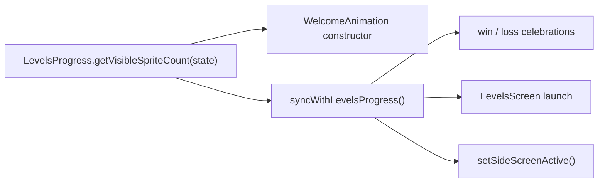

# Plan: the sprite playground shows only the sprites you collected

## Goal Description

Today a player who has not yet played a Levels game sees **120 demo sprites**. The side screens (swipe left or right) force 120 even for players who have collected fewer. Your request changes the original design: **the sprites on the home screen and both side screens are the sprites the player has collected, and nothing else.** There is no 120 default anywhere.

The 120 was a deliberate earlier decision, so this plan records that it is superseded. It does not just delete the number:

- [levels-2-design.md](file:///home/leandi-duplessis/github/workspaces/ShapeKeeper/docs/superpowers/specs/2026-10-21-levels-2-design.md) decision #3, "Show the 120 demo sprites", was marked confirmed on 2026-10-21.
- `AGENTS.md` will gain an invariant so a later agent does not restore the 120.

### Decisions you confirmed
| Question | Answer |
|---|---|
| New player with 0 collected | Show **1 sprite**, the same floor as Level 1 (`MIN_SPRITES_AFTER_TRIGGER`) |
| Scope | **Everywhere**: home menu background and both side screens |
| Very large collections | Show every sprite up to a performance cap of **300**. The count badge on the Levels screen still shows the true total |

## User Review Required

> [!IMPORTANT]
> **Visual trade-off for new players.** A first-time player will now see one sprite on the home screen instead of a busy 120-sprite constellation. There are no connection lines and no flocking until sprites are won. This is the logical result of "no more 120 default". If the empty look bothers you, say so and I will propose a different floor, for example 3.

> [!NOTE]
> The "full-spectrum ink" invariant in `AGENTS.md` is about the **palette**. Its test, `tests/cosmic-identity.test.js`, checks the palette, not the sprite count, so it keeps passing. In practice a player only sees the whole spectrum once they own several sprites.

## Proposed Changes

One source of truth for the count, then every consumer uses it.



---

### Progress rules

#### [MODIFY] [LevelsProgress.js](file:///home/leandi-duplessis/github/workspaces/ShapeKeeper/src/ui/LevelsProgress.js)
Add a cap constant and one pure helper next to `MIN_SPRITES_AFTER_TRIGGER`:

```js
/** Most sprites the playground will animate. Collections above this still count. */
export const MAX_VISIBLE_SPRITES = 300;

/** Sprites to draw: what the player collected, at least 1, at most the cap. */
export function getVisibleSpriteCount(state = LevelsProgress.getState()) {
    const collected = Math.floor(Number(state?.spritesObtained) || 0);
    return Math.min(MAX_VISIBLE_SPRITES, Math.max(MIN_SPRITES_AFTER_TRIGGER, collected));
}
```
Saved data and `spritesObtained` are unchanged, so no migration is needed.

---

### Sprite playground

#### [MODIFY] [WelcomeAnimation.js](file:///home/leandi-duplessis/github/workspaces/ShapeKeeper/src/ui/WelcomeAnimation.js)
- **Constructor:** replace the `levelsTriggered ? max(1, n) : 120` ternary with `this.particleCount = getVisibleSpriteCount(levelsState)`. Update the comment above it, which still describes the 120 default.
- **`syncWithLevelsProgress()`:** drop the `if (state.levelsTriggered)` guard. It always converges on `getVisibleSpriteCount(state)`. Added sprites keep the elastic spawn-in pop, so winning a level visibly adds your new sprite.
- **`setSideScreenActive(active)`:** it only records `this.isSideScreenActive = active` and calls `this.syncWithLevelsProgress()`. The hard-coded 120 branch goes away, and swiping no longer adds or removes sprites. The method keeps its name, so [welcome.js](file:///home/leandi-duplessis/github/workspaces/ShapeKeeper/welcome.js) needs no change.

#### [MODIFY] [LevelsScreen.js](file:///home/leandi-duplessis/github/workspaces/ShapeKeeper/src/ui/LevelsScreen.js)
Comment only, line 40: it still says "clears default 120 sprites to 1".

---

### Tests

#### [MODIFY] [welcome-animation-interaction.test.js](file:///home/leandi-duplessis/github/workspaces/ShapeKeeper/tests/welcome-animation-interaction.test.js)
Replace the test "setSideScreenActive expands particle count to 120 demo sprites". New tests, each with `localStorage` seeded:

| Case | Expectation |
|---|---|
| Fresh profile (no save) | 1 sprite on home |
| `spritesObtained: 7` | 7 on home; still 7 after `setSideScreenActive(true)` and `(false)` |
| `spritesObtained: 1000` | exactly 300 |
| `recordLevelWin` then `syncWithLevelsProgress()` | count +1 and the new sprite starts at `pop === 0` |
| `recordLevelLoss` at 1 sprite | stays 1 |

#### [MODIFY] [levels-progress.test.js](file:///home/leandi-duplessis/github/workspaces/ShapeKeeper/tests/levels-progress.test.js)
Unit tests for `getVisibleSpriteCount`: 0 → 1, negative or NaN → 1, 7 → 7, 300 → 300, 301 → 300.

Existing tests are unaffected. They either take `floatingParticles[0]` or replace the array themselves. The e2e specs `mines.spec.js` and `paywall-level-gate.spec.js` already seed 5 sprites.

---

### Docs and rules

#### [MODIFY] [levels-2-design.md](file:///home/leandi-duplessis/github/workspaces/ShapeKeeper/docs/superpowers/specs/2026-10-21-levels-2-design.md)
- Decision #3 changes to: "**Superseded 2026-10-30:** show only the sprites the player has collected (minimum 1, capped at 300 on screen). The 120 demo sprites are removed."
- The line at about 282 ("120 demo sprites until the first Levels game") is amended the same way, and the original text is kept as struck-through history.

#### [MODIFY] [AGENTS.md](file:///home/leandi-duplessis/github/workspaces/ShapeKeeper/AGENTS.md)
Add under "Background sprite invariants" (the 2026-10-30 date and the owner request are recorded):
> **The playground shows the sprites the player collected. There is no demo default.** Home and both side screens draw `getVisibleSpriteCount()`: `spritesObtained`, floored at 1, capped at 300. Do not reintroduce a fixed demo count such as 120.

Also add a dated line to the Pitfalls section noting that the previously confirmed "120 demo sprites" decision was reversed by the product owner.

## Verification Plan

### Automated Tests
```bash
npx vitest run tests/levels-progress.test.js tests/welcome-animation-interaction.test.js tests/welcome-animation-trail-lines.test.js tests/cosmic-identity.test.js
npm run lint
npx vitest run
npm run test:e2e:smoke
```

### Manual Verification
1. Clear site data. The home screen shows exactly 1 sprite, and swiping to either side screen still shows 1.
2. Play and win a Levels game, then return home. You now see 2 sprites, and the new one pops in.
3. Seed `spritesObtained: 25` in localStorage. Home and both side screens show 25, with no jump when you swipe.
4. Seed 1000. Home and both side screens show 300, the Levels badge shows 1000, and animation stays smooth on a phone.

## Commit
`feat(sprites): show only collected sprites on home and side screens` is one concern. The body explains why: the owner reversed the 120-demo-sprite decision.
