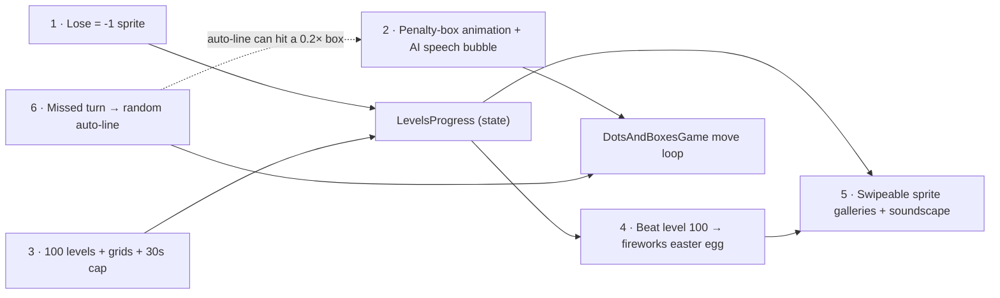
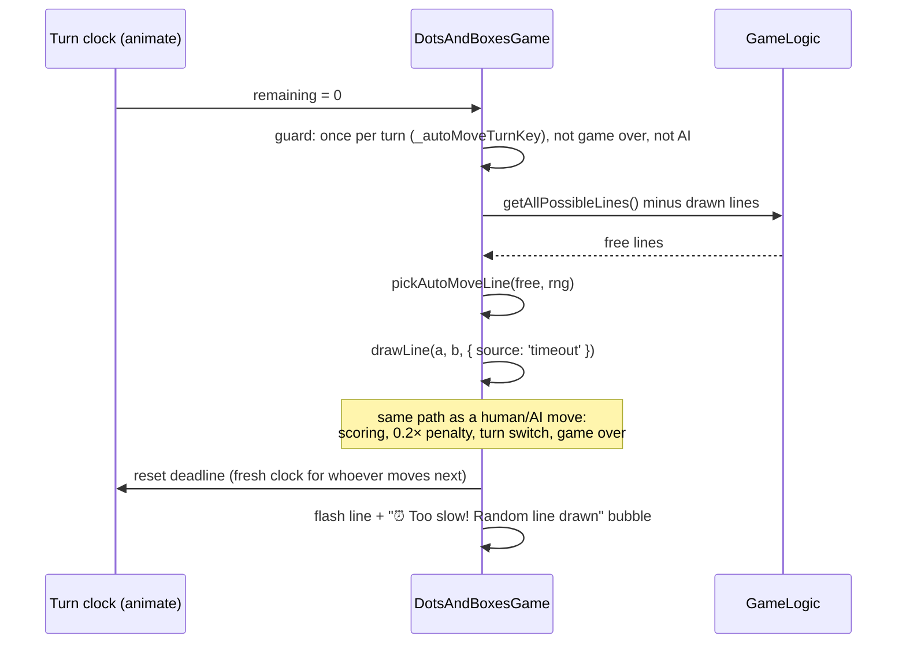
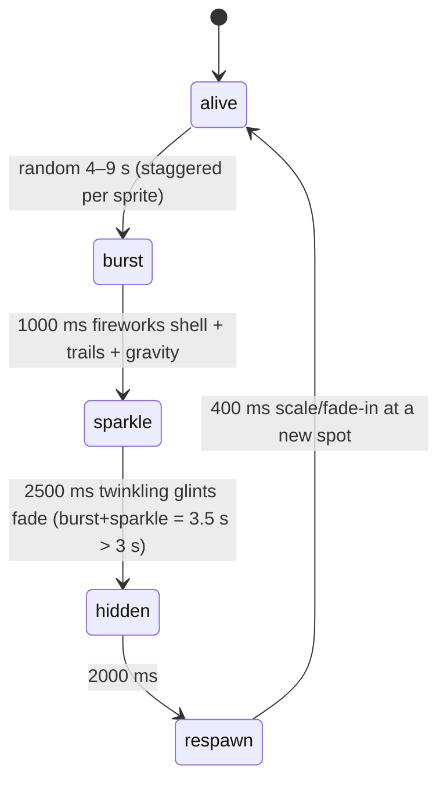
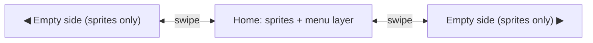

# ShapeKeeper — Levels 2.0: Sprite Stakes, Penalty Theatre, 100 Levels, Auto-Move on Timeout, Fireworks Easter Egg & Sprite Galleries

Six features built on the existing Levels mode (`b2b8dcb` and later). Everything is vanilla ESM with no new dependencies. Audio is synthesised with Web Audio, so there are no asset downloads. Convex changes are limited to Feature 6 (server-side random auto-line), with **no schema change**.



Build order: **1 → 3 → 2 → 6 → 4 → 5**. Feature 6 comes after 2 so it can reuse the bubble component from 2 (with a ⏰ variant) and the penalty animation fires correctly when an auto-line hits a 0.2× box. Each feature gets its own conventional commit.

## User Review Required

> [!IMPORTANT]
> **Assumptions from brainstorming.** You answered the timer question (**A: cap at 30 s**). Nobody objected to the rest, so the plan uses them. Correct any that are wrong:
> - **Losing a sprite:** sprites never drop below **1**. A **tie** counts as a loss (the code already treats a tie as "Level Failed"). Unlocked levels stay unlocked. Running out of time no longer ends a Levels match (see Feature 6), so you only lose sprites by losing on the board.
> - **Grid ranges** (yours overlapped at 50 and 90): **1–25** unchanged · **26–50 → 6×8** · **51–89 → 8×8** · **90–99 → 10×10** · **100 → 10×15**. Sizes are cols×rows **in dots**, matching the current labels, so 10×15 = 9×14 = 126 boxes.
> - **Easter egg** unlocks when level 100 is **beaten** (✅ confirmed). It's permanent after that: losing sprites later doesn't switch it off.
> - **Speech bubble** only fires when the **AI** (player 2 in an AI game, including Levels) completes a 0.2× box. The new box animation plays for **anyone** who completes one.
> - **Soundscape** is generated in the browser and starts on the first touch of the sprites (home or side screens).

> [!WARNING]
> **Existing saves:** players who already beat level 25 have `unlockedLevel` stuck at 25. `getState()` will migrate them automatically: if 25 is completed and the unlocked level is 25, it becomes 26. The storage key stays `…progress.v1` and no data is lost.

## Decisions (resolved 2026-10-21)

| # | Question | Decision |
|---|---|---|
| 1 | Side screens | The **same home screen extended**, with no buttons or pictures. Only sprites, all interactive |
| 2 | Muting | **Fade-out** only, no mute gesture |
| 3 | Sprites before Levels | Show the **120 demo sprites** |
| 4 | Online auto-move | **Yes**, done on the server in Convex |
| 5 | Auto-line choice | **Uniformly random** among all free lines, with no "safe-line" filtering |

No open questions remain.

---

## Proposed Changes

### Feature 1 + 3 — Progression state (`LevelsProgress`)

#### [MODIFY] [LevelsProgress.js](file:///home/leandi-duplessis/github/workspaces/ShapeKeeper/src/ui/LevelsProgress.js)

```diff
-export const MAX_LEVEL = 25;
+export const MAX_LEVEL = 100;
+export const EASTER_EGG_LEVEL = 100;
+export const MAX_LEVEL_TURN_DURATION_SECONDS = 30;
+export const MIN_SPRITES_AFTER_TRIGGER = 1;

 export function getTurnDurationForLevel(completedCountOverride) {
     …
-    return BASE_LEVEL_TURN_DURATION_SECONDS + completedCount * SECONDS_PER_COMPLETED_LEVEL;
+    return Math.min(
+        MAX_LEVEL_TURN_DURATION_SECONDS,
+        BASE_LEVEL_TURN_DURATION_SECONDS + completedCount * SECONDS_PER_COMPLETED_LEVEL
+    );
 }

 export function getGridSizeForLevel(level) {
     const lvl = Math.max(1, Math.min(MAX_LEVEL, Number(level) || 1));
+    if (lvl >= 100) return { cols: 10, rows: 15 };
+    if (lvl >= 90) return { cols: 10, rows: 10 };
+    if (lvl >= 51) return { cols: 8, rows: 8 };
+    if (lvl >= 26) return { cols: 6, rows: 8 };
     const tier = Math.floor((lvl - 1) / 5);   // unchanged 1–25 behaviour
     …
 }
```

New and changed statics:

```js
/** Feature 1: lose a match, lose a sprite (floored at 1). Idempotent per call site. */
static recordLevelLoss(level) {
    const state = this.getState();
    state.levelsTriggered = true;
    const before = Math.max(MIN_SPRITES_AFTER_TRIGGER, state.spritesObtained);
    state.spritesObtained = Math.max(MIN_SPRITES_AFTER_TRIGGER, before - 1);
    this.saveState(state);
    return { state, spriteLost: state.spritesObtained < before, level: Number(level) || 1 };
}

static isEasterEggUnlocked(state = this.getState()) {
    return state.completedLevels.includes(EASTER_EGG_LEVEL);   // beaten, not just unlocked
}
```

- `recordLevelWin` also returns `easterEggJustUnlocked`. It's true only on the **first** win of level 100 (100 wasn't in `completedLevels` before this win), so the win screen can reveal the secret once.
- `getState()` adds the 25 → 26 migration described in the warning above.
- The header doc comment is updated to the new invariants.

#### [MODIFY] [celebrations.js](file:///home/leandi-duplessis/github/workspaces/ShapeKeeper/ui-manager/celebrations.js)

- **Defeat branch** of `showWinner`: call `LevelsProgress.recordLevelLoss(game.currentLevel)` behind a `game._levelResultRecorded` guard so a re-render can't take two sprites. Then sync `window.welcomeAnimation` and show `💔 −1 Sprite (Total: N)`, or `Your last sprite is safe 🛡️` when already at 1.
- **Win branch**: also set the guard. Replace the hard-coded `25` with `MAX_LEVEL`. When `easterEggJustUnlocked` is true, append `🎆 You beat level 100! Secret unlocked — check the home screen!`.
- The `+2s/lvl` copy changes to show `(max 30s)` once the cap is reached.

#### [MODIFY] [LevelsScreen.js](file:///home/leandi-duplessis/github/workspaces/ShapeKeeper/src/ui/LevelsScreen.js) + [index.html](file:///home/leandi-duplessis/github/workspaces/ShapeKeeper/index.html) + `styles/` (levels CSS)

- 100 buttons grouped into **tier sections** with headers: "1–25 · Warm-up", "26–50 · 6×8", "51–89 · 8×8", "90–99 · 10×10", "100 · ★ 10×15".
- The grid becomes a scrollable area (`max-height` + `overflow-y: auto`). It auto-scrolls the highest unlocked level into view with `scrollIntoView({ block: 'center' })`.
- Fix the static `1/25` placeholder and the "25 level buttons" comment.
- Level 100's button gets a shimmer style.

#### [MODIFY] [dots-and-boxes-game.js](file:///home/leandi-duplessis/github/workspaces/ShapeKeeper/dots-and-boxes-game.js)

- No changes for this feature: the turn timer already reads `getTurnDurationForLevel()`, so it picks up the cap automatically.

---

### Feature 6 — Missed turn → a random line is drawn for you

Today a missed turn means different things in different modes. **Levels:** `handleLevelTimeout()` ends the match with the Game Over splash. **Local hot-seat:** `handleTurnExpiration()` / `expireLocalTurn()` skip to the next player. **Online:** the server's `expireTurnHandler` passes the turn. The new rule replaces all of these with: **when the clock hits 0, a random free line is drawn on your behalf, and normal rules apply**. If the line completes a box, you score it and keep your turn with a fresh clock; otherwise the turn passes. The line can land on a 0.2× box, in which case the penalty animation plays.



#### [MODIFY] [dots-and-boxes-game.js](file:///home/leandi-duplessis/github/workspaces/ShapeKeeper/dots-and-boxes-game.js#L1147-L1320)

```js
/** Pure helper (exported for tests). Default: any free line, uniformly random. */
export function pickAutoMoveLine(freeLines, rng = Math.random) {
    if (!freeLines.length) return null;
    return freeLines[Math.floor(rng() * freeLines.length)];
}

async performTimeoutAutoMove() {
    const turnKey = `${this.localTurnCounter}:${this.currentPlayer}:${this.lines.size}`;
    if (this._autoMoveTurnKey === turnKey || this.gameState.isGameOver() || this.isAITurn()) return;
    this._autoMoveTurnKey = turnKey;
    this.selectedDot = null; this.selectionLocked = false; this.selectionRibbon = null;
    const free = this.gameLogic.getAllPossibleLines().filter((k) => !this.lines.has(k));
    const lineKey = pickAutoMoveLine(free);
    if (!lineKey) return;
    this.resetTurnClockDeadline();               // fresh clock for the next turn
    const [a, b] = this.parseLineKey(lineKey);
    await this.drawLine(a, b, { source: 'timeout' });
    this.animationSystem.triggerAutoMoveFlash?.(lineKey);
    this.turnNotice?.show('timeout');            // "⏰ Too slow! Random line drawn"
}
```

- `handleTurnExpiration()` (local branch) and `expireLocalTurn()` call `performTimeoutAutoMove()` instead of skipping the turn or calling `handleLevelTimeout()`.
- `drawLine` already handles turn switching, keeping the turn after a completed box, scoring, `checkGameOver` and `scheduleAITurn`, so there's no duplicate logic. It's checked to see whether `source: 'timeout'` needs a bypass of the "is it a human's turn / input locked" guard. The undo history records it like any other move.
- **Removed:** the Levels timeout game-over path. `handleLevelTimeout()`, the `timedOut` branch in `showWinner`, and the `#gameOverSplashOverlay` timeout trigger are deleted or made unreachable. `tests/levels-timer-gameover.test.js` is rewritten for the new rule. The final-3-s tick sound and red vignette stay as a warning.

#### [MODIFY] `src/ui/TurnNoticeBubble.js` (created in Feature 2)

- Add the `timeout` variant to the same 2 s comic bubble. The two variants are:
  - `ai-penalty`: 🤖, bottom-right (Feature 2)
  - `timeout`: ⏰, **bottom-left** on the player's side, e.g. *"Too slow! The dice chose for you 🎲"*, *"Snooze you lose… a line!"*, *"Autopilot engaged ✈️"*

#### [MODIFY] [animation-system.js](file:///home/leandi-duplessis/github/workspaces/ShapeKeeper/animation-system.js) + [renderer/effects.js](file:///home/leandi-duplessis/github/workspaces/ShapeKeeper/renderer/effects.js)

- `triggerAutoMoveFlash(lineKey)`: the auto-drawn line pulses white→player colour 3 times (600 ms) so it's obvious which line was picked.

#### Online (in scope ✅)

- **[MODIFY]** `convex/games/draw.ts`: pull the core of `drawLineHandler` (validate → insert line → `checkForCompletedSquares` → score → turn advance/keep → game over) into `applyLineForPlayer(ctx, room, playerIndex, lineKey)`. `drawLineHandler` keeps its auth and rate-limit checks and calls this function.
- **[MODIFY]** `convex/games/shared.ts`: add `getAllLineKeys(gridSize)`, which lists every normalised line, and `pickRandomFreeLine(all, drawn, rng)`.
- **[MODIFY]** `convex/games/turnTimer.ts` `expireTurnHandler`: load the room's lines (`by_room` index), pick a random free line, and call `applyLineForPlayer` for the current player. This scores boxes, keeps the turn after a box, ends the game if the board is full, and re-arms the timer.
- **[MODIFY]** `convex/games/draw.ts` late-move branch: when a move arrives after the deadline (the `isTurnExpired` race), the late move is still rejected, but it now runs the same random auto-line instead of skipping the player. A `turnEndTime` check makes sure only one of the scheduler and the late request performs the auto-move.
- **[MODIFY]** client online branch of `handleTurnExpiration()`: remove the optimistic `currentPlayerIndex` skip and wait for the server's subscription update. When an expired turn is followed by a new line from the same player index, show the ⏰ bubble and the auto-line flash. `armTurnTimer` re-arms through that same path. There's no schema change, so `_generated/` stays as it is. `npx convex dev --once` only runs if codegen complains.
- **[MODIFY]** `convex/games/turnTimer.test.ts`: on expiry a line is inserted and the turn advances or is kept correctly.
- **[MODIFY]** `AGENTS.md` Lava Timer section: change "expiry passes the turn" to "expiry draws a random line for the current player".

---

### Feature 2 — Penalty-box animation + AI speech bubble

#### [MODIFY] [animation-system.js](file:///home/leandi-duplessis/github/workspaces/ShapeKeeper/animation-system.js)

New `penaltyBoxAnimations` list and a `triggerPenaltyBoxAnimation(squareKey, …, color)` method. The new list goes through the same pruning and `getState()` paths as `multiplierAnimations`. Animation timeline (1400 ms, constant `ANIMATION_PENALTY_BOX_DURATION` in `constants.js`):

| t (ms) | Effect |
|---|---|
| 0–250 | Box flashes red/violet and **shrinks to 0.2 scale** with an overshoot |
| 250–700 | Squash-and-stretch **wobble** ("deflated balloon") and a crack overlay |
| 700–1400 | Box springs back to full size while desaturated. A big wobbly **"×0.2"** stamp drops in and fades out |

The existing `x0.2` floating text and particles stay as they are.

#### [MODIFY] [renderer/effects.js](file:///home/leandi-duplessis/github/workspaces/ShapeKeeper/renderer/effects.js) + [renderer.js](file:///home/leandi-duplessis/github/workspaces/ShapeKeeper/renderer.js)

- Add `drawPenaltyBoxAnimations(game)`, drawn before the multiplier text. Uses `ctx.save/translate/scale` around the box centre.
- Reduced motion: no wobble or scale, only a colour flash and the stamp.

#### [MODIFY] [dots-and-boxes-game.js](file:///home/leandi-duplessis/github/workspaces/ShapeKeeper/dots-and-boxes-game.js#L455-L473)

```diff
 if (multiplierData && multiplierData.type === 'multiplier' && multiplierData.value === 0.2) {
     …existing score + triggerMultiplierAnimation…
+    this.animationSystem.triggerPenaltyBoxAnimation(squareKey, this.gameLogic.parseSquareKey,
+        this.offsetX, this.offsetY, this.cellSize, playerColor);
+    this.soundManager.playPenaltySound?.();
+    if (this.localMode === 'ai' && this.currentPlayer === 2) {
+        this.turnNotice?.show('ai-penalty');
+    }
 }
```

The "is the animation loop still busy?" check at ~L1066 also looks at `penaltyBoxAnimations`.

#### [NEW] `src/ui/TurnNoticeBubble.js`

- Creates `#turnNoticeBubble` on demand inside `#gameScreen`, bottom-right corner, with a 🤖 avatar and a comic-style tail. It uses `role="status"` and `aria-live="polite"`.
- `show(variant)` (Feature 2 builds the `ai-penalty` variant; Feature 6 adds `timeout`) picks a random quip for that variant, never the same one twice in a row. CSS keyframes run for **exactly 2 s**: pop-in with overshoot (0–250 ms), a little wobble, then shrink out (1700–2000 ms). Calling it again while it's visible restarts it.
- `destroy()` is registered with the game's disposal path so nothing is left behind on rematch or quit.
- Quips, e.g. *"Who put a discount on my box?!"*, *"Error 0.2: dignity not found."*, *"I meant to do that. Totally."*, *"80% off… and not the good kind."*, *"Note to self: avoid sparkly boxes."*, *"My circuits feel… smaller."* (about 12 total, exported for tests).

#### [MODIFY] [sound-manager.js](file:///home/leandi-duplessis/github/workspaces/ShapeKeeper/sound-manager.js)

- Add `playPenaltySound()`: a "wah-wah-waaah" sawtooth falling through 3 steps with a lowpass filter, about 900 ms. It respects `enabled`.

#### [MODIFY] styles (`styles/…game css`)

- `.ai-speech-bubble` keyframes, plus `prefers-reduced-motion` variants (fade only).

---

### Feature 4 — Level-100 fireworks easter egg

#### [NEW] `src/ui/SpriteFireworks.js`

A **pure lifecycle state machine** (unit-testable) plus a small burst renderer.



- `advanceSpriteLifecycle(sprite, dtMs, rng)` → the sprite's phase and timing. It's deterministic when given an RNG, so tests can control it.
- `FireworksLayer`: a pooled particle array capped at **1500** particles and **≤ 8 bursts at once**. Bursts beyond the cap are delayed, which keeps 100+ sprites smooth on phones. Fireworks use each sprite's own colour, then turn into white/gold sparkle glints.
- Reduced motion: the sprite fades out and back in, with no particles.

#### [MODIFY] [WelcomeAnimation.js](file:///home/leandi-duplessis/github/workspaces/ShapeKeeper/src/ui/WelcomeAnimation.js)

- `syncWithLevelsProgress()` also sets `this.easterEggActive = LevelsProgress.isEasterEggUnlocked()`.
- When active, each frame calls `advanceSpriteLifecycle` per sprite. Hidden or exploding sprites skip flocking, connections and trails, and `FireworksLayer.render()` runs after the particles.
- Only runs on the home canvas and the galleries. It stays off on the dimmed in-game background so it doesn't distract during play.

---

### Feature 5 — Swipe sideways for sprites only (no buttons, no pictures) + soundscape

**What you described:** the side screens are the **same home screen, extended**. The same sprites, background and theme, but with **nothing else on them**: no buttons, logo, title, hint text or page dots. Only sprites, which you can touch, drag and play with without the menu getting in the way.

**Design:** the sprite canvas (`#welcomeCanvas`) stays put and fills the screen. Only the **menu layer** (logo plate, wordmark, credit, buttons, theme toggle) slides. Swipe left or right and the menu slides off that side, leaving a bare sprite field. Swipe back and it slides in again. Both sides look and behave exactly the same. It's one sprite world, not separate galleries, so the sprites you see on the side screens are the ones behind the menu.



- Sprite count follows the existing home rule: **120 demo sprites** until the first Levels game, then the sprites you've collected (✅ confirmed).
- If the fireworks easter egg is unlocked, it plays on the side screens too, and you can play with the sprites while they explode and respawn.

#### [MODIFY] [index.html](file:///home/leandi-duplessis/github/workspaces/ShapeKeeper/index.html) (`#mainMenuScreen`)

- Wrap only the existing `.welcome-container` in a `.home-menu-layer` element that can be moved sideways. `#welcomeCanvas` and all existing IDs, test ids and handlers stay unchanged. No new visible elements are added.

#### [NEW] `src/ui/home/HomePager.js`

- Three positions: `-1` (left side screen) · `0` (home) · `+1` (right side screen). The menu layer's position is `translateX(-position × 100vw)`. It follows your finger while dragging and snaps with a CSS transition when you let go.
- **Pure decision function** `resolveSwipe({ dx, dy, dtMs, position, width })` → new position. A swipe counts when it's mostly horizontal (|dx| > 1.5·|dy|) and either |dx| > 25% of the width or the speed is > 0.5 px/ms. Positions are clamped to the range −1…+1.
- **Sprites first, then swipes:** on pointerdown, `WelcomeAnimation.hitTestSprite(x, y)` is checked first (finger-friendly ≥ 24 px radius). If you touched a sprite, the sprite handles the gesture. Otherwise, after 10 px of mostly horizontal movement the pager takes over. Button taps on home still work because nothing is captured before 10 px.
- Desktop: mouse drag (same Pointer Events path), **← / →** keys when the main menu is active and focus isn't in an input, and trackpad horizontal `wheel`.
- While on a side screen, `inert` is set on the menu layer so keyboard focus and screen readers don't land on buttons you can't see.
- Leaving the main menu (`showScreen` to another screen) snaps back to home (position 0).

#### [MODIFY] [WelcomeAnimation.js](file:///home/leandi-duplessis/github/workspaces/ShapeKeeper/src/ui/WelcomeAnimation.js)

Existing touch and mouse input only pushes sprites away (`mousePosition` influence). It becomes properly interactive, the same on **every** screen including home:

- **Grab and fling:** press a sprite, drag it (it glows and grows a little), and release to fling it with the speed you threw it at. It slows down through damping and then joins the flock again.
- **Hold on empty space:** nearby sprites slowly swirl around your finger (a gentle orbit). When you let go they drift back into the flock.
- **Quick tap on empty space:** a soft ripple pushes nearby sprites outward.
- **Multi-touch:** every finger is tracked separately (a `Map` of pointers), so several sprites can be grabbed at once.
- Moved from `touchmove`/`mousemove` listeners to **Pointer Events** with `touch-action: none` on the canvas. The old repel-on-hover behaviour is kept for mouse hover.
- Adds `hitTestSprite(x, y)` and `onInteraction(callback)` hooks, which the soundscape uses.

#### [NEW] `src/audio/AmbientSoundscape.js`

Its own lazily created `AudioContext`. Nothing is created until the **first touch on the sprite canvas** (this also satisfies browser autoplay rules).

| Layer | Sound | What interaction changes |
|---|---|---|
| **Drone pad** | 3 slightly detuned sine/triangle oscillators (root, fifth, octave) → lowpass → feedback-delay "reverb", with a slow breathing LFO (~0.08 Hz) | Filter brightness follows finger **height**. The root note drifts slowly between related chords every ~20 s while you play, so it never loops the same way |
| **Chimes** | Sine plus a soft triangle partial, slow 2–4 s decay, through the delay | Grabbing, flinging into a wall or a ripple plays a pentatonic note picked from the sprite's **x** position (`pickScaleNote(x, width, scale)`, pure) |
| **Shimmer** | Filtered noise swell | Gets louder with **fling or swirl speed**, settles when you're still |

- **Fade-out only, no mute control (✅ confirmed):** master gain fades in over 2 s on first touch. It fades out over **1.5 s** (then the context is suspended) when you stop touching for ~6 s, leave the main menu, or the tab is hidden. Touching again fades it back in.
- Chimes are limited to 8 at once, and master volume is capped at a gentle level.
- `destroy()` closes the context (same leak-safe pattern as the `4904b01` AudioContext fix).

#### [MODIFY] [welcome.js](file:///home/leandi-duplessis/github/workspaces/ShapeKeeper/welcome.js) + `src/ui/menu/*`

- On boot: create `HomePager` and `AmbientSoundscape`, and connect `welcomeAnimation.onInteraction` to the soundscape.
- When leaving the main menu: pager back to home and audio fades out. The `moveToGameScreen` canvas swap turns off interaction on the dimmed in-game background.

#### [MODIFY] styles (`styles/menu-layout.css`)

- `.home-menu-layer { will-change: transform; transition: transform 320ms cubic-bezier(.2,.8,.2,1) }` (no transition during a drag), `#welcomeCanvas { touch-action: none }`, `#mainMenuScreen { overflow: hidden }`, plus a reduced-motion variant (instant snap).

---

### Docs

#### [MODIFY] [AGENTS.md](file:///home/leandi-duplessis/github/workspaces/ShapeKeeper/AGENTS.md)

- Add a short **"Levels invariants"** section covering: MAX_LEVEL 100, the grid tiers, the timer cap at 30 s, a loss costs 1 sprite with a floor of 1, and the easter egg once level 100 is in `completedLevels`, and a missed turn draws a random line for you (plus the Lava Timer wording change). The file says code is the source of truth, so the docs follow the code.

#### [NEW] `docs/superpowers/specs/2026-10-21-levels-2-design.md`

- A copy of this approved plan, committed first (brainstorming spec step).

---

## Verification Plan

### Automated Tests

New and updated Vitest files:

| File | Covers |
|---|---|
| `tests/levels-progress.test.js` (update) | Tiers at the boundaries 25/26/50/51/89/90/99/100. `MAX_LEVEL=100`. Unlock chain to 100. Timer cap (`getTurnDurationForLevel(99) === 30`). `recordLevelLoss` takes 1 and floors at 1. 25→26 save migration. `easterEggJustUnlocked` only fires on 99→100 |
| `tests/levels-loss-celebration.test.js` (new) | A defeat or a tie takes exactly one sprite. The `_levelResultRecorded` guard stops a second deduction |
| `tests/penalty-box-animation.test.js` (new) | The 0.2× box queues a penalty animation for any player. The speech bubble shows only when the AI completes one. Pruning after the duration |
| `tests/timeout-auto-move.test.js` (new, replaces `levels-timer-gameover.test.js`) | When the clock expires in Levels or hot-seat, exactly one free line is drawn (seeded RNG). A completed box keeps the turn and re-arms the clock. Otherwise the turn passes and the AI is scheduled. No game-over splash. Runs only once per expiry. Never fires on the AI's turn or when the game is over. `pickAutoMoveLine([])` returns null |
| `src/ui/TurnNoticeBubble.test.js` (new) | Both variants. Never repeats a quip twice in a row. Timeout removes the visible class at 2000 ms (fake timers). Cleanup on destroy |
| `src/ui/SpriteFireworks.test.js` (new) | Phase order and durations (burst+sparkle ≥ 3000 ms, hidden = 2000 ms). Repeats. Burst/particle caps hold |
| `src/ui/home/HomePager.test.js` (new) | `resolveSwipe` thresholds, clamping to −1…+1, vertical drags ignored, keyboard arrows, `inert` set on side screens, touching a sprite blocks a page swipe |
| `src/ui/WelcomeAnimation.interaction.test.js` (new) | `hitTestSprite` radius, grab→drag→fling velocity, hold-orbit and tap-ripple forces, multi-pointer tracking |
| `convex/games/turnTimer.test.ts` (update) | On expiry exactly one free line is inserted for the current player. A box keeps the turn. A full board finishes the game. A stale schedule does nothing. Only one of scheduler vs late `drawLine` auto-moves |
| `convex/games/shared` tests (new cases) | `getAllLineKeys(n)` count = 2·n·(n−1), all normalised. `pickRandomFreeLine` never returns a drawn line |
| `src/audio/AmbientSoundscape.test.js` (new) | `pickScaleNote` mapping. Nothing audio is created before the first gesture (mocked `AudioContext`). Fade-out after leaving the menu, hiding the tab or 6 s idle. `destroy` closes the context |
| `tests/e2e/home-gallery.spec.js` (new, smoke) | Drag the home screen left → menu buttons are hidden and `inert`, canvas still visible. Drag back → buttons are clickable. Same on the right |

Quality gates, in the AGENTS.md order:

```bash
npm run lint
npx convex typecheck      # draw.ts / turnTimer.ts / shared.ts refactor
npx vitest run
npm run build
npm run test:e2e:smoke
```

### Manual Verification

1. **Lose a sprite:** play level 1 and lose on purpose → the splash shows `💔 −1 Sprite` and the home screen has one fewer sprite. At 1 sprite, losing shows the "last sprite is safe" message.
2. **Penalty theatre:** complete a 0.2× box → it shrinks, wobbles and gets stamped. When the AI hits one → the 🤖 bubble pops up in the corner for 2 s.
3. **100 levels:** in DevTools set `unlockedLevel` to 100 in `localStorage['shapekeeper_levels_progress.v1']` → the Levels screen shows the tiers, level 26 plays on 6×8, level 100 on 10×15, and the timer shows 30 s at most.
4. **Easter egg:** add `100` to `completedLevels` (or beat level 100 for real; the win screen shows the 🎆 reveal) → the home sprites each explode into fireworks, then sparkle (~3.5 s), stay gone for 2 s, respawn, and repeat.
5. **Side screens:** on a phone (or DevTools touch emulation), swipe left or right → the menu slides away and only sprites remain. Grab, fling, hold and tap them → the ambient sound fades in and changes as you play. Leave the menu or stop for ~6 s → the sound fades out. Swipe back → the buttons work.
6. **Missed turn:** start a Levels match and don't move → at 0 s one line flashes in, the ⏰ bubble appears bottom-left, and the game carries on (no Game Over). Same in hot-seat with the timer on. **Online:** in two browser windows, let one player's clock run out → both windows see the same random line appear and the turn continues correctly.
